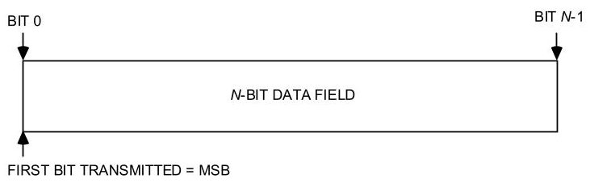
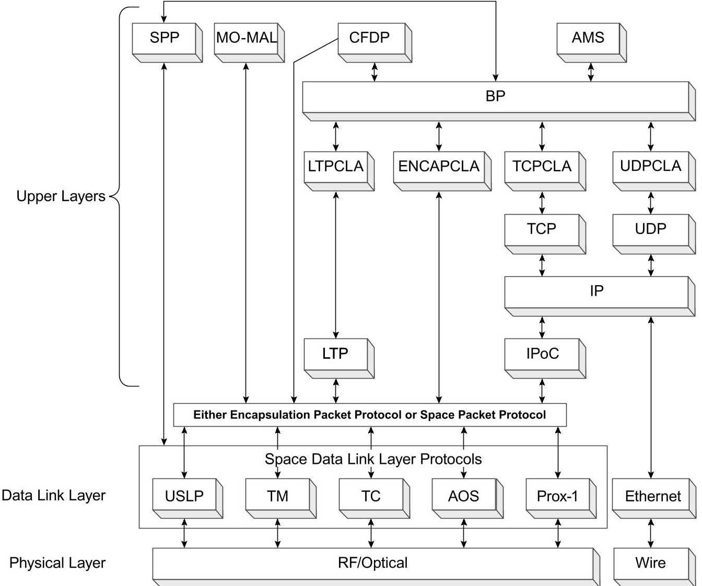
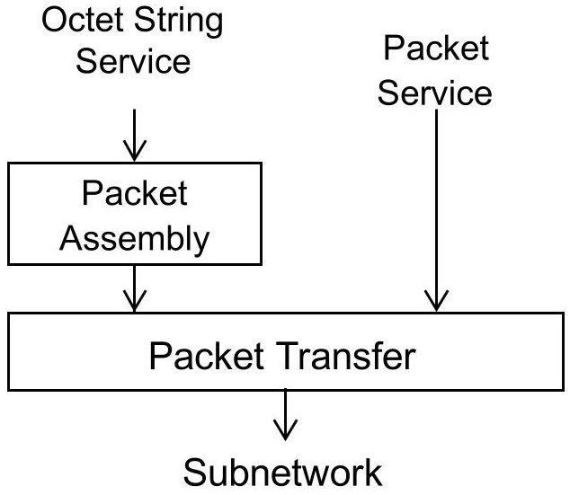
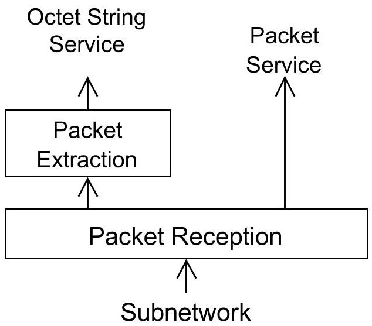
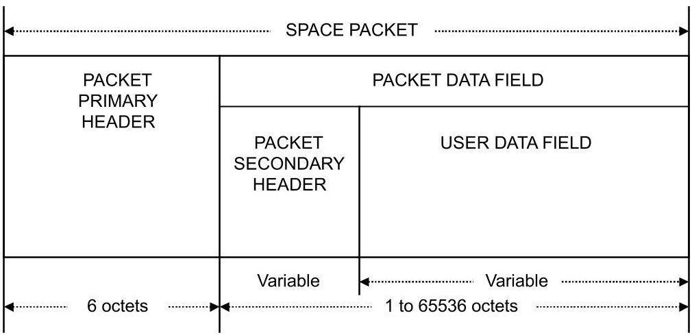
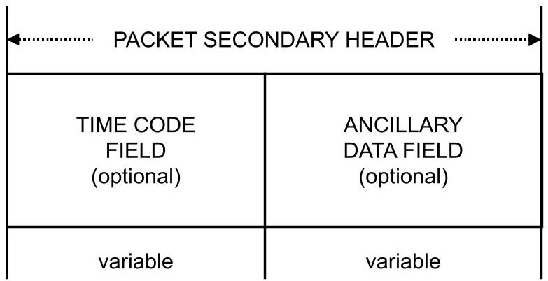
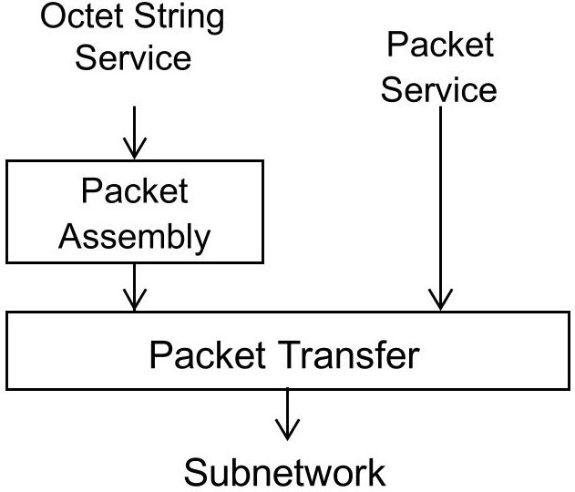
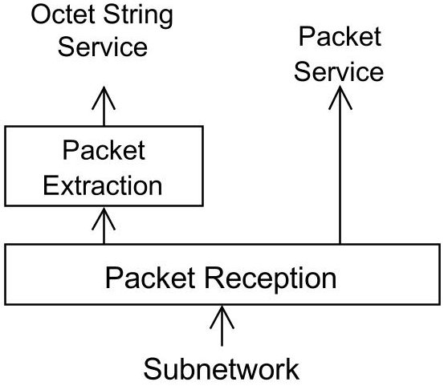

> Complete conversion of the archived source PDF, not an assertion of standard applicability or conformance.

<!-- PDF_PAGE: 1 -->

Recommendation for Space Data System Standards

## SPACE PACKET PROTOCOL

RECOMMENDED STANDARD

CCSDS 133.0-B-2

BLUE BOOK June 2020

<!-- PDF_PAGE: 2 -->

The Consultative Committee for Space Data Systems

Recommendation for Space Data System Standards

SPACE PACKET PROTOCOL

## RECOMMENDED STANDARD

CCSDS 133.0-B-2

BLUE BOOK June 2020

<!-- PDF_PAGE: 3 -->

# CCSDS RECOMMENDED STANDARD FOR SPACE PACKET PROTOCOL

## AUTHORITY

<table border="1"><tr><td>Issue:</td><td>Recommended Standard, Issue 2</td></tr><tr><td>Date:</td><td>June 2020</td></tr><tr><td>Location:</td><td>Washington, DC, USA</td></tr></table>

This document has been approved for publication by the Management Council of the Consultative Committee for Space Data Systems (CCSDS) and represents the consensus technical agreement of the participating CCSDS Member Agencies. The procedure for review and authorization of CCSDS documents is detailed in Organization and Processes for the Consultative Committee for Space Data Systems (CCSDS A02.1-Y-4), and the record of Agency participation in the authorization of this document can be obtained from the CCSDS Secretariat at the e-mail address below.

This document is published and maintained by:

CCSDS Secretariat

National Aeronautics and Space Administration

Washington, DC, USA

Email: secretariat@mailman.ccsds.org

<!-- PDF_PAGE: 4 -->

# CCSDS RECOMMENDED STANDARD FOR SPACE PACKET PROTOCOL

# STATEMENT OF INTENT

The Consultative Committee for Space Data Systems (CCSDS) is an organization officially established by the management of its members. The Committee meets periodically to address data systems problems that are common to all participants, and to formulate sound technical solutions to these problems. Inasmuch as participation in the CCSDS is completely voluntary, the results of Committee actions are termed Recommended Standards and are not considered binding on any Agency.

This Recommended Standard is issued by, and represents the consensus of, the CCSDS members. Endorsement of this Recommendation is entirely voluntary. Endorsement, however, indicates the following understandings:

0 Whenever a member establishes a CCSDS-related standard, this standard will be in accord with the relevant Recommended Standard. Establishing such a standard does not preclude other provisions which a member may develop.

o Whenever a member establishes a CCSDS-related standard, that member will provide other CCSDS members with the following information:

-- The standard itself.

-- The anticipated date of initial operational capability.

-- The anticipated duration of operational service.

0 Specific service arrangements shall be made via memoranda of agreement. Neither this Recommended Standard nor any ensuing standard is a substitute for a memorandum of agreement.

No later than five years from its date of issuance, this Recommended Standard will be reviewed by the CCSDS to determine whether it should: (1) remain in effect without change; (2) be changed to reflect the impact of new technologies, new requirements, or new directions; or (3) be retired or canceled.

In those instances when a new version of a Recommended Standard is issued, existing CCSDS-related member standards and implementations are not negated or deemed to be non- CCSDS compatible. It is the responsibility of each member to determine when such standards or implementations are to be modified. Each member is, however, strongly encouraged to direct planning for its new standards and implementations towards the later version of the Recommended Standard.

<!-- PDF_PAGE: 5 -->

# CCSDS RECOMMENDED STANDARD FOR SPACE PACKET PROTOCOL

## FOREWORD

Attention is drawn to the possibility that some of the elements of this document may be the subject of patent rights. CCSDS has processes for identifying patent issues and for securing from the patent holder agreement that all licensing policies are reasonable and nondiscriminatory. However, CCSDS does not have a patent law staff, and CCSDS shall not be held responsible for identifying any or all such patent rights.

Through the process of normal evolution, it is expected that expansion, deletion, or modification of this document may occur. This Recommended Standard is therefore subject to CCSDS document management and change control procedures, which are defined in Organization and Processes for the Consultative Committee for Space Data Systems (CCSDS A02.1-Y-4). Current versions of CCSDS documents are maintained at the CCSDS Web site:

## http://www.ccsds.org/

Questions relating to the contents or status of this document should be sent to the CCSDS Secretariat at the email address indicated on page i.

<!-- PDF_PAGE: 6 -->

## At time of publication, the active Member and Observer Agencies of the CCSDS were:

## Member Agencies

- Agenzia Spaziale Italiana (ASI)/Italy.

- Canadian Space Agency (CSA)/Canada.

- Centre National d'Etudes Spatiales (CNES)/France.

- China National Space Administration (CNSA)/People's Republic of China.

- Deutsches Zentrum für Luft- und Raumfahrt (DLR)/Germany.

- European Space Agency (ESA)/Europe.

- Federal Space Agency (FSA)/Russian Federation.

- Instituto Nacional de Pesquisas Espaciais (INPE)/Brazil.

- Japan Aerospace Exploration Agency (JAXA)/Japan.

- National Aeronautics and Space Administration (NASA)/USA.

- UK Space Agency/United Kingdom.

## Observer Agencies

- Austrian Space Agency (ASA)/Austria.

- Belgian Federal Science Policy Office (BFSPO)/Belgium.

- Central Research Institute of Machine Building (TsNIIMash)/Russian Federation.

- China Satellite Launch and Tracking Control General, Beijing Institute of Tracking and Telecommunications Technology (CLTC/BITTT)/China.

- Chinese Academy of Sciences (CAS)/China.

- China Academy of Space Technology (CAST)/China.

- Commonwealth Scientific and Industrial Research Organization (CSIRO)/Australia.

- Danish National Space Center (DNSC)/Denmark.

- Departamento de Ciência e Tecnologia Aeroespacial (DCTA)/Brazil.

- Electronics and Telecommunications Research Institute (ETRI)/Korea.

- European Organization for the Exploitation of Meteorological Satellites (EUMETSAT)/Europe.

- European Telecommunications Satellite Organization (EUTELSAT)/Europe.

- Geo-Informatics and Space Technology Development Agency (GISTDA)/Thailand.

- Hellenic National Space Committee (HNSC)/Greece.

- Hellenic Space Agency (HSA)/Greece.

- Indian Space Research Organization (ISRO)/India.

- Institute of Space Research (IKI)/Russian Federation.

- Korea Aerospace Research Institute (KARI)/Korea.

- Ministry of Communications (MOC)/Israel.

- Mohammed Bin Rashid Space Centre (MBRSC)/United Arab Emirates.

- National Institute of Information and Communications Technology (NICT)/Japan.

- National Oceanic and Atmospheric Administration (NOAA)/USA.

- National Space Agency of the Republic of Kazakhstan (NSARK)/Kazakhstan.

- National Space Organization (NSPO)/Chinese Taipei.

- Naval Center for Space Technology (NCST)/USA.

- Research Institute for Particle & Nuclear Physics (KFKI)/Hungary.

- Scientific and Technological Research Council of Turkey (TUBITAK)/Turkey.

- South African National Space Agency (SANSA)/Republic of South Africa.

- Space and Upper Atmosphere Research Commission (SUPARCO)/Pakistan.

- Swedish Space Corporation (SSC)/Sweden.

- Swiss Space Office (SSO)/Switzerland.

- United States Geological Survey (USGS)/USA.

<!-- PDF_PAGE: 7 -->

## DOCUMENT CONTROL

<table border="1"><tr><td>Document</td><td>Title</td><td>Date</td><td>Status</td></tr><tr><td>CCSDS133.0-B-1</td><td>Space Packet Protocol,Recommended Standard,Issue 1</td><td>September2003</td><td>Original issue,superseded</td></tr><tr><td>CCSDS133.0-B-2</td><td>Space Packet Protocol,Recommended Standard,Issue 2</td><td>June2020</td><td>Current issue:-removes networking-type terminology and implied functionality and updates the specification for consistency with modern data communication practices.</td></tr><tr><td>EC1</td><td>Editorial Change1</td><td>October2020</td><td>Corrects figure2-1:-adds missing arrowhead;-clarifies exclusivity of choice between Encapsulation Packet Protocol and Space Packet Protocol.</td></tr><tr><td>EC2</td><td>Editorial Change2</td><td>September2024</td><td>-Corrects duplicated table of contents entries;-changes page size toA4.</td></tr></table>

NOTE - Textual changes from the original issue are too numerous to permit meaningful application of change bars.

<!-- PDF_PAGE: 8 -->

## CONTENTS

Section Page

1 INTRODUCTION...1-1

1.1 PURPOSE...1-1

1.2 SCOPE...1-1

1.3 APPLICABILITY...1-1

1.4 RATIONALE...1-2

1.5 DOCUMENT STRUCTURE...1-2

1.6 CONVENTIONS AND DEFINITIONS...1-2

1.7 REFERENCES...1-6

2 OVERVIEW...2-1

2.1 CONCEPT OF SPACE PACKET PROTOCOL...2-1

2.2 OVERVIEW OF SERVICES...2-4

2.3 OVERVIEW OF FUNCTIONS...2-6

2.4 SERVICES ASSUMED FROM LOWER LAYERS...2-8

3 SERVICE DEFINITION...3-1

3.1 OVERVIEW...3-1

3.2 SOURCE DATA...3-1

3.3 PACKET SERVICE...3-2

3.4 OCTET STRING SERVICE...3-5

4 PROTOCOL SPECIFICATION...4-1

4.1 PROTOCOL DATA UNIT...4-1

4.2 PROTOCOL PROCEDURES AT THE SENDING END...4-9

4.3 PROTOCOL PROCEDURES AT THE RECEIVING END...4-10

5 MANAGED PARAMETERS...5-1

5.1 OVERVIEW OF MANAGED PARAMETERS...5-1

5.2 PROTOCOL CONFIGURATION PARAMETERS...5-1

ANNEX A PROTOCOL IMPLEMENTATION CONFORMANCE

STATEMENT PROFORMA (NORMATIVE)...A-1

ANNEX B SECURITY, SANA, AND PATENT CONSIDERATIONS

(INFORMATIVE)...B-1

ANNEX C INFORMATIVE REFERENCES (INFORMATIVE)...C-1

ANNEX D ABBREVIATIONS (INFORMATIVE)...D-1

<!-- PDF_PAGE: 9 -->

## CONTENTS (continued)

## Figure

Figure Page

1-1 Bit Numbering Convention...1-5

2-1 SPP Context within the CCSDS Protocol Stack ...2-2

2-2 Internal Organization of Protocol Entity (Sending End) ...2-7

2-3 Internal Organization of Protocol Entity (Receiving End) ...2-7

4-1 Space Packet Structural Components ...4-1

4-2 Packet Primary Header...4-2

4-3 Packet Secondary Header...4-7

4-4 Internal Organization of Protocol Entity (Sending End) ...4-9

4-5 Internal Organization of Protocol Entity (Receiving End) ...4-10

## Table

2-1 Summary of Services Provided by Space Packet Protocol ...2-5

5-1 Protocol Configuration Parameters ...5-1

A-1 SPP Service Data Units ...A-4

A-2 Service Parameters ...A-4

A-3 Service Primitives ...A-4

A-4 SPP Protocol Data Unit ...A-4

A-5 Protocol Procedures ...A-5

A-6 Management Parameters ...A-5

<!-- PDF_PAGE: 10 -->

## 1 INTRODUCTION

## 1.1 PURPOSE

The purpose of this Recommended Standard is to specify the Space Packet Protocol. Space missions will use this protocol to transfer space application data between a sending and a receiving entity, relying on services provided by underlying layers.

## 1.2 SCOPE

This Recommended Standard defines the Space Packet Protocol in terms of

a) the abstract services provided to the users of this protocol;

b) the Protocol Data Units (PDUs) employed by the protocol; and

c) the procedures performed by the protocol.

It does not specify

a) individual implementations or products;

b) the implementation of service interfaces within real systems;

c) the methods or technologies required to perform the procedures; or

d) the management activities required to configure and control the protocol.

## 1.3 APPLICABILITY

This Recommended Standard applies to the creation of Agency standards and to data communications over space links between CCSDS Agencies in cross-support situations as well as, for example, data exchange within spacecraft or ground networks. The Recommended Standard includes specification of the abstract services and the interoperable protocol for inter-Agency cross-support. It is neither a specification of, nor a design for, real systems that may be implemented for existing or future missions.

The Recommended Standard specified in this document is to be invoked through the normal standards programs of each CCSDS Agency and is applicable to those missions for which cross-support, based on capabilities described in this Recommended Standard, is anticipated. Where mandatory capabilities are clearly indicated in sections of the Recommended Standard, they must be implemented when this document is used as a basis for cross-support. Where options are allowed or implied, implementation of these options is subject to specific bilateral cross-support agreements between the Agencies involved.

<!-- PDF_PAGE: 11 -->

# CCSDS RECOMMENDED STANDARD FOR SPACE PACKET PROTOCOL

## 1.4 RATIONALE

In many space applications, there is significant value in having a single, common Application Layer data structure for the creation, storage, and transport of variable-length Application Layer data. Such a data structure can be exchanged and stored on board, transferred over one or more space data links, and used within ground systems. Often it is necessary to identify such data as to type, source, and/or destination.

## 1.5 DOCUMENT STRUCTURE

This document is divided into five numbered sections and four annexes:

a) section 1 presents the purpose, scope, applicability, and rationale of this Recommended Standard and lists the conventions, definitions, and references used throughout the Recommended Standard;

b) section 2 provides an overview of the Space Packet Protocol;

c) section 3 defines the services provided by the protocol entity;

d) section 4 specifies the PDUs and procedures employed by the protocol entity;

e) section 5 lists the managed parameters associated with this protocol;

f) annex A contains the Protocol Implementation Conformance Statement (PICS) proforma;

g) annex B discusses security, Space Assigned Numbers Authority (SANA), and patent considerations;

h) annex C lists informative references;

i) annex D lists abbreviations used within this document.

## 1.6 CONVENTIONS AND DEFINITIONS

## 1.6.1 DEFINITIONS

## 1.6.1.1 Terms from the Open Systems Interconnection Basic Reference Model

This Recommended Standard makes use of a number of terms defined in reference [1]. The use of those terms in this Recommended Standard is to be understood in a generic sense, that is, in the sense that those terms are generally applicable to any of a variety of technologies that provide for the exchange of information between real systems. Those terms are

a) connection;

b) entity;

c) flow control;

d) peer entities;

<!-- PDF_PAGE: 12 -->

e) protocol control information;

f) protocol data unit;

g) real subnetwork;

h) real system;

i) service;

j) Service Access Point (SAP);

k) SAP address;

1) service data unit;

m) subnetwork.

In this document, particular relevance is given to the term 'subnetwork' intended as an abstraction of a 'real subnetwork' (i.e., a collection of equipment and physical media which forms an autonomous whole and which can be used to interconnect real systems for the purpose of data transfer).

## 1.6.1.2 Terms from OSI Service Definition Conventions

This Recommended Standard makes use of a number of terms defined in reference [2]. The use of those terms in this Recommended Standard is to be understood in a generic sense, that is, in the sense that those terms are generally applicable to any of a variety of technologies that provide for the exchange of information between real systems. Those terms are

a) indication;

b) primitive;

c) request;

d) service provider; and

e) service user.

## 1.6.1.3 Terms Defined in this Recommended Standard

For the purposes of this Recommended Standard, the following definitions also apply. Many other terms that pertain to specific items are defined in the appropriate sections.

application process identifier, APID: The field in the packet primary header that uniquely identifies a stream of packets (indicates source, destination, or type).

asynchronous: Not synchronous (see synchronous, below).

Idle Packet: A Space Packet identified by a reserved APID value (see 4.1.3.3.4.4) that contains idle data (see 1.6.1.5).

<!-- PDF_PAGE: 13 -->

# CCSDS RECOMMENDED STANDARD FOR SPACE PACKET PROTOCOL

managed data path: The actual path through the end-to-end data system, configured by design or by a management system before data transfer occurs, through which the packets flow. This path can be reconfigured only through the management system.

Mission Phase: A period of a mission during which specified communications characteristics are fixed. The transition between two consecutive Mission Phases may cause an interruption of the communications services and/or a change in communications parameters.

Physical Channel: A stream of bits transferred over a space link in a single direction.

space link: A communications link between a spacecraft and its associated ground system, or between two spacecraft. A space link consists of one or more Physical Channels in one or both directions.

synchronous: Of or pertaining to a sequence of events occurring in a fixed-time relationship (within specified tolerance) to another sequence of events.

user application: In this document, a process generating or receiving Space Packets associated with a specific APID.

## 1.6.1.4 Definition from CCSDS 232.0-B-3 (Reference [C4])

delimited: Having a known (and finite) length; applies to data in the context of data handling.

## 1.6.1.5 Definition from CCSDS 732.0-B-3 (Reference [C5])

idle data: A fixed-length project-specified 'idle' pattern of binary digits, whose assignment is a project design choice.

## 1.6.2 NOMENCLATURE

## 1.6.2.1 Normative Text

The following conventions apply for the normative specifications in this Recommended Standard:

a) the words 'shall' and 'must' imply a binding and verifiable specification;

b) the word 'should' implies an optional, but desirable, specification;

c) the word 'may' implies an optional specification;

d) the words is',are', and will' imply statements of fact.

NOTE - These conventions do not imply constraints on diction in text that is clearly informative in nature.

<!-- PDF_PAGE: 14 -->

## 1.6.2.2 Informative Text

In the normative sections of this document, informative text is set off from the normative specifications either in notes or under one of the following subsection headings:

- Overview;

- Background;

- Rationale;

- Discussion.

## 1.6.3 CONVENTIONS

In this document, the following convention is used to identify each bit in an N-bit field. The first bit in the field to be transmitted (i.e., the most left justified when drawing a figure) is defined to be 'Bit 0'; the following bit is defined to be 'Bit 1' and so on up to 'Bit N-1'. When the field is used to express a binary value (such as a counter), the Most Significant Bit (MSB) shall be the first transmitted bit of the field, that is, 'Bit 0' (see figure 1-1).

Figure 1-1: Bit Numbering Convention

In accordance with standard data-communications practice, data fields are often grouped into eight-bit 'words' that conform to the above convention. Throughout this Recommended Standard, such an eight-bit word is called an 'octet'.

The numbering for octets within a data structure starts with zero.

By CCSDS convention, all 'spare' bits shall be permanently set to '0'.

<!-- PDF_PAGE: 15 -->

# CCSDS RECOMMENDED STANDARD FOR SPACE PACKET PROTOCOL

## 1.7 REFERENCES

The following publications contain provisions which, through reference in this text, constitute provisions of this document. At the time of publication, the editions indicated were valid. All publications are subject to revision, and users of this document are encouraged to investigate the possibility of applying the most recent editions of the publications indicated below. The CCSDS Secretariat maintains a register of currently valid CCSDS publications.

[1] Information Technology—Open Systems Interconnection—Basic Reference Model: The Basic Model. 2nd ed. International Standard, ISO/IEC 7498-1:1994. Geneva: ISO, 1994.

[2] Information Technology—Open Systems Interconnection—Basic Reference Model— Conventions for the Definition of OSI Services. International Standard, ISO/IEC 10731:1994. Geneva: ISO, 1994.

[3] Time Code Formats. Issue 4. Recommendation for Space Data System Standards (Blue Book), CCSDS 301.0-B-4. Washington, D.C.: CCSDS, November 2010.

[4] "Space Packet Protocol Application Process Identifier (APID)." Space Assigned Numbers Authority. https://sanaregistry.org/r/space_packet_protocol_application_process_id.

[5] "Space Packet Protocol Secondary Header Format Document." Space Assigned Numbers Authority. https://sanaregistry.org/r/space_packet_protocol_secondary_header_format_document.

NOTE - Informative references are listed in annex C.

<!-- PDF_PAGE: 16 -->

## 2 OVERVIEW

## 2.1 CONCEPT OF SPACE PACKET PROTOCOL

## 2.1.1 ARCHITECTURE

The Space Packet Protocol (SPP) is designed as a self-delimited carrier of a data unit (i.e., a Space Packet) that contains an APID used to identify the data contents, data source, and/or data user within a given enterprise. A typical use would be to carry data from a specific mission source to a mission user. Different data types often require additional information (such as time) to fully utilize the contained data, and those parameters and the format of the data contents must be identified, in the mission context, by using the APID.

The SPP is designed to meet the requirements of space missions to efficiently transfer space application data of various types and characteristics between nodes, over one or more subnetworks, and possibly involving one or more ground-to-space, space-to-ground, space-to-space, or on-board communication links.

Figure 2-1 illustrates where the SPP can be located in the protocol stack. The SPP is able to provide the functionality of an Application Layer protocol or a 'shim' protocol. For this reason, the SPP box appears twice in that figure. At the Application Layer, the SPP defines the Space Packet, which can be used directly by the user to contain application data. Additionally, the SPP, similar to the Encapsulation Packet Protocol (EPP) (reference [C8]) can provide the functionality of a 'shim' protocol.

The identification of the meaning of APID as to source or destination and the path that the SPP will traverse are entirely determined by the assignment of mission-specific meaning within the context of any given deployment. Most importantly, the SPP itself defines no path, network, or routing functionality and does not provide network services. Furthermore, SPP itself has no networking capabilities and fully relies on the services provided by the applicable subnetworks.

Figure 2-1 illustrates the concept of the SPP within the CCSDS protocol stack when used over a space link. User data units are incorporated in Space Packets defined in 4.1 and are eventually transferred over a space link using either one of the Packet Services of a Space Data Link Protocol (references [C3], [C4], [C5], [C7], and [C6]) or the Bundle Protocol (BP) service (reference [C9]) that transmits a bundle to an identified bundle endpoint. Management establishes which underlying protocol and service is to be used to transfer PDUs. It should be noted that the Coding and Synchronization sublayer of the Data Link Layer is not explicitly shown in the figure.

The SPP provides a unidirectional data transfer service from a single source user application to one or more destination user applications through one or more subnetworks. In this document, a user application is intended to be an application generating (or receiving) Space Packets with a unique APID.

<!-- PDF_PAGE: 17 -->

Figure 2-1: SPP Context within the CCSDS Protocol Stack

The APID provides a single naming domain within a given mission deployment. The APID can be used in a variety of ways by a mission, depending on mission needs. It can be used to designate the intended destination for a stream of packets, to designate the source of a stream of packets, or to designate different types of packets. The ways that the APID are used, and the management of the APID naming domain, are all mission-specific choices.

If missions wish to use the APID naming domain to service, for instance, a spacecraft that has multiple processors, a spacecraft that is 'fractionated', or even a mission that includes a deployment of multiple spacecraft, those missions must either manage and suballocate assignments in the single APID naming domain within the enterprise or define a way to extend it using mission-specific fields in the packet secondary header. This sort of extension is supported by the APID and the secondary header, but it is not defined in this protocol.

As the data traverse the subnetworks, they are carried by subnetwork-specific mechanisms using protocols provided by the subnetworks. The selection of protocols used in the subnetworks is determined independently for each subnetwork and may not be the same throughout.

<!-- PDF_PAGE: 18 -->

The actual path through the end-to-end data system through which the packets flow needs to be configured by design or by a management system before the data transfer occurs and can only be reconfigured through the management system. This flow is referred to as a managed data path; aside from the APID, the SPP does not define any of the mechanisms to define or manage a managed data path. Each managed data path may consist of a single source end system, one or more destination end systems, one or more subnetworks, and, if multiple subnetworks are involved, one or more intermediate systems that interconnect the subnetworks. A managed data path involves only one subnetwork only if the source and destination end systems are on the same subnetwork. The configuration details of the managed data path, and of any underlying transport services, are unknown to the SPP entity. These are all the responsibility of these underlying services, and the only information that SPP directly provides to assist in this is the APID field.

## 2.1.2 PROTOCOL FEATURES

The SPP provides the users with abstract services to transfer space application data from a source to a destination user application. The primary function performed by this protocol is the identification and encapsulation of application data to facilitate its transfer along the managed data path through underlying subnetworks.

The PDUs employed by this protocol are Space Packets (unless otherwise stated, the term 'Packet' in this document refers to the Space Packet). They are variable in length (or may be fixed at the discretion of the user) and are transmitted at variable intervals. Aside from the SPP header that identifies the Packet, the internal data content of Space Packets is completely under the control of the user application. Each user application can define the organization and content of Packets independently of other user applications and with a minimum of constraints imposed by the transmission mechanisms of the underlying subnetworks.

The SPP entity at the source end system either generates Space Packets from Service Data Units (SDUs) supplied by the source user application, or validates Space Packets provided as SDUs by the source user application. At the source system, the SPP entity examines the APID of incoming Space Packets and transfers them through appropriate subnetworks using the services provided by the underlying protocol and communication system. The behavior of intermediate nodes, and the processes to be used for forwarding data, are implementation specific and outside the scope of this document. If there are multiple destinations for a Space Packet, multicasting of Space Packets may be performed by one or more SPP entities at the source end system and/or intermediate system(s).

## 2.1.3 ADDRESSING

The addressing feature within the SPP is the APID. APIDs are unique only in a single naming domain. An APID naming domain usually corresponds to a spacecraft (or an element of a constellation of cooperating space vehicles). Each space project establishes the allocation of APIDs to be used in its naming domain. The assignment of APIDs to managed data paths within a naming domain is controlled by the space project that owns the naming domain.

<!-- PDF_PAGE: 19 -->

## 2.1.4 PROTOCOL DESCRIPTION

The SPP is described in terms of

a) the abstract services provided to the users;

b) the PDUs; and

c) the procedures performed by the protocol.

The service definitions are given in the form of primitives, which present an abstract model of the logical exchange of data and control information between the protocol entity and the service user. The definitions of primitives are independent of specific implementation approaches.

The procedure specifications define the procedures performed by protocol entities for the transfer of information between peer entities. The definitions of procedures are independent of specific implementation methods or technologies.

## 2.2 OVERVIEW OF SERVICES

## 2.2.1 COMMON FEATURES OF SERVICES

The SPP provides users with data transfer services. The point at which a service is provided to a user by a protocol entity is called a SAP (see reference [1]). The SAP of the SPP entity accepts SPP SDUs identified with an APID.

SDUs submitted to a SAP are processed in the order of submission. No processing order is maintained for SDUs submitted to different SAPs.

NOTE - Flow control between the service user and the service provider may be required at a SAP. CCSDS, however, does not define a flow control scheme between the user and provider.

The categories of services in this Recommended Standard include the following:

a) Preconfigured Services: the user can send or receive data only through a preconfigured managed data path that is established by management.

b) Unidirectional (one way) Services: one end of the managed data path can send but not receive data through the path, while the other end can receive but not send.

c) Asynchronous Services: there are no predefined timing rules for the transfer of SDUs supplied by the service user. The user may request data transfer at any time it desires, but there may be restrictions imposed by the provider implementation on the data generation rate.

d) Unconfirmed Services: the sending user does not receive confirmation from the receiving end that data has been received.

<!-- PDF_PAGE: 20 -->

e) Incomplete Services: the services do not guarantee completeness of a sequence of SDUs, nor do they provide a retransmission mechanism.

f) Non-Sequence Preserving Services: the sequence of SDUs supplied by the sending user may not be preserved through the end-to-end managed data path.

NOTE - This protocol may be used for sending data from user A to user B and from user B to user A, but two separate managed data paths, one for each direction, should be used in such cases.

The actual end-to-end quality-of-service provided to service users will vary according to the individual qualities-of-service provided by the various subnetworks along the managed data path. The SPP does not provide any mechanisms for guaranteeing a particular quality-of-service; it is the responsibility of implementing organizations to ensure that the end-to-end performance of a particular service instance meets the requirements of its users.

## 2.2.2 SUMMARY OF SERVICES

## 2.2.2.1 General

The SPP provides two services: Packet Service and Octet String Service. Table 2-1 summarizes these services.

Table 2-1: Summary of Services Provided by Space Packet Protocol

<table border="1"><tr><td>Service</td><td>SDU</td><td>SAP Address</td></tr><tr><td>Packet</td><td>Space Packet</td><td>APID</td></tr><tr><td>Octet String</td><td>Octet String</td><td>APID</td></tr></table>

Each source or destination SAP of an SPP service provider entity has an associated type of service, either Packet or Octet String. The service type need not be preserved from end to end of the managed data path; that is, asymmetric services may be provided. For instance, an invocation of the Octet String Service at the source end system may (at the user's request) result in delivery of data through an instance of the Packet Service at the destination end system(s) of the same managed data path.

NOTE - As explained in 2.1.2, the PDU generated by SPP is the Space Packet for both service types. In the case of the Packet Service, the same Space Packet is used both as the SDU and as the PDU.

<!-- PDF_PAGE: 21 -->

# CCSDS RECOMMENDED STANDARD FOR SPACE PACKET PROTOCOL

## 2.2.2.2 Packet Service

The Packet Service transfers Space Packets, pre-formatted by the service user, intact through the managed data path. The service user must generate Space Packets according to the specification given in subsection 4.1 of this Recommended Standard. Space Packets supplied by the service user are transferred by the service provider without any changes to the formatting.

## 2.2.2.3 Octet String Service

The Octet String service transfers delimited strings of octets supplied by the service user through the managed data path. The service provider transfers the strings of octets by formatting them into Space Packets. The details of this formatting are set by management.

## 2.3 OVERVIEW OF FUNCTIONS

## 2.3.1 GENERAL FUNCTIONS

The SPP transfers SDUs, supplied by sending users, producing a sequence of PDUs known as Space Packets, using services of underlying subnetworks. The Space Packets have variable lengths and are transferred through subnetworks asynchronously.

The protocol entity performs the following protocol functions:

a) generation (or validation) and processing of protocol control information included in the header to perform data identification;

b) initiating transfer of PDUs through a series of underlying subnetworks;

c) multiplexing/demultiplexing in order for various service users (i.e., various managed data paths) to share a physical connection provided by an underlying subnetwork.

The protocol entity does not perform any of the following protocol functions:

a) connection establishment and release;

b) segmenting of SDUs;

c) retransmission of missing SDUs;

d) flow control;

e) quality of service features.

<!-- PDF_PAGE: 22 -->

## 2.3.2 INTERNAL ORGANIZATION OF PROTOCOL ENTITY

Figures 2-2 and 2-3 show the internal organization of the protocol entity of the sending and receiving systems, respectively. In figure 2-2, data flows from top to bottom of the figure. In figure 2-3, data flows from bottom to top.

These figures identify data-handling functions performed by the protocol entity. The purpose of these figures is to show logical relationships among the functions of the protocol entity. The figures are not intended to imply any hardware or software configuration in a real system. Depending on the services provided by a real system, not all of the functions may be present in the protocol entity.

Figure 2-2: Internal Organization of Protocol Entity (Sending End)

Figure 2-3: Internal Organization of Protocol Entity (Receiving End)

<!-- PDF_PAGE: 23 -->

## 2.4 SERVICES ASSUMED FROM LOWER LAYERS

As described in 2.1.1, the SPP uses services provided by the underlying layers. It is intended that the SPP be capable of operating over services provided by a wide variety of real subnetworks and data links. Furthermore, SPP itself has no networking capabilities and fully relies on the services provided by the applicable subnetworks.

It is assumed in this specification that the underlying subnetworks and their associated protocols provide the local addressing, storage, and forwarding capabilities required to perform the transfer of Space Packet PDUs from source to destination.

When operating over space links, SPP relies on the Packet Services provided by the Space Data Link Protocols (i.e., TM, TC, AOS, Proximity-1, and USLP, references [C3]-[C7]) or on the service that transmits a bundle to an identified bundle endpoint provided by the BP (reference [C9]). While BP offers networking capabilities, the Space Data Link Protocols are only for point-to-point communications.

SPP can also operate over many other communications links and can be used, for example, onboard between instruments and data stores over the SOIS Packet Service (reference [C12]), within the S/C over local message busses or private data exchanges, within the ground system over local message busses or private data exchanges, over terrestrial TCP/IP socket links as a flow of data, etc.

<!-- PDF_PAGE: 24 -->

## 3 SERVICE DEFINITION

## 3.1 OVERVIEW

This section provides an abstract service definition in the form of primitives, which present a model of the logical exchange of data and control information between the protocol entity and the service user. The definitions of primitives are independent of specific implementation approaches.

The parameters of the primitives are specified in an abstract sense and specify the information to be made available to the user of the primitive. The way in which a specific implementation makes this information available is not constrained by this specification. In addition to the SPP specific parameters described in this section, an implementation may provide other parameters to the service user (e.g., parameters for controlling the service, monitoring performance, or facilitating diagnosis).

## 3.2 SOURCE DATA

## 3.2.1 SOURCE DATA OVERVIEW

This subsection describes the SDUs that are transferred from sending users to receiving users by the SPP.

The SDUs transferred by the SPP are

a) Space Packet; and

b) Octet String.

## 3.2.2 SPACE PACKET

3. 2.2.1 The Space Packet shall be a variable-length, delimited, octet-aligned data unit defined in section 4 of this Recommended Standard. It shall consist of at least 7 and at most 65542 octets, but individual project organizations may establish the maximum length to be used for their projects, taking into account the maximum SDU size in all subnetworks traversed by the Space Packet.

3. 2.2.2 The SPP user shall use the Packet Service to transfer Space Packets.

## 3.2.3 OCTET STRING

3. 2.3.1 The Octet String shall be a variable-length, delimited, octet-aligned data unit whose content and format are unknown to the SPP. It shall consist of at least 1 and at most 65536 octets, but individual project organizations may establish the maximum length used for their projects, taking into account the maximum SDU size in all subnetworks traversed by the Space Packet.

<!-- PDF_PAGE: 25 -->

3. 2.3.2 The Octet String may contain a Packet Secondary Header defined in 4.1.4.2 of this Recommended Standard.

3. 2.3.3 An Octet String shall be placed within the User Data Field of a single Space Packet.

3. 2.3.4 The SPP user shall use the Octet String Service to transfer Octet Strings.

## 3.3 PACKET SERVICE

## 3.3.1 OVERVIEW OF PACKET SERVICE

The Packet Service shall transfer Space Packets, pre-formatted by the service user, intact through the mission-specified managed data path. The service user must generate Space Packets according to the specification given in section 4 of this Recommended Standard. Space Packets supplied by the service user shall be transferred by the service provider without further formatting.

## 3.3.2 PACKET SERVICE PARAMETERS

## 3.3.2.1 Space Packet

The Space Packet parameter shall be the SDU transferred by the Packet Service.

NOTE - For restrictions on the Space Packets transferred by the Packet Service, see 3.2.2.

## 3.3.2.2 APID

The APID is a mandatory parameter that shall be used to uniquely identify the source destination, or type of the Space Packet.

NOTE - The meaning and use of the APID is mission specific.

## 3.3.2.3 Packet Loss Indicator

The Packet Loss Indicator parameter may be used to alert the user in a destination end system that one or more Packets have been lost during transmission, as evidenced by a discontinuity in the Packet Sequence Count.

NOTE - This is an optional parameter, the presence or absence of which is implementation-specific. In some cases, the sending SPP entity could use the Packet Name in lieu of a Sequence Counter.

If Packet Loss Indicators are to be generated by a particular implementation, they shall be declared at design time and be used consistently by all parties involved in the implementation.

<!-- PDF_PAGE: 26 -->

## 3.3.2.4 QoS Requirement

The QoS Requirement is an optional parameter that indicates the Quality of Service (QoS) requirement of each Space Packet. If one of the underlying subnetworks supports multiple levels of QoS, then this parameter shall be used to select an appropriate QoS level.

NOTE - If the Telecommand (TC) Space Data Link Protocol (reference [C4]) is used as one of the protocols of the underlying subnetworks, the user can specify with this parameter whether the Type-A or Type-B service should be applied to the transfer of each Space Packet.

## 3.3.3 PACKET SERVICE PRIMITIVES

## 3.3.3.1 General

The service primitives associated with this service are

a) PACKET.request; and

b) PACKET.indication.

## 3.3.3.2 PACKET.request

## 3.3.3.2.1 Function

At the sending end, the Packet Service user shall pass a PACKET.request primitive to the service provider to request that a Space Packet be transferred to the user at the receiving end.

NOTE - The PACKET.request primitive is the service request primitive for the Packet Service.

## 3.3.3.2.2 Semantics

The PACKET.request primitive shall provide parameters as follows:

PACKET.request (Space Packet, APID, QoS Requirement (optional))

## 3.3.3.2.3 When Generated

The PACKET.request primitive shall be passed to the service provider to request it to send the Space Packet.

## 3.3.3.2.4 Effect on Receipt

Receipt of the PACKET.request primitive shall cause the service provider to transfer the Space Packet.

<!-- PDF_PAGE: 27 -->

# CCSDS RECOMMENDED STANDARD FOR SPACE PACKET PROTOCOL

## 3.3.3.3 PACKET.indication

## 3.3.3.3.1 Function

At the receiving end, the service provider shall pass a PACKET.indication to the Packet Service user to deliver a Space Packet.

NOTE - The PACKET.indication primitive is the service indication primitive for the Packet Service.

## 3.3.3.3.2 Semantics

The PACKET.indication primitive shall provide parameters as follows:

PACKET.indication

(Space Packet,

APID,

Packet Loss Indicator (optional)

## 3.3.3.3.3 When Generated

The PACKET.indication primitive shall be passed from the service provider to the Packet Service user at the receiving end to deliver a Space Packet.

## 3.3.3.3.4 Effect on Receipt

The effect of receipt of the PACKET.indication primitive by the Packet Service user is undefined.

## 3.3.3.3.5 Discussion

The PACKET.indication primitive is used to deliver Space Packets to the Packet Service user identified with the APID.

<!-- PDF_PAGE: 28 -->

## 3.4 OCTET STRING SERVICE

## 3.4.1 OVERVIEW OF OCTET STRING SERVICE

The Octet String service shall transfer delimited strings of octets supplied by the service user. The service provider shall transfer the strings of octets by formatting them into Space Packets.

## 3.4.2 OCTET STRING SERVICE PARAMETERS

## 3.4.2.1 Octet String

The Octet String parameter shall be the SDU transferred by the Octet String Service.

NOTE - For restrictions on the Octet Strings transferred by the Octet String Service, see 3.2.3.

## 3.4.2.2 APID

The APID is a mandatory parameter that shall be used to uniquely identify the source destination, or type of the Space Packet.

## 3.4.2.3 Secondary Header Indicator

3. 4.2.3.1 The Packet Primary Header shall contain a Secondary Header Flag that indicates the presence or absence of a Packet Secondary Header.

3. 4.2.3.2 The service user in the source end system shall signal whether or not a Packet Secondary Header is contained at the start of the Octet String by passing the Secondary Header Indicator parameter to the service provider.

3. 4.2.3.3 The service provider shall use the value of this parameter to set the value of the Secondary Header Flag in the Packet Primary Header.

## NOTES

1 The Secondary Header is a feature of the Space Packet that allows additional types of information that may be useful to the user application (e.g., a time code) to be included. The format of the secondary header, if present, is managed and mission specific.

2 Secondary Header types are registered with SANA (reference [5]), and the actual contents of the secondary header are 'managed' at the SPP service user interface. The service user of the SPP Packet Service provides the SPP service provider with a predefined space packet in the PACKET.request, while the service user of the SPP Octet String Service provides the SPP service provider with a predefined space packet data field and a Secondary Header Indicator in the OCTET_STRING.request.

<!-- PDF_PAGE: 29 -->

## 3.4.2.4 Data Loss Indicator

The Data Loss Indicator parameter shall be used to alert the user in a destination end system that one or more Octet Strings have been lost during transmission, as evidenced by a discontinuity in the Packet Sequence Count. This is an optional parameter, the presence or absence of which is implementation-specific. If Data Loss Indicators are to be generated by a particular implementation, then they must be declared at design time and be used consistently by all parties involved in the implementation.

## 3.4.3 OCTET STRING SERVICE PRIMITIVES

## 3.4.3.1 General

The service primitives associated with this service are

a) OCTET_STRING.request; and

b) OCTET_STRING.indication.

## 3.4.3.2 OCTET_STRING.request

## 3.4.3.2.1 Function

3. 4.3.2.1.1 At the sending end, the Octet String Service user shall pass an OCTET_STRING.request primitive to the service provider to request that an Octet String be transferred to the user at the receiving end through the managed data path.

3. 4.3.2.1.2 One call to the Octet_String.request function shall result in the creation of one, and only one, Space Packet.

## NOTES

1 The OCTET_STRING.request primitive is the service request primitive for the Octet String Service.

2 The Space Packet will be created according to managed parameters including either a Packet Sequence Count or a Packet Name (see 4.1.3.4.3).

## 3.4.3.2.2 Semantics

The OCTET_STRING.request primitive shall provide parameters as follows:

OCTET_STRING.request (Octet String,

APID,

Secondary Header Indicator,

Packet Type,

Packet Sequence Count/Packet Name)

<!-- PDF_PAGE: 30 -->

# CCSDS RECOMMENDED STANDARD FOR SPACE PACKET PROTOCOL

## 3.4.3.2.3 When Generated

The OCTET_STRING.request primitive shall be passed to the service provider to request it to send the Octet String.

## 3.4.3.2.4 Effect on Receipt

Receipt of the OCTET_STRING.request primitive shall cause the service provider to transfer the Octet String.

## 3.4.3.2.5 Discussion

The OCTET_STRING.request primitive is used to transfer Octet Strings through the managed data path identified with the APID. When Packet Type = '1', this primitive includes the Packet Sequence Count or Packet Name parameter.

## 3.4.3.3 OCTET_STRING.indication

## 3.4.3.3.1 Function

At the receiving end, the service provider shall pass an OCTET_STRING.indication to the Octet String Service user to deliver an Octet String.

NOTE - The OCTET_STRING.indication primitive is the service indication primitive for the Octet String Service.

## 3.4.3.3.2 Semantics

The OCTET_STRING.indication primitive shall provide parameters as follows:

OCTET_STRING.indication (Octet String,

APID,

Secondary Header Indicator,

Data Loss Indicator (optional))

## 3.4.3.3.3 When Generated

The OCTET_STRING.indication primitive shall be passed from the service provider to the Octet String Service user at the receiving end to deliver an Octet String.

## 3.4.3.3.4 Effect on Receipt

The effect of receipt of the OCTET_STRING.indication primitive by the Octet String Service user is undefined.

## 3.4.3.3.5 Discussion

The OCTET_STRING.indication primitive is used to deliver Octet Strings to the Octet String Service user identified with the APID.

<!-- PDF_PAGE: 31 -->

## 4 PROTOCOL SPECIFICATION

## 4.1 PROTOCOL DATA UNIT

## 4.1.1 SPACE PACKET OVERVIEW

The PDU of the SPP is the Space Packet. In this Recommended Standard, the Space Packet is also called the Packet. Space Packets are either created by Packet Service users or by the SPP according to input from the Octet String Service user.

## 4.1.2 SPACE PACKET REQUIREMENTS

4. 1.2.1 A Space Packet shall include the defined fields, positioned contiguously, in the following sequence:

a) Packet Primary Header (6 octets, mandatory);

b) Packet Data Field (from 1 to 65536 octets, mandatory).

4. 1.2.2 A Space Packet shall consist of at least 7 and at most 65542 octets.

## NOTES

1 The maximum Packet length allowed by a particular spacecraft or ground implementation may be less than the maximum specified here.

2 A Space Packet identified by a reserved APID value (see 4.1.3.3.4.4) that contains Idle Data (a fixed-length project-specified 'idle' pattern) in its Packet Data Field is called an Idle Packet (see 1.6.1.3).

3 Idle Packets are generated when needed, by the Telemetry (TM), Advanced Orbiting Systems (AOS), and USLP Space Data Link Protocols (references [C3], [C5], and [C7] respectively), to maintain synchronization of the data transport processes.

4 The structural components of the Space Packet are shown in figure 4-1.

Figure 4-1: Space Packet Structural Components

<!-- PDF_PAGE: 32 -->

## 4.1.3 PACKET PRIMARY HEADER

## 4.1.3.1 General

The Packet Primary Header is mandatory and shall consist of four fields, positioned contiguously, in the following sequence:

a) Packet Version Number (3 bits, mandatory);

b) Packet Identification Field (13 bits, mandatory);

c) Packet Sequence Control Field (16 bits, mandatory);

d) Packet Data Length (16 bits, mandatory).

NOTE - The format of the Packet Primary Header is shown in figure 4-2.

<table border="1"><tr><td rowspan="2">PACKET VERSION NUMBER
3 bits</td><td colspan="3">PACKET IDENTIFICATION</td><td colspan="2">PACKET SEQUENCE CONTROL</td><td rowspan="2">PACKET DATA LENGTH</td></tr><tr><td>PACKET TYPE
1 bit</td><td>SEC. HDR. FLAG
1 bit</td><td>APPLICATION PROCESS IDENTIFIER
11 bits</td><td>SEQUENCE FLAGS
2 bits</td><td>PACKET SEQUENCE COUNT OR PACKET NAME
14 bits</td></tr><tr><td colspan="4">2 octets</td><td colspan="2">2 octets</td><td>2 octets</td></tr></table>

Figure 4-2: Packet Primary Header

## 4.1.3.2 Packet Version Number

4. 1.3.2.1 Bits 0-2 of the Packet Primary Header shall contain the (binary encoded) Packet Version Number (PVN).

4. 1.3.2.2 This 3-bit field shall identify the data unit as a Space Packet defined by this Recommended Standard; it shall be set to '000'.

NOTE - The Version Number is used to reserve the possibility of introducing other packet structures. This Recommended Standard defines Version 1 CCSDS Packet whose binary encoded Version Number is '000'.

<!-- PDF_PAGE: 33 -->

## 4.1.3.3 Packet Identification Field

4. 1.3.3.1 General

4. 1.3.3.1.1 Bits 3-15 of the Packet Primary Header shall contain the Packet Identification Field.

4. 1.3.3.1.2 This 13-bit field shall be sub-divided into three sub-fields as follows:

a) Packet Type (1 bit, mandatory);

b) Secondary Header Flag (1 bit, mandatory);

c) APID (11 bits, mandatory).

## 4.1.3.3.2 Packet Type

4. 1.3.3.2.1 Bit 3 of the Packet Primary Header shall contain the Packet Type.

4. 1.3.3.2.2 The Packet Type shall be used to distinguish Packets used for telemetry (or reporting) from Packets used for telecommand (or requesting).

4. 1.3.3.2.3 For a telemetry (or reporting) Packet, this bit shall be set to '0'; for a telecommand (or requesting) Packet, this bit shall be set to '1'.

NOTE - The exact definition of 'telemetry Packets' and 'telecommand Packets' needs to be established by the project that uses this protocol.

## 4.1.3.3.3 Secondary Header Flag

4. 1.3.3.3.1 Bit 4 of the Packet Primary Header shall contain the Secondary Header Flag.

4. 1.3.3.3.2 The Secondary Header Flag shall indicate the presence or absence of the Packet Secondary Header within this Space Packet. It shall be '1' if a Packet Secondary Header is present; it shall be '0' if a Packet Secondary Header is not present.

4. 1.3.3.3.3 The Secondary Header Flag shall be static with respect to the APID and managed data path throughout a Mission Phase.

4. 1.3.3.3.4 The Secondary Header Flag shall be set to '0' for Idle Packets.

4. 1.3.3.4 Application Process Identifier

4. 1.3.3.4.1 Bits 5-15 of the Packet Primary Header shall contain the APID.

4. 1.3.3.4.2 The APID shall provide the naming mechanism for the managed data path.

NOTE - The APID is unique only within its naming domain. For the discussion of naming domains (see 2.1.1 and 2.1.3 of this Recommended Standard).

<!-- PDF_PAGE: 34 -->

4. 1.3.3.4.3 The APID may uniquely identify the individual sending or receiving application process within a particular space vehicle.

4. 1.3.3.4.4 For Idle Packets the APID shall be '11111111111', that is, 'all ones'(see reference [4]).

## NOTES

1 There are no restrictions on the selection of APIDs except for the APID for Idle Packets stated above. In particular, APIDs are not required to be numbered consecutively.

2 Issue 1 of this Recommended Standard used a reserved APID to carry specific PDUs by, for example, CFDP and LTP (references [C10] and [C11]). This capability of acting as 'shim' protocol is preserved; that is, SPP can still carry PDUs of other protocols, but the coupling of APIDs to protocols is now mission specific. Missions may use the optional Packet Secondary Header to create an extended naming domain, but such uses are not specifically defined in this protocol. This is reflected by the fact that in reference [4] the only reserved value is now the one for Idle Packets.

## 4.1.3.4 Packet Sequence Control Field

## 4.1.3.4.1 General

4. 1.3.4.1.1 Bits 16-31 of the Packet Primary Header shall contain the Packet Sequence Control Field.

4. 1.3.4.1.2 This 16-bit field shall be sub-divided into two sub-fields as follows:

a) Sequence Flags (2 bits, mandatory);

b) Packet Sequence Count or Packet Name (14 bits, mandatory).

## 4.1.3.4.2 Sequence Flags

4. 1.3.4.2.1 Bits 16-17 of the Packet Primary Header shall contain the Sequence Flags.

NOTE - The use of the Sequence Flags is not mandatory for the users of the SPP. However, the Sequence Flags may be used by the user of the Packet Service to indicate that the User Data contained within the Space Packet is a segment of a larger set of application data.

4. 1.3.4.2.2 The Sequence Flags shall be set as follows:

a) '00' if the Space Packet contains a continuation segment of User Data;

b) '01' if the Space Packet contains the first segment of User Data;

<!-- PDF_PAGE: 35 -->

c) '10' if the Space Packet contains the last segment of User Data;

d) '11' if the Space Packet contains unsegmented User Data.

4. 1.3.4.2.3 If the Octet String service is invoked at any point within the managed data path, the Sequence Flags must always be set to '11', since segmentation is not allowed within the Octet String service.

## 4.1.3.4.3 Packet Sequence Count or Packet Name

4. 1.3.4.3.1 Bits 18-31 of the Packet Primary Header shall contain the Packet Sequence Count or the Packet Name.

4. 1.3.4.3.2 For a Packet with the Packet Type set to '0' (i.e., a telemetry Packet), this field shall contain the Packet Sequence Count. For a Packet with the Packet Type set to '1' (i.e., a telecommand Packet), this field shall contain either the Packet Sequence Count or Packet Name.

4. 1.3.4.3.3 The Packet Sequence Count shall provide the sequential binary count of each Space Packet generated by the user application identified by the APID. Packet Sequence Counts are unique and independent per each user application as identified by the APID and are not shared across multiple APIDs.

4. 1.3.4.3.4 The Packet Sequence Count shall be continuous (modulo-16384). A re-setting of the Packet Sequence Count before reaching 16383 shall not take place unless it is unavoidable.

## NOTES

1 The purpose of the Packet Sequence Count is to order the Packets generated by the same user application (identified by a single APID), even though their order may be disturbed during transport from the origin to the destination, as well as to support the detection of missing packets within each user application.

2 If the Packet Sequence Count is reset because of an unavoidable reinitialization of a process, the completeness of a sequence of Packets cannot be determined.

3 The Packet Sequence Count may be used in conjunction with a time code (see 4.1.4.2.2; its insertion is, however, not mandatory) to provide unambiguous ordering during a long operational time period; it is therefore essential that the resolution of the time code is sufficient for this code to increment at least once between successive recyclings of the Packet Sequence Count.

4 The Packet Name allows a particular Packet to be identified with respect to others occurring within the same communications session. There are no restrictions on binary encoding of the Packet Name. That is, the Packet Name can be any 14-bit binary pattern.

<!-- PDF_PAGE: 36 -->

## 4.1.3.5 Packet Data Length

4. 1.3.5.1 Bits 32-47 of the Packet Primary Header shall contain the Packet Data Length.

4. 1.3.5.2 This 16-bit field shall contain a length count C that equals one fewer than the length (in octets) of the Packet Data Field.

4. 1.3.5.3 The length count C shall be expressed as:

C = (Total Number of Octets in the Packet Data Field) - 1

## 4.1.4 PACKET DATA FIELD

## 4.1.4.1 General

4. 1.4.1.1 The Packet Data Field is mandatory and shall consist of at least one of the following two fields, positioned contiguously, in the following sequence:

a) Packet Secondary Header (variable length);

b) User Data Field (variable length).

4. 1.4.1.2 The Packet Data Field shall contain at least one octet.

## 4.1.4.2 Packet Secondary Header

## 4.1.4.2.1 General

4. 1.4.2.1.1 If present, the Packet Secondary Header shall follow, without gap, the Packet Primary Header.

4. 1.4.2.1.2 The Packet Secondary Header shall be mandatory if no User Data Field is present in the Packet; otherwise, it is optional. The presence or absence of a Packet Secondary Header shall be signaled by the Secondary Header Flag within the Packet Identification Field (see 4.1.3.3.3).

4. 1.4.2.1.3 If present, the Packet Secondary Header shall consist of an integral number of octets.

4. 1.4.2.1.4 The contents of the Packet Secondary Header shall be specified by the source end user and provided to the destination end user(s) by management.

## NOTES

1 The intension of the 'Packet Secondary Header Contents' Parameter is explained in table 5-1.

2 The Packet Secondary Header is not allowed for Idle Packets (see 4.1.3.3.3).

<!-- PDF_PAGE: 37 -->

4. 1.4.2.1.5 If present, the Packet Secondary Header shall consist of either:

a) a Time Code Field (variable length) only;

b) an Ancillary Data Field (variable length) only; or

c) a Time Code Field followed by an Ancillary Data Field.

4. 1.4.2.1.6 The chosen option shall remain static for a specific managed data path throughout all Mission Phases.

NOTE - The format of the Packet Secondary Header is shown in figure 4-3.

Figure 4-3: Packet Secondary Header

## NOTES

1 The purpose of the Packet Secondary Header is to allow (but not require) a mission specific means for consistently placing ancillary data (time, internal data field format, spacecraft position/attitude, etc.) in the same location within a Space Packet. The format of the secondary header, if present, is managed and mission specific.

2 Secondary Header types are registered with SANA (reference [5]), and the actual contents of the secondary header are 'managed' at the SPP service user interface. The service user of the SPP Packet Service provides the SPP service provider with a predefined space packet in the PACKET.request, while the service user of the SPP Octet String Service provides the SPP service provider with a predefined space packet data field and a Secondary Header Indicator in the OCTET_STRING.request.

## 4.1.4.2.2 Time Code Field

4. 1.4.2.2.1 If present, the Time Code Field shall consist of an integral number of octets.

4. 1.4.2.2.2 The Time Code Field shall consist of one of the CCSDS segmented binary or unsegmented binary time codes specified in reference [3].

<!-- PDF_PAGE: 38 -->

# CCSDS RECOMMENDED STANDARD FOR SPACE PACKET PROTOCOL

NOTE - The time codes defined in reference [3] consist of an optional P-Field (Preamble Field), which identifies the time code and its characteristics and a mandatory T-Field (Time Field). Examples of time codes are CCSDS Unsegmented Time Code and CCSDS Day Segmented Time Code. Examples of characteristics are ambiguity period, epoch, length, and resolution.

4. 1.4.2.2.3 The time code selected shall be fixed for a given managed data path throughout all Mission Phases.

4. 1.4.2.2.4 If the characteristics of the chosen time code are fixed, the corresponding P-field (as described in reference [3]) need not be present. If the characteristics are allowed to change, the P-field shall be present so as to identify the changes.

4. 1.4.2.2.5 The presence or absence of the P-field in the Time Code Field shall be fixed for a given managed data path throughout all Mission Phases. If present, it shall immediately precede the T-field that is defined in reference [3].

## 4.1.4.2.3 Ancillary Data Field

If present, the Ancillary Data Field shall consist of an integral number of octets.

NOTE - The content and format of the data contained in the Ancillary Data Field are not specified in this Recommended Standard. The Ancillary Data Field may contain any ancillary information necessary for the interpretation of the information contained within the User Data Field of the Space Packet, to define mission-specific header fields for user data, or to extend the naming domain provided by the APID.

## 4.1.4.3 User Data Field

4. 1.4.3.1 If present, the User Data Field shall follow, without gap, either the Packet Secondary Header (if a Packet Secondary Header is present) or the Packet Primary Header (if a Packet Secondary Header is not present).

4. 1.4.3.2 The User Data Field shall be mandatory if a Packet Secondary Header is not present; otherwise, it is optional.

4. 1.4.3.3 If present, the User Data Field shall consist of an integral number of octets.

4. 1.4.3.4 If the Packet is not an Idle Packet, then the User Data Field shall contain application data supplied by the sending user. If the Packet is an Idle Packet, the User Data Field shall contain Idle Data.

NOTE - The bit pattern of Idle Data is set by the mission and is not specified in this Recommended Standard.

<!-- PDF_PAGE: 39 -->

## 4.2 PROTOCOL PROCEDURES AT THE SENDING END

## 4.2.1 OVERVIEW

This subsection describes procedures at the sending end associated with each of the functions shown in figure 4-4. In this figure, data flow from top to bottom of the figure. This figure identifies data-handling functions performed by the protocol entity at the sending end and shows logical relationships among these functions. This figure is not intended to imply any hardware or software configuration in a real system. Depending on the services actually implemented within a real system, not all of the functions may be present in the protocol entity. The procedures described in this subsection are defined in an abstract sense and are not intended to imply any particular implementation approach of a protocol entity.

Figure 4-4: Internal Organization of Protocol Entity (Sending End)

## 4.2.2 PACKET ASSEMBLY FUNCTION

4. 2.2.1 The Packet Assembly Function shall be used to generate Space Packets from Octet Strings.

NOTE - There is an instance of the Packet Assembly Function for each packet service entity that accepts SDUs with the Octet String Service.

4. 2.2.2 The Packet Assembly Function receives Octet Strings from the Octet String Service user and shall build Space Packets by generating the Packet Primary Header.

4. 2.2.3 The Secondary Header Indicator parameter shall be generated by the service user to indicate the presence or absence of a Packet Secondary Header at the start of Octet Strings.

4. 2.2.4 The Packet Assembly Function shall translate the parameter by setting the Secondary Header Flag in the Packet Primary Header to a corresponding value. A sequence counter is maintained and shall be used to generate the Packet Sequence Count in the Packet Primary Header.

<!-- PDF_PAGE: 40 -->

## 4.2.3 PACKET TRANSFER FUNCTION

4. 2.3.1 The Packet Transfer Function shall be used to transfer Space Packets to the packet service entity at receiving end in the managed data path, using services of the underlying subnetwork.

NOTE - There is an instance of the Packet Transfer Function in each sending end system.

4. 2.3.2 If necessary, the Packet Transfer Function shall multiplex Space Packets received from the instances of the Packet Assembly Function and the Packet Service users, and shall put the Space Packets into a queue, in an appropriate order that is set by management. The algorithm to be used to order the Space Packets is not specified by CCSDS, but shall be defined by project organizations considering factors such as priority, release rate, etc.

4. 2.3.3 The Packet Transfer Function, then, shall examine the APID of each Packet in the queue to identify the packet service entity at the receiving end and shall transfer the Packet using a service of the underlying layers.

NOTE - The Packet Transfer Function can transfer the Packet to multiple protocol entities.

## 4.3 PROTOCOL PROCEDURES AT THE RECEIVING END

## 4.3.1 OVERVIEW

This subsection describes procedures at the receiving end associated with each of the functions shown in figure 4-5. In this figure, data flow from bottom to top of the figure. This figure identifies data-handling functions performed by the protocol entity at the receiving end and shows logical relationships among these functions. This figure is not intended to imply any hardware or software configuration in a real system. Depending on the services actually implemented by a real system, not all of the functions may be present in the protocol entity. The procedures described in this subsection are defined in an abstract sense and are not intended to imply any particular implementation approach of a protocol entity.

Figure 4-5: Internal Organization of Protocol Entity (Receiving End)

<!-- PDF_PAGE: 41 -->

## 4.3.2 PACKET EXTRACTION FUNCTION

4. 3.2.1 The Packet Extraction Function shall be used to extract SDUs from Space Packets.

NOTE - There is an instance of the Packet Extraction Function for each packet service entity that delivers SDUs with the Octet String Service.

4. 3.2.2 The Packet Extraction Function shall receive Space Packets from the Packet Reception Function and shall extract Octet Strings by removing the Packet Primary Header. The Secondary Header Indicator parameter shall be generated by the Packet Extraction Function to indicate the presence of a Packet Secondary Header at the start of the Octet String. The Packet Extraction Function checks the continuity of the Packet Sequence Count to determine if one or more Packets have been lost during transmission and shall generate the optional Data Loss Indicator parameter accordingly.

## 4.3.3 PACKET RECEPTION FUNCTION

4. 3.3.1 The Packet Reception Function shall be used to receive and demultiplex Space Packets received from the underlying subnetwork.

NOTE - There is an instance of the Packet Reception Function in each receiving end system.

4. 3.3.2 The Packet Reception Function shall receive Space Packets from the underlying subnetwork and shall demultiplex, if necessary, the received Packets on the basis of the APID of each Packet.

4. 3.3.3 If the receiving user of the APID uses the Packet Service, the received Packets shall be delivered intact to the user identified by the APID. If the receiving user of the APID uses the Octet String Service, then the received Packets shall be delivered to the user through the Packet Extraction Function.

<!-- PDF_PAGE: 42 -->

## 5 MANAGED PARAMETERS

## 5.1 OVERVIEW OF MANAGED PARAMETERS

In order to conserve bandwidth on the underlying link(s) included in the managed data paths, some parameters associated with the SPP are handled by management rather than by in-line protocol mechanisms. The managed parameters are those which tend to be static for long periods of time and whose change generally signifies a major reconfiguration of the protocol entities associated with a particular mission. Through the use of a management system (not specified in this protocol), the management conveys the required information to the protocol entities.

In this section, the managed parameters used by the SPP are listed. These parameters are defined in an abstract sense and are not intended to imply any particular implementation of a management system.

## 5.2 PROTOCOL CONFIGURATION PARAMETERS

Table 5-1 lists the protocol configuration parameters. These parameters should be used by each SPP entity.

Table 5-1: Protocol Configuration Parameters

<table border="1"><tr><td>Managed Parameter</td><td>Allowed Values</td></tr><tr><td>Maximum Packet Length(octets)</td><td>Integer</td></tr><tr><td>Packet Multiplexing Scheme(used only by sending systems)</td><td>Mission Specific</td></tr><tr><td>Service Type(this parameter is specified for each APID at the sending and receiving ends)</td><td>Packet Service, Octet String Service</td></tr><tr><td>Packet Secondary Header Contents(this parameter is intended to state,for each APID having a Packet Secondary Header,the actual contents,for example,per4.1.4.2.1.5and/orby reference to a given SANA Registry(see reference[5]and annexB andNOTE1)</td><td>Mission Specific</td></tr></table>

## NOTES

1 Per 4.1.4.2.1.4, the contents are specified by the source end user and provided to the destination end user(s) by management.

2 Packet Type is set by the SPP user of the packet service or provided directly as a parameter of the OctetString.request primitive.

<!-- PDF_PAGE: 43 -->

# ANNEX A

# PROTOCOL IMPLEMENTATION CONFORMANCE STATEMENT PROFORMA

# (NORMATIVE)

## A1 INTRODUCTION

## A1.1 OVERVIEW

This annex provides the Protocol Implementation Conformance Statement (PICS) Requirements List (RL) for an implementation of the Space Packet Protocol (CCSDS 133.0-B-2). The PICS for an implementation is generated by completing the RL in accordance with the instructions below. An implementation claiming conformance must satisfy the mandatory requirements referenced in the RL.

The RL support column in this annex is blank. An implementation's completed RL is called the PICS. The PICS states which capabilities and options have been implemented. The following can use the PICS:

- the implementer, as a checklist to reduce the risk of failure to conform to the standard through oversight;

- a supplier or potential acquirer of the implementation, as a detailed indication of the capabilities of the implementation, stated relative to the common basis for understanding provided by the standard PICS proforma;

- a user or potential user of the implementation, as a basis for initially checking the possibility of interworking with another implementation (it should be noted that, while interworking can never be guaranteed, failure to interwork can often be predicted from incompatible PICSes);

- a tester, as the basis for selecting appropriate tests against which to assess the claim for conformance of the implementation.

## A1.2 ABBREVIATIONS AND CONVENTIONS

The RL consists of information in tabular form. The status of features is indicated using the abbreviations and conventions described below.

Item Column

The item column contains sequential numbers for items in the table.

NOTE - The item-number prefix 'SPP' = 'Application Layer'.

<!-- PDF_PAGE: 44 -->

# CCSDS RECOMMENDED STANDARD FOR SPACE PACKET PROTOCOL

## Feature Column

The feature column contains a brief descriptive name for a feature. It implicitly means 'Is this feature supported by the implementation?'

## Status Column

The status column uses the following notations:

M Mandatory.

O Optional.

C# Conditional; condition stated below table.

O. <n> Optional, but support of at least one of the group of options labeled by the same numeral <n> is required.

N/A Not applicable.

Support Column Symbols

The support column is to be used by the implementer to state whether a feature is supported by entering Y, N, or N/A, indicating:

Y Yes, supported by the implementation.

N No, not supported by the implementation.

N/A Not applicable.

The support column should also be used, when appropriate, to enter values supported for a given capability.

## A1.3 INSTRUCTIONS FOR COMPLETING THE RL

An implementer shows the extent of compliance to the Recommended Standard by completing the RL; that is, the state of compliance with all mandatory requirements and the options supported are shown. The resulting completed RL is called a PICS. The implementer shall complete the RL by entering appropriate responses in the support or values supported column, using the notation described in A1.2. If a conditional requirement is inapplicable, N/A should be used. If a mandatory requirement is not satisfied, exception information must be supplied by entering a reference Xi, where i is a unique identifier, to an accompanying rationale for the noncompliance.

<!-- PDF_PAGE: 45 -->

## A2 PICS PROFORMA FOR SPACE PACKET PROTOCOL (CCSDS 133.0-B-2)

## A2.1 GENERAL INFORMATION

## A2.1.1 Identification of PICS

<table border="1"><tr><td>Date of Statement(DD/MM/YYYY)</td><td></td></tr><tr><td>PICS serial number</td><td></td></tr><tr><td>System Conformance statement cross-reference</td><td></td></tr></table>

## A2.1.2 Identification of Implementation Under Test (IUT)

<table border="1"><tr><td>Implementation name</td><td></td></tr><tr><td>Implementation version</td><td></td></tr><tr><td>Special Configuration</td><td></td></tr><tr><td>Other Information</td><td></td></tr></table>

A2.1.3 Identification of Supplier

<table border="1"><tr><td>Supplier</td><td></td></tr><tr><td>Contact Point for Queries</td><td></td></tr><tr><td>Implementation Name(s) and Versions</td><td></td></tr><tr><td>Other information necessary for full identification, for example, name(s) and version(s) for machines and/or operating systems;</td><td></td></tr><tr><td>System Name(s)</td><td></td></tr></table>

## A2.1.4 Identification of Specification

<table border="1"><tr><td colspan="3">CCSDS 133.0-B-2</td></tr><tr><td>Have any exceptions been required?
NOTE- A YES answer means that the implementation does not conform to the Recommended Standard. Non-supported mandatory capabilities are to be identified in the PICS, with an explanation of why the implementation is non-conforming.</td><td>Yes[ ] No[ ]</td><td></td></tr></table>

<!-- PDF_PAGE: 46 -->

## A2.2 REQUIREMENTS LIST

Table A-1: SPP Service Data Units

<table border="1"><tr><td>Item</td><td>Description</td><td>Reference</td><td>Status</td><td>Support</td></tr><tr><td>SPP-1</td><td>Space Packet SDU</td><td>3.2.2</td><td>M</td><td></td></tr><tr><td>SPP-2</td><td>Octet String SDU</td><td>3.2.3</td><td>M</td><td></td></tr></table>

Table A-2: Service Parameters

<table border="1"><tr><td>Item</td><td>Description</td><td>Reference</td><td>Status</td><td>Values Allowed</td><td>Support</td></tr><tr><td colspan="6">Space Packet Service Parameters</td></tr><tr><td>SPP-3</td><td>APID</td><td>3.3.2.2</td><td>M</td><td></td><td></td></tr><tr><td>SPP-4</td><td>Packet Loss Indicator</td><td>3.3.2.3</td><td>O</td><td></td><td></td></tr><tr><td>SPP-5</td><td>QoS Requirement</td><td>3.3.2.4</td><td>O</td><td></td><td></td></tr><tr><td colspan="6">Octet String Service Parameters</td></tr><tr><td>SPP-6</td><td>Octet String</td><td>3.4.2.1</td><td>M</td><td></td><td></td></tr><tr><td>SPP-7</td><td>APID</td><td>3.4.2.2</td><td>M</td><td></td><td></td></tr><tr><td>SPP-8</td><td>Secondary Header Indicator</td><td>3.4.2.3</td><td>M</td><td></td><td></td></tr><tr><td>SPP-9</td><td>Data Loss Indicator</td><td>3.4.2.4</td><td>O</td><td></td><td></td></tr></table>

Table A-3: Service Primitives

<table border="1"><tr><td>Item</td><td>Description</td><td>Reference</td><td>Status</td><td>Support</td></tr><tr><td colspan="5">Space Packet Service Primitives</td></tr><tr><td>SPP-10</td><td>Packet.request</td><td>3.3.3.2</td><td>M</td><td></td></tr><tr><td>SPP-11</td><td>Packet.indication</td><td>3.3.3.3</td><td>M</td><td></td></tr><tr><td colspan="5">Octet String Service Primitives</td></tr><tr><td>SPP-12</td><td>Octet_String.request</td><td>3.4.3.2</td><td>M</td><td></td></tr><tr><td>SPP-13</td><td>Octet_String.indication</td><td>3.4.3.3</td><td>M</td><td></td></tr></table>

Table A-4: SPP Protocol Data Unit

<table border="1"><tr><td>Item</td><td>Description</td><td>Reference</td><td>Status</td><td>Support</td></tr><tr><td>SPP-14</td><td>Space Packet</td><td>4.1</td><td>M</td><td></td></tr><tr><td>SPP-15</td><td>Packet Primary Header</td><td>4.1.3</td><td>M</td><td></td></tr><tr><td>SPP-16</td><td>Packet Data Field</td><td>4.1.4</td><td>M</td><td></td></tr><tr><td>SPP-17</td><td>Packet Secondary Header</td><td>4.1.4.2</td><td>C1</td><td></td></tr><tr><td>SPP-18</td><td>User Data Field</td><td>4.1.4.3</td><td>C2</td><td></td></tr></table>

C1: It is mandatory for a Space Packet to contain a Packet Secondary Header if no User Data Field is present; otherwise, it is optional.

C2: It is mandatory for a Space Packet to contain a User Data Field if the Packet Secondary Header is not present; otherwise, it is optional.

<!-- PDF_PAGE: 47 -->

Table A-5: Protocol Procedures

<table border="1"><tr><td>Item</td><td>Description</td><td>Reference</td><td>Status</td><td>Support</td></tr><tr><td>SPP-19</td><td>Packet Assembly Function</td><td>4.2.2</td><td>M</td><td></td></tr><tr><td>SPP-20</td><td>Packet Transfer Function</td><td>4.2.3</td><td>M</td><td></td></tr><tr><td>SPP-21</td><td>Packet Extraction Function</td><td>4.3.2</td><td>M</td><td></td></tr><tr><td>SPP-22</td><td>Packet Reception Function</td><td>4.3.3</td><td>M</td><td></td></tr></table>

Table A-6: Management Parameters

<table border="1"><tr><td colspan="6">Protocol Configuration Parameters</td></tr><tr><td>SPP-23</td><td>Maximum Packet Length (octets)</td><td>Table 5-1</td><td>M</td><td>Integer</td><td></td></tr><tr><td>SPP-24</td><td>Packet Type of Outgoing Packets (used only by sending systems)</td><td>Table 5-1</td><td>M</td><td>0 or 1</td><td></td></tr><tr><td>SPP-25</td><td>Packet Multiplexing Scheme (used only by sending and intermediate systems)</td><td>Table 5-1</td><td>O</td><td>Mission specific</td><td></td></tr><tr><td>SPP-26</td><td>Service Type (this parameter is specified for each APID at the sending and receiving ends of the managed data path)</td><td>Table 5-1</td><td>M</td><td>Packet Service or Octet String Service</td><td></td></tr></table>

<!-- PDF_PAGE: 48 -->

# CCSDS RECOMMENDED STANDARD FOR SPACE PACKET PROTOCOL

# ANNEX B

# SECURITY, SANA, AND PATENT CONSIDERATIONS

# (INFORMATIVE)

## B1 SECURITY CONSIDERATIONS

The SPP does not provide any security function. Nevertheless, security functions (authentication, confidentiality, integrity) can be implemented either at the data link layer using Space Data Link Security (SDLS) protocols (references [355.0-B-1], [355.1-B]) or at the network layer using Bundle Security Protocol (reference [734.5-B]).

## B2 SANA CONSIDERATIONS

## B2.1 GENERAL

This SANA Considerations annex subsection is a mandatory part of any Recommended Standard that creates or modifies a registry. Familiarity with this subsection is not required for users of this standard. It is a record of the information supplied to the SANA operator in order to set up the SANA registries described here.

In this version 2, the existing registry (reference [4]) has been modified and a new registry for SPP Secondary Header formats (reference [5]) has been added.

Because of the change of policy, in the registry "Space Packet Protocol Application Process Identifier (APID)" the reserved values for CFDP and LTP (references [C10] and [C11]) have been removed as clarified in Note 2 to 4.1.3.3.4.4. With this issue of this document, the following policy is applicable for the registry "Space Packet Protocol Application Process Identifier(APID)":

Policy: 0-2046: Unmanaged

2047: CCSDS Blue Book

Authority: CCSDS.SLS.SLP

References: [ccsds-133.0-B-2]

From the point of view of an implementer of this Recommended Standard, this annex subsection contains a description of the registry for SPP Secondary Header format documents and also a description of structure of the SPP secondary packet data structure document registry. The registry itself, as implemented in the SANA, is provided for the purpose of interoperability between agencies. It contains fields that document the available Packet Secondary Header formats that have been registered, including the source, submitting organization, and pointer to where the descriptions needed to interpret the data (fields, types, sizes) may be found.

<!-- PDF_PAGE: 49 -->

The only indicator that a Packet Secondary Header is in use remains the Secondary Header Indicator specified in 3.4.2.3. The association between the actual Packet Secondary Header format that is in use, and any entry in this registry, is a managed parameter as specified in 4.1.4.2.1.4.

## B2.2 NEW REGISTRY SPECIFICATION

## Registry Name: Space Packet Protocol Secondary Header Format Document Registry

Registry Description: This registry allows single projects, a single space agency, or multiagency enterprises to register SPP Secondary Header formats. It contains information to allow end user applications to interpret the data content and format within the Space Packet. User organizations may use this registry to guide processing of Packet Secondary Header contents. The transmission of the specific Secondary Header Format ID that is in use is done by management and it is outside the scope of this specification.

## B2.3 REGISTRY STRUCTURE

The Secondary Header Format Document Registry shall consist of the following fields:

<table border="1"><tr><td>Field</td><td>Type</td><td>Comments</td></tr><tr><td>Secondary Header Format Name</td><td>Character</td><td>Mandatory</td></tr><tr><td>Submitting Organization</td><td>Character</td><td>Mandatory</td></tr><tr><td>Format Point of Contact</td><td>Character</td><td>Mandatory</td></tr><tr><td>Format source document</td><td>Character</td><td>Mandatory.
NOTE- Document should be stored in the References Registry</td></tr><tr><td>Reference Uniform Resource Name(URN)</td><td>URN</td><td>Optional. URN provides additional information on the registered format</td></tr></table>

The Submitting Organization is the one supplying the format; it identifies the organization that created this Space Packet Packet Secondary Header format. If the Organization is not yet registered, it must register in the SANA Organizations registry following the Registry Management Policy (RMP) rules (reference [C13]).

The Format Point of Contact is the individual in the Submitting Organization who is identified as the point of contact. If the person is not yet registered he or she must register in the SANA Contact registry following the RMP rules.

The Format source document is the identifier of the document where the secondary header format is formally specified. If this document is not yet registered it must be entered into the References registry. The Submitting Organization may provide an optional Uniform

<!-- PDF_PAGE: 50 -->

Resource Name (URN) that has additional information, descriptions, or even code fragments that can interpret the Secondary Header format.

NOTE - The Header Format Source Document is expected to clearly document the Data Structure (description needed to interpret the data: fields, types, sizes), Endianness (big or little endian structure of the encapsulated data), and any other details needed to interpret this Secondary Header format. There is no requirement to use a specific approach for these format descriptions, but use of one of the existing CCSDS approaches, such as Spacecraft Onboard Interface Services—XML Specification for Electronic Data Sheets, CCSDS 876.0-B-1 (reference [C15]) or XML Telemetric and Command Exchange—Version 1.2, CCSDS 660.0-B-2 (reference [C16]) is preferred.

## B2.4 REGISTRY RULES

This registry is defined within the SLS Area, but it may find use in other areas such as MOIMS or SOIS.

Registration Maintenance Rules for SANA Operator: Registry change (add/delete/edit) shall be submitted by any valid CCSDS Agency Representative (Member, Observer, or Affiliate). No special Role is required. The Organization, PoC, and Header Format Source document shall all be verified to be valid and correctly registered and referenced. The SANA Operator shall assign a unique identifier that may be used to reference this registry entry. New versions of existing specifications shall be assigned a unique identifier.

Registration category: SLS Area Registry.

Review authority: SLP WG (or SLS Area if the WG is no longer in existence) who will provide the designated expert to review the registry, the proposed format, and the source document.

## B3 PATENT CONSIDERATIONS

At the time of publication, CCSDS was not aware of any claimed patent rights applicable to implementing the provisions of this Recommended Standard.

<!-- PDF_PAGE: 51 -->

## ANNEX C

## INFORMATIVE REFERENCES

## (INFORMATIVE)

[C1] Organization and Processes for the Consultative Committee for Space Data Systems. Issue 4. CCSDS Record (Yellow Book), CCSDS A02.1-Y-4. Washington, D.C.: CCSDS, April 2014.

[C2] Overview of Space Communications Protocols. Issue 3. Report Concerning Space Data System Standards (Green Book), CCSDS 130.0-G-3. Washington, D.C.: CCSDS, July 2014.

[C3] TM Space Data Link Protocol. Issue 2. Recommendation for Space Data System Standards (Blue Book), CCSDS 132.0-B-2. Washington, D.C.: CCSDS, September 2015.

[C4] TC Space Data Link Protocol. Issue 3. Recommendation for Space Data System Standards (Blue Book), CCSDS 232.0-B-3. Washington, D.C.: CCSDS, September 2015.

[C5] AOS Space Data Link Protocol. Issue 3. Recommendation for Space Data System Standards (Blue Book), CCSDS 732.0-B-3. Washington, D.C.: CCSDS, September 2015.

[C6] Proximity-1 Space Link Protocol—Data Link Layer. Issue 5. Recommendation for Space Data System Standards (Blue Book), CCSDS 211.0-B-5. Washington, D.C.: CCSDS, December 2013.

[C7] Unified Space Data Link Protocol. Issue 1. Recommendation for Space Data System Standards (Blue Book), CCSDS 732.1-B-1. Washington, D.C.: CCSDS, October 2018.

[C8] Encapsulation Packet Protocol. Issue 3. Recommendation for (Blue Book), CCSDS 133.1-B-3. Washington, D.C.: CCSDS, May 2020.

[C9] CCSDS Bundle Protocol Specification. Issue 1. Recommendation for Space Data System Standards (Blue Book), CCSDS 734.2-B-1. Washington, D.C.: CCSDS, September 2015.

[C10] CCSDS File Delivery Protocol (CFDP). Issue 4. Recommendation for Space Data System Standards (Blue Book), CCSDS 727.0-B-4. Washington, D.C.: CCSDS, January 2007.

<!-- PDF_PAGE: 52 -->

[C11] Licklider Transmission Protocol (LTP) for CCSDS. Issue 1. Recommendation for Space Data System Standards (Blue Book), CCSDS 734.1-B-1. Washington, D.C.: CCSDS, May 2015.

[C12] Spacecraft Onboard Interface Services—Subnetwork Packet Service. Issue 1. Recommendation for Space Data System Practices (Magenta Book), CCSDS 851.0-M1. Washington, D.C.: CCSDS, December 2009.

[C13] CCSDS SANA Registry Management Policy. Issue 1. CCSDS Record (Yellow Book), CCSDS 313.1-Y-1. Washington, D.C.: CCSDS, May 2016.

[C14] Mission Operations—MAL Space Packet Transport Binding and Binary Encoding. Issue 1. Recommendation for Space Data System Standards (Blue Book), CCSDS 524.1-B-1. Washington, D.C.: CCSDS, August 2015.

[C15] Spacecraft Onboard Interface Services—XML Specification for Electronic Data Sheets. Issue 1. Recommendation for Space Data System Standards (Blue Book), CCSDS 876.0-B-1. Washington, D.C.: CCSDS, April 2019.

[C16] XML Telemetric and Command Exchange—Version 1.2. Issue 2. Recommendation for Space Data System Standards (Blue Book), CCSDS 660.0-B-2. Washington, D.C.: CCSDS, February 2020.

NOTE - Normative references are listed in 1.7.

<!-- PDF_PAGE: 53 -->

# CCSDS RECOMMENDED STANDARD FOR SPACE PACKET PROTOCOL

## ANNEX D

## ABBREVIATIONS

## (INFORMATIVE)

AMS Asynchronous Message Service

APID Application Process Identifier

AOS Advanced Orbiting Systems

BP Bundle Protocol

CCSDS Consultative Committee for Space Data Systems

CFDP CCSDS File Delivery Protocol

ENCAPCLA Encapsulation Packet Protocol Convergence Layer Adapter

EPP Encapsulation Packet Protocol

IP Internet Protocol

IPoC IP over CCSDS

LTP Licklider Transmission Protocol

LTPCLA Licklider Transmission Protocol Convergence Layer Adapter

MOIMS Mission Operations and Information Management Services

MSB Most Significant Bit

OSI Open Systems Interconnection

PDU Protocol Data Unit

Prox-1 Proximity-1

PVN Packet Version Number

RF Radio Frequency

SAP Service Access Point

SDU Service Data Unit

<!-- PDF_PAGE: 54 -->

# CCSDS RECOMMENDED STANDARD FOR SPACE PACKET PROTOCOL

<table border="1"><tr><td>SLP</td><td>Space Link Protocols(Working Group)</td></tr><tr><td>SLS</td><td>Space Link Services(Area)</td></tr><tr><td>SOIS</td><td>Spacecraft Onboard Interface Services</td></tr><tr><td>SPP</td><td>Space Packet Protocol</td></tr><tr><td>TC</td><td>Telecommand</td></tr><tr><td>TCP</td><td>Transaction Control Protocol</td></tr><tr><td>TCPCLA</td><td>Transaction Control Protocol Convergence Layer Adapter</td></tr><tr><td>TM</td><td>Telemetry</td></tr><tr><td>UDP</td><td>User Datagram Protocol</td></tr><tr><td>UDPCLA</td><td>User Datagram Protocol Convergence Layer Adapter</td></tr><tr><td>USLP</td><td>Unified Space Link Protocol</td></tr></table>
