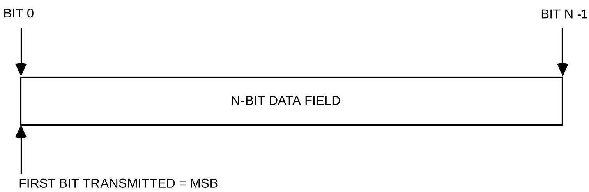
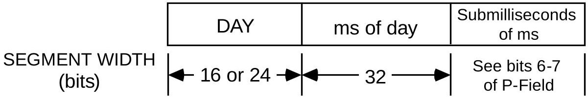
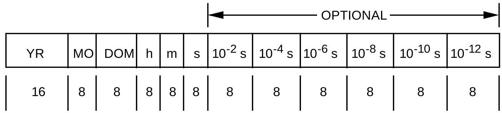
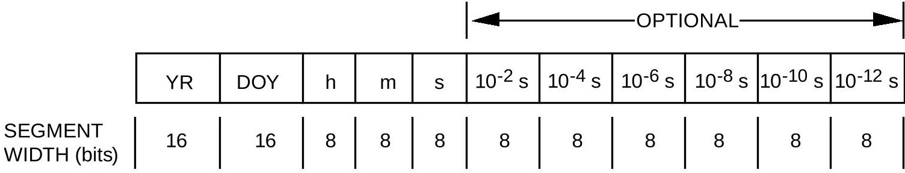

> Complete conversion of the archived source PDF, not an assertion of standard applicability or conformance.

<!-- PDF_PAGE: 1 -->

Recommendation for Space Data System Standards

TIME CODE FORMATS

RECOMMENDED STANDARD

CCSDS 301.0-B-4

BLUE BOOK November 2010

<!-- PDF_PAGE: 2 -->

# Recommendation for Space Data System Standards

TIME CODE FORMATS

## RECOMMENDED STANDARD

CCSDS 301.0-B-4

BLUE BOOK November 2010

<!-- PDF_PAGE: 3 -->

## AUTHORITY

<table border="1"><tr><td>Issue:</td><td>Recommended Standard, Issue 4</td></tr><tr><td>Date:</td><td>November 2010</td></tr><tr><td>Location:</td><td>Washington, DC, USA</td></tr></table>

This document has been approved for publication by the Management Council of the Consultative Committee for Space Data Systems (CCSDS) and represents the consensus technical agreement of the participating CCSDS Member Agencies. The procedure for review and authorization of CCSDS documents is detailed in the Procedures Manual for the Consultative Committee for Space Data Systems, and the record of Agency participation in the authorization of this document can be obtained from the CCSDS Secretariat at the address below.

This document is published and maintained by:

CCSDS Secretariat

Space Communications and Navigation Office, 7L70

Space Operations Mission Directorate

NASA Headquarters

Washington, DC 20546-0001, USA

<!-- PDF_PAGE: 4 -->

# CCSDS RECOMMENDATION FOR TIME CODE FORMATS

# STATEMENT OF INTENT

The Consultative Committee for Space Data Systems (CCSDS) is an organization officially established by the management of its members. The Committee meets periodically to address data systems problems that are common to all participants, and to formulate sound technical solutions to these problems. Inasmuch as participation in the CCSDS is completely voluntary, the results of Committee actions are termed Recommended Standards and are not considered binding on any Agency.

This Recommended Standard is issued by, and represents the consensus of, the CCSDS members. Endorsement of this Recommendation is entirely voluntary. Endorsement, however, indicates the following understandings:

0 Whenever a member establishes a CCSDS-related standard, this standard will be in accord with the relevant Recommended Standard. Establishing such a standard does not preclude other provisions which a member may develop.

o Whenever a member establishes a CCSDS-related standard, that member will provide other CCSDS members with the following information:

-- The standard itself.

-- The anticipated date of initial operational capability.

-- The anticipated duration of operational service.

0 Specific service arrangements shall be made via memoranda of agreement. Neither this Recommended Standard nor any ensuing standard is a substitute for a memorandum of agreement.

No later than five years from its date of issuance, this Recommended Standard will be reviewed by the CCSDS to determine whether it should: (1) remain in effect without change; (2) be changed to reflect the impact of new technologies, new requirements, or new directions; or (3) be retired or canceled.

In those instances when a new version of a Recommended Standard is issued, existing CCSDS-related member standards and implementations are not negated or deemed to be non-CCSDS compatible. It is the responsibility of each member to determine when such standards or implementations are to be modified. Each member is, however, strongly encouraged to direct planning for its new standards and implementations towards the later version of the Recommended Standard.

<!-- PDF_PAGE: 5 -->

# CCSDS RECOMMENDATION FOR TIME CODE FORMATS

## FOREWORD

This document is a technical Recommended Standard for time code formats and has been prepared by the Consultative Committee for Space Data Systems (CCSDS). The set of time code formats described in this Recommended Standard is the baseline concept for time representation in data interchange applications that are cross-supported between Agencies of the CCSDS.

This Recommended Standard establishes a common framework and provides a common basis for the formats of time code data. It allows implementing organizations within each agency to proceed coherently with the development of compatible derived Standards for the flight and ground systems that are within their cognizance. Derived Agency Standards may implement only a subset of the optional features allowed by the Recommended Standard and may incorporate features not addressed by this Recommended Standard.

Through the process of normal evolution, it is expected that expansion, deletion or modification to this document may occur. This Recommended Standard is therefore subject to CCSDS document management and change control procedures which are defined in reference [1]. Current versions of CCSDS documents are maintained at the CCSDS Web site:

## http://www.ccsds.org/

Questions relating to the contents or status of this document should be addressed to the CCSDS Secretariat at the address indicated on page i.

<!-- PDF_PAGE: 6 -->

At time of publication, the active Member and Observer Agencies of the CCSDS were:

## Member Agencies

- Agenzia Spaziale Italiana (ASI)/Italy.

- Canadian Space Agency (CSA)/Canada.

- Centre National d'Etudes Spatiales (CNES)/France.

- China National Space Administration (CNSA)/People's Republic of China.

- Deutsches Zentrum für Luft- und Raumfahrt e.V. (DLR)/Germany.

- European Space Agency (ESA)/Europe.

- Instituto Nacional de Pesquisas Espaciais (INPE)/Brazil.

- Japan Aerospace Exploration Agency (JAXA)/Japan.

- National Aeronautics and Space Administration (NASA)/USA.

- Federal Space Agency (FSA)/Russian Federation.

- UK Space Agency/United Kingdom.

## Observer Agencies

- Austrian Space Agency (ASA)/Austria.

- Belgian Federal Science Policy Office (BFSPO)/Belgium.

- Central Research Institute of Machine Building (TsNIIMash)/Russian Federation.

- China Satellite Launch and Tracking Control General, Beijing Institute of Tracking and Telecommunications Technology (CLTC/BITTT)/China.

- Chinese Academy of Sciences (CAS)/China.

- Chinese Academy of Space Technology (CAST)/China.

- Commonwealth Scientific and Industrial Research Organization (CSIRO)/Australia.

- CSIR Satellite Applications Centre (CSIR)/Republic of South Africa.

- Danish National Space Center (DNSC)/Denmark.

- Departamento de Ciência e Tecnologia Aeroespacial (DCTA)/Brazil.

- European Organization for the Exploitation of Meteorological Satellites (EUMETSAT)/Europe.

- European Telecommunications Satellite Organization (EUTELSAT)/Europe.

- Geo-Informatics and Space Technology Development Agency (GISTDA)/Thailand.

- Hellenic National Space Committee (HNSC)/Greece.

- Indian Space Research Organization (ISRO)/India.

- Institute of Space Research (IKI)/Russian Federation.

- KFKI Research Institute for Particle & Nuclear Physics (KFKI)/Hungary.

- Korea Aerospace Research Institute (KARI)/Korea.

- Ministry of Communications (MOC)/Israel.

- National Institute of Information and Communications Technology (NICT)/Japan.

- National Oceanic and Atmospheric Administration (NOAA)/USA.

- National Space Agency of the Republic of Kazakhstan (NSARK)/Kazakhstan.

- National Space Organization (NSPO)/Chinese Taipei.

- Naval Center for Space Technology (NCST)/USA.

- Scientific and Technological Research Council of Turkey (TUBITAK)/Turkey.

- Space and Upper Atmosphere Research Commission (SUPARCO)/Pakistan.

- Swedish Space Corporation (SSC)/Sweden.

- United States Geological Survey (USGS)/USA.

<!-- PDF_PAGE: 7 -->

## CCSDS RECOMMENDATION FOR TIME CODE FORMATS

## DOCUMENT CONTROL

<table border="1"><tr><td>Document</td><td>Title</td><td>Date</td><td>Status</td></tr><tr><td>CCSDS301.0-B-1</td><td>Time Code Formats, Issue 1</td><td>January1987</td><td>Original issue, superseded</td></tr><tr><td>CCSDS301.0-B-2</td><td>Time Code Formats, Issue 2</td><td>April1990</td><td>Issue 2, superseded</td></tr><tr><td>CCSDS301.0-B-3</td><td>Time Code Formats, Issue 3</td><td>January2002</td><td>Issue 3, superseded</td></tr><tr><td>CCSDS301.0-B-4</td><td>Time Code Formats,Recommended Standard, Issue 4</td><td>November2010</td><td>Current issue: defines a second P-Field octet for the CCSDSUnsegmented TimeCode(CUC)adds a new section on securityupdates some editorial elements</td></tr><tr><td>CCSDS301.0-B-4EC1</td><td>Editorial Change 1</td><td>February2014</td><td>Corrects erroneousinformation on page v.</td></tr></table>

NOTE Substantive changes from the previous issue are identified by change bars in the inside margin.

<!-- PDF_PAGE: 8 -->

## CCSDS RECOMMENDATION FOR TIME CODE FORMATS

## CONTENTS

Section Page

1 INTRODUCTION 1-1

1.1 PURPOSE AND OVERVIEW 1-1

1.2 SCOPE 1-1

1.3 CATEGORIZING OF CCSDS TIME CODE FORMATS 1-1

1.4 APPLICABILITY 1-2

1.5 BIT NUMBERING CONVENTION AND NOMENCLATURE 1-2

2 SECURITY 2-1

2.1 SECURITY BACKGROUND 2-1

2.2 SECURITY CONCERNS 2-1

2.3 POTENTIAL THREATS AND ATTACK SCENARIOS 2-2

2.4 CONSEQUENCES OF NOT APPLYING SECURITY 2-2

3 TIME CODE FORMATS 3-1

3.1 TIME CODE FIELDS 3-1

3.2 CCSDS UNSEGMENTED TIME CODE (CUC) 3-2

3.3 CCSDS DAY SEGMENTED TIME CODE (CDS) 3-3

3.4 CCSDS CALENDAR SEGMENTED TIME CODE (CCS) 3-4

3.5 CCSDS ASCII CALENDAR SEGMENTED TIME CODE (ASCII) 3-6

3.6 AGENCY-DEFINED CODES 3-9

ANNEX A RANGE OF SEGMENT COUNTERS

FOR SEGMENTED TIME CODES (Normative) A-1

ANNEX B RATIONALE FOR TIME CODES (Informative) B-1

ANNEX C GLOSSARY OF SELECTED TIME TERMS (Informative) C-1

ANNEX D CONVERSION BETWEEN TAI AND UTC (Informative) D-1

ANNEX E EXAMPLE OF ACCOMMODATION OF AGENCY-DEFINED

CODES (PB-5J) (Informative) E-1

ANNEX F INFORMATIVE REFERENCES (Informative) F-1

Table

B-1 Applicability of the Criteria B-2

B-1 Applicability of the Criteria...B-2

B-2 Time Code Services...B-3

B-3 Service Categories of Time Codes ...B-4

<!-- PDF_PAGE: 9 -->

## 1 INTRODUCTION

## 1.1 PURPOSE AND OVERVIEW

The purpose of this Recommended Standard is to establish a small number of standardized recommended time code formats for use in data interchange applications between Agencies of the CCSDS. This Recommended Standard does not address timing performance issues such as stability, precision, accuracy, etc.

## 1.2 SCOPE

Time codes are digital representations of time information. Four standard CCSDS-Recommended time codes are described (one 'unsegmented' and three 'segmented' codes) which use the international standard second as the fundamental unit of time.

An unsegmented time code is a pure binary count of time units and fractional time units from a starting time called the 'epoch'.

A segmented time code is one in which the count of time units and fractional time units is accumulated in two or more cascaded counters which count modulo of various bases and start from the epoch.

The four Recommended time code formats carry both the time data (in the TIME SPECIFICATION FIELD, or T-FIELD) and, where applicable, additional information (in the TIME CODE PREAMBLE FIELD or P-FIELD) that uniquely identifies a specific time code format. The P-FIELD may be either explicit or implicit (refer to paragraph 2.1.1).

## 1.3 CATEGORIZING OF CCSDS TIME CODE FORMATS

In this Recommended Standard, four Levels of time code formats can be defined based on the four degrees of interpretability of the code.

All time code Levels provide for recognizing the boundaries of the time code field and thus that field can be transferred, as a block, to another location.

## Level 1: Complete Unambiguous Interpretation

Level 1 code formats are fully self-defined and allow absolute time interpretation for the events tagged with the code. Time comparison with other time sources utilizing Level 1 codes can thus be made. These codes are the CCSDS-Recommended codes and have the Recommended epochs.

<!-- PDF_PAGE: 10 -->

# CCSDS RECOMMENDATION FOR TIME CODE FORMATS

## Level 2: Partial Interpretation

Level 2 code formats have a fully self-defined structure, but support only partial interpretation because it is necessary to obtain the epoch from an external source. Relative time interpretation for the events tagged with Level 2 formats can be made. To make accurate time comparisons with other time sources which use other epochs (Level 1 or Level 2), additional information must be obtained from external sources.

## Level 3: No Interpretation Except for Recognition of Increasing Time Value

Level 3 code formats are those for which only the code length is self-defined and a monotonically increasing (possibly non-uniformly increasing) value is guaranteed except for the recycling instant (i.e., counter rollover). For Level 3 codes, the epoch, the time units, and the T-field structure are not self-defined.

## Level 4: No Interpretation

Level 4 code formats are those for which only the code length is self-defined. No other features of the code are identified.

## 1.4 APPLICABILITY

This Recommended Standard contains a number of time codes designed for applications involving data interchange in space data systems. It does not attempt to prescribe which code to use for any particular application. The rationale behind the design of each code is described in annex B and may help the application engineer to select a suitable code. Definition of the timing accuracy underlying a particular time code is not a function of this Recommended Standard but is the responsibility of the authority cognizant of time performance for the applicable system.

## 1.5 BIT NUMBERING CONVENTION AND NOMENCLATURE

In this document, the following convention is used to identify each bit in an N-bit field. The first bit in the field to be transmitted (i.e., the most left justified when drawing a figure) is defined to be 'Bit 0'; the following bit is defined to be 'Bit 1' and so on up to 'Bit N-1'. When the field is used to express a binary value (such as a counter), the Most Significant Bit (MSB) shall be the first transmitted bit of the field, i.e., 'Bit 0'.

<!-- PDF_PAGE: 11 -->

In accordance with modern data communications practice, spacecraft data fields are often grouped into 8-bit 'words' which conform to the above convention. Throughout this Recommended Standard, the following nomenclature is used to describe this grouping:

<!-- PDF_PAGE: 12 -->

## 2 SECURITY

## 2.1 SECURITY BACKGROUND

The time code formats are expected to be used to encode time values within selected transmitted parameters. It is also expected that these parameters may need to be protected from undetectable corruption, and sometimes the true value of the parameter will be required to be hidden.

The specification of such security services is outside the scope of this document but will be discussed in subsequent subsections.

Time code values may be critical to the correct operation of a spacecraft (for example, the exact time a maneuver burn should be accomplished), or may be non-critical (for example, a time tag on an image being downlinked from a spacecraft).

In the case of transmitting critical time codes, it is expected that integrity and possibly authentication may be required. Depending on other circumstances, there may also be a need to ensure confidentiality of the time code.

## 2.2 SECURITY CONCERNS

As previously stated, a critical time code transmission might need to have security services applied for protection. Depending on the threat, the mission security policy(s), and the desire of the mission planners, security services might need to be applied to the entity carrying the time code. If a time code is critical, it is important to ensure that it is not modified without detection during transmission. Authentication may also be required to ensure there can be no injection of erroneous/false time codes, which could change the spacecraft's knowledge of time.

While these security concerns are valid, they are outside the scope of this document. This document assumes that either upper or lower layers of the Open Systems Interconnection (OSI) model will provide the security services. That is, if authenticity at the granularity of a specific user is required, it is best applied at the Application layer. If less granularity is required, it could be applied at the Network or Data Link layers. If integrity is required, it can be applied at the Application, Network, or Data Link layer. Similarly, if confidentiality is required, it can be applied at the Application layer, Network layer, or Data Link layer. For more information regarding the choice of service and where it can be implemented (see reference [4]).

<!-- PDF_PAGE: 13 -->

## 2.3 POTENTIAL THREATS AND ATTACK SCENARIOS

Without authentication, unauthorized time codes might be uploaded to a spacecraft, changing the time basis. Without integrity, corrupted time codes might be uploaded to a spacecraft. Without confidentiality, the contents of the time code might be disclosed to an unauthorized entity.

## 2.4 CONSEQUENCES OF NOT APPLYING SECURITY

The security services are out of scope of this document and should be applied at layers above or below those specified in this document. However, should there be a requirement for authentication and it is not implemented, unauthorized time codes might be loaded onto a spacecraft potentially resulting in the loss of a mission. If integrity is not implemented, erroneous time codes might be loaded onto a spacecraft, also potentially resulting in the loss of the mission. If confidentiality is not implemented, time code or other parameters transmitted to or from a spacecraft might be visible to unauthorized entities resulting in disclosure of sensitive or private information.

<!-- PDF_PAGE: 14 -->

## 3 TIME CODE FORMATS

The time code formats can be represented as a combination of a preamble field (P) and a time specification field (T). The P-field uniquely defines the options, parameters, and encoding structure of the T-field and should be included whenever the recipient of the time code may be uncertain as to the selected code. The T-field and the P-field shall each be an integral number of octets in length.

## 3.1 TIME CODE FIELDS

## 3.1.1 PREAMBLE FIELD (P-FIELD)

The time code preamble field (P-field) may be either explicitly or implicitly conveyed. If it is implicitly conveyed (not present with T-field), the code is not self-identified, and identification must be obtained by other means.

When it is explicitly conveyed the explicit representation of the mandatory first octet is as follows:

<table border="1"><tr><td>Bit</td><td>Interpretation</td></tr><tr><td>0</td><td>Extension flag</td></tr><tr><td>1-3</td><td>Time code identification</td></tr><tr><td>4-7</td><td>Detail bits for information on the code</td></tr></table>

The first bit (Bit 0) of the P-field is the extension flag, used to indicate that an additional octet is included in the P-field for time code format definition. Such an expansion may be required to accommodate new time codes or to provide more information (for example, on the clock used). Presently, the value of this bit is '0', indicating that there is not a second octet present. If a second octet is present, its first bit shall be an extension flag with the same definition: '0' implies it is the last octet of the P-field, '1' implies another octet follows.

The detailed specifications of bits 1 to 7 are given in the following paragraphs with the description of each code. The time code identifications (bit 1-3) = 000, 011 and 111 are reserved for future application.

The preamble field does not apply in the case of the ASCII time code.

## 3.1.2 TIME FIELD (T-FIELD)

For each code the T-field has a basic structure and optional extensions which allow increases in resolution or ambiguity period.

<!-- PDF_PAGE: 15 -->

## 3.2 CCSDS UNSEGMENTED TIME CODE (CUC)

## 3.2.1 T-FIELD DESCRIPTION

The T-field consists of a selected number of contiguous octets representing an integrated number of basic time units from a defined epoch along with an optional integer number of octets representing the elapsed binary fraction of the basic time unit. Each octet within the T-field represents the state of 8 consecutive bits of a binary counter, cascaded with the adjacent counters, which rolls over at a modulo of 256. The time code represented by the T-field shall increase monotonically without reversion.

The basic unit of time intended for correlation with Earth-based clocks is the second. The basic unit of time represented by the value of the T-Field is required to be defined in the metadata. The metadata also defines the epoch of the time and the number of octets of basic and fractional time units. This metadata can be provided by the P-field if self-identification is employed or by metadata external to the P-field.

The CCSDS-Recommended epoch is that of 1958 January 1 (TAI) and the recommended time unit is the second, using TAI as reference time scale, for use as a level 1 time code. This time code is not UTC-based and leap-second corrections do not apply.

## 3.2.2 P-FIELD DESCRIPTION

Octet 1 (mandatory if P-Field is used)

Octet 1 (mandatory if P-Field is used)

Bit 0 = P-Field Extension ('zero': no extension; 'one': field is extended)

Bit 1 - 3 = Time code identification

001 — 1958 January 1 epoch (Level 1 Time Code)

010 — Agency-defined epoch (Level 2 Time Code)

Bit 4 - 5 = Number of octets of the basic time unit minus one

Bit 6 - 7 = Number of octets of the fractional time unit

Octet 2 (optional—presence is signaled in Octet 1)

Bit 0 = P-Field Extension ('zero': no extension; 'one': field is extended)

Bits 1-2 = Number of additional octets of the basic time added to that specified in Octet 1

Bits 3-5 = Number of additional octets of the fractional time added to that specified in Octet 1

Bits 6-7 = Reserved for mission definition

<!-- PDF_PAGE: 16 -->

## 3.3 CCSDS DAY SEGMENTED TIME CODE (CDS)

## 3.3.1 T-FIELD

For the segmented binary time code described herein, the T-field consists of a selected number of contiguous time segments. Each segment represents the state of a binary counter, cascaded with the adjacent counters, which rolls over at a modulo specified for each counter.

The segmented binary day count code recommendation, designated CDS (CCSDS Day Segmented), is as follows:

Each segment above is a right-adjusted binary counter. The CCSDS recommended day segment is a continuous counter of days from 1958 January 1 starting with 0, but other Agency-defined epochs may be accommodated as a level 2 code.

The submilliseconds segment is optional depending upon the resolution desired (see bits 6-7 of the P-Field). Since this code is UTC-based, the leap second correction must be made.

## 3.3.2 P-FIELD

Bits 1-3 = time code identification = '100'

Bit 4 = epoch identification:

'0' — 1958 January 1 epoch (Level 1)

'1' — Agency-defined epoch (Level 2)

Bit 5 = length of day segment:

'0' — 16-bit day segment

'1' — 24-bit day segments

Bits 6-7 = length of submillisecond segment (i.e., resolution):

'00' — submillisecond segment is absent (millisecond)

'01' — 16-bit (microsecond)

'10' — 32-bit (picosecond)

'11' — reserved for future use

<!-- PDF_PAGE: 17 -->

## 3.4 CCSDS CALENDAR SEGMENTED TIME CODE (CCS)

## 3.4.1 T-FIELD

For the segmented Binary Coded Decimal (BCD) time code described herein, the T-field consists of a variable number of contiguous time segments. Each 8-bit segment represents two decimal digits.

Both CCS time code variations are UTC-based. The leap second correction must be made.

The calendar segmented code recommendations, designated CCS (CCSDS Calendar Segmented time code), are Level 1 time code formats and are as follows:

## 3.4.1.1 Month of Year/Day of Month Calendar Variation

The year A.D. segment (YR) requires 16 bits for proper representation of the decimal year. All other segments require 8 bits for proper representation. The month (MO) and day of month (DOM) segments are present when the calendar variation flag (bit 4 of the P-field) is set to zero.

## 3.4.1.2 Day of Year Calendar Variation

This variation of the CCS time code substitutes day of year (DOY) in place of the month (MO) and day of month (DOM) segments. The day of year segment must be 16 bits long (all segments must be multiples of 8 bits). The four most significant bits of this segment are not used and are set to zero. The day of year segment is present when the calendar variation flag (bit 4 of the P-field) is set to a value of one. The year A.D. segment is 16 bits in length.

## 3.4.2 P-FIELD

Bits 1-3 = time code identification = 101

<!-- PDF_PAGE: 18 -->

4 = calendar variation flag:

0 month of year/day of month variation

1 day of year variation

Bits 5-7 = resolution (number of optional subsecond segments):

000 — 1 s

001 — $ 1 0^{-2} \mathrm{s} $

010 — $ 1 0^{-4} \mathrm{s} $

011 — $ 1 0^{-6} \mathrm{s} $

100 — $ 1 0^{-8} \mathrm{s} $

101 — $ 1 0^{-1 0} \mathrm{s} $

110 — $ 1 0^{-1 2} \mathrm{s} $

111 — not used

<!-- PDF_PAGE: 19 -->

## 3.5 CCSDS ASCII CALENDAR SEGMENTED TIME CODE (ASCII)

## 3.5.1 T-FIELD

The CCSDS ASCII segmented time code is composed of a variable number of ASCII characters forming the T-field.

Both ASCII time code variations are UTC-based and leap second corrections must be made. The time represented is intended to match civil time usage. Therefore, the epoch is taken to be the usual Gregorian calendar epoch of 1 AD, and the time is that of the prime meridian.

The ASCII time code recommendations are Level 1 time code formats.

## 3.5.1.1 ASCII TIME CODE A, Month/Day of Month Calendar Variation:

The format for ASCII Time Code A is as follows:

## YYYY-MM-DDThh:mm:ss.d $ \rightarrow $ dZ

where each character is an ASCII character using one octet with the following meanings:

YYYY = Year in four-character subfield with values 0001-9999

MM = Month in two-character subfield with values 01-12

DD = Day of month in two-character subfield with values 01-28, -29, -30, or -31

T = Calendar-Time separator

hh = Hour in two-character subfield with values 00-23

mm = Minute in two-character subfield with values 00-59

ss = Second in two-character subfield with values 00-59 (-58 or -60 during leap seconds)

d $ \to $ d = Decimal fraction of second in one- to n-character subfield where each d has values 0-9

Z = time code terminator (optional)

The hyphen (-), colon (:), letter 'T' and period (.） are used as specific subfield separators, and that all subfields must include leading zeros.

As many 'd' characters to the right of the period as required may be used to obtain the required precision.

An optional terminator consisting of the ASCII character 'Z' may be placed at the end of the time code.

EXAMPLE: 1988-01-18T17:20:43.123456Z

<!-- PDF_PAGE: 20 -->

## 3.5.1.2 ASCII TIME CODE B, Year/Day of Year Calendar Variation:

The format for ASCII Time Code B is as follows:

YYYY-DDDThh:mm:ss.d→dZ

where each character is an ASCII character using one octet with the following meanings:

YYYY = Year in four-character subfield with values 0001-9999

DDD = Day of year in three-character subfield with values 001-365 or -366

T = Calendar-Time separator

hh = Hour in two-character subfield with values 00-23

mm = Minute in two-character subfield with values 00-59

ss = Second in two-character subfield with values 00-59 (-58 or -60 during leap seconds)

d $ \to $ d = Decimal fraction of second in one- to n-character subfield where each d has values 0-9

Z = time code terminator (optional)

The hyphen (-), colon (:), letter ' T' and period (.） are used as specific subfield separators, and that all subfields must include leading zeros.

As many 'd' characters to the right of the period as required may be used to obtain the required precision.

An optional terminator consisting of the ASCII character 'Z' may be placed at the end of the time code.

EXAMPLE: 1988-018T17:20:43.123456Z

## 3.5.1.3 SUBSETS OF THE COMPLETE TIME CODES:

When it is desired to use SUBSETS of each of the TWO ASCII time code format variations described above, the following rules must be observed:

a) The 'calendar' subset (all subfields to the left of the 'T') and the 'time' subset (all subfields to the right of the 'T') may be used independently as separate 'calendar' or 'time' formats, provided the context in which each subset is used makes its interpretation unambiguous.

b) When calendar or time subsets are used alone, the 'T' separator is omitted.

c) Calendar or time subsets may contain all the defined subfields, or may be abbreviated to the span of interest by deleting the unneeded subfields, either on the left or on the right. However, when subfields are deleted on the LEFT, all separators that had delimited the deleted subfields must be retained (except for the 'T' which, by rule b, is dropped if the subset is used alone.) When subfields are deleted on the RIGHT, the separators that had delimited the deleted subfields are dropped.

<!-- PDF_PAGE: 21 -->

# CCSDS RECOMMENDATION FOR TIME CODE FORMATS

d) Subsets may NOT consist of partial subfields (e.g., must use 'ss', not 's'). In particular, consistent use of the complete four-character YYYY subfield is required (e.g., '1989' instead of '89') because of the need to accommodate the upcoming century rollover in only 11 years. It should be noted, however, that each fractional second ('d' character) is considered to be a complete subfield, and so any number of fractional seconds may be used.

e) If calendar and time SUBSETS are then brought together to form a single time code format (joined with the 'T' separator) the CALENDAR subset may NOT have been truncated from the RIGHT, and the TIME subset may NOT have been truncated from the LEFT. That is, the format must be integral around the 'T'.

f) Standardization on the use of these time code formats for purposes OTHER than identifying an instant of calendar or time in UTC (e.g., unconventional use as a counter or tool for measuring arbitrary intervals) is not recommended. It is felt such a specialized application can best be viewed not as a time code format but rather as an engineering measurement format. Any such application of these time code formats is considered beyond the scope of this Recommended Standard.

## 3.5.2 P-FIELD

There is no P-field identifying the ASCII Time Code Formats. The P-field information is implicit in the parsing of the ASCII time code.

<!-- PDF_PAGE: 22 -->

## 3.6 AGENCY-DEFINED CODES

These codes are not CCSDS-Recommended, but the presence of a P-field may allow a limited level of service.

## 3.6.1 T-FIELD

For the time codes described herein, the T-field consists of a variable number of octets. These octets together can be considered a binary number. If that number increases monotonically with time (except at a recycle time), the code is a Level 3 code; if not, it is a Level 4 code.

The time code Levels are defined in 1.3.

The length of that T-field is indicated by the P-field.

## 3.6.2 P-FIELD

Bit 1-3 = time code identification 110 Level 3 or 4 Agency-defined code

Bit 4-7 = T-field length [（number of octets of time）minus one $ ^{1} $]

<!-- PDF_PAGE: 23 -->

## ANNEX A RANGE OF SEGMENT COUNTERS FOR SEGMENTED TIME CODES (NORMATIVE)

Purpose:

This annex specifies the range of the counters defined in the Recommended segmented codes.

<!-- PDF_PAGE: 24 -->

## RANGE OF TIME CODE SEGMENT COUNTERS

<table border="1"><tr><td>Segment Identification</td><td>Range of Counter</td></tr><tr><td>Microsecond-of-millisecond</td><td>0 to 999</td></tr><tr><td>Millisecond-of-day</td><td>0 to 86,399,999(0 to 86,400,999 or 86,398,999when leap second adjustments are introduced)</td></tr><tr><td>Second-of-minute</td><td>0 to 59(0 to 60 or 58 when leap second adjustments are introduced)</td></tr><tr><td>Minute-of-hour</td><td>0 to 59</td></tr><tr><td>Hour-of-day</td><td>0 to 23</td></tr><tr><td>Day</td><td>0 to $(2^{16}-1)$，or0 to $(2^{24}-1)$</td></tr><tr><td>Day-of-month</td><td>1 to 31 for month1,3,5,7,8,10,121 to 30 for month4,6,9,111 to 28 for month2(1 to 29 for leap years)*</td></tr><tr><td>Day-of-year</td><td>1 to 365(366 for leap years)*</td></tr><tr><td>Month-of-year</td><td>1 to 12</td></tr><tr><td>Year</td><td>1 to 9999</td></tr></table>

<!-- PDF_PAGE: 25 -->

## ANNEX B RATIONALE FOR TIME CODES (INFORMATIVE)

Purpose:

This annex presents the rationale behind the design of each code. It may help the application engineer to select a suitable code.

<!-- PDF_PAGE: 26 -->

## B1 GENERAL

Instrument data acquired from spacecraft have little value unless it is possible to recreate the significant environment of the instrument during the measurement collection phase. Such ancillary data parameters as time, position, velocity, attitude, instrument temperature, concurrent ground truth measurements and many other parameters may be essential for the proper interpretation of the instrument data. Of these ancillary data parameters, the time of the instrument measurements is certainly the most vital parameter. The reasons for this are the following:

(1) In many cases, the instrument analysis can be based, nearly exclusively, on the sampled sensor time series.

(2) Time provides the most efficient and often the only possible linkage between instrument data and externally generated ancillary parameters. Two independent measurement processes, each correlated with time, can then be correlated with each other.

However, the resulting proliferation of slightly different codes is not desirable. The selection of one particular code will depend on the chosen optimization criteria in the given application. For example, table B-1 compares the four Recommended codes in terms of the three selection criteria identified by the CCSDS:

- UTC compatible : Permits unambiguous representation of leap seconds

- Computer efficient : Fewer segments improves data handling and processing

- Human readable : Easily readable code corresponding to widely used civil time representation

Table B-1: Applicability of the Criteria

<table border="1"><tr><td>Time Code</td><td>S(Segmented)U(Unsegmented)</td><td>UTCCompatible</td><td>ComputerEfficient</td><td>HumanReadable</td></tr><tr><td>CUC</td><td>U</td><td>No</td><td>Yes</td><td>No</td></tr><tr><td>CDS</td><td>S</td><td>Yes</td><td>Yes</td><td>No</td></tr><tr><td>CCS</td><td>S</td><td>Yes</td><td>No</td><td>Yes</td></tr><tr><td>ASCII</td><td>S</td><td>Yes</td><td>No</td><td>Yes</td></tr></table>

<!-- PDF_PAGE: 27 -->

## B2 SERVICE RELATED TO THE DIFFERENT LEVELS OF TIME CODE FORMATS

The different Levels of the time codes have been distinguished by the self-interpretability of the codes.

All time code Levels provide for recognizing the boundaries of the time code field and thus can transfer that field, as a block, to another location.

The different services which can be achieved without special arrangements between users of the CCSDS time codes are:

- Absolute time interpretation: time comparison and differencing for events based on separate time sources, with all sources having the same CCSDS-Recommended epoch.

- Relative time interpretation: time comparison and differencing for events based on the same time source, with the source having a known, Agency-defined epoch.

- Ordering of events time-tagged from a single source.

Table B-2 shows how these three services can be related to the time code Levels.

Table B-3 shows the different time code format identifications in the P-field, and the associated time code Levels.

Table B-2: Time Code Services

<table border="1"><tr><td colspan="2">Level</td><td>Absolute Time Interpretation</td><td>Relative Time Interpretation</td><td>Ordering</td></tr><tr><td>CUC</td><td>Level1</td><td>Y</td><td>Y</td><td>Y</td></tr><tr><td>CUC</td><td>Level2</td><td>N</td><td>Y</td><td>Y</td></tr><tr><td>CDS</td><td>Level1</td><td>Y</td><td>Y</td><td>Y</td></tr><tr><td>CDS</td><td>Level2</td><td>N</td><td>Y</td><td>Y</td></tr><tr><td rowspan="3">CCS</td><td>Level1</td><td>Y</td><td>Y</td><td>Y</td></tr><tr><td>Level3</td><td>N</td><td>N</td><td>Y</td></tr><tr><td>Level4</td><td>N</td><td>N</td><td>N</td></tr><tr><td>ASCII</td><td></td><td>Y</td><td>Y</td><td>Y</td></tr></table>

<!-- PDF_PAGE: 28 -->

Table B-3: Service Categories of Time Codes

<table border="1"><tr><td>Time Code Name</td><td>Format IdentificationP-field-Bits1-3</td><td>Time Code Category</td></tr><tr><td>Reserved</td><td>000</td><td>-</td></tr><tr><td>CUC</td><td>001</td><td>Level1</td></tr><tr><td>CUC</td><td>010</td><td>Level2</td></tr><tr><td>Reserved</td><td>011</td><td>-</td></tr><tr><td>CDS</td><td>100</td><td>Level1or2</td></tr><tr><td>CCS</td><td>101</td><td>Level1</td></tr><tr><td>Agency-Defined</td><td>110</td><td>Level3or4</td></tr><tr><td>Reserved</td><td>111</td><td>-</td></tr><tr><td>ASCII</td><td>None</td><td>Level1or3</td></tr></table>

## B3 DISCUSSION OF RECOMMENDED CODES

All the Recommended time code lengths are an integer number of octets. This helps to optimize the computer processing of these codes and allows the use of high level languages.

The range of all segment counters (especially for leap year and leap second) is shown in annex A.

## B3.1 CCSDS UNSEGMENTED (CUC)

The unsegmented binary time code is particularly suited to computer applications which involve arithmetic computation of time differences. Since the unsegmented format is a representation of the state of consecutive bits of a binary counter (i.e., a continuous function with no discontinuities), arithmetic operations can be carried out directly.

The code allows for both absolute time (TAI scale) and time measured relative to an Agency-defined epoch. Various allowed truncations of the code make it bit-efficient. The attributes of this code make it suitable for applications such as spacecraft clock measurement.

## B3.2 CCSDS DAY SEGMENTED (CDS)

Most terrestrial time measurements are made using the UTC time scale. Usually, spacecraft instrument events are ultimately time-tagged with UTC because the events have to be correlated with other phenomena. This time code is based on UTC. Since UTC contains

<!-- PDF_PAGE: 29 -->

# CCSDS RECOMMENDATION FOR TIME CODE FORMATS

discontinuities at the instant of leap second correction, the unsegmented binary code cannot be used to represent UTC.

The CCSDS Day Segmented code (CDS) consists in its simplest form of two binary counters, one counting days from a defined epoch and the other counting milliseconds of day. The code retains attributes similar to the unsegmented binary code in being oriented toward arithmetic operations by computers. The choice of millisecond unit results in an optimum use of 4 octets (28 bits used) and also provides the resolution necessary for most time computations.

Extended microsecond precision is provided by allowing one optional additional segment. Provision has been made in the P-field to accommodate, in the future, greater resolution.

CCSDS recommends the epoch 1958 January 1 (Julian date 2436203.5), the epoch of the TAI time scale. An Agency-defined epoch is also allowed (such as 1950 January 1). The difference between the epochs 1958 January 1 and 1950 January 1 is exactly 2922.0 days on the Julian date calendar.

The optional 24-bit length of the day segment is included for special applications such as Astronomy. CDS is the most 'machine friendly' of the UTC codes and is therefore particularly suitable for use in computer-to-computer communication requiring very frequent, very fast automated time interpretation and processing.

## B3.3 CCSDS CALENDAR SEGMENTED (CCS)

In human interactions, UTC is frequently expressed in a segmented form consisting of years, months, days, hours, minutes, seconds and decimal fractions of seconds. UTC is also expressed in a segmented form consisting of years, days of year, hours, minutes, seconds and decimal fractions of seconds. The CCSDS Calendar Segmented (CCS) codes (both variations) are oriented towards representing these segments directly in binary coded decimal (BCD) format for ease of human reading and interpretation.

CCS is useful for applications where all or part of the code is to be frequently interpreted by humans, for example, when frequently converting to character form for display purposes. However, CCS is not as efficient as CDS for arithmetic operations.

## B3.4 CCSDS ASCII

While binary or BCD-based time code formats are computer efficient and minimize overhead on uplinked/downlinked data streams, there are many ground-segment applications for which an ASCII character-based time code is more appropriate. For example, when files or data objects are created using text editors or word processors, ASCII character-based time code format representations are necessary. They are also useful in transferring text files between heterogeneous computing systems, because the ASCII character set is nearly universally used and is interpretable by all popular systems. In addition, direct humanly readable dumps of

<!-- PDF_PAGE: 30 -->

text files or objects to displays or printers are possible without preprocessing. The penalty for this convenience is inefficiency.

The two ASCII time code variations (A, day of month, and B, day of year) include the most widely used human-readable presentations. Both variations are subsets of ISO 8601 (reference [2]).

<!-- PDF_PAGE: 31 -->

# ANNEX C GLOSSARY OF SELECTED TIME TERMS (INFORMATIVE)

Purpose:

This annex presents definitions of a number of time-related terms used in the Recommended Standard or useful in understanding the text of the Recommended Standard. Definitions are derived from ITU-R TF.686-2 (reference [5]).

<!-- PDF_PAGE: 32 -->

# CCSDS RECOMMENDATION FOR TIME CODE FORMATS

## ACCURACY:

Closeness of the agreement between the result of a measurement and a true value of the measurand. Accuracy is generally characterized by the overall uncertainty of a measured value. (See also 'uncertainty'.)

## AMBIGUITY PERIOD:

The interval between successive recurrences of the same time code.

## ASCII:

A coded set of alphanumeric and control characters used for information interchange. The coded character set used to form the ASCII time codes defined in 3.5 is described in detail in International Standard ISO 8859-1 (reference [3]).

## ATOMIC TIME SCALE:

A time scale based on atomic or molecular resonance phenomena. Elapsed time is measured by counting cycles of a frequency locked to an atomic or molecular transition.

## COORDINATED UNIVERSAL TIME (UTC):

The time scale maintained by the Bureau International des Poids et Mesures (BIPM) and the International Earth Rotation and Reference Systems Service (IERS), which forms the basis of a coordinated dissemination of standard frequencies and time signals.

It corresponds exactly in rate with TAI, but differs from it by an integer number of seconds. The UTC scale is adjusted by the insertion or deletion of seconds (positive or negative leap seconds) to ensure approximate agreement with UT1. (See 'universal time'.)

<!-- PDF_PAGE: 33 -->

# CCSDS RECOMMENDATION FOR TIME CODE FORMATS

## DATE:

The reading of a specified time scale, usually a calendar.

NOTE - The date can be conventionally expressed in years, months, days, hours, minutes, seconds and fractions thereof.

## DTAI:

The value of the difference TAI-UTC, as disseminated with time signals is denoted DTAI. DTAI = TAI-UTC may be regarded as a correction to be added to UTC to obtain TAI.

## DUT1:

The value of the predicted difference UT1- UTC, as disseminated with the time signals. DUT1 may be regarded as a correction to be added to UTC to obtain a better approximation to UT1. The values of DUT1 are given by the International Earth Rotation Service and Reference Systems (IERS) in multiples of 0.1 s. (See 'universal time'.)

## EPHEMERISTIME:

An astronomical time scale based on the orbital motion of the Earth around the sun. It was used to define the SI second between 1960 and 1967, and continued in use for astronomical applications until 1977 when it was replaced by Terrestrial Dynamical Time (TDT). TDT in turn was replaced by Terrestrial Time (TT) in 1991.

## EPOCH:

The beginning of an era (or event) or the reference date of a system of measurements.

## GREENWICH MEAN TIME (GMT):

Mean solar time as it was measured at the Royal Observatory, Greenwich. GMT was adopted as the world's first global time scale in 1884. However, while the term remains in popular usage, GMT is no longer maintained and has been replaced by Universal Time (UT) and Coordinated Universal Time (UTC) for precise applications.

## INTERNATIONAL ATOMIC TIME (TAI):

The time scale established and maintained by the BIPM on the basis of data from atomic clocks operating in a number of establishments around the world. Its epoch was set so that TAI was in approximate agreement with UT1 on 1 January 1958. The rate of TAI is explicitly related to the definition of the SI second that is defined as the duration of 9,192,631,770 periods of the radiation corresponding to the transition between two hyperfine levels of the ground state of the caesium-133 atom. (Also see 'second', 'universal time' and 'UT1'.)

<!-- PDF_PAGE: 34 -->

# CCSDS RECOMMENDATION FOR TIME CODE FORMATS

## JULIAN DATE:

The Julian day number followed by the fraction of the day elapsed since the preceding noon (12 hours UT).

Example: The date 1900 January 0.5 UT corresponds to JD = 2415020.0.

## JULIAN DAY NUMBER:

A number of a specific day from a continuous day count having an initial origin of 12 hours UT on 1 January 4713 BC, Julian Calendar (start of Julian Day zero).

Example: The day extending from 1900 January 0.5 d UT to 1900 January 1.5 d UT as the number 2,415,020.

## LEAP SECOND

An intentional time step of one second used to adjust Coordinated Universal Time (UTC) to ensure approximate agreement with UT1. An inserted second is called positive leap second, and an omitted second is called negative leap second. A description of the procedures associated with UTC, including leap seconds, is given in Recommendation ITU-R TF.460 (reference [6]). (See also 'coordinated universal time', 'universal time', and 'UT1').

## MODIFIED JULIAN DATE (MJD):

Julian Date less 2,400,000.5 days.

NOTE - Other modifications of the Julian date can be created by using other constants; for example:

(1) The constant 2,436,203.5 days, which occurs on 1958 January 1, gives the origin of TAI, recognized as the epoch of both the CCSDS Unsegmented Code (CUC) and the CCSDS Day Segmented Code (CDS).

(2) The constant 2,440,000.5, which occurs on 1968 May 24.0 gives the origin of the Truncated Julian Date (TJD) time scale used in the NASA PB-5J time code (see annex E).

## NETWORK TIME PROTOCOL (NTP):

The Network Time Protocol (NTP) is used to synchronize the time of a computer client or server to another server or reference time source, such as a terrestrial or satellite broadcast service or modem. NTP provides distributed time accuracies on the order of one millisecond on LANs and tens of milliseconds on WANs. NTP is widely used over the Internet to synchronize computer clocks to national time references.

<!-- PDF_PAGE: 35 -->

## PRECISION:

The degree of mutual agreement among a series of individual measurements; often, but not necessarily, expressed by the standard deviation. (See also 'uncertainty'.)

## SECOND:

The basic unit of time or time interval in the International System of Units (SI) that is equal to the duration of 9,192,631,770 periods of the radiation corresponding to the transition between the two hyperfine levels of the ground state of caesium-133 as defined at the 1967 CGPM meeting. In 1997 the CIPM affirmed that: "This definition refers to a caesium atom at rest at a temperature of 0 K." This was intended to make it clear that the definition of the SI second is based on a Cs atom unperturbed by black-body radiation, that is, in a 0 K environment, and therefore the frequencies of primary frequency standards should be corrected for the shift due to ambient radiation, as further stated at the CCTF meeting in 1999.

## TIME CODE FORMAT:

A system of digital or analogue symbols used in a specified format to convey time information (i.e. date, time of day or time interval).

NOTE - Any representation of time NOT based on the second as the fundamental unit of time is not considered a time code, but is considered to be an engineering parameter. However, it is not necessary for the second to appear explicitly in the time code; decimal multiples or submultiples (e.g., milliseconds of day) may be used.

## TIME INTERVAL:

The duration between two instants read on the same time scale.

## TIME SCALE:

A system of unambiguous ordering of events.

## TIME SCALE READING:

The value read on a time scale at a given instant. To avoid ambiguity the reading of a time scale should be denoted by giving the time scale name. (e.g. UTC, TAI, etc.) followed, in parenthesis, by the clock name, transmitting station, astronomical observatory, institution, or standards laboratory such as UTC (k).

## TIME SCALE UNIT:

The basic time interval in a time scale.

<!-- PDF_PAGE: 36 -->

TRUNCATED JULIAN DATE:

A four-decimal-digit day count originating at midnight 1968-05-23,24 (see annex E).

## UNCERTAINTY:

Parameter associated with the result of a measurement that characterizes the dispersion of the values that could reasonably be attributed to the measurand.

Frequently it is possible to distinguish two components, the random component (also known as Type A error) and the component due to systematic (also known as Type B error) effects.

The random uncertainty is often expressed by the standard deviation or by a multiple of the standard deviation for repeated measurements. The component due to systematic effects is generally estimated on the basis of all available information about relevant parameters.

NOTE - A more detailed treatment of this subject can be found in Evaluation of Measurement Data—Guide to the Expression of Uncertainty in Measurement, JCGM 100:2008, Geneva: ISO, 2008.

## UNIVERSAL TIME (UT)

Universal time is a measure of time that conforms, within a close approximation, to the mean diurnal motion of the sun as observed on the prime meridian. UT is formally defined by a mathematical formula as a function of Greenwich mean sidereal time. Thus UT is determined from observations of the diurnal motions of the stars. The time scale determined directly from such observations is designated UT0; it is slightly dependent on the place of observation. When UT0 is corrected for the shift in longitude of the observing station caused by polar motion, the time scale UT1 is obtained. A further level of refinement is provided with UT2 that corrects UT1 empirically for annual and semiannual variations in the rotation rate of the Earth.

## UT0:

A direct measure of universal time as observed at a given point on the Earth's surface. In practice, the observer's meridian (position on Earth) varies slightly because of polar motion, and so observers at different locations will measure different values of UT0. Other forms of universal time, UT1 and UT2, apply corrections to UT0 in order to establish more uniform time scales.

## UT1:

A form of universal time that accounts for polar motion and is proportional to the rotation of the Earth in space.

<!-- PDF_PAGE: 37 -->

# CCSDS RECOMMENDATION FOR TIME CODE FORMATS

## UT2:

A form of universal time that accounts both for polar motion and is further corrected empirically for annual and semiannual variations in the rotation rate of the Earth to provide a more uniform time scale. The seasonal variations are primarily caused by meteorological effects.

NOTE - The UT2 time scale is no longer determined in practice.

UNIVERSAL TIME COORDINATED (UTC):

Equivalent to 'Coordinated Universal Time (UTC) ' (see above).

<!-- PDF_PAGE: 38 -->

CCSDS RECOMMENDATION FOR TIME CODE FORMATS

# ANNEX D CONVERSION BETWEEN TAI AND UTC (INFORMATIVE)

Purpose:

This annex provides a conversion formula between TAI time and UTC time expressed in seconds.

<!-- PDF_PAGE: 39 -->

In the TAI time scale, the CUC code represents a binary count of the elapsed seconds since the 1958 January 1 epoch. Thus it is ideally suited to computation of the true time difference between widely separated events.

In the UTC time scale, CCS time code is the code normally used for time presentation. Computation of the difference between two UTC times requires knowledge of any intervening leap seconds in order to achieve a true difference.

Since January 1, 1972, the relationship between TAI and UTC has been given by a simple accumulation of leap seconds occurring approximately once per year:

At any instant i:

$$
T _ {i} = T A I t i m e
$$

$$
U _ {i} = U T C \mathrm {t i m e e x p r e s s e d i n s e c o n d s}
$$

$$
T _ {i} = U _ {i} + L _ {i}
$$

where $ L_{i} $ is the accumulated leap second additions between the epoch and the instant i.

The following table contains a reference list of the accumulated leap second additions $ L_{i} $ between 1972 and 1990:

<table border="1"><tr><td colspan="2">Time Period</td><td>Li</td></tr><tr><td>1972 Jan.1</td><td>-1972 July1</td><td>10.0000000s</td></tr><tr><td>1972 July1</td><td>-1973 Jan.1</td><td>11.0000000s</td></tr><tr><td>1973 Jan.1</td><td>-1974 Jan.1</td><td>12.0000000s</td></tr><tr><td>1974 Jan.1</td><td>-1975 Jan.1</td><td>13.0000000s</td></tr><tr><td>1975 Jan.1</td><td>-1976 Jan.1</td><td>14.0000000s</td></tr><tr><td>1976 Jan.1</td><td>-1977 Jan.1</td><td>15.0000000s</td></tr><tr><td>1977 Jan.1</td><td>-1978 Jan.1</td><td>16.0000000s</td></tr><tr><td>1978 Jan.1</td><td>-1979 Jan.1</td><td>17.0000000s</td></tr><tr><td>1979 Jan.1</td><td>-1980 Jan.1</td><td>18.0000000s</td></tr><tr><td>1980 Jan.1</td><td>-1981 July1</td><td>19.0000000s</td></tr><tr><td>1981 July1</td><td>-1982 July1</td><td>20.0000000s</td></tr><tr><td>1982 July1</td><td>-1983 July1</td><td>21.0000000s</td></tr><tr><td>1983 July1</td><td>-1985 July1</td><td>22.0000000s</td></tr><tr><td>1985 July1</td><td>-1988 Jan.1</td><td>23.0000000s</td></tr><tr><td>1988 Jan.1</td><td>-1990 Jan.1</td><td>24.0000000s</td></tr><tr><td>1990 Jan.1</td><td>-1991 Jan.1</td><td>25.0000000s</td></tr><tr><td>1991 Jan.1</td><td>-1992 Jul.1</td><td>26.0000000s</td></tr><tr><td>1992 Jul.1</td><td>-1993 Jul.1</td><td>27.0000000s</td></tr><tr><td>1993 Jul.1</td><td>-1994 Jul.1</td><td>28.0000000s</td></tr><tr><td>1994 Jul.1</td><td>-1996 Jan.1</td><td>29.0000000s</td></tr><tr><td>1996 Jan.1</td><td>-1997 Jul.1</td><td>30.0000000s</td></tr></table>

<!-- PDF_PAGE: 40 -->

<table border="1"><tr><td colspan="3">Time Period</td><td>Li</td></tr><tr><td>1997 Jul.1</td><td>-</td><td>1999 Jan.1</td><td>31.0000000s</td></tr><tr><td>1999 Jan.1</td><td>-</td><td>2006 Jan.1</td><td>32.0000000s</td></tr><tr><td>2006 Jan.1</td><td>-</td><td>2009 Jan.1</td><td>33.0000000s</td></tr><tr><td>2009 Jan.1</td><td></td><td></td><td>34.0000000s</td></tr></table>

<!-- PDF_PAGE: 41 -->

# ANNEX E EXAMPLE OF ACCOMMODATION OF AGENCY-DEFINED CODES (PB-5J) (INFORMATIVE)

Purpose:

This annex shows how Agency-defined (Level 3 and Level 4) time codes may be accommodated. A typical example is the new PB-5J code which is presently being considered for use by NASA.

<!-- PDF_PAGE: 42 -->

## E1 PB-5J

The NASA PB-5J time code is a segmented time code in which the segments represent, respectively, coarse time in truncated Julian day (TJD) and fine time in SI units with optional resolution to 1 nanosecond. The segment boundaries coincide with the octet boundaries. The length of the optional forms of PB-5J are all multiples of 8 bits.

The PB-5J code is constructed as follows:

<table border="1"><tr><td></td><td></td><td colspan="4">OPTIONAL</td></tr><tr><td>TJD</td><td>s of day</td><td>ms of s</td><td>μs of ms</td><td>ns of μs</td><td>PB-5J ID Code</td></tr><tr><td>SEGMENT WIDTH(bits)</td><td>16</td><td>24</td><td>16</td><td>16</td><td>8</td></tr></table>

Fill bits have been added in the most significant position of each segment to ensure that the segments end on octet boundaries.

For consistency with the CCSDS standard format, the P-field must be constructed as follows:

Bits 1 - 3 = Time Code Identification : 110

Bits 4 - 7 = Length PB-5JA (6 octets): 0101

PB-5JB (8 octets): 0111

PB-5JC (10 octets): 1001

PB-5JD (12 octets): 1011

<!-- PDF_PAGE: 43 -->

## ANNEX F

## INFORMATIVE REFERENCES

## INFORMATIVE

[1] Procedures Manual for the Consultative Committee for Space Data Systems. CCSDS A00.0-Y-9. Yellow Book. Issue 9. Washington, D.C.: CCSDS, November 2003.

[2] Data Elements and Interchange Formats—Information Interchange—Representation of Dates and Times. International Standard, ISO 8601:2004. 3rd ed. Geneva: ISO, 2004.

[3] Information Technology—8-Bit Single-Byte Coded Graphic Character Sets—Part 1: Latin Alphabet No.1. International Standard, ISO/IEC 8859-1:1998. Geneva: ISO, 1998.

[4] The Application of CCSDS Protocols to Secure Systems. Report Concerning Space Data System Standards, CCSDS 350.0-G-2. Green Book. Issue 2. Washington, D.C.: CCSDS, January 2006.

[5] Glossary and Definitions of Time and Frequency Terms. ITU-R TF.686-2. Geneva: ITU, 2002.

[6] Standard-Frequency and Time-Signal Emissions. ITU-R TF.460-6. Geneva: ITU, 2002.

The latest issue of CCSDS documents may be obtained from the CCSDS Secretariat at the address indicated on page i.
