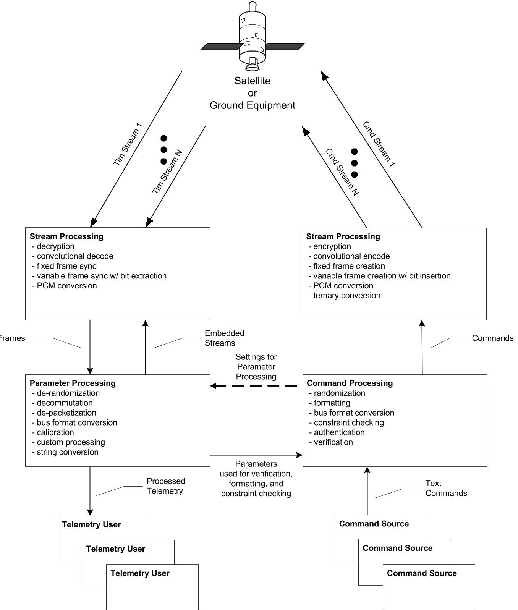
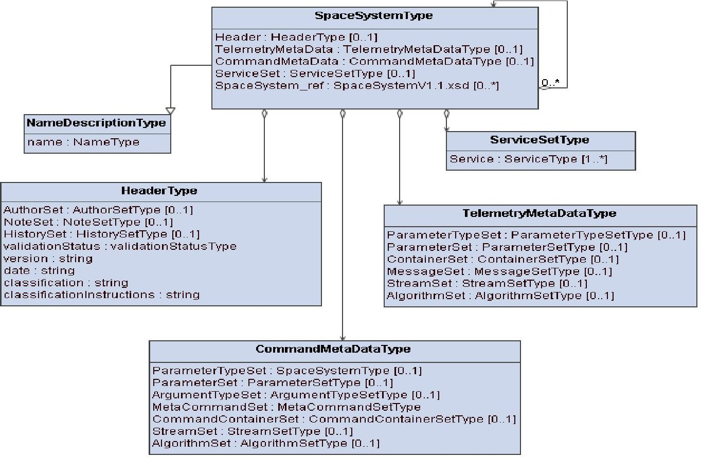
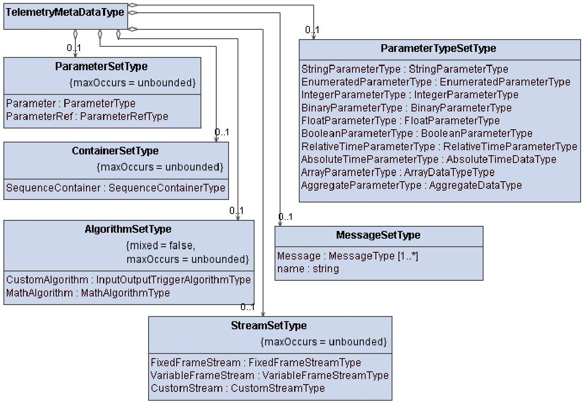
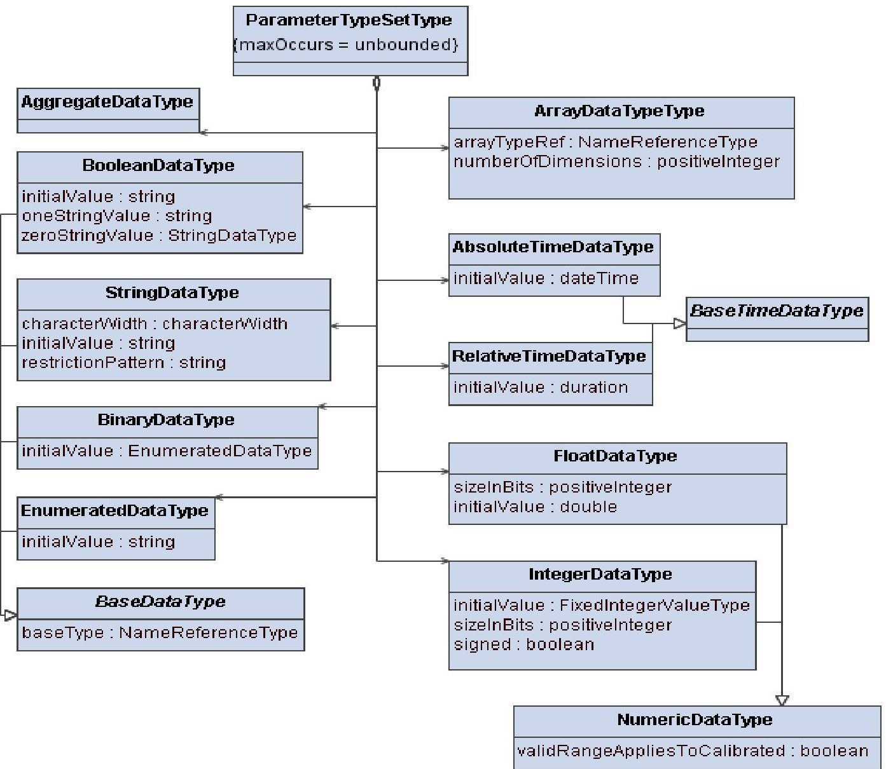
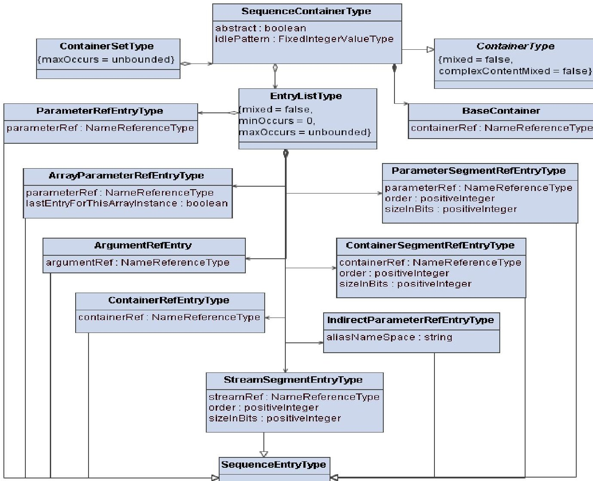
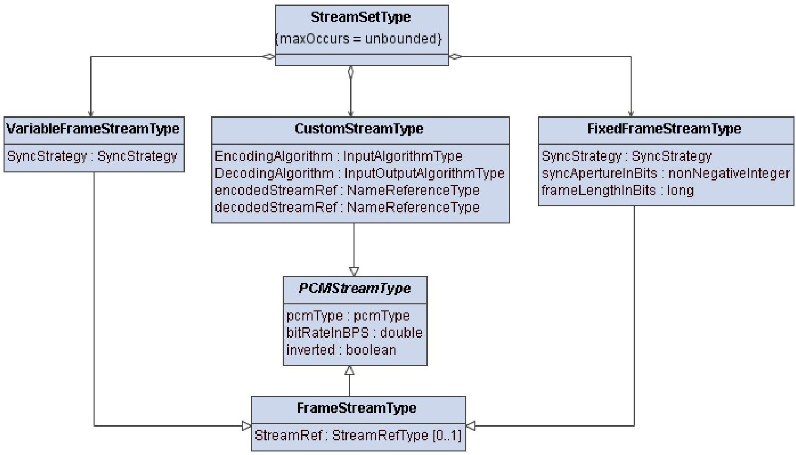
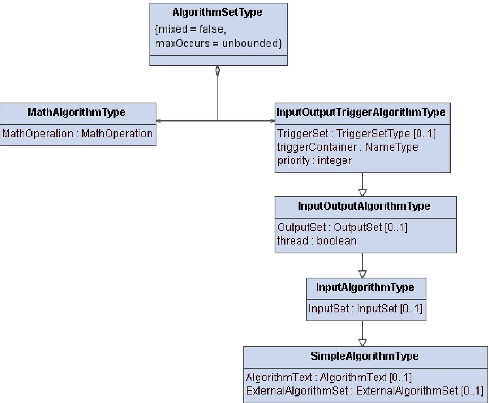
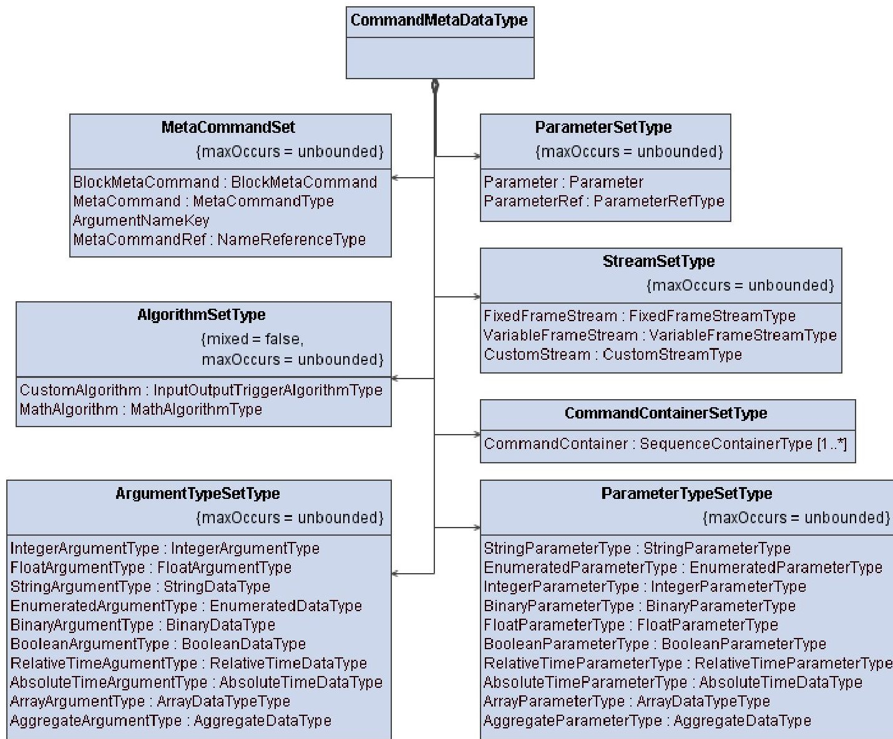
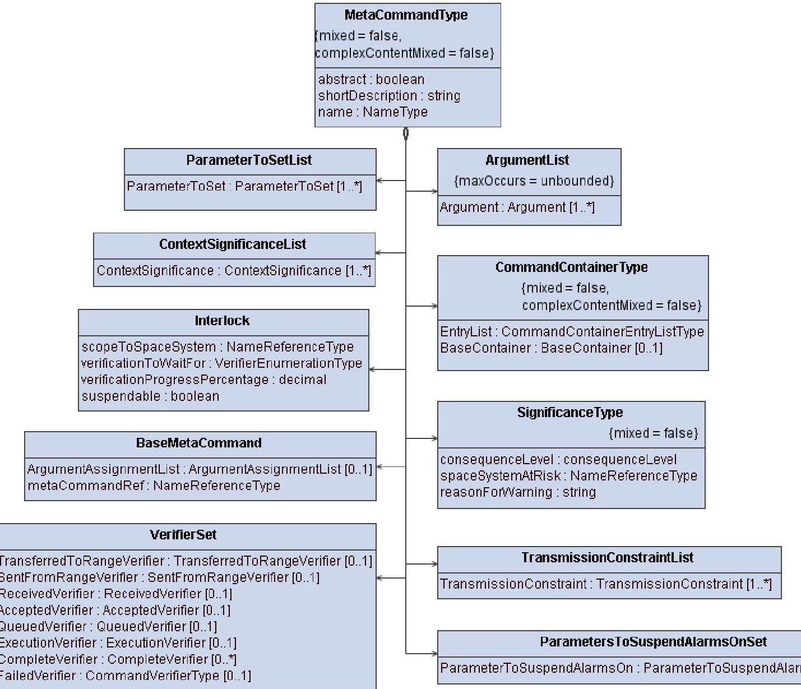
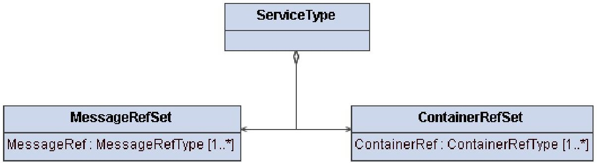

> Complete conversion of the archived source PDF, not an assertion of standard applicability or conformance.

<!-- PDF_PAGE: 1 -->

Recommendation for Space Data System Standards

XML TELEMETRIC AND COMMAND EXCHANGE VERSION 1.2

RECOMMENDED STANDARD

CCSDS 660.0-B-2

BLUE BOOK February 2020

<!-- PDF_PAGE: 2 -->

The Consultative Committee for Space Data Systems

Recommendation for Space Data System Standards

XML TELEMETRIC AND COMMAND EXCHANGE VERSION 1.2

## RECOMMENDED STANDARD

## CCSDS 660.0-B-2

BLUE BOOK February 2020

<!-- PDF_PAGE: 3 -->

## AUTHORITY

<table border="1"><tr><td>Issue:</td><td>Recommended Standard, Issue 2</td></tr><tr><td>Date:</td><td>February 2020</td></tr><tr><td>Location:</td><td>Washington, DC, USA</td></tr></table>

This document has been approved for publication by the Management Council of the Consultative Committee for Space Data Systems (CCSDS) and represents the consensus technical agreement of the participating CCSDS Member Agencies. The procedure for review and authorization of CCSDS documents is detailed in Organization and Processes for the Consultative Committee for Space Data Systems (CCSDS A02.1-Y-4), and the record of Agency participation in the authorization of this document can be obtained from the CCSDS Secretariat at the email address below.

This document is published and maintained by:

CCSDS Secretariat

National Aeronautics and Space Administration

Washington, DC, USA

Email: secretariat@mailman.ccsds.org

<!-- PDF_PAGE: 4 -->

# STATEMENT OF INTENT

The Consultative Committee for Space Data Systems (CCSDS) is an organization officially established by the management of its members. The Committee meets periodically to address data systems problems that are common to all participants, and to formulate sound technical solutions to these problems. Inasmuch as participation in the CCSDS is completely voluntary, the results of Committee actions are termed Recommended Standards and are not considered binding on any Agency.

This Recommended Standard is issued by, and represents the consensus of, the CCSDS members. Endorsement of this Recommendation is entirely voluntary. Endorsement, however, indicates the following understandings:

0 Whenever a member establishes a CCSDS-related standard, this standard will be in accord with the relevant Recommended Standard. Establishing such a standard does not preclude other provisions which a member may develop.

o Whenever a member establishes a CCSDS-related standard, that member will provide other CCSDS members with the following information:

-- The standard itself.

-- The anticipated date of initial operational capability.

-- The anticipated duration of operational service.

0 Specific service arrangements shall be made via memoranda of agreement. Neither this Recommended Standard nor any ensuing standard is a substitute for a memorandum of agreement.

No later than five years from its date of issuance, this Recommended Standard will be reviewed by the CCSDS to determine whether it should: (1) remain in effect without change; (2) be changed to reflect the impact of new technologies, new requirements, or new directions; or (3) be retired or canceled.

In those instances when a new version of a Recommended Standard is issued, existing CCSDS-related member standards and implementations are not negated or deemed to be non- CCSDS compatible. It is the responsibility of each member to determine when such standards or implementations are to be modified. Each member is, however, strongly encouraged to direct planning for its new standards and implementations towards the later version of the Recommended Standard.

<!-- PDF_PAGE: 5 -->

## FOREWORD

Attention is drawn to the possibility that some of the elements of this document may be the subject of patent rights. CCSDS has processes for identifying patent issues and for securing from the patent holder agreement that all licensing policies are reasonable and non-discriminatory. However, CCSDS does not have a patent law staff, and CCSDS shall not be held responsible for identifying any or all such patent rights.

Through the process of normal evolution, it is expected that expansion, deletion, or modification of this document may occur. This Recommended Standard is therefore subject to CCSDS document management and change control procedures, which are defined in Organization and Processes for the Consultative Committee for Space Data Systems (CCSDS A02.1-Y-4). Current versions of CCSDS documents are maintained at the CCSDS Web site:

## http://www.ccsds.org/

Questions relating to the contents or status of this document should be sent to the CCSDS Secretariat at the email address indicated on page i.

<!-- PDF_PAGE: 6 -->

At time of publication, the active Member and Observer Agencies of the CCSDS were:

## Member Agencies

- Agenzia Spaziale Italiana (ASI)/Italy.

- Canadian Space Agency (CSA)/Canada.

- Centre National d'Etudes Spatiales (CNES)/France.

- China National Space Administration (CNSA)/People's Republic of China.

- Deutsches Zentrum für Luft- und Raumfahrt (DLR)/Germany.

- European Space Agency (ESA)/Europe.

- Federal Space Agency (FSA)/Russian Federation.

- Instituto Nacional de Pesquisas Espaciais (INPE)/Brazil.

- Japan Aerospace Exploration Agency (JAXA)/Japan.

- National Aeronautics and Space Administration (NASA)/USA.

- UK Space Agency/United Kingdom.

## Observer Agencies

- Austrian Space Agency (ASA)/Austria.

- Belgian Federal Science Policy Office (BFSPO)/Belgium.

- Central Research Institute of Machine Building (TsNIIMash)/Russian Federation.

- China Satellite Launch and Tracking Control General, Beijing Institute of Tracking and Telecommunications Technology (CLTC/BITTT)/China.

- Chinese Academy of Sciences (CAS)/China.

- China Academy of Space Technology (CAST)/China.

- Commonwealth Scientific and Industrial Research Organization (CSIRO)/Australia.

- Danish National Space Center (DNSC)/Denmark.

- Departamento de Ciência e Tecnologia Aeroespacial (DCTA)/Brazil.

- Electronics and Telecommunications Research Institute (ETRI)/Korea.

- European Organization for the Exploitation of Meteorological Satellites (EUMETSAT)/Europe.

- European Telecommunications Satellite Organization (EUTELSAT)/Europe.

- Geo-Informatics and Space Technology Development Agency (GISTDA)/Thailand.

- Hellenic National Space Committee (HNSC)/Greece.

- Hellenic Space Agency (HSA)/Greece.

- Indian Space Research Organization (ISRO)/India.

- Institute of Space Research (IKI)/Russian Federation.

- Korea Aerospace Research Institute (KARI)/Korea.

- Ministry of Communications (MOC)/Israel.

- Mohammed Bin Rashid Space Centre (MBRSC)/United Arab Emirates.

- National Institute of Information and Communications Technology (NICT)/Japan.

- National Oceanic and Atmospheric Administration (NOAA)/USA.

- National Space Agency of the Republic of Kazakhstan (NSARK)/Kazakhstan.

- National Space Organization (NSPO)/Chinese Taipei.

- Naval Center for Space Technology (NCST)/USA.

- Research Institute for Particle & Nuclear Physics (KFKI)/Hungary.

- Scientific and Technological Research Council of Turkey (TUBITAK)/Turkey.

- South African National Space Agency (SANSA)/Republic of South Africa.

- Space and Upper Atmosphere Research Commission (SUPARCO)/Pakistan.

- Swedish Space Corporation (SSC)/Sweden.

- Swiss Space Office (SSO)/Switzerland.

- United States Geological Survey (USGS)/USA.

<!-- PDF_PAGE: 7 -->

## CCSDS RECOMMENDED STANDARD FOR XML TELEMETRIC AND COMMAND EXCHANGE

## DOCUMENT CONTROL

<table border="1"><tr><td>Document</td><td>Title</td><td>Date</td><td>Status</td></tr><tr><td>CCSDS660.0-B-1</td><td>XML Telemetric and CommandExchange(XTCE),RecommendedStandard,Issue1</td><td>October2007</td><td>Original issue,superseded</td></tr><tr><td>CCSDS660.0-B-2</td><td>XML Telemetric and CommandExchange—Version1.2,RecommendedStandard,Issue2</td><td>February2020</td><td>Current issue</td></tr></table>

<!-- PDF_PAGE: 8 -->

## CONTENTS

Section

Page

XML TELEMETRIC AND COMMAND EXCHANGE—VERSION 1.2...1

<!-- PDF_PAGE: 9 -->

An OMG $ ^{\circ} $XML Telemetric and Command Exchange $ ^{\mathrm{TM}} $Publication

OBJECT MANAGEMENT GROUP $ ^{\textcircled{R}} $

# XML Telemetric and Command Exchange

## Version 1.2

OMG Document Number: formal/18-10-04

Release Date: January 2019

Standard Document URL: https://www.omg.org/spec/XTCE/

Normative Machine Consumable File(s):

https://www.omg.org/spec/XTCE/20180204/SpaceSystem.xsd

<!-- PDF_PAGE: 10 -->

Copyright $ \textcircled{c} $ 2018, Boeing Satellite Systems

Copyright $ \textcircled{c} $ 2018, European Space Operations Centre

Copyright $ \textcircled{c} $ 2018, Lockheed Martin - Integrated Systems & Solutions

Copyright $ \textcircled{c} $ 2014-2018, Object Management Group, Inc.

## USE OF SPECIFICATION - TERMS, CONDITIONS & NOTICES

The material in this document details an Object Management Group specification in accordance with the terms, conditions and notices set forth below. This document does not represent a commitment to implement any portion of this specification in any company's products. The information contained in this document is subject to change without notice.

## LICENSES

The companies listed above have granted to the Object Management Group, Inc. (OMG) a nonexclusive, royalty-free, paid up, worldwide license to copy and distribute this document and to modify this document and distribute copies of the modified version. Each of the copyright holders listed above has agreed that no person shall be deemed to have infringed the copyright in the included material of any such copyright holder by reason of having used the specification set forth herein or having conformed any computer software to the specification.

Subject to all of the terms and conditions below, the owners of the copyright in this specification hereby grant you a fully-paid up, non-exclusive, nontransferable, perpetual, worldwide license (without the right to sublicense), to use this specification to create and distribute software and special purpose specifications that are based upon this specification, and to use, copy, and distribute this specification as provided under the Copyright Act; provided that: (1) both the copyright notice identified above and this permission notice appear on any copies of this specification; (2) the use of the specifications is for informational purposes and will not be copied or posted on any network computer or broadcast in any media and will not be otherwise resold or transferred for commercial purposes; and (3) no modifications are made to this specification. This limited permission automatically terminates without notice if you breach any of these terms or conditions. Upon termination, you will destroy immediately any copies of the specifications in your possession or control.

## PATENTS

The attention of adopters is directed to the possibility that compliance with or adoption of OMG specifications may require use of an invention covered by patent rights. OMG shall not be responsible for identifying patents for which a license may be required by any OMG specification, or for conducting legal inquiries into the legal validity or scope of those patents that are brought to its attention. OMG specifications are prospective and advisory only. Prospective users are responsible for protecting themselves against liability for infringement of patents.

## GENERAL USE RESTRICTIONS

Any unauthorized use of this specification may violate copyright laws, trademark laws, and communications regulations and statutes. This document contains information which is protected by copyright. All Rights Reserved. No part of this work covered by copyright herein may be reproduced or used in any form or by any means--graphic, electronic, or mechanical, including photocopying, recording, taping, or information storage and retrieval systems--without permission of the copyright owner.

<!-- PDF_PAGE: 11 -->

## DISCLAIMER OF WARRANTY

WHILE THIS PUBLICATION IS BELIEVED TO BE ACCURATE, IT IS PROVIDED "AS IS" AND MAY CONTAIN ERRORS OR MISPRINTS. THE OBJECT MANAGEMENT GROUP AND THE COMPANIES LISTED ABOVE MAKE NO WARRANTY OF ANY KIND, EXPRESS OR IMPLIED, WITH REGARD TO THIS PUBLICATION, INCLUDING BUT NOT LIMITED TO ANY WARRANTY OF TITLE OR OWNERSHIP, IMPLIED WARRANTY OF MERCHANTABILITY OR WARRANTY OF FITNESS FOR A PARTICULAR PURPOSE OR USE. IN NO EVENT SHALL THE OBJECT MANAGEMENT GROUP OR ANY OF THE COMPANIES LISTED ABOVE BE LIABLE FOR ERRORS CONTAINED HEREIN OR FOR DIRECT, INDIRECT, INCIDENTAL, SPECIAL, CONSEQUENTIAL, RELIANCE OR COVER DAMAGES, INCLUDING LOSS OF PROFITS, REVENUE, DATA OR USE, INCURRED BY ANY USER OR ANY THIRD PARTY IN CONNECTION WITH THE FURNISHING, PERFORMANCE, OR USE OF THIS MATERIAL, EVEN IF ADVISED OF THE POSSIBILITY OF SUCH DAMAGES.

The entire risk as to the quality and performance of software developed using this specification is borne by you. This disclaimer of warranty constitutes an essential part of the license granted to you to use this specification.

## RESTRICTED RIGHTS LEGEND

Use, duplication or disclosure by the U.S. Government is subject to the restrictions set forth in subparagraph (c) (1) (ii) of The Rights in Technical Data and Computer Software Clause at DFARS 252.227-7013 or in subparagraph (c)(1) and (2) of the Commercial Computer Software - Restricted Rights clauses at 48 C.F.R. 52.227-19 or as specified in 48 C.F.R. 227-7202-2 of the DoD F.A.R. Supplement and its successors, or as specified in 48 C.F.R. 12.212 of the Federal Acquisition Regulations and its successors, as applicable. The specification copyright owners are as indicated above and may be contacted through the Object Management Group, 109 Highland Avenue, Needham, MA 02494, U.S.A.

## TRADEMARKS

CORBA $ ^{\circ} $ , CORBA logos $ ^{\circ} $ , FIBO $ ^{\circ} $ , Financial Industry Business Ontology $ ^{\circ} $ , FINANCIAL INSTRUMENT GLOBAL IDENTIFIER $ ^{\circ} $ , IIOP $ ^{\circ} $ , IMM $ ^{\circ} $ , Model Driven Architecture $ ^{\circ} $ , MDA $ ^{\circ} $ , Object Management Group $ ^{\circ} $ , OMG $ ^{\circ} $ , OMG Logo $ ^{\circ} $ , SoaML $ ^{\circ} $ , SOAML $ ^{\circ} $ , SysML $ ^{\circ} $ , UAF $ ^{\circ} $ , Unified Modeling Language $ ^{\circ} $ , UML $ ^{\circ} $ , UML Cube Logo $ ^{\circ} $ , VSIPL $ ^{\circ} $ , and XMI $ ^{\circ} $ are registered trademarks of the Object Management Group, Inc.

For a complete list of trademarks, see: http://www.omg.org/legal/tm_list.htm. All other products or company names mentioned are used for identification purposes only, and may be trademarks of their respective owners.

## COMPLIANCE

The copyright holders listed above acknowledge that the Object Management Group (acting itself or through its designees) is and shall at all times be the sole entity that may authorize developers, suppliers and sellers of computer software to use certification marks, trademarks or other special designations to indicate compliance with these materials.

Software developed under the terms of this license may claim compliance or conformance with this specification if and only if the software compliance is of a nature fully matching the applicable compliance points as stated in the specification. Software developed only partially matching the applicable compliance points may claim only that the software was based on this specification, but may not claim compliance or conformance with this specification. In the event that testing suites are implemented or approved by Object Management Group, Inc., software developed using this specification may claim compliance or conformance with the specification only if the software satisfactorily completes the testing suites.

XML Telemetric and Command Exchange, v1.2

<!-- PDF_PAGE: 12 -->

## OMG's Issue Reporting Procedure

All OMG specifications are subject to continuous review and improvement. As part of this process we encourage readers to report any ambiguities, inconsistencies, or inaccuracies they may find by completing the Issue Reporting Form listed on the main web page https://www.omg.org, under OMG Specifications, Report an Issue.

<!-- PDF_PAGE: 13 -->

## Table of Contents

1 Scope...1

2 Conformance...1

3 References...1

4 Terms and Definitions...2

5 Symbols (and abbreviated terms)...2

6 The Specification...5

6.1 The Root Object – The SpaceSystem...5

6.1.1 The Header Record...6

6.1.2 TelemetryMetadata...6

6.1.3 CommandMetaData...12

6.1.4 ServiceSet...16

6.2 Common Types...16

6.2.1 MatchCriteria...16

6.2.2 Polynomial...16

6.2.3 Unit...16

6.3 The Schema...16

<!-- PDF_PAGE: 14 -->

## Preface

## OMG

Founded in 1989, the Object Management Group, Inc. (OMG) is an open membership, not-for-profit computer industry standards consortium that produces and maintains computer industry specifications for interoperable, portable, and reusable enterprise applications in distributed, heterogeneous environments. Membership includes Information Technology vendors, end users, government agencies, and academia.

OMG member companies write, adopt, and maintain its specifications following a mature, open process. OMG's specifications implement the Model Driven Architecture $ ^{\circledR} $ (MDA $ ^{\circledR} $ ), maximizing ROI through a full lifecycle approach to enterprise integration that covers multiple operating systems, programming languages, middleware and networking infrastructures, and software development environments. OMG's specifications include: UML $ ^{\circledR} $ (Unified Modeling Language $ ^{\circledR} $ ); CORBA $ ^{\circledR} $ (Common Object Request Broker Architecture); CWM $ ^{\mathrm{TM}} $ (Common Warehouse Metamodel $ ^{\mathrm{TM}} $ ); and industry-specific standards for dozens of vertical markets.

More information on the OMG is available at https://www.omg.org/.

## OMG Specifications

As noted, OMG specifications address middleware, modeling and vertical domain frameworks. All OMG Specifications are available from the OMG website at:

https://www.omg.org/spec

All of OMG's formal specifications may be downloaded without charge from our website. (Products implementing OMG specifications are available from individual suppliers.) Copies of specifications, available in PostScript and PDF format, may be obtained from the Specifications Catalog cited above or by contacting the Object Management Group, Inc. at:

OMG Headquarters 109 Highland Avenue Needham, MA 02494 USA

Tel: +1-781-444-0404

Fax: +1-781-444-0320

Email: pubs@omg.org

Certain OMG specifications are also available as ISO standards. Please consult http://www.iso.org

## Issues

The reader is encouraged to report any technical or editing issues/problems with this specification via the report form at the OMG main page, under OMG Specifications, Report an Issue.

<!-- PDF_PAGE: 15 -->

## Foreword

This XML Telemetric and Command Exchange (XTCE) data specification presents a robust information model and data exchange format for telemetry and commanding in all phases of the spacecraft, payload, and ground segment lifecycle: system design, development, test, validation, and mission operations.

This specification addresses a compelling need for a standard exchange format recognized independently by each of its authors and contributors. Lockheed Martin, ESA, Boeing, NASA GSFC, USAF SMC, Harris, Raytheon, SciSys, CSC and GST have all made significant contributions representing a wide and varied sampling of the space industry.

Space mission implementations face a very dynamic environment with fast-paced information technology advancement and shrinking space budgets. A more focused use of decreasing public investments in space requires a cost reduction over their entire lifecycle, from development up to the end of the useful life of a spacecraft. The use of standards specifications from the early stages of satellite development through mission operation will reduce life-cycle cost.

The XTCE specification is intended to provide a robust international standard for data exchange, one that can be easily become a central element in a simplified contract to Space System providers for Telemetry and Command definition - from simple space components to entire constellations.

Satellite design and development is performed today through the use of a number of disparate tools and techniques. The interface design for spacecraft systems and spacecraft payloads is still a manual and time-consuming effort. Data design, both telemetry and commanding, is still performed multiple times by multiple contractors during the lifecycle of the satellite - well before the satellite is ever deployed for mission operations. The standardization of satellite telemetry and command data for spacecraft health and safety, as well as payload interfaces, will reduce the cost of these implementations as well as decrease the schedule of development, integration, and test of the satellite and its component systems. This specification can also be used to support multiple, heterogeneous missions, facilitating interoperability between ground control systems, simulators, testing facilities, and other types of spacesystems.

## Introduction

Purpose: This specification is an information model for spacecraft telemetry and commanding data. For a given mission there are a number of lifecycle phases that are supported by a variety of systems and organizations. Additionally, many of these organizations support multiple heterogeneous missions using a common ground segment infrastructure. Telemetry and command definitions must be exchanged among all of these phases, systems, and organizations. This is made difficult and costly because there is no standard format for exchanging this information. The lack of standardization currently requires custom ingestion of the telemetry and commanding information. This customization is inherently error-prone, resulting in the need to revalidate the definitions at each step in the lifecycle.

A typical example of this process is between the spacecraft manufacturer and spacecraft-operating agency. The spacecraft manufacturer defines the telemetry and command data in a format that is much different than the one used in the ground segment. This creates the need for database translation, increased testing, software customization, and increased probability of error. Standardization of the command and telemetry data definition format will streamline the process allowing dissimilar systems to communicate without the need for the development of mission specific database import/export tools.

Ideally, a spacecraft operator should be able to transition a spacecraft mission from one ground system to another by simply moving an already existing command and telemetry database compliant with this

<!-- PDF_PAGE: 16 -->

specification to another ground system which equally supports this specification. In addition, standardization will enable space or ground segment simulators to more easily support multiple heterogeneous missions.

The XTCE specification provides a standard format for defining the Telemetric and Telecommand (TM/TC) data required to perform the processing shown in Figure 1.

Overview: The normative portion of this specification is presented as a single XML schema compliant with the W3C recommendation of May 2, 2001. The schema is found in Annex A or may be obtained as an independent convenience document.

The schema has an object-oriented structure where all the elements of this specification belong to a single root object - the SpaceSystem.

Philosophy: The space industry is currently divided between Packet telemetry and commanding and Time Division Multiplexing (TDM) telemetry and commanding. While the basic construction of either TDM or packet telemetry is fundamentally similar, nomenclature differences between the two give the appearance of a larger divide. The XTCE specification avoids using nomenclature from either the TDM or Packet worlds to avoid any possible confusion; terms like 'minor frame', 'major frame', or 'packet' are nowhere in this specification other than in examples. Furthermore, the XTCE specification does not itself use any existing Packet or TDM standards (such as CCSDS packet formats, or IRIG-106 minor frame dxestandards), but it does provide a mechanism to use XTCE to build libraries of available containers that represent these standards.

<!-- PDF_PAGE: 17 -->

Figure 1 - Telemetric and Command Processing Meta Data Encapsulated in XTCE XML

<!-- PDF_PAGE: 18 -->

This page intentionally left blank.

<!-- PDF_PAGE: 19 -->

## 1 Scope

This specification addresses the need for a standardized information model capable of supporting Telemetry/Telecommand (TM/TC) definitions across the widest possible range of space domain activities. The goal is to allow TM/TC definitions to be exchanged between different organizations and systems, often at the boundaries of mission phases, without the need for customized import/export, re-validation, or even re-implementation of mission databases.

The scope of this specification is limited to the satellite telemetry and commanding meta-data constructs necessary to perform satellite and payload data processing. This specification includes the meta-data needed to:

- Define the structure and sequence of both CCSDS packets and TDM frames.

- Define the data manipulation required for packaging and unpacking of individual data items.

- Describe command data including command identification, argument specification, and validation criteria.

- Define parameter and command encoding.

- Define data properties including including default values, validity criteria, and data dependencies.

The scope of this specification does not extend to:

- Data distribution mechanisms or rules

- Command and data protocol specifications

- RF or analog stream characterization

- Data grouping including aggregation and coherent data sets

- Data representation (visualization properties)

- Scheduling configuration properties

- Orbital properties

- Displays

- Flight Software

This specification addresses only the definition of TM/TC data, but is not a specification for the transfer of live or historical TM/TC data - this is a meta-data specification, not a data specification.

## 2 Conformance

The Schema (.xsd file) in Annex A is normative. A compliant database is an XML file that complies with this schema. Fully compliant implementing software will interpret and/or generate any databases compliant with this specification. Compliant implementing software will interpret and/or generate all database elements required by the schema.

## 3 References

The following normative documents contain provisions which, through reference in this text, constitute provisions of this specification. For dated references, subsequent amendments to, or revisions of, any of these publications do not apply.

W3C Recommendation - Extensible Markup Language (XML) 1.0 (Second Edition, 6 October 2000) http://www.w3.org/TR/REC-xml

<!-- PDF_PAGE: 20 -->

<table border="1"><tr><td>W3C Recommendation-XML Schema Part 0: Primer(2 May 2001)</td><td>http://www.w3.org/TR/xmlschema-0/</td></tr><tr><td>W3C Recommendation-XML Schema Part 1: Structures(2 May 2001)</td><td>http://www.w3.org/TR/xmlschema-1/</td></tr><tr><td>W3C Recommendation-XML Schema Part 2: Datatypes(2 May 2001)</td><td>http://www.w3.org/TR/xmlschema-2/</td></tr></table>

## 4 Terms and Definitions

For the purposes of this specification, the following terms and definitions apply.

## Telemetering

(IEEE Std 100-1996 [1996]) "Measurement with the aid of intermediate means that permit the measurement to be interpreted at a distance from the primary detector." Measurements on board the spacecraft are transmitted via one or more telemetry streams to spacecraft monitoring systems. Telemetry as used here refers to these measurements originating from both the spacecraft and from systems (such as ground system components) used to support the spacecraft. Most telemetry measurements will require engineering unit conversion and measurements will have associated validation ranges or lists of acceptable values.

## Commands

Commands are messages which initiate actions on a remote system. Commands as used here may mean both commands destined for the spacecraft and to the systems used to support the spacecraft. Spacecraft commanding usually implies coding and packaging of the command information, validation and verification, as well as authorization to perform. Telemetry and Commanding data are necessarily related to one another, with some command information originating from telemetry and commands relating to particular telemetry measurements. Therefore, the ability to relate individual telemetry with one another and to commands is a very important part of this specification.

## 5 Symbols (and abbreviated terms)

## List of symbols/abbreviations

In general, the XTCE specification favors expressive, fully spelled out terms over abbreviated notation. The exceptions are modifiers used as prefixes or postfixes to objects used within the schema, and of course 'XTCE' the name of the standard itself. These terms are listed below.

Abbreviations:

DOM - Document Object Model

Parm - Is an abbreviation sometimes used for Parameter

XTCE - XML Telemetric and Command Exchange format

Prefixes and Postfixes:

Meta - Is a description; For example a MetaCommand is a command description.

PCM - Pulse Code Modulation.

Set—An unordered collection; for example a MetaCommandSet is an unordered collection of command descriptions.

List -an ordered collection, for example an ArgumentList is an ordered collection of arguments.

<!-- PDF_PAGE: 21 -->

Ref-A reference (by name) to an object defined elsewhere in the XML document. For example an ArgumentRef is a named reference to an Argument defined elsewhere.

SAX - Simple API for XML

TDM - Time Division Multiplexed

UCS - Universal Character Set

UTF - UCS Transformation Format

W3C - World Wide Web Consortium

<!-- PDF_PAGE: 22 -->

This page intentionally left blank

<!-- PDF_PAGE: 23 -->

## 6 The Specification

## 6.1 The Root Object - The SpaceSystem

Recognizing that spacecraft operations involve much more than simply controlling the spacecraft, the top-level object is not 'Spacecraft' but the more generic term 'SpaceSystem'. This name reflects that a spacecraft operations center must control antennas, recorders, ground processing equipment, RF hardware and many other assets that may use this data specification; each of these objects is a 'SpaceSystem'. A SpaceSystem, like all of the major objects in an XTCE database, may have a short description, a long description (that may contain HTML markup documentation), and a list of alias names. A SpaceSystem may have a Header, zero or more sub-SpaceSystems, CommandMetaData and TelemetryMetaData. The CommandMetaData and TelemetryMetaData components provide boundaries for command mata-data and telemetry meta-data. The SpaceSystems (as are many other XTCE Schema Types) are types of NameDescription. A NameDescription simply contains useful descriptive information about the objects. SpaceSystem may contain sub-SpaceSystems, thereby giving the data a hierarchical structure.

## Note on the sub-SpaceSystem and the hierarchical structure

Because a SpaceSystem may itself contain other SpaceSystems, the data may also have a hierarchical structure similar to the structure of a real space system. The hierarchical organization offers several important advantages over a flat entity list:

- Fewer name space collisions - Almost every spacecraft contains redundant components for reliability or to accomplish the mission. A communications spacecraft may have a dozen transponders each with the same set of telemetry points and commands. In a flat namespace each of those telemetry points needs to be mapped into a unique name. Using a hierarchical namespace, those identical telemetry points can be simply placed into separate sub-SpaceSystems.

- Better organization - modern spacecraft typically have thousands of commands and tens of thousands of telemetry parameters; this number is trending upward. The directory structure provided by this specification provides an improved way to manage this large volume of data. Each subsystem developer can deliver SpaceSystems representing their subsystem without integration issues.

- Spacecraft, which are normally thought of as a SpaceSystem may actually be sub-SpaceSystems for a constellation of spacecraft SpaceSystems.

- Natural hierarchy - spacecraft designs are increasing in complexity and are normally comprised of systems of systems. The hierarchical organization allowed by a directory structure reflects this.

## Note on Names

Parameter, and MetaCommand and other major entity names within this database may be any length but may only contain numeric, a-z letters, underscores, hyphens, or backslashes. The characters '/', '.', [', ']' and ':' are expressly reserved. The '/' is used as the SpaceSystem separator (Unix and HTTP style). The ':' is reserved for future use as a selector for data from other SpaceSystems. The '.' is used to select members of aggregate Parameters and Argurments. The square brackets are reserved for array indexes. Names are case sensitive.

<!-- PDF_PAGE: 24 -->

Figure 2 - SpaceSystem UML Class Diagram[1]

[1] 'AnonymousType' is used in the UML whenever a new complexType is generated inside an Element definition (without a named ComplexType).

## 6.1.1 The Header Record

A SpaceSystem may contain an optional header record. This record contains some basic context on the data itself (e.g., source, version, revision history, notes, and classification).

## 6.1.2 TelemetryMetadata

Because Telemetry and Command databases are frequently developed and maintained independently, the XTCE format divides TelemetryMetaData and CommandMetaData into separate, but similar sections. TelemetryMetaData is really nothing more than a grouping for data about Telemetry. TelemetryMetaData has a ParameterTypeSet, a ParameterSet, a ContainerSet, a MessageSet, a StreamSet, and an AlgorithmSet. Following are descriptions of these collection types.

<!-- PDF_PAGE: 25 -->

Figure 3 - Telemetry MetaData UML Class Diagram

## 6.1.2.1 ParameterTypeSet

A ParameterTypeSet is an unordered collection of ParameterTypes. ParameterTypes are the MetaData for Parameters; ParameterTypes are instantiated to create Parameters. ParameterType is the description of something that can have a value (a Parameter). Information contained in ParameterType includes the data type, description, alarm limits, engineering units and string conversion 'ToString' specifications. Parameters may be of variable length. Most Parameters are telemetered parameters (a.k.a measurands) and must also include information about how the Parameter value is encoded for transmission. This information includes size in bits, byte order, data type, calibrations and parity checks. All of the encoding information is in one of four different 'DataEncoding' elements. XTCE supports four different types of encodings:

IntegerDataEncoding: specifies the bit order, size in bits, the encoding (unsigned, signMagnitude, twosCompliment, onesCompliment, BCD, or packedBCD). The byte order in the case of multi byte integers can also be specified, along with error detection (CRC or Parity checks).

FloatDataEncoding: specifies the bit order, size in bits, the encoding (IEEE754_1985 or MILSTD_1750A). The byte order in the case of multi byte floats can also be specified, along with error detection (CRC or Parity checks).

StringEncoding: specifies the bit order, the encoding (UTF-8 or UTF-16), the size in bits or variable size determined by either a termination character, or a leading size parameter, along with error detection (CRC or Parity checks).

BinaryDataEncoding: specifies the bit order, the size in bits, and two algorithms to convert to and from the endcode value, along with error detection (CRC and Parity checks).

<!-- PDF_PAGE: 26 -->

The DataEncodingType element that can be specified for a ParameterType defines the transmission characteristics of the associated Parameters, not how each Parameter is stored on the SpaceSystem or the ground. The ParameterType attributes, e.g., width, sizeInBits, provide hints on the precision required to store the data, but formats native to the ground system may be used and may be larger than the specified characteristics.

Figure 4 presents the UML representation of the Parameter Type Set, and therefore all available data types. Encoding data types are children of these elements and not depicted in that figure.

Figure 4 - ParameterTypeSet UML Class Diagram

## 6.1.2.2 ParameterSet

A ParameterSet is an unordered collection of Parameters and ParameterRefs. Parameters are instantiations of ParameterTypes. Parameters are normally a very simple name and reference to a ParameterType. Parameters may also have alias names and may have properties unique to that instantiation. At any point in time (instance) a Parameter has a value; a Parameter is not the value itself. Parameter names follow the same naming rules as for SpaceSystems. The

<!-- PDF_PAGE: 27 -->

aliases have no restrictions. The sub-element ParameterRef inside of ParameterSet refers to a previously defined Parameter definition in another ParameterSet.

## 6.1.2.3 ContainerSet

A ContainerSet is an unordered collection of SequenceContainers. A SequenceContainer may represent a packet, frame, a subframe, or any other grouping/structure of data items. The simple form of a Sequence element is an ordered set of Parameter References or other Container References. A SequenceContainer contains (in the EntryList) an ordered list of raw parameters, parameter segments, stream segments, other containers, or container segments. Figure 5 is the Container UML class diagram.

## 6.1.2.3.1 BaseContainer

SequenceContainers may inherit from other sequence containers by pointing to the parent container using the BaseContainer element. The inheritance aspect of SequenceContainers is useful not only for minimizing the effort required to describe a family of SequenceContainers, but is also a powerful and expressive means of container identification - the process of distinguishing one container from others (e.g. minorFrame 20 is a type of minorFrame where the minor frame counter equals 20). RestrictionCriteria in the BaseContainer element is used as a constraint to identify a SequenceContainer subtype from its BaseContainer. In the example above, the RestrictionCriteria is minor frame counter equals 20. RestrictionCriteria is a type of MatchCriteria. SequenceContainer inheritance may be arbitrarily deep.

Figure 5 - Container UML Class Diagram

<!-- PDF_PAGE: 28 -->

A SequenceContainer may represent a packet, a frame, a sub-frame or any other grouping/structure of data items. The simple form of a Sequence element is an ordered set of Parameter References or other Container References.

## 6.1.2.4 MessageSet

A MessageSet is an unordered collection of Messages. Messages are an alternative method of uniquely identifying containers within a Service. A message provides a test in the form of MatchCriteria to match to a container. A Match Criteria is a simple or complex comparison of elements in a container against preset values. A simple example might be: When minorframeID=21, the message is the 21st minorframe container. The collection of messages to search through will be bound by a Service. A service is a set of messages and/or containers used to filter containers. This mechanism can be used to sort containers, for instance all containers with a field X equal to a supplied value will be given the name of a service. These containers will be found according to a generic container or a message (the message itself refers to a container).

## 6.1.2.5 StreamSet

A StreamSet is an unordered collection of Streams. Spacecraft uplinks and spacecraft downlinks are digital streams of data and there are a number of processing functions that are done on the stream level. The StreamSet in a SpaceSystem XTCE document can contain all of the information on how to assemble, disassemble and process spacecraft uplink and downlink streams for that SpaceSystem. There are three possible Streams types: VariableFrameStream for streams containing variable length streams, FixedFrameStream for streams containing fixed length streams and a custom stream that can be used to define any other kind of stream needed (The name of a Custom Algorithms are given for processing these streams).

Figure 6 - StreamSet UML Class Diagram

<!-- PDF_PAGE: 29 -->

## 6.1.2.6 AlgorithmSet

An AlgorithmSet is an unordered collection of Algorithms. In spacecraft ground systems, it is necessary to perform some specialized processing to process the telemetry, and preprocess commands. There are a number of predefined algorithms and the algorithm section makes it possible to reference externally defined algorithms for arbitrarily sophisticated data processing.

## 6.1.2.6.1 MathAlgorithm

A Math Algorithm is a simple mathematical operation with two operands (each of which may be a fixed or a parameter instance value) and an operand.

## 6.1.2.6.2 SimpleAlgorithm

A simple algorithm only has an optional Algorithm Text (for pseudo code) and Set of names to external algorithms (which be really be Java class files, DLLs, scripts, etc.). There is a set of external algorithms so one XTCE file can be used across multiple platforms.

## 6.1.2.6.3 InputAlgorithm

An InputAlgorithm is a type of SimpleAlgorithm that also has a set of inputs. These inputs may be named Parameter Instances or constants.

## 6.1.2.6.4 InputOutputAlgorithm

An InputOutputAlgorighm is a type of InputAlgorithm that also has a set of outputs. These outputs are named ParameterRefs.

## 6.1.2.6.5 InputOutputTriggerAlgorithm

An InputOutputTriggerAlgorithm is a type of InputOutputAlgorithm that also has a set of Triggers. Triggers are used to 'fire' the algorithm and may be either periodic, or event based (new parameter or container instance).

<!-- PDF_PAGE: 30 -->

Figure 7 - AlgorithmSet UML Class Diagram

## 6.1.3 CommandMetaData

The CommandMetaData element is very similar to TelemetryMetaData, but also contains information that is specific only to commanding. CommandMetaData has a ParameterTypeSet, a ParameterSet, a ContainerSet, a StreamSet, and an AlgorithmSet. CommandMetaData also has an ArgumentTypeSet and a MetaCommandSet.

Parameters are scoped to the Space System basis, so elements defined in the telemetry part can be reused in the command part and vice versa.

<!-- PDF_PAGE: 31 -->

Figure 8 - CommandMetaData UML Class Diagram

## 6.1.3.1 ArgumentTypeSet

ArgumentTypes serve the same function for Arguments as ParameterTypes to Parameters and are closely related, both in terms of content and function: a command argument must also have an ArgumentType defined in the command ArgumentTypeSet area.

An ArgumentTypeSet is an unordered collection of ArgumentTypes. ArgumentTypes (very similar to ParameterTypes) are the MetaData for Command Arguments; ArgumentTypes are instantiated to create Arguments. ArgumentType contains the description of something that can have a value and is used as an operator supplied option to a Command (Command Argument). Information contained in ArgumentType includes the argument's data type, description, valid range, engineering units and string conversion specifications and calibrations. Most Arguments are sent via a data link and must also include information about how the value is encoded for transmission. This information includes size in bits, byte order, data type, and parity checks. All of the encoding information in ArgumentType is in one of four different DataEncoding elements. XTCE supports four different types of DataEncodings: IntegerDataEncoding, FloatDataEncoding, StringEncoding and BinaryDataEncoding. Note that the data encoding element only speaks to how the Command argument is transmitted, not how it is handled on the SpaceSystem or ground.

<!-- PDF_PAGE: 32 -->

## 6.1.3.2 MetaCommandSet

A MetaCommandSet contains an unordered collection of MetaCommands. MetaCommands are descriptions of commands. MetaCommands have a name, a BaseMetaCommand, an ArgumentList, a CommandContainer, a TransmissionConstraintList, a DefaultSignificance, a ContextSignificanceList, a ParametersToSuspendAlarmsOnList, an Interlock, Verifiers, and a ParameterToSetList.

Figure 9 - MetaCommandType UML Class Diagram

## 6.1.3.2.1 BaseMetaCommand

The MetaCommand is derived from this BaseMetaCommand. Arguments of the BaseMetaCommand are inherited by this MetaCommand, and may be further specified in this MetaCommand.

## 6.1.3.2.2 ArgumentList

An ArgumentList is an ordered collection of Arguments. Many commands have one or more options. These are called command arguments. Command arguments may be of any of the standard data types. MetaCommand arguments are

<!-- PDF_PAGE: 33 -->

local to the MetaCommand. In XTCE, command arguments are variable inputs to a command either supplied by an operator or automation software.

## 6.1.3.2.3 CommandContainer

A Command Container tells how to package this command and is very similar to a Telemetry SequenceContainer. CommandContainers, however, may also have arguments and fixed values in the sequence. Each MetaCommand may have one CommandContainer. CommandContainers may also be constructed using inheritance. Just like SequenceContainers, the function of RestrictionCriteria is to constrain the values of one or more entries from the parent Container.

## 6.1.3.2.4 TransmissionConstraintList

TransmissionConstraintList is an ordered list of TransmissionConstraints. A CommandTransmission constraint is used to check that the command can be run in the current operating mode and may block the transmission of the command if the constraint condition is true. The TransmissionConstraint element uses the MatchCriteria Schema Type to determine if the Constraint is in effect or not. The MatchCriteria allows one to set up comparisons between parameters and expected values, or define a customAlgorithm for the comparison.

## 6.1.3.2.5 DefaultSignificance and ContextSignificanceList

Some Command and Control Systems may require special user access confirmations before transmitting commands with certain levels. The Significance includes the name of the SpaceSystem at risk, and a significance level. MetaCommands will also inherit any Significance defined in the Base MetaCommand. Significance levels are: none, watch, warning, distress, critical and severe. Additionally, it is possible to change or have different significance levels set as driven by the operating context of the SpaceSystem.

## 6.1.3.2.6 ParametersToSuspendAlarmsSet

Sometimes it is necessary to suspend alarms - particularly 'change' alarms for commands that will change the value of a Parameter. Each Parameter in the list will have all its alarms suspended for the given suspension time starting after the given verifier occurs.

The attributes for ParameterToSuspendAlarmsOn specify a time to suspend (suspenseTime), and the 'state' of the command which will cause the suspension to occur (verifierToTriggerOn).

## 6.1.3.2.7 Interlock

An Interlock is a type of Constraint, but not on Command instances of this MetaCommand; Interlocks apply instead to any Commands that may follow instances this MetaCommand. An Interlock will block successive commands until this command has reached a certain stage (through verifications). Interlocks are scoped to a SpaceSystem basis.

## 6.1.3.2.8 Verifiers

A Command Verifier is a conditional check on the telemetry from a SpaceSystem that that provides positive indication on the processing state of a command. There are eight different verifiers each associated with difference states in command processing: TransferredToRange, TransferredFromRange, Received, Accepted, Queued, Execution, Complete, and Failed. There may be multiple 'complete' verifiers. 'Complete' verifiers are added to the Base MetaCommand 'Complete' verifier list. All others will override a verifier defined in a Base MetaCommand.

## 6.1.3.2.9 ParameterToSetList

The ParameterToSetList is an ordered collection of ParametersToSet. A ParameterToSet is a Parameter whose value will be set after the Command has reached a certain state as determined by the MetaCommand verifiers. New Parameters to Set are appended to the Base Command list.

<!-- PDF_PAGE: 34 -->

## 6.1.4 ServiceSet

ServiceSet is an unordered collection of Services. A service is a logical grouping of containers and/or messages.

Figure 10 - ServiceType UML Class Diagram

Services allow one to logically group XTCE containers. For example, your SpaceSystem may have a 'memory dump service' and all the XTCE containers associated with that 'service' may be grouped by listing them in a 'service'.

The ServiceType allows one to specify Messages or Containers. Note that these two are related but separate in this entity. In XTCE Messages are constructed using aggregate techniques, whereas if Containers are specified here they should be the one's associated with inheritance.

Services are optional and may not be useful for your SpaceSystem.

## 6.2 Common Types

There are a number of Common data types used throughout the schema.

## 6.2.1 MatchCriteria

Contains either a simple Comparison, a ComparisonList, an arbitrarily complex BooleanExpression or an escape to an externally defined algorithm.

## 6.2.2 Polynomial

This is simply a polynomial expression. For example: 3+2x.

## 6.2.3 Unit

Unit is used to hold the unit(s) plus possibly the exponent and factor for each of the units.

## 6.3 The Schema

The W3C XML schema reference in Annex A is the normative specification. Any XML document compliant with this specification must validate with the schema and any other rules noted in the 'appinfo' annotation. Style notes used within the schema are provided in Annex B.

<!-- PDF_PAGE: 35 -->

## Annex A -The SpaceSystem Schema

The normative schema for the XML Telemetric and Command Exchange specification is provided as a machine consumable file at https://www.omg.org/spec/XTCE/20180204/SpaceSystem.xsd, where the URL contains the year, month, and revision number of the schema file at adoption. Links to the specific schema corresponding to the specification version are also provided at https://www.omg.org/spec/XTCE.

<!-- PDF_PAGE: 36 -->

This page intentionally left blank.

<!-- PDF_PAGE: 37 -->

## Annex B - Schema Style Notes

A number of conventions were developed and adopted during the authorship of the XTCE schema to make understanding it easier and its presentation more consistent.

- Element and Type names begin with a capital letter.

- Type names end with the word "Type".

- Attribute names begin with a lowercase letter.

- Usually when the UML class diagram references classes, W3C Elements are used, and whenever the UML references simple types (strings, ints), W3C Attributes are used. In general, attributes are preferred over elements because they're easier to deal with in SAX and DOM, but whenever the Element/Attribute may one day carry metadata, elements should be used. One exception is enumerated classes, because enumerations may be defined for attributes but not for elements.

- Names are biased towards self-describing names over short, bandwidth conserving ones.

- Names contain mixed case rather than underscores to combine multiple words (i.e., camelCase).

- A documentation annotation is included in every element and type definition. Annotations for a type are included with the type definition; use of the type is annotated in the element definition.

- Hints on units (for values with units) are provided in the names of attributes and elements (e.g., "dataRateInBPS" is preferred over "dataRate" and "frameLengthInBits" is preferred over frameLength").

- Major elements or any elements used multiple times are first defined with a complexType definition.

- All collections are put inside either a "List" element or a "Set" Element depending on whether the collection is ordered or unordered.

- Simplicity in the XML files is favored over simplicity in the Schema.

- Whenever an additional validity check must be performed that is not describable in the schema language, an appinfo annotation describes that validity check.

<!-- PDF_PAGE: 38 -->

This page intentionally left blank.

<!-- PDF_PAGE: 39 -->

## Annex C - Bibliography

1) CCSDS Packet Telemetry, CCSDS 102.0-B-4

2) CCSDS Telecommand, CCSDS 203.0-B-1

3) Telemetry and Telecommand Packet Utilisation, Draft 5.3, 5 Apr 2001, ECSS-E-70-41

4) SCOS-2000 Database Import ICD, Issue 5.0, 19 Jun 2001, S2K-MCS-ICD-0001-TOS-GCI

5) Telemetric and Command Data Specification, Space RFP-1, 20 Aug 2001, Space/01-04-01

6) Packet Utilisation Standard, Issue 1, May 1994, ESA PSS-07-101

7) CCSDS Time Code Formats, Issue 2, April 1990, CCSDS 301.0-B-2

8) SCOS-2000 Synthetic Parameters Software User Manual, Issue 3.1, September 2001, S2K-MCS-SUM-0019- TOS-GCI

9) Telemetry Attributes Transfer Standard (TMATS), IRIG-106

<!-- PDF_PAGE: 40 -->

This page intentionally left blank.
