> Complete conversion of the archived source PDF, not an assertion of standard applicability or conformance.

<!-- PDF_PAGE: 1 -->

<table border="1"><tr><td colspan="2">Document
Classification</td></tr><tr><td>X</td><td>Public Domain</td></tr></table>

CubeSat Design Specification (1U-12U) REV 14.1 CP-CDS-R14.1

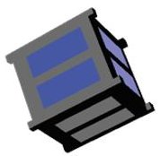

Cal Poly - San Luis Obispo, CA

<!-- PDF_PAGE: 2 -->

REV14 CHANGE SUMMARY

<table border="1"><tr><td>Effective Date</td><td>Revision</td><td>Author</td><td>Description of Changes</td></tr><tr><td>July 2020</td><td>14</td><td>Alicia Johnstone</td><td>CDS Rev 14 supersedes CDS Rev 13 and 6U CDS Rev 1.0.
For Revision 14, the CDS was updated to reflect current industry standards as well as include standards for 6U and 12U CubeSats.
Previous versions of the CDS were presented as a set of requirements, many of the specifications in Rev 14 have been revised to serve more as guidelines than hard requirements in an effort to make the CDS into a useful tool for CubeSat Developers. Sections were added with information on available CubeSat dispensers. Appendix drawings were also updated.
See Appendix A for the full Change History Log and detailed revision history.</td></tr><tr><td>February 2022</td><td>14.1</td><td>Alicia Johnstone</td><td>Removed DRAFT and published as official Rev 14.1. Added and updated dispenser information in Sections 4 and 5. Added clarifying language to Sections 2 and 3.
See Appendix A for the full Change History Log and detailed revision history.</td></tr></table>

<!-- PDF_PAGE: 3 -->

## TABLE OF CONTENTS

1. **INTRODUCTION** ... 7

1.1 Overview ... 7

1.2 Purpose ... 8

1.3 Mission Requirements ... 8

1.4 Non-compliance with CDS ... 9

1.5 Definitions ... 9

1.6 Definition of Terms ... 9

2. **CUBESAT SPECIFICATION** ... 9

2.1 General Specifications ... 9

2.2 CubeSat Mechanical Specifications ... 10

2.3 Electrical Specifications ... 14

2.4 Operational Specifications ... 15

3. **TESTING REQUIREMENTS** ... 16

3.1 Random Vibration ... 16

3.2 Thermal Vacuum Bakeout ... 16

3.3 Shock Testing ... 16

3.4 Visual Inspection ... 16

3.5 CubeSat Testing Philosophy ... 16

4. **CUBESAT DISPENSER** ... 18

4.1 Interface ... 18

5. **DISPENSER OPTIONS** ... 20

6. **CONTACTS** ... 23

<!-- PDF_PAGE: 4 -->

## APPENDICES

A. CHANGE HISTORY LOG...24

B. CUBESAT SPECIFICATION DRAWINGS...27

<!-- PDF_PAGE: 5 -->

## List of Acronyms and Abbreviations

<table border="1"><tr><td>ADC</td><td>Attitude Determination and Control</td></tr><tr><td>AFSPCMAN</td><td>Air Force Space Command Manual</td></tr><tr><td>C&amp;DH</td><td>Command and Data Handling</td></tr><tr><td>CA</td><td>California</td></tr><tr><td>Cal Poly</td><td>California Polytechnic State University, San Luis Obispo</td></tr><tr><td>CDS</td><td>CubeSat Design Specification</td></tr><tr><td>CIFP</td><td>CubeSat Inspection and Fit-check Procedure</td></tr><tr><td>cm</td><td>Centimeters</td></tr><tr><td>CP</td><td>Cal Poly</td></tr><tr><td>CPCL</td><td>Cal Poly CubeSat Laboratory</td></tr><tr><td>CVCM</td><td>Collected Volatile Condensable Mass</td></tr><tr><td>DAS</td><td>Debris Assessment Software</td></tr><tr><td>ESA</td><td>European Space Agency</td></tr><tr><td>FAA</td><td>Federal Aviation Administration</td></tr><tr><td>FCC</td><td>Federal Communication Commission</td></tr><tr><td>GEVS</td><td>General Environmental Verification Standard</td></tr><tr><td>GSFC</td><td>Goddard Space Flight Center</td></tr><tr><td>IARU</td><td>International Amateur Radio Union</td></tr><tr><td>ISIS</td><td>Innovative Solutions in Space</td></tr><tr><td>ITU</td><td>International Telecommunication Union</td></tr><tr><td>JAXA</td><td>Japan Aerospace Exploration Agency</td></tr><tr><td>kg</td><td>Kilogram</td></tr><tr><td>kHz</td><td>Kilohertz</td></tr><tr><td>lbf</td><td>Pound-force</td></tr><tr><td>LSP</td><td>Launch Services Program</td></tr><tr><td>LV</td><td>Launch Vehicle</td></tr><tr><td>mA</td><td>milli-Amps</td></tr><tr><td>MIN</td><td>Minimum</td></tr><tr><td>mm</td><td>Millimeters</td></tr><tr><td>N</td><td>Newton</td></tr><tr><td>N/A</td><td>Not Applicable</td></tr><tr><td>NASA</td><td>National Aeronautics and Space Administration</td></tr></table>

<!-- PDF_PAGE: 6 -->

NOAA National Oceanic and Atmospheric Administration

NLAS Nanosatellite Launch Adapter System

NPR NASA Procedural Requirements

P-POD Poly Picosatellite Orbital Deployer

PSC Planetary Systems Corporation

PSL-P PicoSatellite Launch-Pack

RBF Remove Before Flight

REQ Requirement

Rev. Revision

RF Radio Frequency

RTC Real Time Clock

SLO San Luis Obispo

SMCS Space and Missile Systems Center Standard

SSDL Space Systems Development Lab

SSOD Small Satellite Orbital Deployer

STD Standard

TML Total Mass Loss

U Unit

UL Underwriters Laboratories

Wh Watt-hours

μm Micrometer

## Applicable Documents

The following documents form a part of this document to the extent specified herein.

Air Force Space Command Manual 91-710, Range Safety User Requirements Manual (AFSPCMAN 91-710)

General Environmental Verification Standard for GSFC Flight Programs and Projects (GSFC-STD-7000 A)

LSP Program Level P-POD and CubeSat Requirements Document (LSP-REQ-317.01 B)

NASA Procedural Requirements for Limiting Orbital Debris (NPR 8715.6B)

Space and Missile Systems Center Standard Test Requirements for Launch, Upper-Stage and Space Vehicles (SMC-S-016)

Standard Materials and Processes Requirements for Spacecraft (NASA-STD-6016)

<!-- PDF_PAGE: 7 -->

## 1. Introduction

## 1.1 Overview

Started in 1999, the CubeSat Project began as a collaborative effort between Prof. Jordi Puig-Suari at California Polytechnic State University (Cal Poly), San Luis Obispo, and Prof. Bob Twiggs at Stanford University's Space Systems Development Laboratory (SSDL). The intent of the CubeSat Project was to reduce cost and development time, increase accessibility to space, and sustain frequent launches. A CubeSat is a class of satellites that adopt a standard size and form factor, which unit is defined as 'U'. A 1U CubeSat is a 10 cm cube with a mass of up to 2 kg. This standard primary objective is to provide specifications for the design of CubeSats ranging from 1U to 12U. The standard secondary objective is to provide information on available CubeSat dispensers and their corresponding interfaces. To view the most updated versions of the CubeSat Design Specification, please visit: http://www.cubesat.org/.

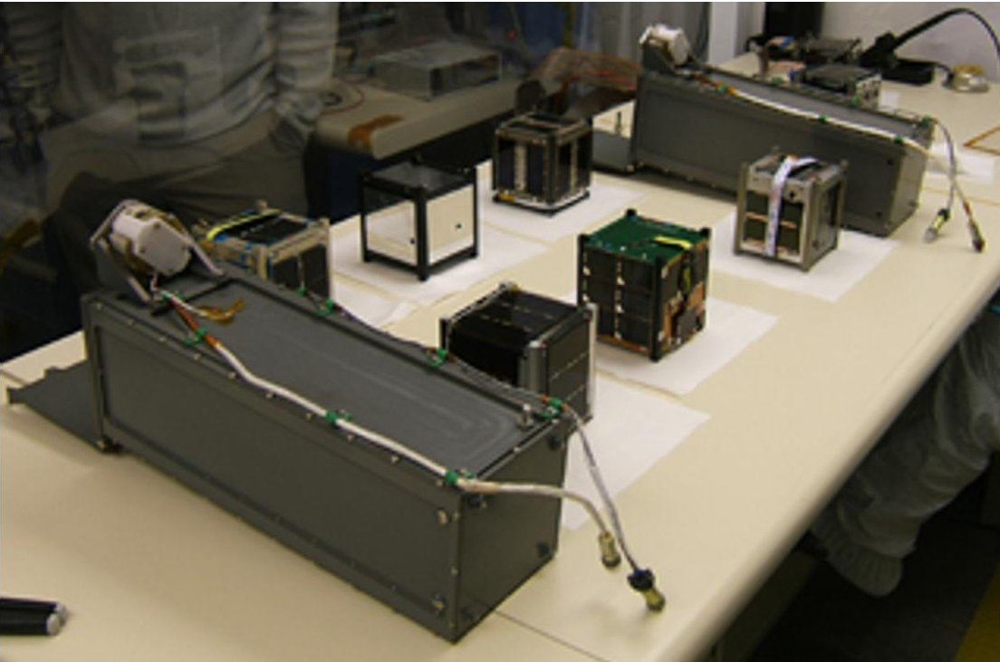

Figure 1: The first CubeSats developed at Cal Poly, CP1 and CP2, are pictured here with four other 1U CubeSats before being integrated into two early generation P-PODs in 2006.

<!-- PDF_PAGE: 8 -->

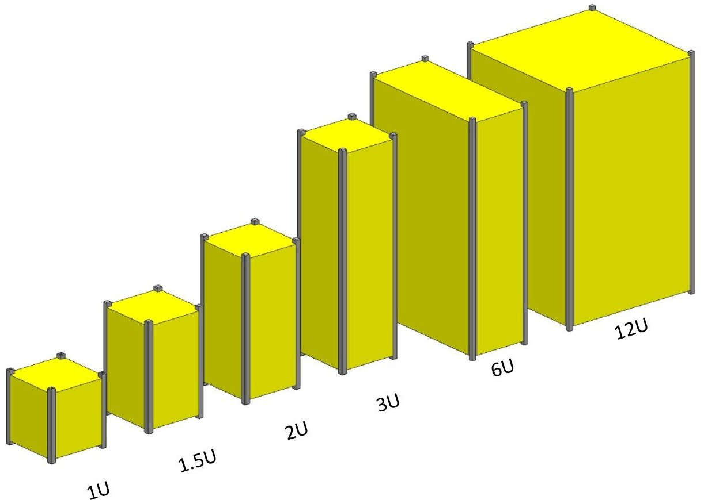

Figure 2: The Current CubeSat Family (1U-12U)

## 1.2 Purpose

CubeSat developers should play an active role in ensuring the safety and success of CubeSat missions by implementing good engineering practice, testing, and verification of their systems. Failures of CubeSats, CubeSat dispensers, or interface hardware can damage the LV or a primary payload, putting the entire CubeSat Program in jeopardy. As such, the purpose of the specifications described in this document is to help ensure the success and safety of the mission, as well as provide baseline requirements for CubeSat developers to design their spacecraft, such that they will be compatible with as many CubeSat dispensers and launch opportunities as possible.

As part of the CubeSat Community, all participants have an obligation to ensure safe operation of their systems, obtain the required licensing from the appropriate agencies, and to meet the design and minimum testing requirements outlined in this document.

## 1.3 Mission Requirements

Although mission requirements are oftentimes similar to the requirements in the CDS, the CubeSat Developer will only be responsible for meeting the requirements provided by the Launch Provider. The requirements in this document are meant for preliminary design purposes, and are written conservatively to allow for the best chances of compatibility with any launch vehicle.

Launch vehicle provider requirements supersede the requirements in this document.

<!-- PDF_PAGE: 9 -->

## 1.4 Non-compliance with CDS

Prior to a CubeSat being manifested on a launch, the specifications and requirements stated in the CDS provide guidance on the CubeSat design to ensure safe operation of the system.

After a CubeSat is manifested on a launch, the Launch Provider requirements supersede the CDS requirements. In some cases, CDS specifications and requirements may be more restrictive than the Launch Provider requirements. Ideally, a CubeSat that complies with all CDS requirements will comply with the requirements for most, if not all, Launch Provider requirements. For more information, please contact the Cal Poly CubeSat Laboratory: cubesat@calpoly.edu.

Developers should understand that each requirement deviation potentially reduces the chances of finding a suitable launch opportunity.

## 1.5 Definitions

1. 5.1 Developer: Person or organization responsible for the creation and delivery of the CubeSat

1. 5.2 Dispenser integrator: Person or organization responsible for safely stowing the CubeSat into the dispenser and preparing the dispenser for the launch vehicle

1. 5.3 Dispenser manufacturer: Person or organization responsible for the construction of the CubeSat dispenser

1. 5.4 Launch Provider: Person or organization responsible for the launch vehicle and/or the system delivering the CubeSat to orbit

## 1.6 Definition of Terms

Throughout this document, one of three different operational words will be used in each specification. Their associated definitions are shown below.

1. 6.1 Shall is used to denote requirements that must be met and will need formal verification.

1. 6.2 Should is used to denote a strong recommendation or a suggestion to make formal verification of another requirement easier. In many cases, failure to adhere to "should" statements will limit launch opportunities.

1. 6.3 Will is used to denote a situation that is going to happen regardless of inputs from the launch vehicle and/or spacecraft developer. "Will" statements serve to indicate events that the spacecraft developers should be prepared for.

1. 6.4 Note is used to denote a recommendation or advice meant to aid the CubeSat Developer.

## 2. CubeSat Specification

## 2.1 General Specifications

2. 1.1 All parts shall remain attached to the CubeSats during launch, ejection and operation.

2. 1.2 Pyrotechnics shall conform to AFSPCMAN 91-710, Volume 3.

2. 1.3 Any propulsion systems shall be designed, integrated, and tested in accordance with AFSPCMAN 91-710 Volume 3.

2. 1.4 Propulsion systems shall have at least 3 inhibits to activation.

<!-- PDF_PAGE: 10 -->

2. 1.5 Note: It is recommended to consider Federal Aviation Administration (FAA) requirements for Batteries Carried by Airline Passengers. For example, the maximum allowed capacity for consumer-sized lithium ion batteries in carry-on baggage is 100 Wh per battery.

2. 1.6 CubeSat hazardous materials shall conform to AFSPCMAN 91-710, Volume 3.

2. 1.7 CubeSat materials shall satisfy low out-gassing criteria, as defined in 2.1.7.1 and 2.1.7.2, to prevent contamination of other spacecraft during integration, testing, and launch. A list of NASA approved low out-gassing materials can be found at: http://outgassing.nasa.gov.

2. 1.7.1 CubeSats materials shall have a Total Mass Loss (TML) of less than or equal to 1.0 %

2. 1.7.2 CubeSat materials shall have a Collected Volatile Condensable Material (CVCM) of less than or equal to 0.1%

2. 1.8 The magnetic field of any passive magnets shall be limited to 0.5 Gauss above Earth's magnetic field, outside the CubeSat static envelope.

2. 1.9 The CubeSat shall be designed to accommodate ascent venting per ventable volume/area of less than 50.8 meters (2000 inches).

## 2.2 CubeSat Mechanical Specifications

CubeSat dimensions and features are outlined in the CubeSat Specification Drawings (Appendix B).

Note: The CubeSat Inspection and Fit-check Procedure (CIFP) can be used to aid in verifying that the CubeSat meets the dimensional requirements specified in Appendix B. The CIFP can be found on cubesat.org.

These requirements are applicable for all dispensers not utilizing the tab constraint method. CubeSats designed with tabs can find those specific requirements at the PSC website (planetarysystemscorp.com).

2. 2.1 The CubeSat shall use the coordinate system as defined in Appendix B. The origin of the CubeSat coordinate system is located at the geometric center of the CubeSat.

2. 2.1.1 The CubeSat configuration and physical dimensions shall conform to the appropriate section of Appendix B.

2. 2.1.2 Note: The standoff length dimension ["(0.5-7.0) 0.1 MIN +/- Z FACES"] , specified in the drawings in Appendix B, exists to prevent interference with potential neighboring CubeSats and dispenser interfaces.

2. 2.1.3 Note: Extra volume may be available for 3U, 6U, and 12U CubeSats. This extra volume is shown in Figure 3, sometimes referred to as the "Tuna Can" volume. The availability and volume dimensions are dispenser dependent.

<!-- PDF_PAGE: 11 -->

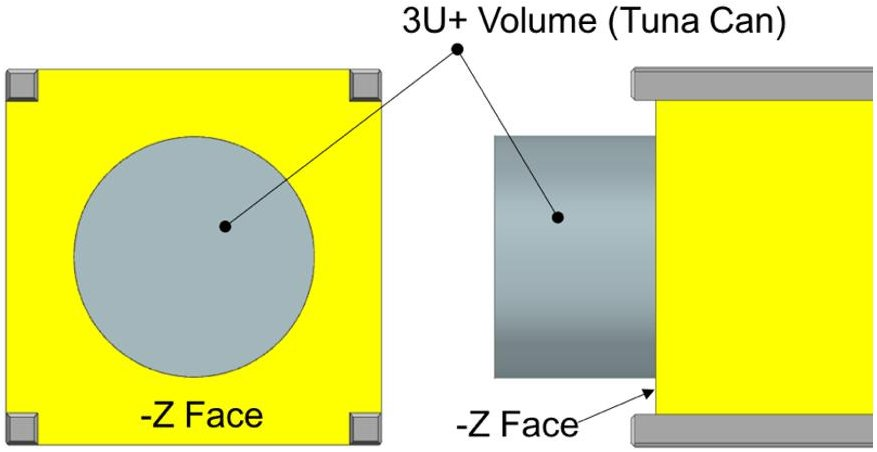

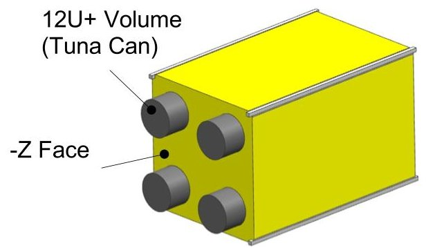

Figure 3: Optional Extra Volume shown on 3U and 12U-Z Face (also known as a "Tuna Can"). The Extra Volume is also an optional feature for the 6U configuration.

2. 2.2 The -Z face of the CubeSat will be inserted first into the dispenser.

2. 2.3 No components on the yellow shaded sides (see Appendix B CDS drawings) shall protrude farther than 6.5 mm normal to the surface from the plane of the rail.

2. 2.3.1 Note: Please refer to the CIFP for recommended protrusion measurement technique.

2. 2.4 Deployables shall be constrained by the CubeSat, not the dispenser. This requirement originates from requirements of most Launch Providers.

2. 2.5 Rails shall have a minimum width of 8.5mm measured from the edge of the rail to the first protrusion on each face.

2. 2.5.1 Note: An example is shown in Figure 4.

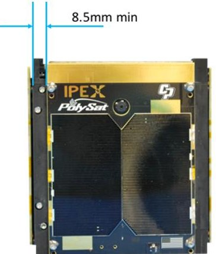

Figure 4: Distance measured from edge of rail to first protrusion

<!-- PDF_PAGE: 12 -->

2. 2.6 Rails should have a surface roughness less than 1.6 $ \mu\mathrm{m} $

2. 2.6.1 Note: This is typically met if the rail material is shown to be properly anodized. Otherwise, if the surface appears rough, more testing may be required.

2. 2.7 The edges of the rails should be rounded to a radius of at least 1 mm.

2. 2.7.1 Note: This is typically met using engineering drawings and manufacturer certification.

2. 2.8 The ends of the rails on the +/- Z face shall have a minimum surface area of 6.5 mm x 6.5 mm contact area with neighboring CubeSat rails (as per drawing in Appendix B).

2. 2.8.1 Note: If the CubeSat is not sharing the dispenser with another spacecraft, the Launch Provider may choose to waive this surface area requirement.

2. 2.9 At least 75% of the rail should be in contact with the dispenser rails. 25% of the rails may be recessed.

2. 2.10 Note: Table 1 shows the typical maximum mass for each U configuration.

Table 1: CubeSat Mass Specifications

<table border="1"><tr><td>U Configuration</td><td>Mass[kg]</td></tr><tr><td>1U</td><td>2.00</td></tr><tr><td>1.5U</td><td>3.00</td></tr><tr><td>2U</td><td>4.00</td></tr><tr><td>3U</td><td>6.00</td></tr><tr><td>6U</td><td>12.00</td></tr><tr><td>12U</td><td>24.00</td></tr></table>

2. 2.10.1 Note: Masses larger than the one presented in Table 1 may be evaluated on a mission-to-mission basis. Verify constraints with your dispenser provider or Launch Provider.

2. 2.10.2 Note: Acceptable masses may vary depending on the dispenser capabilities. Verify capabilities with your dispenser provider.

2. 2.11 The CubeSat center of gravity shall fall within the ranges specified in Table 2.

Table 2: Ranges of acceptable center of gravity locations as measured from the geometric center on each major axis

<table border="1"><tr><td></td><td>XAxis</td><td>YAxis</td><td>ZAxis</td></tr><tr><td>1U</td><td>+2cm/-2cm</td><td>+2cm/-2cm</td><td>+2cm/-2cm</td></tr><tr><td>1.5U</td><td>+2cm/-2cm</td><td>+2cm/-2cm</td><td>+3cm/-3cm</td></tr><tr><td>2U</td><td>+2cm/-2cm</td><td>+2cm/-2cm</td><td>+4.5cm/-4.5cm</td></tr><tr><td>3U</td><td>+2cm/-2cm</td><td>+2cm/-2cm</td><td>+7cm/-7cm</td></tr><tr><td>6U</td><td>+4.5cm/-4.5cm</td><td>+2cm/-2cm</td><td>+7cm/-7cm</td></tr><tr><td>12U</td><td>+4.5cm/-4.5cm</td><td>+4.5cm/-4.5cm</td><td>+7cm/-7cm</td></tr></table>

2. 2.12 The CubeSat structure should be made from aluminum alloy.

2. 2.12.1 Note: Typically, Aluminum 7075, 6061, 6082, 5005, and/or 5052 are used for both the main CubeSat structure and the rails. If materials other than aluminum are used, the CubeSat developer should contact the Launch Provider or dispenser manufacturer.

<!-- PDF_PAGE: 13 -->

2. 2.13 Any aluminum CubeSat external surfaces, such as rails and standoffs that are in contact with the dispenser rails, shall be hard anodized to prevent any cold welding within the dispenser.

2. 2.14 If a CubeSat shares a dispenser with another CubeSat(s), each CubeSat shall employ a mechanism to encourage separation from neighboring CubeSats within the dispenser.

2. 2.14.1 Note: Any mechanism that will provide separation is acceptable. The common assumption with separation springs is that "stronger is better". This is not always the case. Stronger separation springs can overpower the CubeSat dispenser deployment spring force during ejection and yield unpredictable separation characteristics, possibly re-contacting neighboring CubeSats. On the other hand, lower force springs may not have sufficient energy to separate the CubeSats the required amount. The general guideline is to select a separation spring with a max force less than 6.7 N (1.5 lbf) but with a stroke length greater than 2.5 mm (0.1 inches)

2. 2.14.2 The separation mechanism shall not extend beyond the level of the standoff in a stowed configuration.

2. 2.14.3 Note: The most common placement of the CubeSat separation mechanism is centered on the end of the two standoffs on the CubeSat's -Z face as per Figure 5.

2. 2.14.4 Note: A separation mechanism is not required for CubeSats that do not share a dispenser with another CubeSat(s).

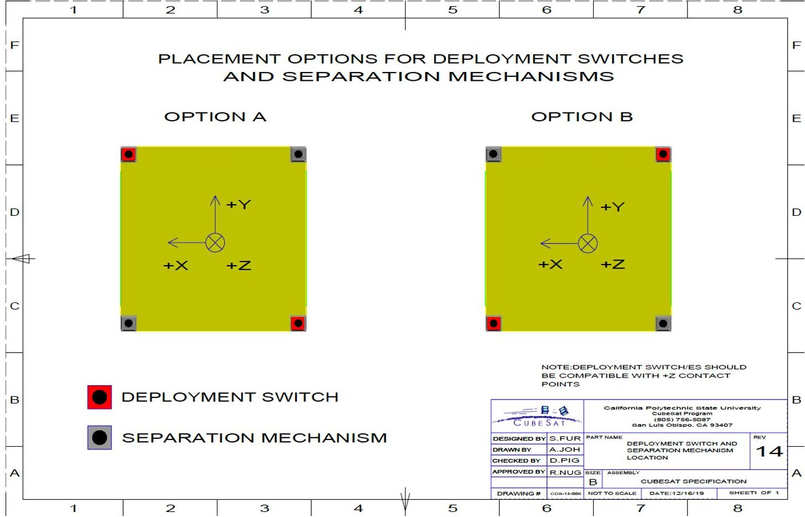

Figure 5: Recommended Deployment Switches and Separation Spring Locations

<!-- PDF_PAGE: 14 -->

## 2.3 Electrical Specifications

Electronic systems will be designed with the following safety features. These specifications are applicable for all dispensers.

2. 3.1 To prevent CubeSat from activating any powered functions, the CubeSat power system shall be at a power off state from the time of delivery to the LV through on-orbit deployment.

2. 3.1.1 Note: CubeSat powered function include the variety of subsystems such as C&DH, RF Communication, ADC, deployable mechanism actuation. CubeSat power systems include all battery assemblies and solar cells.

2. 3.1.2 Powered-on battery protection circuitry may be permitted per specification 2.3.6.

2. 3.2 The CubeSat shall have, at a minimum, one deployment switch, which is actuated while integrated in the dispenser.

2. 3.2.1 In the actuated state, the CubeSat deployment switch shall electrically disconnect the power system from the powered functions.

2. 3.2.2 The deployment switch shall be in the actuated state at all times while integrated in the dispenser.

2. 3.2.3 In the actuated state, the CubeSat deployment switch should be at or below the level of any external surface that interfaces with the dispenser or neighboring CubeSat. This ensures that the switch will not damage or interfere with the contacting surface.

2. 3.2.4 If the CubeSat deployment switch toggles from the actuated state and back, the satellite shall reset to a pre-launch state, including reset of transmission and deployable timers.

2. 3.3 Real Time Clocks (RTC) may be permitted, if they satisfy requirements 2.3.2.1 through 2.3.2.3.

2. 3.3.1 RTC circuits shall be isolated from the CubeSat's main power system.

2. 3.3.2 RTC frequencies shall be less than 320 kHz.

2. 3.3.3 RTC circuits shall be current limited to less than 10 mA.

2. 3.4 The RBF pin and all CubeSat umbilical connectors shall be within the designated access port locations if available on the CubeSat's dispenser. Please contact the manufacturer for specific charging and diagnostic port locations and procedures.

2. 3.4.1 Note: Some dispensers do not have access ports, therefore the RBF must be removed before insertion into the dispenser. It is advised that the CubeSat developer takes this possibility into account when designing the power-on and boot-up sequence.

2. 3.5 The CubeSat shall include an RBF pin, which cuts all power to the satellite once it is inserted into the satellite.

2. 3.5.1 Access to the CubeSat is not guaranteed during or after integration. The RBF pin shall be removed from the CubeSat before integration into the dispenser, if the dispenser does not have access ports.

2. 3.5.2 The RBF pin shall protrude no more than 6.5 mm from the CubeSat rail surface when it is fully inserted into the satellite.

2. 3.6 CubeSats shall incorporate battery circuit protection for charging/discharging to avoid unbalanced cell conditions. Additional manufacturer documentation and/or testing will be required for modified, customized, or non-UL-listed cells.

2. 3.7 The CubeSat shall have at least three independent RF inhibits to prohibit inadvertent RF transmission.

<!-- PDF_PAGE: 15 -->

2. 3.7.1 Note: An inhibit is a physical device between a power source and a hazard.

2. 3.7.2 Note: A timer is not considered an independent inhibit.

2. 3.7.3 Note: Some launch vehicle providers will only require one or two independent inhibits depending on the CubeSat's RF power output. However, the use of three independent inhibits is highly recommended and can reduce required documentation and analyses.

2. 3.8 The CubeSat shall have at least three independent inhibits to prohibit the inadvertent release of any deployable structures such as antennas or solar panels.

## 2.4 Operational Specifications

CubeSats will meet certain requirements pertaining to integration and operation to meet legal obligations and ensure safety of other CubeSats.

2. 4.1 Operators shall obtain and provide documentation of proper licenses for use of radio frequencies.

2. 4.1.1 Note: For amateur frequency use, this requires proof of frequency coordination by the IARU. Applications can be found at www.iaru.org.

2. 4.2 CubeSats shall comply with their country's radio license agreements and restrictions.

2. 4.2.1 Note: CubeSat operator should refer to the International Telecommunication Union (ITU) to determine what licenses and approvals are needed for their country.

2. 4.3 CubeSat mission design and hardware shall be in accordance with NPR 8715.6 to limit orbital debris.

2. 4.3.1 Any CubeSat component shall re-enter with energy less than 15 Joules.

2. 4.3.2 Developers should be ready to provide orbital debris mitigation data if requested by the licensing agency or Launch Provider.

2. 4.3.3 Note: Analysis can be conducted to satisfy the above with NASA DAS, available at https://orbitaldebris.jsc.nasa.gov/mitigation/.

2. 4.3.4 Note: The European Space Agency (ESA) offers debris assessment software at https://sdup.esoc.esa.int.

2. 4.4 All deployables such as booms, antennas, and solar panels shall wait to deploy a minimum of 30 minutes after the CubeSat's deployment switch(es) are activated during dispenser ejection.

2. 4.5 CubeSats shall not generate or transmit a signal earlier than 45 minutes after on-orbit deployment.

2. 4.5.1 Note: The CubeSat can be powered on immediately following deployment from the dispenser.

2. 4.6 Note: Private entities (non-U.S. Government) under the jurisdiction or control of the United States who propose to operate a remote sensing space system (satellite), such as a visual imager, may need to have a remote sensing license as required by U.S. law. For more information visit http://www.nesdis.noaa.gov/CRSRA/licenseHome.html.

2. 4.7 The dispenser developer will conduct a minimum of one fit check in which the CubeSat flight unit will be inspected and integrated into the dispenser or engineering dispenser to verify the fit. A final fit check will be conducted just prior to integration of the CubeSat flight unit to the dispenser.

<!-- PDF_PAGE: 16 -->

2. 4.7.1 Note: It is recommended to verify dimension limits using documentation specific to the intended dispenser. In lieu of a document provided by the dispenser vendor, the CIFP located at cubesat.org can be used.

## 3. Testing Requirements

All testing levels and requirements are mission specific and vary with every launch. The examples provided in this document, are typically, the most stringent to encompass requirements from most of the possible launch opportunities to date.

Testing will be performed to meet the Launch Provider requirements as well as any additional testing requirements deemed necessary to ensure the safety of the CubeSats, dispenser, and the primary launch vehicle payload. If the launch vehicle environment is unknown, the General Environmental Verification Standard (GEVS, GSFC-STD-7000A) and SMC-S-016 can be used to define testing environments and requirements. Note that the test levels defined in GSFC-STD 7000A and SMC-S-016 are not guaranteed to encompass or satisfy all LV testing environments. Test requirements and levels that are not generated by the Launch Provider are considered unofficial. The Launch Provider testing requirements will supersede testing environments from any other source. Typically, all CubeSats will undergo the following tests.

## 3.1 Random Vibration

3. 1.1 Random vibration testing shall be performed to the levels and duration as defined by the Launch Provider.

## 3.2 Thermal Vacuum Bakeout

3. 2.1 Thermal vacuum bakeout shall be performed to ensure proper outgassing of components.

3. 2.2 The test specification will be defined by the Launch Provider.

## 3.3 Shock Testing

3. 3.1 Shock testing shall be performed as defined by the Launch Provider.

3. 3.1.1 Note: Shock testing is typically not required for CubeSats.

## 3.4 Visual Inspection

3. 4.1 Visual inspection of the CubeSat and measurement of critical areas will be performed per the CIFP (cubesat.org) or as defined by the Launch Provider.

## 3.5 CubeSat Testing Philosophy

This section outlines a conservative test flow approach for CubeSats to meet environmental test requirements for launch. The CubeSat shall be subjected to either qualification or protoflight testing as defined in the CubeSat Testing Flow Diagram, shown in Figure 6. The test levels and durations will be supplied by the Launch Provider.

## 3.5.1 Qualification

Qualification testing is performed on an engineering unit that is identical to the flight model CubeSat. Qualification levels will be determined by the Launch Provider. Both SMC-S-016 and

<!-- PDF_PAGE: 17 -->

GSFC-STD-7000A are used as guides in determining test levels and durations. The flight model will then be tested to acceptance levels on its own. The Launch Provider may also require a final acceptance/workmanship random vibration test on the CubeSat and flight dispenser after integration.

Additional testing may be required if modifications or changes are made to the CubeSat after qualification testing.

## 3.5.2 Protoflight

Protoflight testing is performed on the flight model CubeSat. Protoflight levels will be determined by the Launch Provider. Both SMC-S-016 and GSFC-STD-7000A are used as guides in determining test levels and durations. The flight model will be tested to protoflight levels on its own. The Launch Provider may also require a final acceptance/workmanship random vibration test on the CubeSat and flight dispenser after integration. The flight CubeSat shall not be disassembled or modified after protoflight testing. Disassembly of hardware after protoflight testing will require the developer to adhere to the waiver process prior to disassembly.

Additional testing will be required if modifications or changes are made to the CubeSat after protoflight testing.

3. 5.2.1 Note: Some launch providers consider any physical or mechanical changes to the spacecraft's configuration to invalidate any previous vibration tests. For example, actuating deployment mechanisms for a deployment test would constitute a change to the spacecraft's configuration.

## 3.5.3 Acceptance

After delivery and integration of the CubeSat into the dispenser, additional testing may be performed on the integrated system. This test ensures proper integration of the CubeSat into the dispenser. Acceptance test levels will be determined by the Launch Provider. Both SMC-S-016 and GSFC-STD-7000A are used as guides in determining testing levels. The CubeSat shall not be deintegrated at this point. If a CubeSat failure is discovered, a decision to deintegrate the dispenser will be made by the Launch Provider based on mission safety concerns.

The developer is responsible for any additional testing required due to corrective modifications to deintegrated dispensers and CubeSats.

<!-- PDF_PAGE: 18 -->

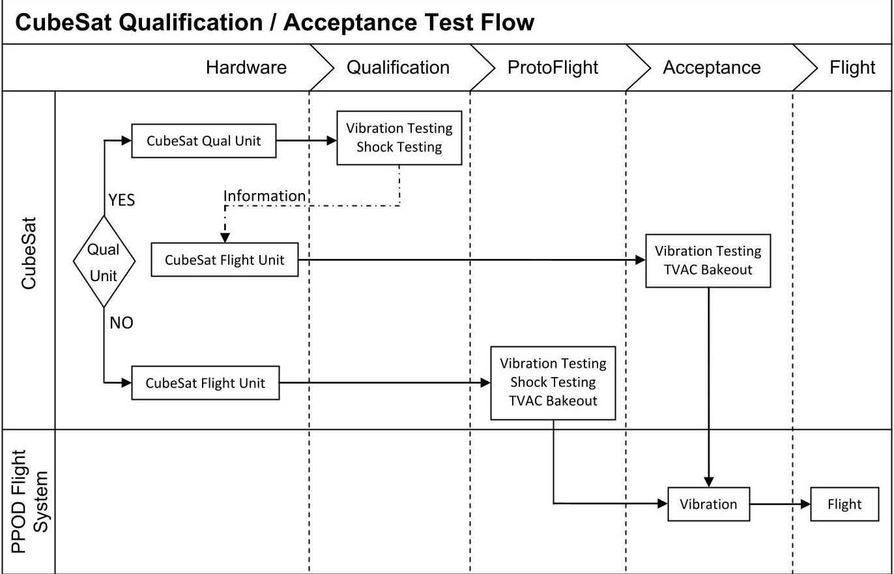

Figure 6: CubeSat General Testing Flow Diagram

Note: CubeSat test flows will vary from mission to mission. The Launch Provider will provide the CubeSat Developer with the approved test flow for a specific mission.

## 4. CubeSat Dispenser

## 4.1 Interface

The CubeSat dispenser is designed to carry CubeSats, and serve as the interface between the CubeSat and LV. A payload from the dispenser viewpoint may be a single CubeSat that makes use of the dispenser's total volume, or a combination of multiple CubeSats that amount to the dispenser's full capacity.

Multiple companies are developing dispensers which all adhere to one of two standardized constraint systems. The first system, originally developed by CPCL for the Poly Picosatellite Orbital Deployer (P-POD), utilizes a rail design. The second system, developed by Planetary Systems Corporation (PSC), utilizes a tab design and employ a constraint mechanism, CSD flange, that clamps onto these tabs, which creates a stiff invariant load path when integrated.

In both cases, the deployment force is provided by a spring driving the internal pusher plate. The pusher plate, in turn, interfaces with the CubeSat, which glides along the dispenser rails as it is ejected into orbit. Mechanical requirements for the CubeSat rail system are outlined in Section 2.2, and the mechanical requirements for tabbed CubeSats can be found at planetarysystemcorp.com. Developers are encouraged to explore both options to determine which is optimal for their needs. Due to the mechanical differences in dispenser designs, CubeSats are not expected to be compatible with both types of dispenser. To ensure safety and success of the mission, CubeSats will be compatible with either the rail system or the tab system dispensers by meeting the applicable requirements outlined in this document or the PSC website.

<!-- PDF_PAGE: 19 -->

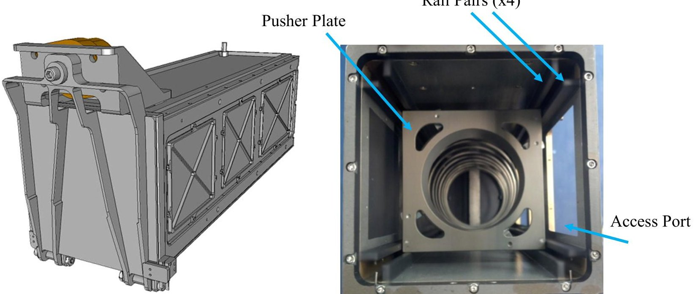

Figure 7: Poly Picosatellite Orbital Deployer (P-POD) and cross section utilizing the rail system

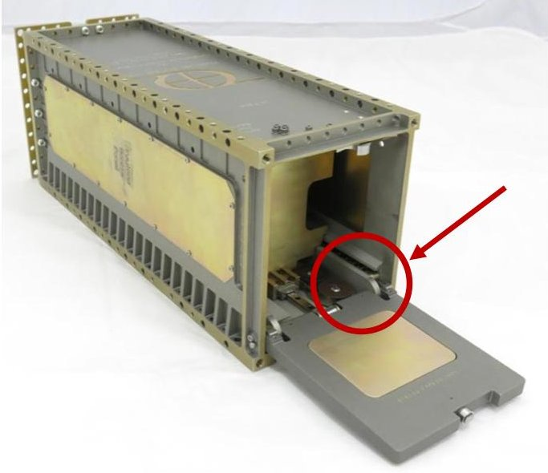

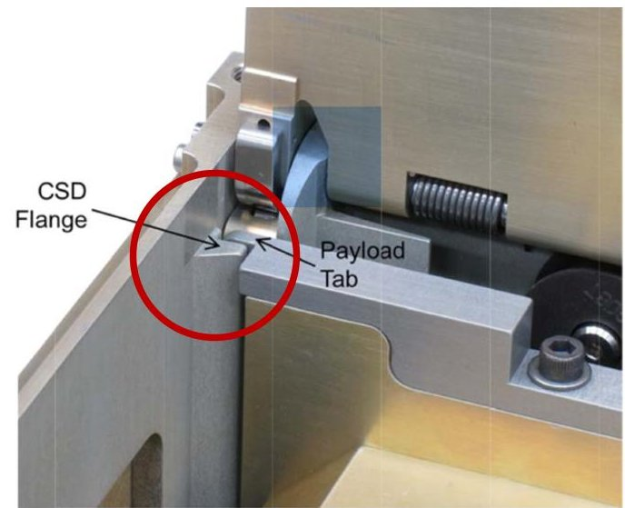

Figure 8: Planetary Systems Corporation (PSC) 3U Dispenser and detail utilizing the tab system (image credit PSC)

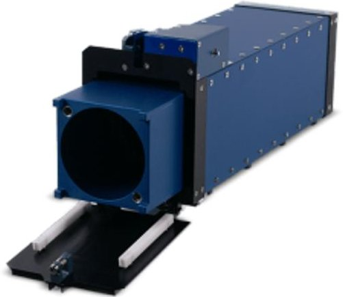

Figure 9: An Example of a 3U Rail-based Dispenser designed by ISIS (ISIPOD)

<!-- PDF_PAGE: 20 -->

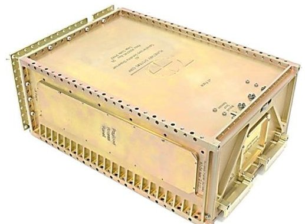

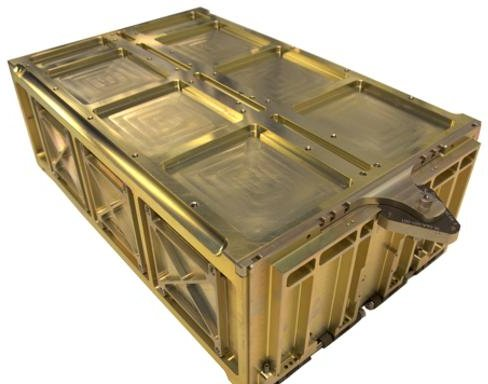

Figure 10: (Left) 6U Dispenser designed by Planetary Systems Corporation (CDS, tab-based) and (Right) 6U Dispenser designed by Tyvak (NLAS, rail-based)

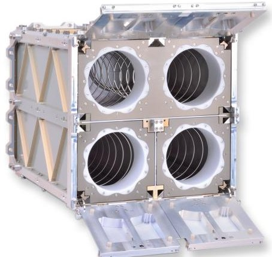

Figure 11: One Example of 12U Rail-based Dispenser designed by AstroFein (PSL-P)

## 5. Dispenser Options

Dispenser specific options are available to support specific CubeSat mission requirements. Please contact the dispenser provider for details about any options prior to incorporating them into your CubeSat design. A summary of the dispenser capabilities is presented in Table 3. For further details, consult the dispenser developer website as provided in Table 4.

Keep in mind that designing a spacecraft to a specific feature that is not available in all dispensers will restrict the spacecraft's ability to qualify for launch opportunities.

To request another dispenser be added to the next revision of this document, please contact the Cal Poly CubeSat Laboratory at cubesat@calpoly.edu.

<!-- PDF_PAGE: 21 -->

Table 3: CubeSat Dispenser Options

<table border="1"><tr><td></td><td>Type</td><td>Max Volume</td><td>Access Ports</td><td colspan="2">Additional Mass</td><td colspan="2">Extended Body Length</td><td colspan="2">Extended Protrusions</td><td colspan="2">Power/Data Port</td><td colspan="2">Purge</td><td colspan="2">RF Insulation</td><td colspan="2">Vibration Attenuation</td><td colspan="2">X-Y Constraint</td><td colspan="2">Z Constraint</td><td colspan="2">-Z Additional Volume(Tuna Can)</td></tr><tr><td>PSL Astro-Fein</td><td>Rail</td><td>3U</td><td>X</td><td></td><td></td><td></td><td></td><td></td><td></td><td></td><td></td><td></td><td></td><td></td><td></td><td>X</td><td>X</td><td></td><td></td><td></td><td></td><td></td><td></td></tr><tr><td>PLS-P Astro-Fein</td><td>Rail</td><td>12U</td><td>X</td><td></td><td></td><td></td><td></td><td></td><td></td><td></td><td></td><td></td><td></td><td></td><td></td><td></td><td></td><td>X</td><td>X</td><td></td><td></td><td></td><td></td><td></td></tr><tr><td>P-POD Cal Poly</td><td>Rail</td><td>3U</td><td>X</td><td></td><td></td><td></td><td></td><td></td><td></td><td>X</td><td>X</td><td>X</td><td>X</td><td></td><td></td><td></td><td></td><td>X</td><td>X</td><td></td><td></td><td></td><td></td><td></td></tr><tr><td>COSPOD COSATS</td><td>Rail</td><td>12U</td><td>X</td><td>X</td><td>X</td><td>X</td><td></td><td></td><td></td><td></td><td></td><td>X</td><td>X</td><td>X</td><td>X</td><td>X</td><td>X</td><td>X</td><td>X</td><td></td><td></td><td></td><td></td></tr><tr><td>EXOpod Exolaunch</td><td>Rail</td><td>12U</td><td>X</td><td>X</td><td></td><td>X</td><td></td><td></td><td></td><td></td><td></td><td></td><td></td><td></td><td></td><td>X</td><td>X</td><td>X</td><td></td><td></td><td></td><td></td><td></td><td></td></tr><tr><td>ISIPOD ISIS</td><td>Rail</td><td>3U</td><td></td><td></td><td>X</td><td>X</td><td></td><td></td><td></td><td></td><td></td><td></td><td></td><td></td><td></td><td>X</td><td>X</td><td>X</td><td></td><td></td><td></td><td></td><td></td><td></td></tr><tr><td>6-POD ISIS</td><td>Rail</td><td>6U</td><td></td><td></td><td>X</td><td>X</td><td></td><td></td><td></td><td></td><td></td><td></td><td></td><td></td><td></td><td>X</td><td>X</td><td>X</td><td></td><td></td><td></td><td></td><td></td><td></td></tr><tr><td>QuadPack ISIS</td><td>Rail</td><td>12U</td><td>X</td><td>X</td><td>X</td><td></td><td></td><td></td><td></td><td></td><td></td><td></td><td></td><td></td><td></td><td>X</td><td>X</td><td>X</td><td></td><td></td><td></td><td></td><td></td><td></td></tr><tr><td>E-SSOD JAXA</td><td>Rail</td><td>3U</td><td>X</td><td></td><td></td><td></td><td></td><td></td><td></td><td></td><td></td><td></td><td></td><td></td><td></td><td></td><td></td><td>X</td><td></td><td></td><td></td><td></td><td></td><td></td></tr><tr><td>J-SSOD JAXA</td><td>Rail</td><td>3U,6U</td><td>X</td><td>6U</td><td>X</td><td></td><td></td><td></td><td></td><td></td><td></td><td></td><td></td><td></td><td></td><td></td><td></td><td></td><td></td><td></td><td></td><td></td><td></td><td></td></tr><tr><td>CSD Planetary Systems</td><td>Tab</td><td>3U,6U,12U</td><td>X</td><td></td><td>X</td><td></td><td>X</td><td></td><td>X</td><td></td><td></td><td></td><td></td><td></td><td></td><td>X</td><td>X</td><td></td><td></td><td></td><td></td><td></td><td></td><td></td></tr><tr><td>RailPOD Tyvak</td><td>Rail</td><td>3U</td><td>X</td><td></td><td></td><td></td><td></td><td></td><td></td><td></td><td></td><td></td><td></td><td></td><td></td><td></td><td></td><td>X</td><td>X</td><td></td><td></td><td></td><td></td><td></td></tr><tr><td>NLAS Tyvak</td><td>Rail</td><td>6U</td><td>X</td><td>X</td><td>X</td><td>X</td><td>X</td><td>X</td><td>X</td><td>X</td><td>X</td><td></td><td></td><td></td><td></td><td></td><td></td><td>X</td><td>X</td><td></td><td></td><td></td><td></td><td></td></tr><tr><td>12U Dispenser Tyvak</td><td>Rail</td><td>12U</td><td>X</td><td>X</td><td>X</td><td>X</td><td>X</td><td>X</td><td>X</td><td>X</td><td>X</td><td></td><td></td><td></td><td></td><td>X</td><td>X</td><td>X</td><td></td><td></td><td></td><td></td><td></td><td></td></tr><tr><td>RAMI UARX</td><td>Rail</td><td>12U</td><td>X</td><td>X</td><td>X</td><td>X</td><td>X</td><td>X</td><td>X</td><td></td><td></td><td></td><td></td><td></td><td></td><td></td><td></td><td>X</td><td>X</td><td></td><td></td><td></td><td></td><td></td></tr></table>

Note: If a dispenser provider would like to update, revise, or add information to Table 3, please contact the Cal Poly CubeSat Laboratory, cubesat@calpoly.edu.

<!-- PDF_PAGE: 22 -->

Table 4. Capabilities Description of the Available Dispensers

<table border="1"><tr><td>Access Ports</td><td>Access ports are used to physically access the satellite while the CubeSat is integrated within the 6U dispenser. The access ports allow the RBF pins to be removed post-integration into a 6U dispenser, and they can be used to visually verify separation switch engagement after the CubeSat has been integrated.</td></tr><tr><td>Additional Mass</td><td>Some dispensers have been designed to accommodate a larger payload mass than this document specifies. Please refer to the dispenser website for specific mass limits. The mass limits of a dispenser are dependent on the dynamic environments of a launch.</td></tr><tr><td>Extended Body Length</td><td>Some dispensers have been designed to accommodate a longer overall 3U body length in the Z direction. Please refer to the dispenser website for specific length limits.</td></tr><tr><td>Extended Protrusions from Body</td><td>Some dispensers have been designed to accommodate longer protrusions on the CubeSat X and Y surfaces than the 6.5mm that is specified in this document. Please refer to the dispenser website for specific protrusion limits. PSC utilizes a dynamic envelope and does not require rails. Therefore, it does not have “protrusions”.</td></tr><tr><td>Power/Data Port</td><td>This option allows the CubeSat to electrically interface with the dispenser while integrated. For specific information regarding power-on capabilities, please refer to the dispenser website.</td></tr><tr><td>Gaseous Purge</td><td>This option allows the dispenser to be configured for gaseous purge throughout launch. For specific information regarding purge capabilities, please refer to the dispenser website.</td></tr><tr><td>X-Y Constraint</td><td>PSC utilizes long flat tabs, in lieu of rails, to which the dispenser applies a clamping pre-load. This constrains the CubeSat while integrated in the dispenser. CubeSats designed to a tab system specification may not be compatible with a rail-based 6U dispenser, and visa-versa.The ISIS 6-POD dispenser and Tyvak 12U dispenser employ constraint systems that are compatible with the rail design.Please see the dispenser website for a full list of mechanical requirements associated with each constraint system.</td></tr><tr><td>Z Constraint</td><td>All current dispensers fully constrain the payload in the Z axis.</td></tr><tr><td>-Z Additional Volume</td><td>This option offers a cylindrical volume extension on the-Z face of the CubeSat (also known as the “Tuna Can”). It is usually only offered to 3U, 6U, or 12U CubeSats that won’t be sharing dispenser space with other CubeSats, but smaller</td></tr></table>

<!-- PDF_PAGE: 23 -->

Table 5. Dispenser Developer Websites

<table border="1"><tr><td>Company or Institution</td><td>Website</td></tr><tr><td>Astro-Fein</td><td>http://www.astrofein.com/</td></tr><tr><td>Cal Poly CubeSat Laboratory</td><td>http://www.cubesat.org/</td></tr><tr><td>COSATS</td><td>cosatspace.com</td></tr><tr><td>Exolaunch</td><td>www.exolaunch.com</td></tr><tr><td>ISIS</td><td>www.isispace.nl</td></tr><tr><td>JAXA</td><td>https://global.jaxa.jp/projects/rockets/epsilon/</td></tr><tr><td>Planetary Systems</td><td>www.planetarysystemscorp.com</td></tr><tr><td>Tyvak</td><td>www.tyvak.com</td></tr><tr><td>UARX</td><td>www.uarx.com</td></tr></table>

## 6. Contacts

Cal Poly CubeSat Lab Director Prof. John Bellardo Aerospace Engineering Dept. (805) 756-5087 bellardo@calpoly.edu

Cal Poly CubeSat Program Manager Ryan Nugent (805) 756-5087 rnugent@calpoly.edu

Cal Poly CubeSat Lab

(805) 756-5087

cubesat@calpoly.edu

<!-- PDF_PAGE: 24 -->

Appendix A: Change History Log

<table border="1"><tr><td>Effective Date</td><td>Revision</td><td>Author</td><td>Description of Changes</td></tr><tr><td>N/A</td><td>8</td><td>Simon Lee</td><td>N/A</td></tr><tr><td>5/26/05</td><td>8.1</td><td>Amy Hutputanasin</td><td>Formatting updated.</td></tr><tr><td>5/15/06</td><td>9</td><td>Armen Toorian</td><td>Information and presentation revised.</td></tr><tr><td>8/2/07</td><td>10</td><td>Wenschel Lan</td><td>Information updated.</td></tr><tr><td>10/02/08</td><td>11</td><td>Riki Munakata</td><td>Format, Design specification and Mk.III P-POD compatibility update.</td></tr><tr><td>8/1/09</td><td>12</td><td>Riki Munakata</td><td>Requirements update, waiver form requirements, and 3U CubeSat Specification drawing.</td></tr><tr><td>3/30/12</td><td>12.1</td><td>Justin Carnahan</td><td>Reformatted document to improve readability, updated to include 1.5U, 2U, and 3U+. Added and modified some req.</td></tr><tr><td>7/12/13</td><td>13-draft</td><td>David Pignatelli</td><td>Added applicable documents section. Removed restrictions on propulsion, added guidance for propulsion systems and hazardous materials. Added magnetic field restrictions and suggestions. Cleaned Section 3.2. Added custom spring plunger specs and recommendation. Extended restrictions on inhibits. Added links to outside resources. Cleaned Section 4.</td></tr><tr><td>2/20/14</td><td>13</td><td>Arash Mehrparvar</td><td>Fixed page numbering, error in spring plunger thread callout, other minor edits based on external suggestions. Update 6-April-2015:1.5U length req. was 170.25+/-0.1 revised to 170.2+/-0.1 (p.25);2U length req. tolerance was +/-0.1 revised to +/-0.2 (p.27);3U length req. tolerance was +/-0.1 revised to +/-0.3 (p.29 and p.31);1U CAC mass spec was 1.0+0.5/-0.2 kg revised to &lt;1.33kg (p.34);1U CAC length spec was 113.5+/-0.5mm revised to 113.5+/-0.1mm (p.34);1.5U CAC mass spec was 1.5+0.7/-0.3kg revised to &lt;2.00kg (p.36);1.5U CAC length spec was 170.2+/-0.7mm revised to 170.2+/-0.1mm (p.36);2U CAC mass spec was 2.0+0.7/-0.4kg revised to &lt;2.66kg (p.38);2U CAC length spec was 227.0+/-0.1mm revised to 227.0+/-0.2mm (p.38);3U and 3U+ CAC mass spec was &lt;4kg revised to &lt;4.00kg (p.40 and 42);3U and 3U+ CAC length spec was 340.5+/-1.5mm revised to 340.5+/-0.3mm (p.40 and 42). All drawing dates were updated to 02/20/14. Update 14-Oct-2016: Added Update 6-April-2015 to change log</td></tr><tr><td>July 2020</td><td>14</td><td>Alicia Johnstone</td><td></td></tr></table>

<!-- PDF_PAGE: 25 -->

Added 6U and 12U specifications. Title page: removed ITAR and Internal classification options. Update logo. Detailed change log moved to Appendix A. Page2: document update summary added. Add appendices to ToC. List of Acronyms updated and changed to List of Acronyms and Abbreviations. Applicable Documents updated to most recent revisions and MIL-HDBK-5 was removed. Introduction Section text updated to include 6U and 12U, and improve language. Figure 1 caption added detail to the description. Waiver Process section removed. Added Mission Requirements section. Added Non-compliance with CDS section. Added Definitions and Definition of Terms sections. P-POD and Interface sections removed.

CubeSat Specifications section was 3, is 2. Req 3.1.1 removed and all following req #'s adjusted accordingly.

General Specifications: Section renamed from Requirements to Specifications. Req(Spec) 3.1.2 (2.1.1) removed "No additional space debris will be created." Req(Spec) 3.1.3 (2.1.2) revised to reference AFSPCMAN 91-710 and remove pyrotechnics prohibition. Req(Spec) 3.1.4 (2.1.5) revised to a Note and language changed to guideline referencing FAA battery requirements. Req(Spec) 3.1.9 and 3.1.9.1 removed. Req(Spec) 3.1.10 (2.1.8) revised from Note to "shall" and language revised. Req(Spec) 3.1.11 (2.1.9) specification was inches, is now meters and inches conversion. Mechanical Specifications: P-POD image removed. Tab configured dispenser statement added. Req(Spec) 3.2.1(2.2.1) removed reference to P-POD. Req(Spec) 3.2.1.2(2.2.1.2) included additional relevant U configurations. Req(Spec) 3.2.2(2.2.2) P-POD reference replaced with dispenser. Req(Spec) 3.2.3(2.2.3) reference to green shaded areas on Appendix drawings removed. Req(Spec) 3.2.3.1(2.2.3.1) CAC reference changed to CIFP. Req(Spec) 3.2.4(2.2.4) P-POD reference replaced with dispenser. Req(Spec) 3.2.5 (2.2.5) Measurement described in greater detail. Spec 2.2.5.1 added, image added. Req(Spec) 3.2.6(2.2.6) Will changed to should. Spec 2.2.6.1 note added. Req(Spec) 3.2.7(2.2.7) Will changed to should. Spec 2.2.7.1 note added. Req(Spec) 3.2.8(2.2.8) Figure 6 reference replaced with Appendix B reference. Spec 2.2.8.1 note added. Req(Spec) 3.2.9(2.2.9) Will changed to should and P-POD reference removed. Req 3.2.10 through 3.2.13.1 replaced with Spec 2.2.10, 2.2.10.1, and 2.2.10.2 and Table 1. Req 3.2.14 through 3.2.14.4 replaced with Spec 2.2.11and Table 2. Req(Spec) 3.2.15(2.2.12) and 3.2.15.1(2.2.12.1) will changed to should and Note. Req(Spec) 3.2.16(2.2.13) updated language. Req(Spec) 3.2.17(2.2.14) replaced "separation spring" with "mechanism to encourage separation". Req(Spec) 3.2.17.1(2.2.14.1) Cal Poly custom separation springs replaced with general separation mechanism and guidance for separation mechanism design added. Req(Spec) 3.2.17.2(2.2.14.2) separation spring replaced with separation mechanism and language updated. Req(Spec) 3.2.17.3(2.2.14.3) will replaced with Note and separation spring replaced with separation mechanism. Req(Spec) 3.2.17.4(2.2.14.4) revised to a Note, language updated, and separation spring replaced with separation mechanism. Table1: CubeSat Separation Spring Characteristics and Figure 5: Custom Spec Spring Plunger (Separation Spring) removed. Figure 7 (Figure 5) Separation Spring replaced with Separation Mechanism. Figure 6 (Figure 3) updated.

Electrical Specifications: Req(Spec) 3.3.1(2.3.1) language updated. Spec 2.3.1.1 and 2.3.1.2 added. Req(Spec) 3.3.2(2.3.2) updated language and remove Figure 7 reference. Req(Spec) 3.3.3(2.3.2.1) updated language. Req(Spec) 3.3.4(2.3.2.2) P-POD changed to dispenser. Req(Spec) 3.3.4.1(2.3.2.3) will changed to should and language updated. Req(Spec) 3.3.5(2.3.2.4) language updated. Spec 2.3.3 and 2.3.3.1-2.3.3.3 RTC specification added. Req(Spec) 3.3.6(2.3.4) language updated. Req(Spec) 3.3.6.1(2.3.4.1) language updated. Req(Spec) 3.3.7(2.3.5) language updated. Req 3.3.7.1-3.3.7.3 replaced by Spec 2.3.5.1-2.3.5.2. Req(Spec) 3.3.8(2.3.6) language updated. Req 3.3.9, 3.3.9.1, and 3.3.9.2 replaced with Spec 2.3.7 and 2.3.7.1-2.3.7.3. Spec 2.3.8 added.

Operational Specifications: Req(Spec) 3.4.1(2.4.1) will changed to shall. Req(Spec) 3.4.1.1(2.4.1.1) revised to Note. Req(Spec) 3.4.2(2.4.2) will changed to shall. Spec 2.4.2.1 added. Req(Spec) 3.4.3.2(2.4.3.2) will changed to should. Req 3.4.2.1 removed. Spec 2.4.3.4 added. Req(Spec) 3.4.4(2.4.4) P-POD reference removed. Req(Spec) 3.4.5(2.4.5) language updated. Spec 2.4.5.1 added. Req(Spec) 3.4.6(2.4.6) language updated and revised to Note. Req(Spec) 3.4.7(2.4.7) language updated, Cal Poly and P-POD specific language removed. Spec 2.4.7.1 added.

Testing Requirements: Updated language and updated standards sources. Req(Spec) 4.1(3.1.1) language updated. Req 4.2 replaced with Specs 3.2.1-3.2.2. Req 4.3 replaced by 3.3.1. Spec 3.3.1.1 added. Req(Spec) 4.4(3.4.1) replace CAC with CIFP. Req(Spec) 4.5(3.5) language updated. Req(Spec) 4.5.1-4.5.3(3.5.1-3.5.3) language updated. Figure 8(Figure 6) Note added.

CubeSat Dispenser: section added.

Dispenser Options: section added.

Contacts: Points of contact updated.

Appendix A: Waiver form removed and Change History Log details added.

Appendix B: Added 6U and 12U drawings; replaced 3U+ drawing with U+ drawing.

Appendix C: section removed.

<!-- PDF_PAGE: 26 -->

<table border="1"><tr><td>February 2022</td><td>14.1</td><td>Alicia Johnstone</td><td>Added PSL-P to List of Acronyms. Added Notes 2.2.1.2 and 3.5.2.1 to clarify the preceding specification. Updated Figure 11. Updated Tables 3 and 5.</td></tr><tr><td></td><td></td><td></td><td></td></tr><tr><td colspan="4">Drawing Revision History (Appendix B)</td></tr><tr><td>March 2020</td><td>14</td><td>Alicia Johnstone</td><td>1U: removed P-POD access port locations; removed coordinate systems; added X/YZ face identifier flags; updated ADDITIONAL NOTES section; added Detail B; updated dim D5/6 to ref. range and MIN note; remove radius dim Detail A; removed dims 8.5 MIN E/F2; updated DWG number for rev14; added REVISION HISTORY note1.5U: removed coordinate systems; added X/YZ face identifier flags; updated ADDITIONAL NOTES section; added Detail B; updated dim D5/6 to ref. range and MIN note; remove radius dim Detail A; removed dims 8.5 MIN E/F2; updated DWG number for rev14; added REVISION HISTORY note2U: same as 1U3U: removed P-POD access port locations; removed coordinate systems; added X/YZ face identifier flags; updated ADDITIONAL NOTES section; added Detail B; updated dims D5 &amp; D8 to ref. range and MIN note; remove radius dim Detail A; removed dims 8.5 MIN E/F2; updated DWG number for rev14; added REVISION HISTORY note3U+: removedU+: added6U: new for CDS rev 14, previously published in 6U CDS as 6U RAIL CUBESAT rev 1.0; added Detail A and Detail B; removed coordinate systems; added X/YZ face identifier flags; updated ADDITIONAL NOTES section; DWG number updated for CDS rev 14; dims in E3 and E4 removed, replaced in Detail B; added ref dim to D7/8; replaced views -Z and -X faces to +X and -Z faces12U: new for CDS rev 14</td></tr></table>

<!-- PDF_PAGE: 27 -->

Appendix B: 1U,1.5U,2U,3U,U+,6U,and 12U CubeSat Specification Drawings

<!-- PDF_PAGE: 28 -->

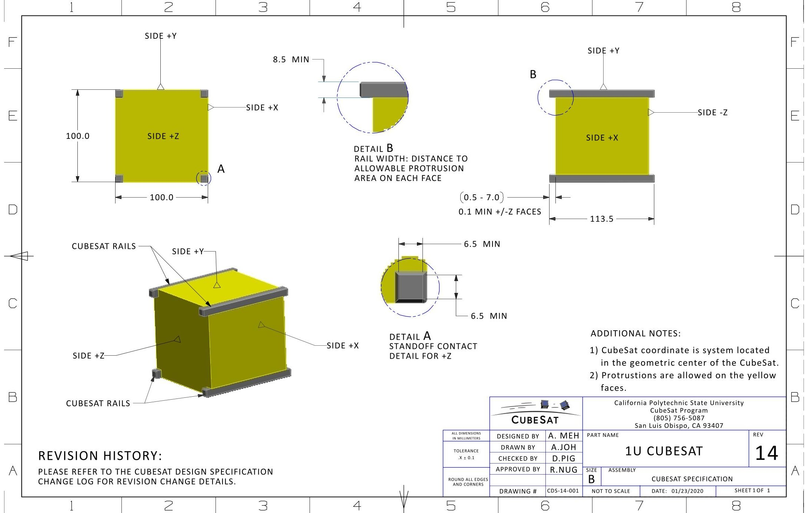

<!-- PDF_PAGE: 29 -->

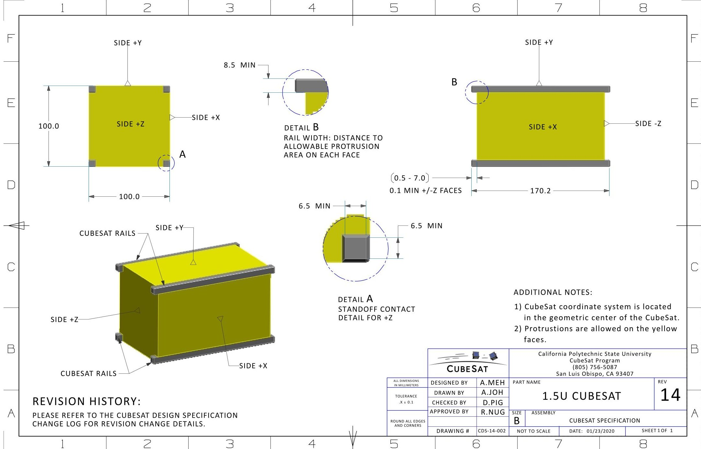

<!-- PDF_PAGE: 30 -->

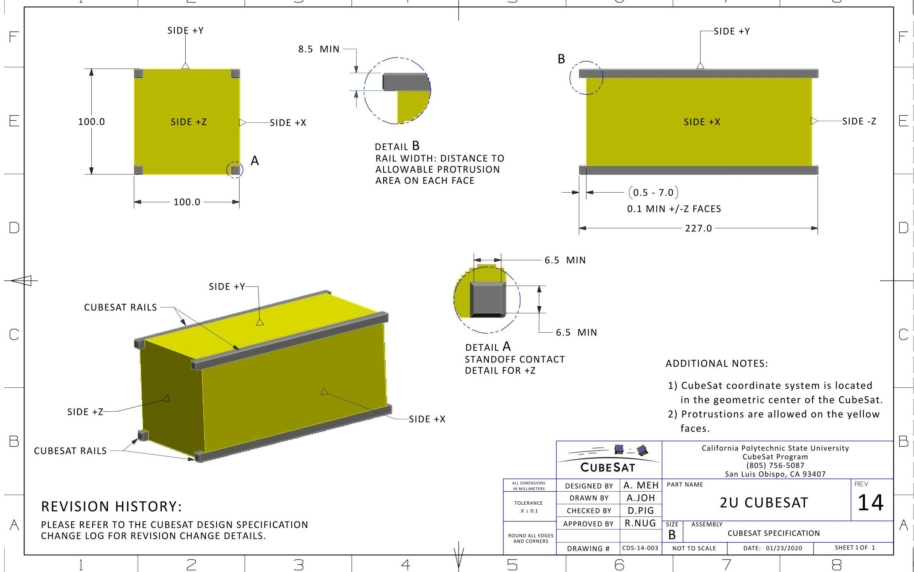

<!-- PDF_PAGE: 31 -->

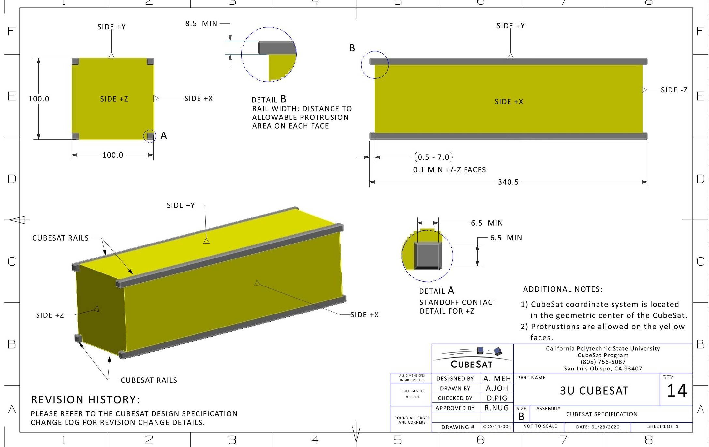

<!-- PDF_PAGE: 32 -->

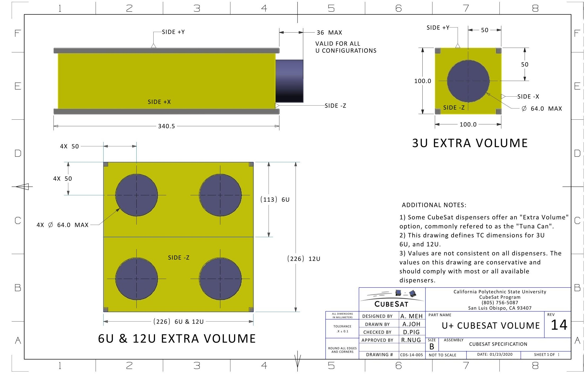

<!-- PDF_PAGE: 33 -->

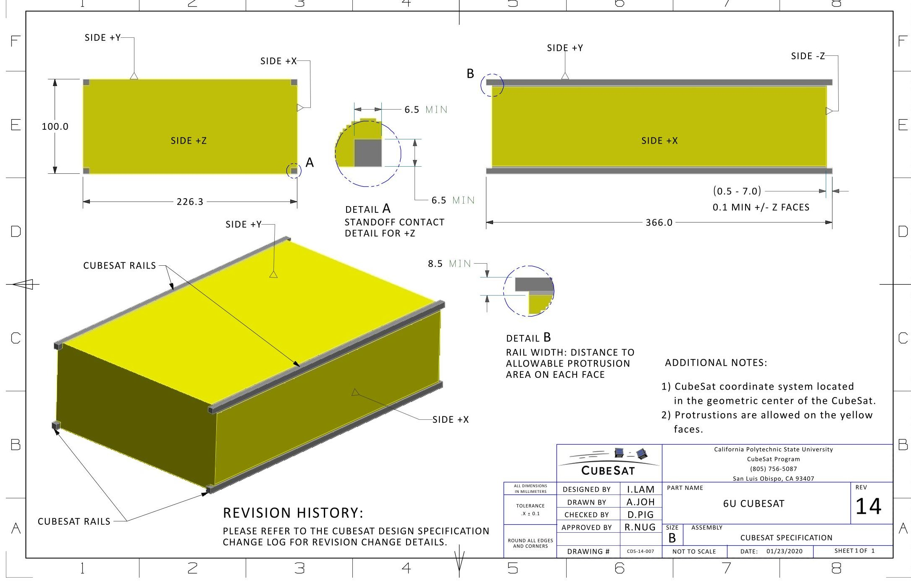

<!-- PDF_PAGE: 34 -->

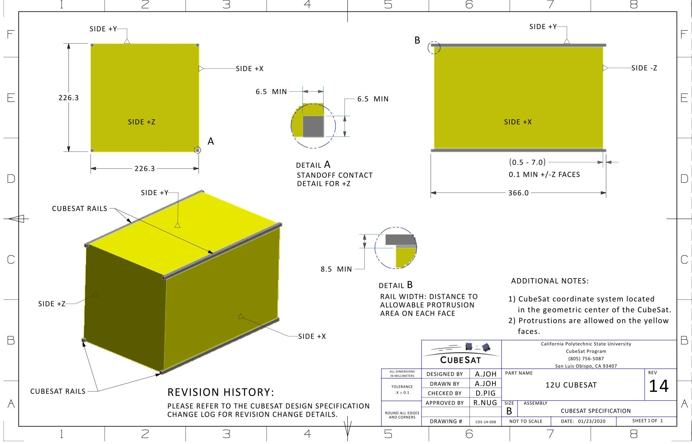

