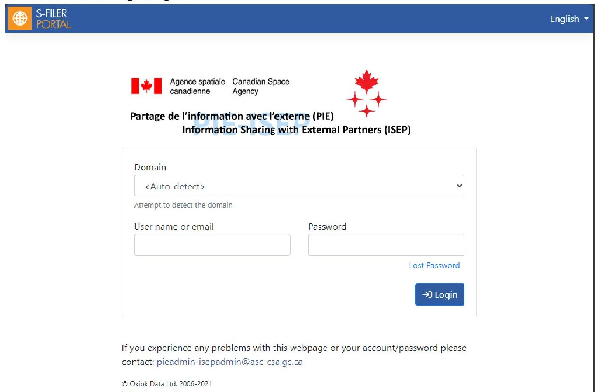
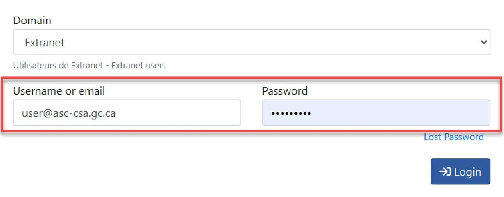
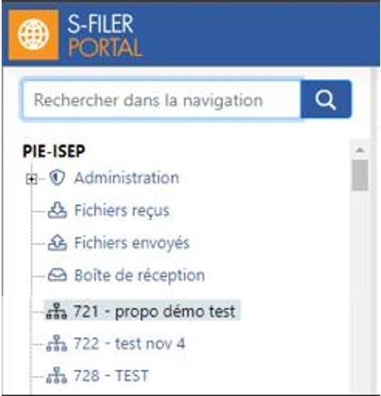
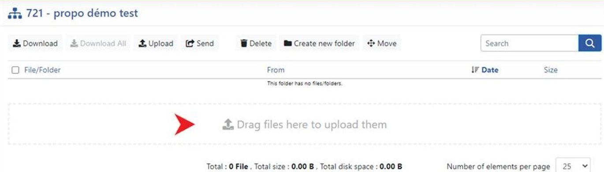
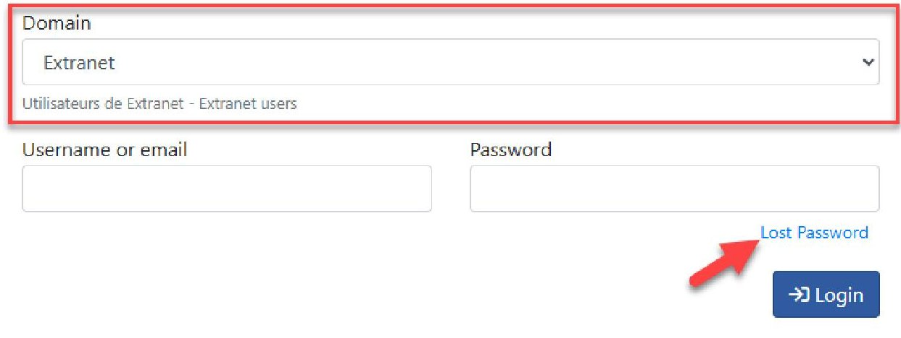

> Complete public administrative user guide, not an engineering standard.

<!-- PDF_PAGE: 1 -->

# PIE-ISEP: Guidelines for the use of protected document submission system

Log in to SFiler portal and access a community

Note: The login link and the following account information should have been provided to you by email beforehand:

- Username / Email Address associated with the account

- Password

## 1- Access the Portal Login Page :

## 2- Select the "Extranet" domain :

Domain

<table border="1"><tr><td>&lt;Auto-detect&gt;</td></tr><tr><td>&lt;Auto-detect&gt;</td></tr><tr><td>Extranet</td></tr><tr><td>Employees et Partenaires - Employees and Partners</td></tr></table>

<!-- PDF_PAGE: 2 -->

3- Enter the username (Email Address) associated with your account and your password, then click Login

4- In the left pane, below "Inbox", you will see the communities corresponding to the proposals you have submitted for various Announcements of Opportunity (AOs). Each community name begins with the AO identification number, followed by your proposal title.

5- Click the community where you want to upload documents. In the right-hand pane, simply drag and drop the files you wish to submit from your file explorer into the central upload area.

<!-- PDF_PAGE: 3 -->

Lost password

To reset your password:

1. Select the appropriate domain.

2. Click the "Lost Password" link.

3. Enter the email address associated with your account.

A password reset link will then be sent to your email address.

## Compatible Browsers

Here are the browsers that works with PIE-ISEP

<table border="1"><tr><td>BROWSER</td><td>SUPPORTED</td><td>COMMENT</td></tr><tr><td>Chrome</td><td>Yes</td><td>Version 40 or newer required. Limitation: allow to download 1 file at a time (does not allow to download several files at the same time).</td></tr><tr><td>Firefox</td><td>Yes</td><td>Version 44 or newer required. Limitation: allow to download 1 file at a time (does not allow to download several files at the same time).</td></tr><tr><td>Internet Explorer 11</td><td>No</td><td></td></tr><tr><td>Edge</td><td>Yes</td><td>Newer version. Limitation: allow to download 1 file at a time (does not allow to download several files at the same time).</td></tr><tr><td>Opéra</td><td>Yes</td><td></td></tr><tr><td>Safari</td><td>Yes</td><td></td></tr></table>
