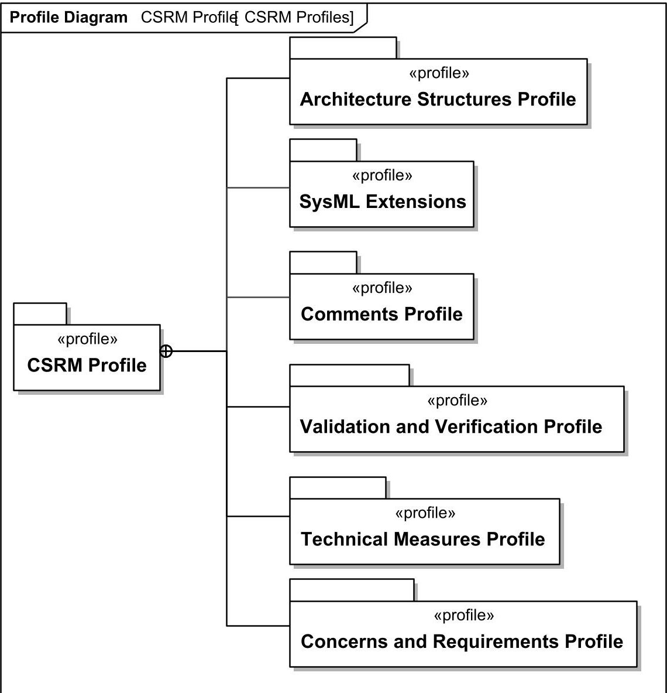
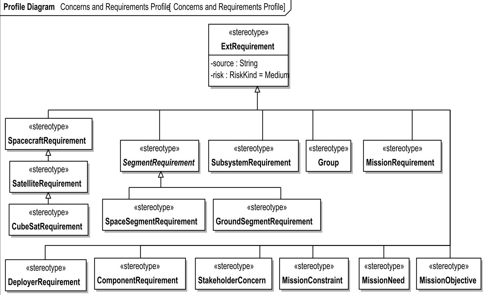
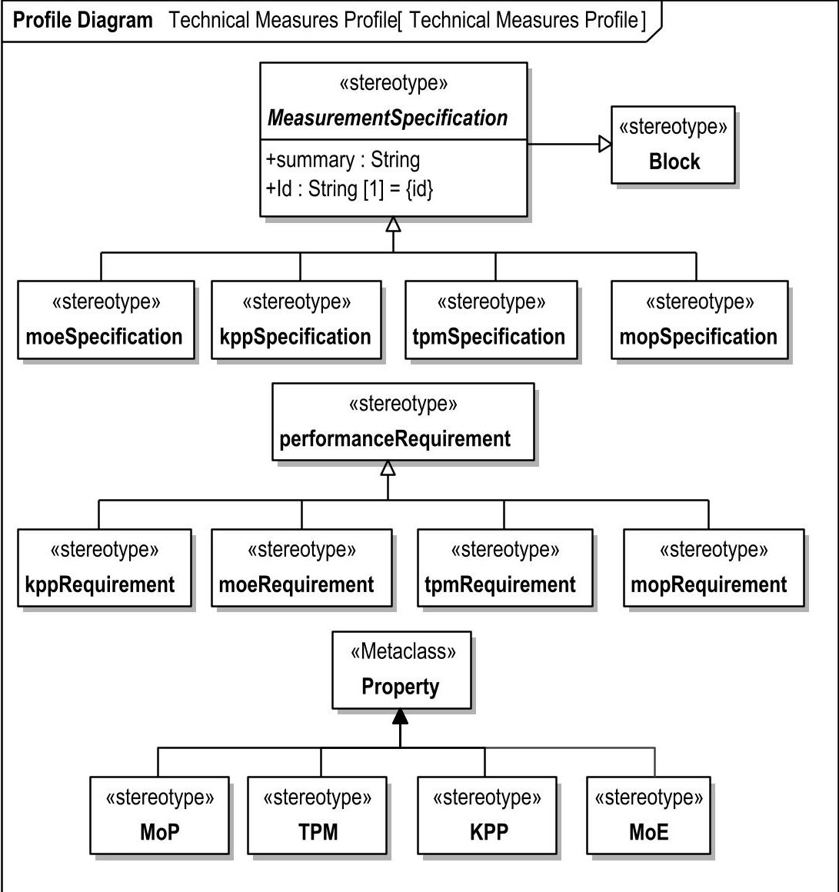
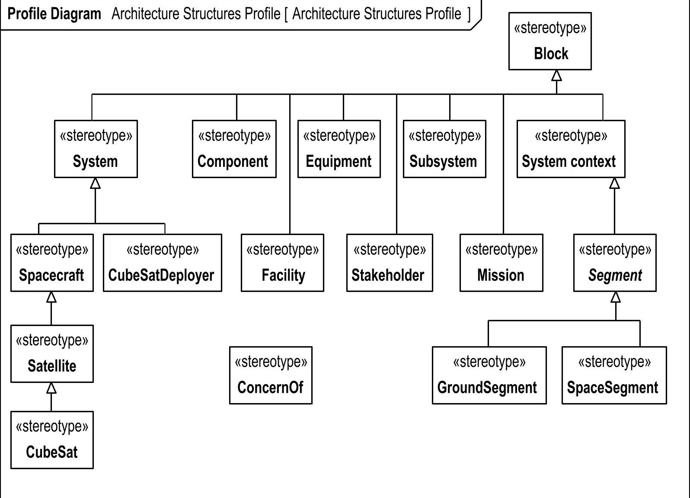
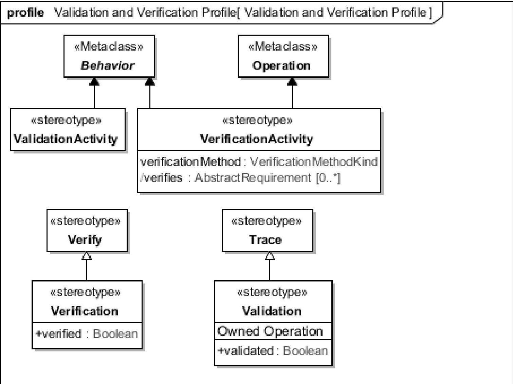
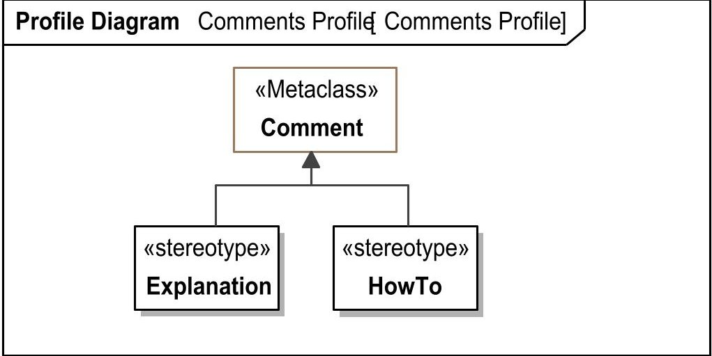
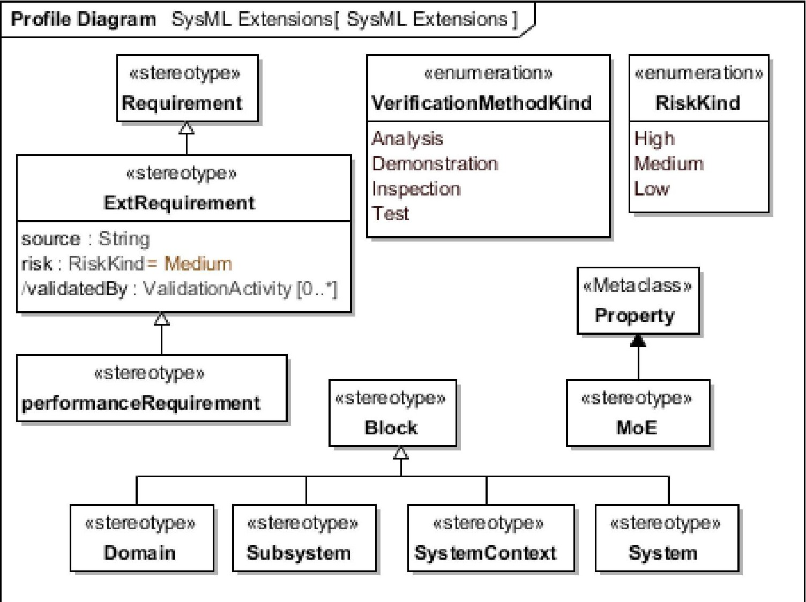

> Formal CSRM 1.0, superseded by 1.1. This is a historical source conversion, not CSRM 1.1 or the 2019 reference paper.

<!-- PDF_PAGE: 1 -->

Standards Development Organization

# CubeSat System Reference Model Profile

Version 1.0

OMG Document Number: formal/23-05-05

Standard Document URL: https://www.omg.org/spec/CSRM

<!-- PDF_PAGE: 2 -->

Copyright $ \textcircled{c} $ 2021-2022, Dassault Systèmes.

Copyright 2021-2022, Sparx Systems, Pty Ltd

Copyright 2021-2022, The Aerospace Corporation.

Copyright $ \textcircled{c} $ 2021-2022, International Council on Systems Engineering.

Copyright © 2021-2022, Braxton Technologies, LLC

Copyright $ \textcircled{c} $ 2021-2022, NASA

Copyright 2021-2023, Object Management Group, Inc

## USE OF SPECIFICATION - TERMS, CONDITIONS & NOTICES

The material in this document details an Object Management Group specification in accordance with the terms, conditions and notices set forth below. This document does not represent a commitment to implement any portion of this specification in any company's products. The information contained in this document is subject to change without notice.

## LICENSES

The companies listed above have granted to the Object Management Group, Inc. (OMG) a nonexclusive, royalty-free, paid up, worldwide license to copy and distribute this document and to modify this document and distribute copies of the modified version. Each of the copyright holders listed above has agreed that no person shall be deemed to have infringed the copyright in the included material of any such copyright holder by reason of having used the specification set forth herein or having conformed any computer software to the specification.

Subject to all of the terms and conditions below, the owners of the copyright in this specification hereby grant you a fully-paid up, non-exclusive, nontransferable, perpetual, worldwide license (without the right to sublicense), to use this specification to create and distribute software and special purpose specifications that are based upon this specification, and to use, copy, and distribute this specification as provided under the Copyright Act; provided that: (1) both the copyright notice identified above and this permission notice appear on any copies of this specification; (2) the use of the specifications is for informational purposes and will not be copied or posted on any network computer or broadcast in any media and will not be otherwise resold or transferred for commercial purposes; and (3) no modifications are made to this specification. This limited permission automatically terminates without notice if you breach any of these terms or conditions. Upon termination, you will destroy immediately any copies of the specifications in your possession or control.

## PATENTS

The attention of adopters is directed to the possibility that compliance with or adoption of OMG specifications may require use of an invention covered by patent rights. OMG shall not be responsible for identifying patents for which a license may be required by any OMG specification, or for conducting legal inquiries into the legal validity or scope of those patents that are brought to its attention. OMG specifications are prospective and advisory only. Prospective users are responsible for protecting themselves against liability for infringement of patents.

## IPR Mode

This specification is issued under the Non-Assert Mode based on the OMG IPR Policy. Each Obligated Party in a Non-Assert Mode Adoption or Revision Process must provide the Non-Assertion Covenant found in Appendix A of the OMG IPR Policy: https://www.omg.org/cgi-bin/doc.cgi?ipr

<!-- PDF_PAGE: 3 -->

Any unauthorized use of this specification may violate copyright laws, trademark laws, and communications regulations and statutes. This document contains information which is protected by copyright. All Rights Reserved. No part of this work covered by copyright herein may be reproduced or used in any form or by any means--graphic, electronic, or mechanical, including photocopying, recording, taping, or information storage and retrieval systems--without permission of the copyright owner.

## DISCLAIMER OF WARRANTY

WHILE THIS PUBLICATION IS BELIEVED TO BE ACCURATE, IT IS PROVIDED "AS IS" AND MAY CONTAIN ERRORS OR MISPRINTS. THE OBJECT MANAGEMENT GROUP AND THE COMPANIES LISTED ABOVE MAKE NO WARRANTY OF ANY KIND, EXPRESS OR IMPLIED, WITH REGARD TO THIS PUBLICATION, INCLUDING BUT NOT LIMITED TO ANY WARRANTY OF TITLE OR OWNERSHIP, IMPLIED WARRANTY OF MERCHANTABILITY OR WARRANTY OF FITNESS FOR A PARTICULAR PURPOSE OR USE. IN NO EVENT SHALL THE OBJECT MANAGEMENT GROUP OR ANY OF THE COMPANIES LISTED ABOVE BE LIABLE FOR ERRORS CONTAINED HEREIN OR FOR DIRECT, INDIRECT, INCIDENTAL, SPECIAL, CONSEQUENTIAL, RELIANCE OR COVER DAMAGES, INCLUDING LOSS OF PROFITS, REVENUE, DATA OR USE, INCURRED BY ANY USER OR ANY THIRD PARTY IN CONNECTION WITH THE FURNISHING, PERFORMANCE, OR USE OF THIS MATERIAL, EVEN IF ADVISED OF THE POSSIBILITY OF SUCH DAMAGES.

The entire risk as to the quality and performance of software developed using this specification is borne by you. This disclaimer of warranty constitutes an essential part of the license granted to you to use this specification.

## RESTRICTED RIGHTS LEGEND

Use, duplication or disclosure by the U.S. Government is subject to the restrictions set forth in subparagraph (c) (1) (ii) of The Rights in Technical Data and Computer Software Clause at DFARS 252.227-7013 or in subparagraph (c)(1) and (2) of the Commercial Computer Software - Restricted Rights clauses at 48 C.F.R. 52.227-19 or as specified in 48 C.F.R. 227-7202-2 of the DoD F.A.R. Supplement and its successors, or as specified in 48 C.F.R. 12.212 of the Federal Acquisition Regulations and its successors, as applicable. The specification copyright owners are as indicated above and may be contacted through the Object Management Group, 9C Medway Road, PMB 274, Milford, MA 01757, U.S.A.

## TRADEMARKS

CORBA $ ^{\circ} $ , CORBA logos $ ^{\circ} $ , FIBO $ ^{\circ} $ , Financial Industry Business Ontology $ ^{\circ} $ , FINANCIAL INSTRUMENT GLOBAL IDENTIFIER $ ^{\circ} $ , IIOP $ ^{\circ} $ , IMM $ ^{\circ} $ , Model Driven Architecture $ ^{\circ} $ , MDA $ ^{\circ} $ , Object Management Group $ ^{\circ} $ , OMG $ ^{\circ} $ , OMG Logo $ ^{\circ} $ , SoaML $ ^{\circ} $ , SOAML $ ^{\circ} $ , SysML $ ^{\circ} $ , UAF $ ^{\circ} $ , Unified Modeling Language $ ^{\circ} $ , UML $ ^{\circ} $ , UML Cube Logo $ ^{\circ} $ , VSIPL $ ^{\circ} $ , and XMI $ ^{\circ} $ are registered trademarks of the Object Management Group, Inc.

For a complete list of trademarks, see: https://www.omg.org/legal/tm_list.htm. All other products or company names mentioned are used for identification purposes only, and may be trademarks of their respective owners.

## COMPLIANCE

The copyright holders listed above acknowledge that the Object Management Group (acting itself or through its designees) is and shall at all times be the sole entity that may authorize developers, suppliers and sellers of computer software to use certification marks, trademarks or other special designations to indicate compliance with these materials.

Software developed under the terms of this license may claim compliance or conformance with this specification if and only if the software compliance is of a nature fully matching the applicable compliance points as stated in the specification. Software developed only partially matching the applicable compliance points may claim only that the software was based on this specification, but may not claim compliance or conformance with this specification. In the

<!-- PDF_PAGE: 4 -->

event that testing suites are implemented or approved by Object Management Group, Inc., software developed using this specification may claim compliance or conformance with the specification only if the software satisfactorily completes the testing suites.

## OMG's Issue Reporting Procedure

All OMG specifications are subject to continuous review and improvement. As part of this process we encourage readers to report any ambiguities, inconsistencies, or inaccuracies they may find by completing the Issue Reporting Form listed on the main web page https://www.omg.org, under Documents, Report a Bug/Issue.

<!-- PDF_PAGE: 5 -->

## Table of Contents

CubeSat System Reference Model Profile ... i

Preface ... viii

1 Scope ... 1

2 Conformance ... 1

3 References ... 1

3.1 Normative References ... 1

3.2 Non-normative References ... 2

4 Terms and definitions ... 3

5 Symbols and Abbreviations ... 3

6 CSRM Profile (Normative) ... 4

6.1 Concerns and Requirements Profile ... 4

6.1.1 StakeholderConcern ... 5

6.1.2 MissionObjective ... 5

6.1.3 MissionNeed ... 6

6.1.4 MissionConstraint ... 6

6.1.5 MissionRequirement ... 6

6.1.6 CubeSatRequirement ... 6

6.1.7 GroundSegmentRequirement ... 7

6.1.8 SubsystemRequirement ... 7

6.1.9 ComponentRequirement ... 7

6.1.10 DeployerRequirement ... 7

6.1.11 SpaceSegmentRequirement ... 7

6.1.12 Group ... 8

6.1.13 SpacecraftRequirement ... 8

6.1.14 SegmentRequirement ... 8

6.1.15 SatelliteRequirement ... 8

6.2 Technical Measures Profile ... 9

6.2.1 moeSpecification ... 9

6.2.2 mopSpecification ... 10

6.2.3 tpmSpecification ... 10

6.2.4 MOP ... 10

6.2.5 TPM ... 10

6.2.6 kppSpecification ... 10

6.2.7 KPP ... 11

6.2.8 MeasurementSpecification ... 11

6.2.9 mopRequirement ... 11

6.2.10 tpmRequirement ... 11

6.2.11 moeRequirement ... 12

6.2.12 kppRequirement ... 12

6.3 Architecture Structures Profile ... 13

6.3.1 Component ... 13

6.3.2 Segment ... 13

6.3.3 CubeSat ... 14

6.3.4 Facility ... 14

6.3.5 Equipment ... 14

6.3.6 Stakeholder ... 14

6.3.7 GroundSegment ... 14

6.3.8 SpaceSegment ... 15

6.3.9 Spacecraft ... 15

6.3.10 Satellite ... 15

6.3.11 CubeSatDeployer ... 15

6.3.12 Mission ... 16

6.3.13 ConcernOf ... 16

6.4 Validation and Verification Profile ... 17

<!-- PDF_PAGE: 6 -->

6.4.1 ValidationActivity ... 17

6.4.2 Validation ... 18

6.4.3 VerificationActivity ... 18

6.4.4 Verification ... 19

6.5 Comments Profile ... 19

6.5.1 Explanation ... 20

6.5.2 HowTo ... 20

6.6 SysML Extensions ... 20

6.6.1 performanceRequirement ... 21

6.6.2 MoE ... 21

6.6.3 ExtRequirement ... 21

6.6.4 System ... 21

6.6.5 SystemContext ... 22

6.6.6 Subsystem ... 22

6.6.7 Domain ... 22

6.6.8 VerificationMethodKind ... 22

6.6.9 RiskKind ... 23

<!-- PDF_PAGE: 7 -->

## Table of Figures

Figure 1 CSRM Profiles ... 4

Figure 2 Concerns and Requirements Profile ... 5

Figure 3 Technical Measures Profile ... 9

Figure 4 Architecture Structures Profile ... 13

Figure 5 Validation and Verification Profile ... 17

Figure 6 Comments Profile ... 19

Figure 7 SysML Extensions ... 20

<!-- PDF_PAGE: 8 -->

## Preface

## OMG

Founded in 1989, the Object Management Group, Inc. (OMG) is an open membership, not-for-profit computer industry standards consortium that produces and maintains computer industry specifications for interoperable, portable, and reusable enterprise applications in distributed, heterogeneous environments. Membership includes Information Technology vendors, end users, government agencies, and academia.

OMG member companies write, adopt, and maintain its specifications following a mature, open process. OMG's specifications implement the Model Driven Architecture $ ^{\circledR} $ (MDA $ ^{\circledR} $ ), maximizing ROI through a full-lifecycle approach to enterprise integration that covers multiple operating systems, programming languages, middleware and networking infrastructures, and software development environments. OMG's specifications include: UML $ ^{\circledR} $ (Unified Modeling Language $ ^{\mathrm{TM}} $ ); CORBA $ ^{\circledR} $ (Common Object Request Broker Architecture); CWM $ ^{\mathrm{TM}} $ (Common Warehouse Metamodel $ ^{\mathrm{TM}} $ ); and industry-specific standards for dozens of vertical markets.

More information on the OMG is available at https://www.omg.org/.

## OMG Specifications

As noted, OMG specifications address middleware, modeling and vertical domain frameworks. All OMG Specifications are available from the OMG website at:

## https://www.omg.org/spec

All of OMG's formal specifications may be downloaded without charge from our website. (Products implementing OMG specifications are available from individual suppliers.) Copies of specifications, available in PostScript and PDF format, may be obtained from the Specifications Catalog cited above or by contacting the Object Management Group, Inc. at:

OMG Headquarters

9C Medway Road, PMB 274

Milford, MA 01757

USA

Tel: +1-781-444-0404

Fax: +1-781-444-0320

Email: pubs@omg.org

Certain OMG specifications are also available as ISO standards. Please consult https://www.iso.org

<!-- PDF_PAGE: 9 -->

This page intentionally left blank.

<!-- PDF_PAGE: 10 -->

<!-- PDF_PAGE: 11 -->

## 1 Scope

The CubeSat System Reference Model Profile (CSRM Profile) defines the necessary stereotypes (extends SysML) for logical CubeSat space-ground architectures. The profile is intended to promote consistency and interoperability of logical CubeSat space/ground architectures models. The profile is intended to be used as-is or extended.

The CSRM Profile is composed of six sub-profiles

- Architecture Structures Profile - Extends the architectural structures of SysML to include common structure types (extensions of Block) of a CubeSat system.

- Comments Profile - Extends the Comment element to facilitate building of reference models with tool and instructional information.

- Concerns and Requirements Profile - Extends SysML with new requirement types to accommodate stakeholder needs, missions, and categorized requirements for the structural levels of specification of CubeSats and ground systems.

- SysML Extensions - Additional stereotypes similar to and slightly modified from the suggested SysML non-normative extensions found in Annex E: Non-normative Extensions of the OMG Systems Modeling Language specification.

- Technical Measures Profile - Extensions of SysML to enhance specification and categorization of technical measures.

- Validation and Verification Profile - Extension and enhancement to SysML to facilitate validation (correctness) and verification (testing) of requirements.

An example use of the CSRM Profile, is provided as a non-normative example of a CubeSat System Reference Model template available at: https://github.com/ObjectManagementGroup/CSRM. The example represents a template and starting elements focused on the United States government and its regulatory environment. Although the example is for the United States, the CSRM profile is government agnostic. Our goal is to add additional examples of the CSRM template with other regulatory context in the future (like the European Union and its European Space Agency).

This release of the CSRM Profile contains the stereotypes and some constraints. It is expected that future versions will extend the profile with additional constraints and stereotypes to aid in consistency and coverage of CubeSat space/ground domains.

## 2 Conformance

Conformant implementations must implement the CSRM Profile in its entirety. Ideally, the Profile should be usable "asis" however implementers may extend the profile as needed.

## 3 References

## 3.1 Normative References

The following normative documents contain provisions which, through reference in this text, constitute provisions of this specification. For dated references, subsequent amendments to, or revisions of, any of these publications do not apply.

- Object Management Group, "Unified Modeling Language, version 2.5.1," http://www.omg.org/spec/ UML/2.5.1, December 2017.

- Object Management Group, "Systems Modeling Language, version 1.6," http://www.omg.org/spec/ SysML/1.6, November 2019.

- Object Management Group, "XML Metadata Interchange, version 2.5.1," https://www.omg.org/spec/XMI/2.5.1 November 2019.

<!-- PDF_PAGE: 12 -->

## 3.2 Non-normative References

The following references were used to inform the contents of the CSRM Profile:

- CubeSat Systems Reference Model website: https://github.com/ObjectManagementGroup/CSRM. The referenced model uses a version of the CSRM Profile.

- INCOSE Systems Engineering Handbook, 4th ed., INCOSE-TP-2003-002-04 2015.

- NASA Systems Engineering Handbook, rev. 1, December 2007, NASA/SP-2007-6105 Rev1.

- S. Friedenthal, A. Moore, R. Steiner, A Practical Guide to SysML, 3nd ed., Elsevier, Waltham, MA, 2015.

- G. Roedler and C. Jones, Technical Measurement, ver. 1, INCOSE-TP-2003-020-01, December 2005.

- W. Larson, et. al., Applied Space Systems Engineering, (Space Technology Series), McGraw Hill, Boston, MA, 2009.

- J.R. Wertz, D. Everett, and J. Puschell, Eds., Space Mission Engineering: The New SMAD, (Space Technology. Library, Volume 28), Hawthorne, CA, Microcosm Press, 2011.

- Systems Engineering Book of Knowledge https://www.sebokwiki.org/wiki/Guide_to_the_Systems_Engineering_Body_of_Knowledge (SEBoK)

- ANSI/AIAA G-043A-2012, "Guide to the Preparation of Operational Concept Documents"

- "Operational Concepts and the Case for Use Cases: Unifying UML with Systems Engineering", Ray Jorgensen, 2002.

- "Reference Model for Service Oriented Architecture 1.0, OASIS Standard, 12 October 2006."

- "Reference Architecture Foundation for Service Oriented Architecture Version 1.0, 4 Dec. 2012."

- "Systems and software engineering - Architecture description" ISO/IEC/IEEE 42010:2011.

- "Systems Engineering Fundamentals," Defense Acquisition University Press, 2001.

- D. Kaslow, B. Ayres, P. Cahill, L. Hart, and R. Yntema. "A Model-Based Systems Engineering (MBSE) Approach for Defining the Behaviors of CubeSats." Proceedings of IEEE Aerospace Conference. Big Sky, MT. 2017.

- D. Kaslow, B. Ayres, P. Cahill, L. Hart. "A Model-Based Systems Engineering Approach for Technical Measurement with Application to a CubeSat." Proceedings of IEEE Aerospace Conference. Big Sky, MT. 2018.

- "Glossary of Defense Acquisition Acronyms and Terms", Defense Acquisition University https://www.dau.edu/glossary/Pages/Glossary.aspx

<!-- PDF_PAGE: 13 -->

## 4 Terms and definitions

The following are acronyms, references and terms that are used in the CSRM.

For a detailed understanding of the CubeSat domain and related terms, see the non-normative references.

Table 1: Acronyms

<table border="1"><tr><td>Term</td><td>Description</td></tr><tr><td>ConOps</td><td>Concept of Operations</td></tr><tr><td>CSRM</td><td>CubeSat System Reference Model</td></tr><tr><td>KPP</td><td>Key Performance Parameter</td></tr><tr><td>MOE</td><td>Measure of Effectiveness</td></tr><tr><td>MOP</td><td>Measure of Performance</td></tr><tr><td>RFP</td><td>Request for Proposal</td></tr><tr><td>SysML</td><td>Systems Modeling Language</td></tr><tr><td>TPM</td><td>Technical Performance Measure</td></tr><tr><td>UML</td><td>Unified Modeling Language</td></tr><tr><td>XMI</td><td>XML Metadata Interchange</td></tr></table>

## 5 Symbols and Abbreviations

The specification uses the same Symbology of UML.

<!-- PDF_PAGE: 14 -->

## 6 CSRM Profile (Normative)

The CSRM Profile contains the sub-profiles of the CubeSat System Reference Model (CSRM) Profile. The purpose of extensions is to add metadata, aid in dynamic reporting/analysis, validate a model's composition, and aid in grouping.

Figure 1: CSRM Profiles

The CSRM Profile diagram documents the sub-profiles contained in the CSRM Profile.

## 6.1 Concerns and Requirements Profile

The Concerns and Requirements Profile contains extensions to add requirement types common to CubeSat Systems and a replacement of SysML's《Stakeholder》to improve that traceability of Stakeholders to concerns.

The intent of this design to extend the requirement types of SysML is to support a top down analysis from the stakeholders high-level requirements through each level of detail in the architecture.

<!-- PDF_PAGE: 15 -->

Figure 2: Concerns and Requirements Profile

The Concerns and Requirements Profile contains extensions to better classify requirements for CubeSat systems.

## 6.1.1 StakeholderConcern

## Description

《StakeholderConcern》 is an interest in a system relevant to one or more of its stakeholders. A stakeholder concern could be manifest in many forms, such as one or more stakeholder needs, goals, expectations, responsibilities, requirements, design constraints, assumptions, dependencies, quality attributes, architecture decisions, risks, or other issues.

A Stakeholder can have multiple «StakeholderConcern»s, and a single «StakeholderConcern» can be shared by numerous «Stakeholder»s. The «ConcernOf» dependency relates «Stakeholder» to corresponding «StakeholderConcern».

《StakeholderConcern》are high-level requirements that specific requirements are derived.

The 'Text' attribute of «AbstractRequirement» is used to document the stakeholder concern.

## Generalization:

- CSRM Profile::SysML Extensions::ExtRequirement

## 6.1.2 MissionObjective

## Description

《MissionObjective》 is one of a broad set of goals that must be achieved to successfully satisfy the stated mission need, such as the purpose to be achieved, product to be produced, or a service to be performed.

<!-- PDF_PAGE: 16 -->

《MissionObjective》are derived from 《MissionNeed》or《StakeholderConcern》. A《MissionObjective》is usually not satisfied directly but one or more 《MissionRequirement》are created (derived) to translate to requirements that are then satisfied by a part of the design.

## Generalization:

- CSRM Profile::SysML Extensions::ExtRequirement

## 6.1.3 MissionNeed

## Description

《MissionNeed》is a concise description of a need or service that the system must provide. It should be solution independent and only describe the problem the system is supposed to solve. The mission need is the main driver of the architecture.

《MissionNeed》 is satisfied by one or more 《Mission》 or by one or more of its sub-elements. 《MissionObjective》 are derived from 《MissionNeed》. 《MissionConstraint》 can be used as a derived constraint of the 《MissionNeed》 that limits the scope of the 《MissionNeed》.

## Generalization:

- CSRM Profile::SysML Extensions::ExtRequirement

## 6.1.4 MissionConstraint

## Description

«MissionConstraint» is a limitation placed on cost, schedule, or implementation techniques available to the system designer. It is typically fixed and not subject to trades, e.g., mission budget and schedule.

《MissionConstraint》can be satisfied by any element that is a subject to the constraint. Alternatively, 《PerformanceRequirement》or specialization (like《moeRequirement》) can be created and derived from the 《MissionConstraint》and then the《PerformanceRequirement》is then satisfied by a corresponding value property.

## Generalization:

- CSRM Profile::SysML Extensions::ExtRequirement

## 6.1.5 MissionRequirement

## Description

《MissionRequirement》is a statement of facts and assumptions that define expectations on the system's capabilities in terms of mission objectives, environment, constraints, and measures of effectiveness (MoE).《MissionRequirement》are satisfied by《Mission》or one or more of its sub-elements and or derived further into《SpaceSegmentRequirement》和 《GroundSegmentRequirement》.《MissionRequirement》are derived from《MissionObjective》or directly derived from mission needs/constraints or stakeholder concerns.

## Generalization:

- CSRM Profile::SysML Extensions::ExtRequirement

## 6.1.6 CubeSatRequirement

## Description

《CubeSatRequirement》is a requirement specific to a《CubeSat》needed to design and operate the《CubeSat》or its parts. 《CubeSatRequirement》is a kind of Requirement on the CubeSat system satisfied by the《CubeSat》or by one or more of its sub-elements.

## Generalization:

- CSRM Profile::Concerns and Requirements Profile::SatelliteRequirement

<!-- PDF_PAGE: 17 -->

## 6.1.7 GroundSegmentRequirement

## Description

《GroundSegmentRequirement》is a requirement specific to a《GroundSegment》needed to design and operate the 《GroundSegment》or its parts. 《GroundSegmentRequirement》is a requirement of satisfied by a《GroundSegment》or by one or more of its sub-elements.

## Generalization:

- CSRM Profile::Concerns and Requirements Profile::SegmentRequirement

## 6.1.8 SubsystemRequirement

## Description

《SubsystemRequirement》 is a requirement specific to a《Subsystem》needed to design and operate a《Subsystem》or its parts. 《SubsystemRequirement》 is a requirement satisfied by a《Subsystem》or by one or more of its sub-elements.

## Generalization:

- CSRM Profile::SysML Extensions::ExtRequirement

## 6.1.9 ComponentRequirement

## Description

《ComponentRequirement》 is a requirement specific to a《Component》needed to design and operate the《component》or its parts. 《ComponentRequirement》 is a requirement Satisfied by a《Component》or by one or more of its sub-elements.

## Generalization:

- CSRM Profile::SysML Extensions::ExtRequirement

## 6.1.10 DeployerRequirement

## Description

《DeployerRequirement》 is a requirement specific to a《CubeSatDeployer》 needed to design and operate the 《CubeSatDeployer》 or its parts. 《DeployerRequirement》 is a requirement satisfied by a《CubeSatDeployer》 or by one or more of its sub-elements.

Note that the Deployer in this case is referring to the Deployer mechanism, not an organization.

## Generalization:

- CSRM Profile::SysML Extensions::ExtRequirement

## 6.1.11 SpaceSegmentRequirement

## Description

《SpaceSegmentRequirement》 is a requirement specific to a《SpaceSegment》 needed to design elements of the 《SpaceSegment》 and operate the 《SpaceSegment》 parts. 《SpaceSegmentRequirement》 is a requirement satisfied by a 《SpaceSegment》 or one or more composed-elements.

## Generalization:

- CSRM Profile::Concerns and Requirements Profile::SegmentRequirement

<!-- PDF_PAGE: 18 -->

## 6.1.12 Group

## Description

《Group》is used to organize requirements into nested hierarchies. A《Group》has nested (owns as nested classifiers) requirements that are categorized by the name of the《Group》.《Group》owned requirements are not sub-requirements as described by SysML (see 16.3.2.5 Requirement or the SysML specification).

A model may have many «Group» elements. For example, as a part of a larger set of requirements, some are contained (owned) in a «Group» named 'Functional Requirements' and another «Group» might be called 'Regulatory', each would own requirements related to those categories.

《Group》facilitates a de facto pattern in which hierarchical organization of requirements with some requirements only having a name with the text attribute blank to imply that they are used to categorize requirements. Using requirements in that manner can be confusing as there is no true indicator of the intent. 《Group》designates the requirement element as organizational, preventing such confusion.

## Generalization:

- CSRM Profile::SysML Extensions::ExtRequirement

## 6.1.13 SpacecraftRequirement

## Description

《SpacecraftRequirement》is a system requirement needed to design and operate a spacecraft and/or its subsystems. 《SpacecraftRequirement》is a requirement satisfied by one or more kind of《Spacecraft》。

## Generalization:

- CSRM Profile::SysML Extensions::ExtRequirement

## 6.1.14 SegmentRequirement

## Description

《SegmentRequirement》 is an abstract requirement that is satisfied by a《Segment》or its parts. Note that 《SegmentRequirement》 is a base type for 《SpaceSegmentRequirement》 and 《GroundSegmentRequirement》 and it is expected to only be used when creating a specific kind of《SegmentRequirement》。

## Generalization:

- CSRM Profile::SysML Extensions::ExtRequirement

## 6.1.15 SatelliteRequirement

## Description

《SatelliteRequirement》is a requirement of a satellite system needed to design and operate a satellite and/or its subsystems. 《SatelliteRequirement》is satisfied by a《Satellite》or one or more of its sub-elements. 《SatelliteRequirement》is derived from 《SpaceSegmentRequirement》or directly derived from mission needs/objectives/constraints or stakeholder concerns.

## Generalization:

- CSRM Profile::Concerns and Requirements Profile::SpacecraftRequirement

<!-- PDF_PAGE: 19 -->

## 6.2 Technical Measures Profile

The Technical Measures Profile adds extensions to the SysML profile for KPP, TPM, and MoE. The profile also adds 《MeasurementSpecification》 and its specializations which are used to define and describe measures.

Figure 3: Technical Measures Profile

The Technical Measures Profile diagram shows extensions of the SysML profile for identifying value property types KPP, MoP, TMP, and MoE with corresponding requirements and measurement specifications.

## 6.2.1 moeSpecification

## Description

The Measure of Effectiveness (MoE) Specification («moeSpecification») specifies attributes of a system that determine how well the system element is satisfying or expected to satisfy technical requirements. «moeSpecification» is a «Block» that specifies a technical measure, constraints, and measurement activities used to provide insight into the progress made in the definition and development of the technical solution, risks and issues. «moeSpecification» may refine 《MissionNeed》。

The «moeSpecification» captures Stakeholder descriptions of operational measures of success that are satisfied by «MoE» properties.

## Generalization:

- CSRM Profile::Technical Measures Profile::MeasurementSpecification

<!-- PDF_PAGE: 20 -->

## 6.2.2 mopSpecification

## Description

The Measure of Performance (MoP) Specification <<mopSpecification>> specifies attributes of a system that determine how well the system element is satisfying or expected to satisfy technical requirements. <<mopSpecification>> is a <<Block>> that specifies a technical measure, constraints, and measurement activities used to provide insight into the progress made in the definition and development of the technical solution, risks and issues.

The «mopSpecification» captures Stakeholder descriptions of physical or functional attributes relating to system operation that are to be transformed into one or more MoPs.

«mopSpecification» may refine MoE or KPP Specifications.

## Generalization:

- CSRM Profile::Technical Measures Profile::MeasurementSpecification

## 6.2.3 tpmSpecification

## Description

The Technical Performance Measure (TPM) Specification specifies attributes of a system that determine how well the system element is satisfying or expected to satisfy technical requirements. «tpmSpecification» is a «Block» that specifies a technical measure, constraints, and measurement activities used to provide insight into the progress made in the definition and development of the technical solution, risks and issues. «tpmSpecification» refine «tpmRequirement».

《tpmSpecification》may refine 《mopSpecification》.

## Generalization:

- CSRM Profile::Technical Measures Profile::MeasurementSpecification

## 6.2.4 MOP

## Description

The «MoP» stereotype represents a performance property of a system (or other element). The «MoP» stereotype is applied to a «ValueProperty» element to mark the property as a Measure of performance (MoP). MoP is an engineering performance measure that provides a value necessary for meeting a Measure of Effectiveness (MoE). «MoP» satisfy «mopRequirement».

## 6.2.5 TPM

## Description

The «TPM» stereotype represents a performance property of a system (or other element). Technical Performance Measure (TPM) of the attributes of a system element to determine how well the system element is satisfying or expected to satisfy specified technical requirements. They are based on the driving requirements or technical parameters of high risk or significance - e.g., mass, power, or data rate. Actual versus planned progress of TPMs are tracked so the systems engineer or project manager can assess progress and the risk associated with each TPM.

## 6.2.6 kppSpecification

## Description

«kppSpecification» is a «Block» that specifies a technical measure, constraints, and measurement activities used to provide insight into the progress made in the definition and development of the technical solution, risks and issues. «kppSpecification» is a refinement of a Key Performance Parameter (KPP) requirement of a «Block». KPPs are a critical subset of Technical Measures representing the most critical capabilities and characteristics.

## Generalization:

- CSRM Profile::Technical Measures Profile::MeasurementSpecification

<!-- PDF_PAGE: 21 -->

## 6.2.7 KPP

## Description

Key Performance Parameter (KPP) represents a performance property of a system (or other element). KPPs are a critical subset of Technical Measures representing the most critical capabilities and characteristics. The «KPP» stereotype is applied to a «ValueProperty» of a «Block». «KPP» Satisfy «kppRequirement».

The «KPP» stereotype applied to a value property of a Block.

## Generalization:

- CSRM Profile::Technical Measures Profile::MeasurementSpecification

## 6.2.8 MeasurementSpecification

## Description

Measurement Specification is a «Block» that specifies a technical measure, constraints, and measurement activities used to provide insight into the progress made in the definition and development of the technical solution, risks, and issues.

The «MeasurementSpecification» is an abstract stereotype that is the base for defining specific measurement specifications. This is an extension of «Block» to allow the full capability of a «Block» to be used in the specification of a measurement.

A MeasurementSpecification are intended to be Validated by a ValidationActivity.

## Generalization:

- SysML::Blocks::Block

## Attributes:

- id:String[1] - The unique id of the MeasurementSpecification.

- Summary: String - The summary is a textual description of constraints, and measurement activities used to provide insight into the progress made in the definition and development of the technical solution, risks, and issues.

## 6.2.9 mopRequirement

## Description

A Measure of Performance (MoP) Requirement («mopRequirement») is a requirement specific to a «MoP» property that specifies performance criteria for the element. «mopRequirement» is a type of Performance Requirement («performanceRequirement») that is satisfied by a «MoP» property of a «Block».

In a «refine», the «mopSpecification» is the supplier property and the client property is a «mopRequirement». In a «satisfy», the «mopRequirement» is the supplier property and the client property is a «MoP».

## Generalization:

- CSRM Profile::SysML Extensions::performanceRequirement

## 6.2.10 tpmRequirement

## Description

A Technical Performance Measure (TPM) Requirement («tpmRequirement») is a requirement specific to a «TPM» property that specifies performance criteria for the element. «mopRequirement» is a type of Performance Requirement («performanceRequirement») that is satisfied by a «TPM» property of a «Block».

<!-- PDF_PAGE: 22 -->

In a «refine», the «tpmSpecification» is the supplier property and the client property is a «tpmRequirement». In a «satisfy», the «tpmRequirement» is the supplier property, and the client property is a «TPM».

## Generalization:

- CSRM Profile::SysML Extensions::performanceRequirement

## 6.2.11 moeRequirement

## Description

A Measure of Performance (MoE) Requirement («moeRequirement») is a requirement specific to a «MoE» property that specifies performance criteria for the element. «moeRequirement» is a type of Performance Requirement («performanceRequirement») that is satisfied by a «MoE» property of a «Block».

In a «refine», the «moeSpecification» is the supplier property, and the client property is a «moeRequirement». In a «satisfy», the «moeRequirement» is the supplier property, and the client property is a «MoE».

## Generalization:

- CSRM Profile::SysML Extensions::performanceRequirement

## 6.2.12 kppRequirement

## Description

A Key Performance (KPP) Requirement («kppRequirement») is a requirement specific to a «KPP» property that specifies performance criteria for the property. «kppRequirement» is a type of Performance Requirement («performanceRequirement») that is satisfied by a KPP property of a «Block».

In a «refine», the «kppSpecification» is the supplier property, and the client property is a «kppRequirement». In a «satisfy», the «kppRequirement» is the supplier property, and the client property is a «KPP».

## Generalization:

- CSRM Profile::SysML Extensions::performanceRequirement

<!-- PDF_PAGE: 23 -->

## 6.3 Architecture Structures Profile

This profile extends the architectural structures of SysML to include common structure types (extensions of Block) of a CubeSat system.

Figure 4: Architecture Structures Profile

The Architecture Structures Profile diagram shows the structural extensions added to the SysML profile used to enhance SysML for CubeSat design.

## 6.3.1 Component

## Description

The 《Component》 is a type of 《Block》 that is a part of a subsystem element such as a hardware component, software, or procedures. 《Component》 satisfies 《ComponentRequirement》。

## Generalization:

- SysML::Blocks::Block

## 6.3.2 Segment

## Description

A «Segment» is one of the parts into which something naturally separates or is divided. The «Segment» is abstract and intended to be implemented as a specific kind of segment like «GroundSegment» and «SpaceSegment».

<!-- PDF_PAGE: 24 -->

- CSRM Profile::SysML Extensions::System context

## 6.3.3 CubeSat

## Description

The 《CubeSat》 is a type of 《Satellite》. A CubeSat follows the CubeSat form-factor established in 1999 by California Polytechnic State University and Stanford University.

《CubeSat》is a part of a《SpaceSegment》and satisfies one or more《CubeSatRequirement》.

## Generalization:

- CSRM Profile::Architecture Structures Profile::Satellite

## 6.3.4 Facility

## Description

A «Facility» is a place, amenity, or piece of equipment provided for a particular purpose.

A «Facility» may be a part of another «Facility». Generally «Facility» is part of a «GroundSegment».

## Generalization:

- SysML::Blocks::Block

## 6.3.5 Equipment

## Description

《Equipment》 is a type of 《Block》 used to represent tools, machines, or other items required for a particular job or activity. Generally 《Equipment》 are part of a 《Facility》.

## Generalization:

- SysML::Blocks::Block

## 6.3.6 Stakeholder

## Description

A «Stakeholder» is a «Block» representing any entity (individual or organization) that has an interest in the system. Typical stakeholders include users, operators, decision-makers, parties to the agreement, regulatory bodies, developing agencies, support organizations, and society at large. Stakeholders can also represent an entity in opposition or threat to the system.

Stakeholder is a replacement of the SysML Stakeholder and should be used in its place.

Note: Because of the incompatibility between the SysML «Stakeholder» and the CSRM «Stakeholder», «ConcernOf» should be used to relate «ViewPoint» to «Stakeholder» property of the «ViewPoint».

## Generalization:

- SysML::Blocks::Block

## 6.3.7 GroundSegment

## Description

The 《GroundSegment》 is a kind of 《Segment》 composed of kinds of Block like 《Facility》》，《System》 and 《Equipment》 or other 《GroundSegment》. The composed parts of 《GroundSegment》 represent systems and facilities like the following:

<!-- PDF_PAGE: 25 -->

- Ground stations, which provide communication interfaces with spacecraft (in the «SpaceSegment»)

- Mission operations, from which spacecraft are managed, including activities like mission planning and scheduling, command and control of satellites, control of the ground equipment, mission telemetry processing, and mission data processing and distribution

- Ground networks, which connect the other ground elements to one another

- Remote terminals, used by support personnel

- Spacecraft integration and test facilities

- Launch facilities

«GroundSegment» is a kind of «Segment» and usually satisfies one or more «GroundSegmentRequirement».

Generalization:

- CSRM Profile::Architecture Structures Profile::Segment

## 6.3.8 SpaceSegment

## Description

The 《SpaceSegment》 is a 《Segment》 that is composed of types of 《spacecraft》。In addition the 《SpaceSegment》 may be also be composed of 《blocks》 representing orbits, the uplink/downlink and the space environment (radiation, atmospheric density, solar wind, etc.). The 《SpaceSegment》 is controlled by and communicates with the 《GroundSegment》。The 《SpaceSegment》 satisfies one or more 《SpaceSegment》 requirements.

## Generalization:

- CSRM Profile::Architecture Structures Profile::Segment

## 6.3.9 Spacecraft

## Description

Spacecraft is a kind of System Block representing a spacecraft systemfor example, satellite, rocket, rocket stage interplanetary vehicle, or space station.

## Generalization:

- CSRM Profile::SysML Extensions::System

## 6.3.10 Satellite

## Description

A 《Satellite》 is a kind of 《Spacecraft》 representing an orbital satellite system.

## Generalization:

- CSRM Profile::Architecture Structures Profile::Spacecraft

## 6.3.11 CubeSatDeployer

## Description

«CubeSatDeployer» is a type of «System» used to deploy one or more «CubeSat».

## Generalization:

- CSRM Profile::SysML Extensions::System

<!-- PDF_PAGE: 26 -->

## 6.3.12 Mission

## Description

A «Mission» describes what the system will do and the purpose of doing it. The Mission provides the context for defining measures of effectiveness and for the development of the Concept of Operations.

A mission is accomplished by operational nodes completing one or more operational activities. An operational node can be an organization, individual(s), or system(s). Operational activities are actions that either transform one or more inputs into outputs or change the state of the system. A system provides capabilities through the execution of operational activities. There may be one or more missions composed of Space and Ground segments. Missions may also be composed of one or more missions (sub-missions).

## Generalization:

- SysML::Blocks::Block

## 6.3.13 ConcernOf

## Description

The «ConcernOf» stereotype is a dependency relationship used to relate an element of the model to a «Stakeholder». The client of the dependency can be any element and the supplier must be a type of «Stakeholder» that has a concern. The documentation of the dependency can be used to document the concern(s) the stakeholder has about the element.

Another client of ConcernOf is the StakeholderConcern].《StakeholderConcern》is a specialized requirement that can be used to document a stakeholder concern for use in creating derived requirements from the concern.

<!-- PDF_PAGE: 27 -->

## 6.4 Validation and Verification Profile

The Validations and Verification Profile has extensions of SysML for validation and verification of requirements.

Figure 5: Validation and Verification Profile

The Validation and Verification profile diagram shows the extensions of the SysML profile.

The profile introduces 《VerificationActivity》，a process (Behavior) for verifying a requirement. The 《Verification》 relationship maps the 《VerificationActivity》 to a requirement or measurement specification that it verifies. The 《Verify》 has the verified property to indicate the status of a measurement specification or requirement's verification status as a result of performing the related 《VerificationActivity》。

The profile also introduces《ValidationActivity》，a process (Behavior) for validating a requirement is correct. The 《Validation》 relationship maps the《ValidationActivity》to a requirement or measurement specification that it validates. The《Validation》 has the validated property to indicate the status of a measurement specification or requirement's validation status as a result of performing the related《VerificationActivity》。

In addition, the 《VerificationActivity》 has the property verificationMethod such that the VerificationMethodKind of a requirement can be aligned with the 《VerificationActivity》.

## 6.4.1 ValidationActivity

## Description

The《ValidationActivity》stereotype is applied to a process for validating requirements and technical specifications for correctness, implementability, testability, and that the requirement meets the needs of stakeholders. It often involves acceptance and suitability with customers. The requirements should also be annotated with a《rationale》comment. The activity to validate one or more requirements is often an analysis task performed in concert with the stakeholders to ensure the following:

<!-- PDF_PAGE: 28 -->

- The set of requirements is correct, complete, and consistent,

- A model can be created that satisfies the requirements, and

- A real-world solution can be built and tested to prove that it satisfies the requirements.

The state of the analysis is recorded by the validated property of «Validation».

The «ValidationActivity» has a metaclass of Behavior, which allows the modeler to choose the appropriate type of modeling element (Activity, Sequence, etc.) to document the process. Note that the documentation of the ValidationActivity can also be used to capture the process.

## 6.4.2 Validation

## Description

《Validation》 is a relationship between a source element (《AbstractRequirement》 or technical specification) and a client element (《ValidationActivity》).

The element has a boolean property, validated, which is used to document the status of the validation activity. The property has the following meaning:

- undefined(default): The element has not been validated.

- false: The supplier element has been validated and is considered invalid according to the 《ValidationActivity》.

- true: The supplier element has been validated and is deemed to be valid according to the 《ValidationActivity》.

Note that the requirement or technical specification is the driver (supplier) of the relationship. This means that if the supplier element changes, the state of validated property should be changed to unknown until the «ValidationActivity» is performed for the changed element. Changes to a «ValidationActivity» implies the need for re-running the «ValidationActivity» for each supplier but are based on the possibility of invalidating the validation state.

## Generalization:

- SysML::Requirements::Trace

## Operations:

- getValidates - The query getValidates() returns all the NamedElements that are suppliers ( "to" end of the concrete syntax ) of a «Validation» relationship whose client is the element input parameter, ref. This is a static query. Due to constraints, the getValidates() returns types of Abstract Requirement and Measurement Specification.

Parameters:

- in ref : NamedElement [1]

- return result : NamedElement [0..*]

## 6.4.3 VerificationActivity

## Description

The «VerificationActivity» stereotype is intended to extend SysML to add a verificationMethod (from SysML) such that the Test Case or other behavior method can be annotated with the kind of verification. This improves the original SysML to allow a Requirement to have multiple verification methods by moving the method to the «VerificationActivity» rather than the Requirement.

《VerificationActivity》has the attribute verificationMethod which is a VerificationMethodKind. Users are encouraged to set the verificationMethod on 《VerificationActivity》rather than on the Requirement as this allows a requirement to be verified by many verification method kinds.

<!-- PDF_PAGE: 29 -->

## Attributes

- verificationMethod : VerificationMethodKind -The verificationMethod indicates the primary method that 《VerificationActivity》uses to verify a Requirement.

- /verifies : AbstractRequirement - The requirements that this VerificationActivity verifies.

## Operations:

- getVerifies():ValidationActivity - The query getVerifies() returns all the NamedElements that are suppliers ( "to" end of the concrete syntax ) of a «Verifies» relationship whose client is the element input parameter, ref. This is a static query.

Specification:

Verification.allInstances()->select(base_Abstraction.client=ref).base_Abstraction.supplier

## 6.4.4 Verification

## Description

《Verification》is a relationship between a type of《AbstractRequirement》(the client of the Abstraction relationship) and a《VerificationActivity》(the supplier of the Abstraction relationship). The relationship is to associate a prescribed Verification Activity that tests for the satisfaction of a requirement.

The 《Verification》 stereotype has a boolean property, verified, which is used to document the performance of the 《VerificationActivity》. The property has the following meaning:

- Unset(default): The supplier element has not been verified by the «VerificationActivity».

- false: The supplier element has failed the «VerificationActivity».

- true: The supplier element has passed the «VerificationActivity».

A change of the supplier or client elements should be followed by a change to the verified property to unknown. The verification property is also changed whenever the《VerificationActivity》 is performed.

Note: The 《Verification》 should be used instead of the 《verify》 of SysML.

## Generalization:

- SysML::Requirements::Verify

## 6.5 Comments Profile

The Comments Profile adds comment types to aid in classifying comments when creating a reference model.

Figure 6: Comments Profile

The Comments diagram shows the CSRM extensions added to the SysML profile to add additional types of comment: 《Explanations》 and 《HowTo》.

<!-- PDF_PAGE: 30 -->

## 6.5.1 Explanation

## Description

The «Explanation» stereotype is a type of «comment» used to contain explanatory text. This type of comment is used for documenting what model elements are to be created, why they are created or other tutorial information.

## 6.5.2 HowTo

## Description

The «HowTo» stereotype is a type of «comment» used to contain instructions on how to do a modeling tool task. For example, how elements of the model are created. These comments are usually tool-specific instructions.

## 6.6 SysML Extensions

This package contains stereotypes that are a subset of stereotypes and enumerations from the suggested SysML nonnormative extensions found in "Annex E: Non-normative Extensions" of the SysML specification.

The SysML Extensions profile contains the «MoE» stereotype, extensions of «Block» («Domain», «Subsystem», 《System Context》, 《System》） and extension of «Requirement» («ExtRequirement》） and two enumerations, VerificationMethodKind and RiskKind, that are used in the «ExtRequirement» to document verification method and risk respectively.

Figure 7: SysML Extensions

The SysML Extensions diagram documents the elements added that are used instead of the SysML non-normative extensions described by the SysML Specification.

<!-- PDF_PAGE: 31 -->

## 6.6.1 performanceRequirement

## Description

Requirement that quantitatively measures the extent to which a system, or a system part, satisfies a required capability or condition.

Note: This stereotype should be used instead of the «performanceRequirement» in the SysML non-normative extension of SysML.

## Generalization:

- CSRM Profile::SysML Extensions::ExtRequirement

## 6.6.2 MoE

## Description

Measure of Effectiveness (MoE) represents a performance property of a system (or other element). The <<MoE>> stereotype is applied to a <<valueProperty>> to mark the property as a MoE. The stereotype indicates an engineering performance measure. An <<MoE>> property represents a parameter whose value is used to measure the effectiveness of a <<Block>>. MoE are measures designed to correspond to the accomplishment of mission objectives and the achievement of desired results. MoE quantify the results to be obtained by a system.

Each <<MoE>> should satisfy a kind of <<moeRequirement>>.

Note: This stereotype should be used instead of the <<MoE>> in the SysML non-normative extension of SysML.

## 6.6.3 ExtRequirement

## Description

The «ExtRequirement» is a mix-in stereotype that contains generally useful attributes for requirements.

Note: This stereotype should be used instead of the «ExtendedRequirement» in the SysML non-normative extension of SysML

## Generalization:

SysML::Requirements::Requirementspecification:

## Attributes

- risk : RiskKind - Risk level of the requirement.

- source : String - Source (originating person and/or organization) of the requirement.

- /validatedBy : ValidationActivity[0..*] - The validatedBy is derived from all elements that are the client of a «validation» relationship for which this requirement is a supplier.

## Operations:

- getValidatedBy - The query getValidatedBy() returns all the NamedElements that are suppliers ( "to" end) of a 《Validation》 relationship whose client is the element input parameter, ref.

- specification:

Validate.allInstances()->select(base Abstraction.client=ref).base_Abstraction.supplier

## 6.6.4 System

## Description

A System is an artificial artifact consisting of blocks that pursue a common goal that cannot be achieved by the system's individual elements. A block can be software, hardware, a person, or an arbitrary unit.

<!-- PDF_PAGE: 32 -->

Note: This stereotype should be used instead of the «System» in the SysML non-normative extension of SysML.

## Generalization:

- SysML::Blocks::Block

## 6.6.5 SystemContext

## Description

A SystemContext element is a virtual container that includes the entire system and its actors.

Note: This stereotype should be used instead of the System Context in the SysML non-normative extension of SysML.

## Generalization:

- SysML::Blocks::Block

## 6.6.6 Subsystem

## Description

A Subsystem is a - typically large - encapsulated block within a larger system.

Note: This stereotype should be used instead of the «Subsystem» in the SysML non-normative extension of SysML.

## Generalization:

- SysML::Blocks::Block

## 6.6.7 Domain

## Description

A «Domain» block represents an entity, a concept, a location, or a person from the real-world domain.

Note: This stereotype should be used instead of the «Domain» in the SysML non-normative extension of SysML.

## Generalization:

- SysML::Blocks::Block

## 6.6.8 VerificationMethodKind

VerificationMethodKind is an Enumeration that specifies the kind of verification specified for a requirement or the kind of a verification activity. The following are the kinds of verification methods:

1) Analysis indicates that verification will be performed by technical evaluation using mathematical representations, charts, graphs, circuit diagrams, data reduction, or representative data. Analysis also includes the verification of requirements under conditions, which are simulated or modeled; where the results are derived from the analysis of the results produced by the model,

2) Demonstration indicates that verification will be performed by operation, movement or adjustment of the item under specific conditions to perform the design functions without recording of quantitative data. Demonstration is typically considered the least restrictive of the verification types,

3) Inspection indicates that verification will be performed by examination of the item, reviewing descriptive documentation, and comparing the appropriate characteristics with a predetermined standard to determine conformance to requirements without the use of special laboratory equipment or procedures, and

4) Test indicates that verification will be performed through systematic exercising of the applicable item under appropriate conditions with instrumentation to measure required parameters and the collection, analysis, and evaluation of quantitative data to show that measured parameters equal or exceed specified requirements.

<!-- PDF_PAGE: 33 -->

Note: This enumeration should be used instead of the VerificationMethodKind in the SysML non-normative extension of SysML.

VerificationMethodKind is an enumeration consisting of the following enumeration literals:

- Analysis

- Demonstration

- Inspection

- Test

## 6.6.9 RiskKind

RiskKind is an enumeration that specifies the level of risk.

1) High indicates an unacceptable level of risk,

2) Medium indicates an acceptable level of risk, and

3) Low indicates a minimal level of risk or no risk.

Note: This enumeration should be used instead of the RiskKind in the SysML non-normative extension of SysML.

RiskKind is an enumeration consisting of the following enumeration literals:

- High

- Medium

- Low
