> 2023 reference overview and training document, not a formal modeling-profile specification.

<!-- PDF_PAGE: 1 -->

Below is an overview of CSRM Documentation Items 1-4 are internal to the CSRM Items 5 and 6 are relate to the self-documentation of packages and package diagrams Items 7 and 8 are external to the CSRM

## CSRM Documentation - Overview

1 - Overview and Navigation Package

2 - Reference Information Package

3 - Population Packages

4 - Examples and Illustrations Packages

5 - Example of Hovering a Cursor to Reveal Definitions and Descriptions

6 - Example of Using Comments to Provide: Explanation and How-To

7 - Papers and Presentations

8-Memos

Memos provide guidance in addition to the Explanation and How-To comments imbedded in the CSRM.

<!-- PDF_PAGE: 2 -->

## CSRM Overview and Navigation Page

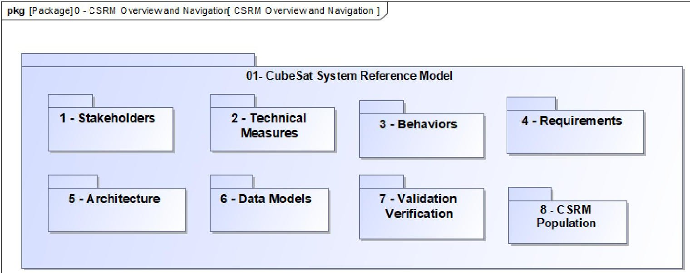

1 - CSRM Overview and Navigation Package

XX

<!-- PDF_PAGE: 3 -->

## CSRM Reference Information Package

Use of these terms in the CSRM will be noted with an underline and hovering the cursor over a term exposes the definition of the term. The definition is populated in the documentation property of the term. Additionally hovering over a package exposes the description of package,

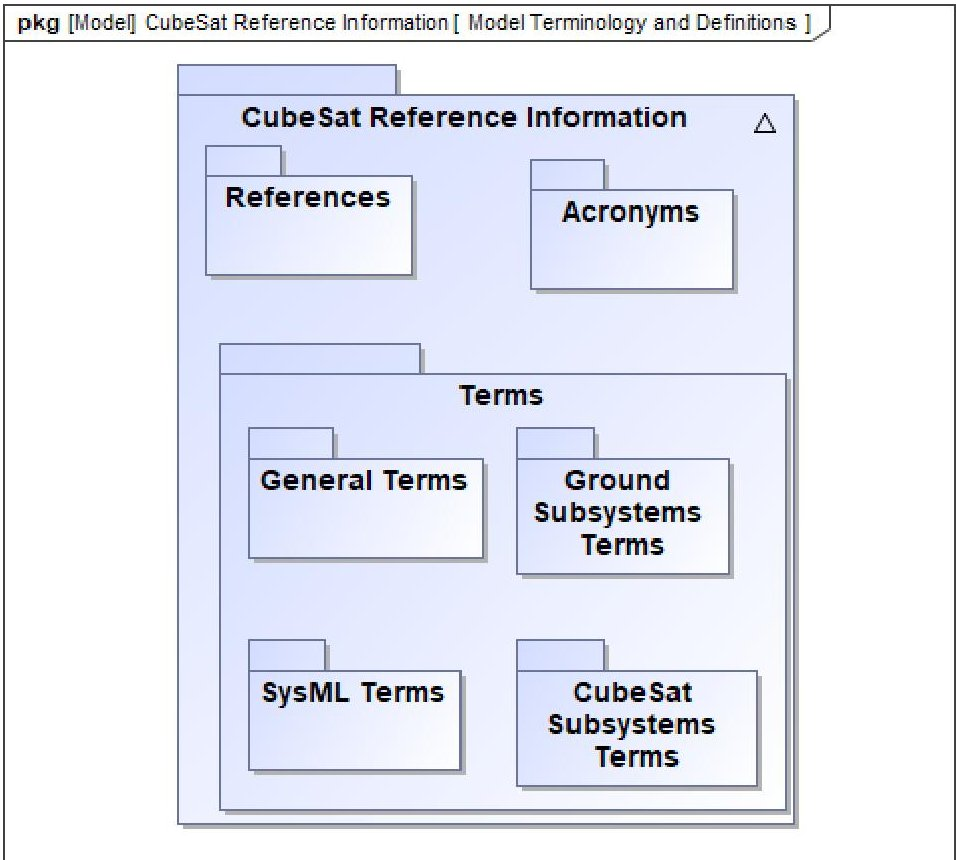

2 - CSRM Reference Information

XX

<!-- PDF_PAGE: 4 -->

The CSRM Population package is a centralized collection of all population packages.

Regulatory Agency Stakeholders and Concerns - Population

Mission Stakeholders and Requirements - Population

Technical Measures - Specifications and Requirements - Population

Behaviors - Use Cases - Activities - Population

Requirements Hierarchy -Population

CubeSat Rqts - Population

CubeSat Subsystems Rqts - Population

CubeSat Components Rqts - Population

CubeSat Subsystems -Population

CubeSat Components - Population

Ground Segment Rqts - Population

Ground Subsystem Rqts - Population

Ground Component Rqts - Population

Ground Subsystems - Population

Ground Subsystems Components - Population

**pkg** [Package] 8.1 - CSRM Population CSRM Population

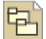

Regulatory Agency Stakeholders and Concerns - Population

CSRM Population

Mission Stakeholders and Requirements - Population

Technical Measures Specifications and Requirements Population

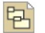

Behaviors - Use Cases

- Activities - Population

Requirements Hierarchy - Population

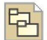

Validation Verification

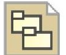

CubeSat Rqts Population

CubeSat Subsystems Rqts - Population

CubeSat Components Rqts - Population

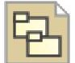

CubeSat Subsystems

- Population

CubeSat Components - Population

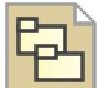

Ground Segment Rqts - Population

Ground Subsystem Rqts - Population

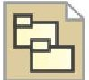

Ground Component Rqts - Population

Ground Subsystems - Population

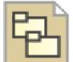

Ground Subsystems Components - Population

<!-- PDF_PAGE: 5 -->

## 4 - CSRM Examples and Illustrations-Packages

The following will be gathered in a centralized collection just like the above population packages.

Regulatory Agency Stakeholders - Example

Mission Stakeholders - Examples

Mission Stakeholders - Requirements, Technical Measures, Use Cases - Illustration

Mission Stakeholders Requirements Relationship-Example

Technical Measures - Specifications and Requirements - Illustration

## Behaviors - Enterprise Level - Illustration

Collect and Distribute Mission Data Example

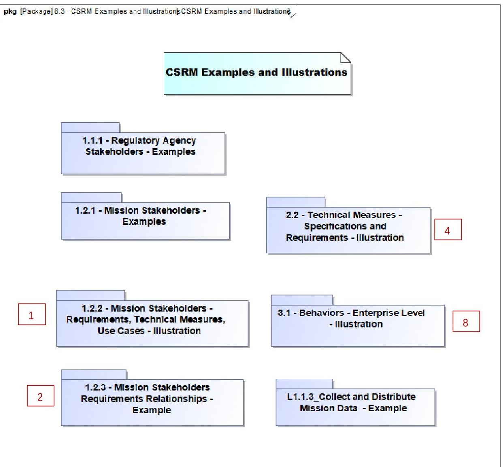

<!-- PDF_PAGE: 6 -->

# 5 - Example of Hovering a Cursor to Reveal Definitions and Descriptions

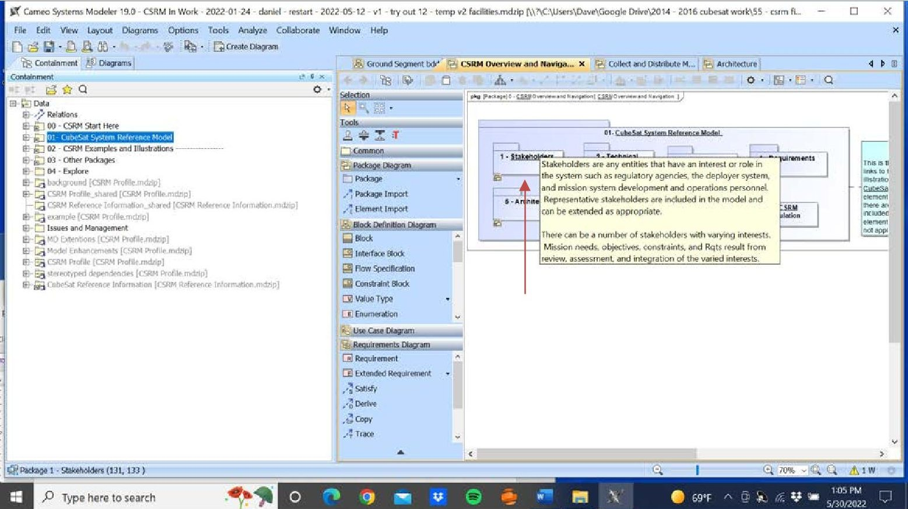

## Hovering over the CSRM Reference Information term: Stakeholder The underline denotes a CSRM Reference Information term

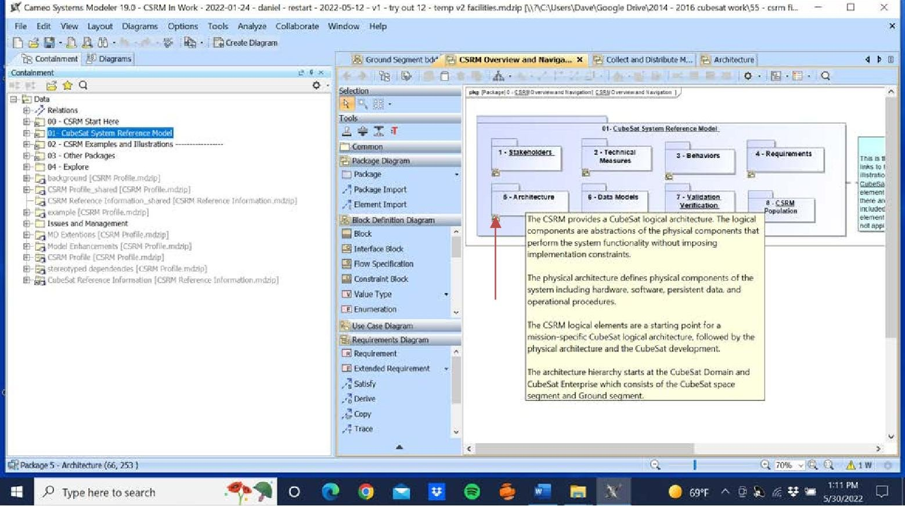

Hovering over package: 5 - Architecture

<!-- PDF_PAGE: 7 -->

## Example of Using Comments to Provide: Explanation and How-To

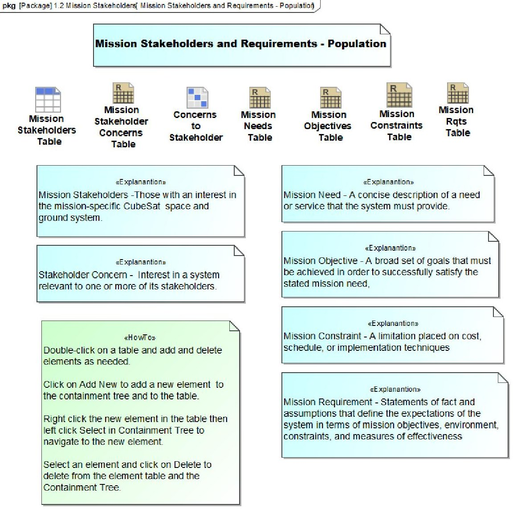

