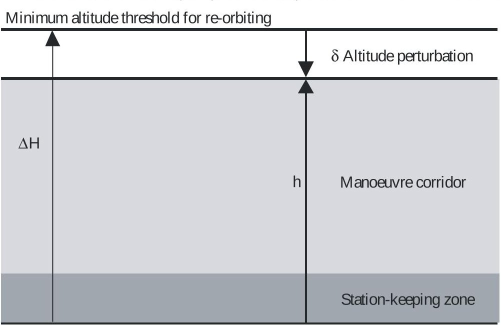

> Complete conversion of the archived source PDF, not an assertion of standard applicability or conformance.

<!-- PDF_PAGE: 1 -->

Radiocommunication Sector of ITU

Recommendation ITU-R S.1003-2 (12/2010)

# Environmental protection of the geostationary-satellite orbit

S Series Fixed-satellite service

<!-- PDF_PAGE: 2 -->

## Foreword

The role of the Radiocommunication Sector is to ensure the rational, equitable, efficient and economical use of the radio-frequency spectrum by all radiocommunication services, including satellite services, and carry out studies without limit of frequency range on the basis of which Recommendations are adopted.

The regulatory and policy functions of the Radiocommunication Sector are performed by World and Regional Radiocommunication Conferences and Radiocommunication Assemblies supported by Study Groups.

## Policy on Intellectual Property Right (IPR)

ITU-R policy on IPR is described in the Common Patent Policy for ITU-T/ITU-R/ISO/IEC referenced in Annex 1 of Resolution ITU-R 1. Forms to be used for the submission of patent statements and licensing declarations by patent holders are available from http://www.itu.int/ITU-R/go/patents/en where the Guidelines for Implementation of the Common Patent Policy for ITU-T/ITU-R/ISO/IEC and the ITU-R patent information database can also be found.

Series of ITU-R Recommendations

<table border="1"><tr><td>Series</td><td>Title</td></tr><tr><td>BO</td><td>Satellite delivery</td></tr><tr><td>BR</td><td>Recording for production, archival and play-out; film for television</td></tr><tr><td>BS</td><td>Broadcasting service (sound)</td></tr><tr><td>BT</td><td>Broadcasting service (television)</td></tr><tr><td>F</td><td>Fixed service</td></tr><tr><td>M</td><td>Mobile, radiodetermination, amateur and related satellite services</td></tr><tr><td>P</td><td>Radiowave propagation</td></tr><tr><td>RA</td><td>Radio astronomy</td></tr><tr><td>RS</td><td>Remote sensing systems</td></tr><tr><td>S</td><td>Fixed-satellite service</td></tr><tr><td>SA</td><td>Space applications and meteorology</td></tr><tr><td>SF</td><td>Frequency sharing and coordination between fixed-satellite and fixed service systems</td></tr><tr><td>SM</td><td>Spectrum management</td></tr><tr><td>SNG</td><td>Satellite news gathering</td></tr><tr><td>TF</td><td>Time signals and frequency standards emissions</td></tr><tr><td>V</td><td>Vocabulary and related subjects</td></tr></table>

Note: This ITU-R Recommendation was approved in English under the procedure detailed in Resolution ITU-R1.

<!-- PDF_PAGE: 3 -->

# RECOMMENDATION ITU-R S.1003-2 $ ^{*} $ Environmental protection of the geostationary-satellite orbit (Question ITU-R 34/4)

(1993-2003-2010)

## Scope

This Recommendation provides guidance about disposal orbits for satellites in the geostationary satellite orbit and comments on the increase in debris due to fragments resulting from increased numbers of satellites and their associated launches.

The ITU Radiocommunication Assembly,

considering

a) that the GSO (see Fig.1) is a unique resource that offers significant benefits to operators from the standpoint of station-keeping requirements, ground visibility and coverage, the absence of the need for tracking facilities in small earth station antennas and a relatively benign orbital environment;

b) that satellites have little survivability in case of a collision in orbit;

c) that telecommunications functions of a satellite would be lost or at least degraded by a collision in orbit;

d) that satellite breakup due to a collision or explosion would create a cloud of orbital debris that would dissipate around the orbit, increasing the collision probability within that orbit region;

e) that a satellite drifting in GSO after the end of its life may block RF links of active satellites,

## recommends

1 that as little debris as possible should be released into the GSO region during the placement of a satellite in orbit;

2 that every reasonable effort should be made to shorten the lifetime of debris in elliptical transfer orbits with the apogees at or near GSO altitude;

3 that before complete exhaustion of its propellant, a geostationary satellite at the end of its life should be removed from the GSO region such that under the influence of perturbing forces on its trajectory, it would subsequently remain in an orbit with a perigee no less than 200 km above the geostationary altitude (see Annex 1);

4 that the transfer to the graveyard orbit removal should be carried out with particular caution in order to avoid RF interference with active satellites.

<!-- PDF_PAGE: 4 -->

## Annex 1

## Environmental protection of the GSO

In 2010 there are approximately 1100 known spacecraft and rocket bodies near the GSO, of which approximately one-third are currently operational.

Knowledge of the geostationary environment is limited by the resolution of Earth-based observations. The smallest dimension of an object detectable and trackable (under best conditions) in the GSO at present is slightly less than 1 m; by comparison, in low-Earth orbit the population of objects having dimensions above 30 cm is deterministically known and catalogued, and the population of objects having dimensions down to 5 mm is statistically characterized as to altitude and inclination. Position knowledge of spacecraft or objects not under RF control is not as good as the operator's knowledge of position of active spacecraft.

Risk to operational spacecraft derives from explosion debris fragments attributable to residual propellants and gases in rocket bodies and less frequently to stored energy in batteries. Risk can also derive from fragments produced by collisions between intact spacecraft. Moreover, additional fragments are also produced when a fragment collides with an intact spacecraft or another fragment. This latter risk has increased significantly in recent years at some altitudes as a result of a small number of events. Approximately 60% of the objects in the Space Surveillance Catalogue are fragmentation debris objects. Two fragmentations have been identified in the geostationary region, both characterized as explosion events. It is quite likely that there have been other events that have escaped detection due to the limitations of observation methods at this altitude.

While collisions in the geosynchronous orbit will not have the extreme consequences of those in low-Earth orbit, with characteristic impact velocities of the order of 500 m/s, such collisions can still result in significant damage to orbiting systems.

Given the current limitations (primarily specific impulse) of space propulsion systems, it is impractical to retrieve objects from GSO altitudes or to return them to Earth at the end of their operational life. A protected region must therefore be established above, below and around the GSO which defines the nominal orbital regime within which operational satellites will reside and manoeuvre. To avoid an accumulation of non-functional objects in this region, and the associated increase in population density and potential collision risk that this would lead to, satellites should be manoeuvred out of this region at the end of their operational life. In order to ensure that these objects do not present a collision hazard to satellites being injected into GSO, they should be manoeuvred to altitudes higher than the GSO region, rather than lower. The target disposal altitude should be sufficiently high that, under the influence of perturbing forces, the satellite cannot interfere with existing operational satellites in the GSO region. The GSO region incorporates both the GSO (operational station-keeping zone) and the manoeuvre corridor directly above the GSO, and reaches an altitude of 200 km above the GSO altitude (as shown in Fig. 1).

The basic requirement is that following disposal into a higher altitude orbit, the spacecraft, which will be under the influence of perturbing forces, must not migrate back into the GSO region:

$$
\Delta H > h + \delta
$$

<!-- PDF_PAGE: 5 -->

FIGURE1

Illustration of the GSO region (shaded areas) and the minimum re-orbit altitude

Geostationary altitude

$ \Delta H $: minimum altitude increase above the GSO altitude of re-orbited spacecraft

δ: maximum descent of re-orbited spacecraft due to perturbations

h: minimum altitude of the protected GSO region above the GSO altitude

S.1003-02

1 Perturbations to a satellite in a super-synchronous orbit

The motion of a satellite injected into an orbit with altitude wholly above GSO will be perturbed in a periodic manner due to the influence of:

- the gravitational influence of the asphericity of the Earth;

- the gravitational attraction of the sun and moon;

- the radiation pressure of the sun.

The overall orbital perturbation, $ \delta $ , can be represented empirically by two components. The combined influence of the periodic gravitational perturbations should not exceed 35 km for any satellite in a circular orbit (eccentricity less than 0.003), or:

$$
\delta_ {\mathrm {g r a v}} < 3 5 \mathrm {k m}
$$

For more eccentric disposal orbits, the perturbation effect could be greater than 35 km.

The maximum extent of the solar radiation pressure (SRP) perturbation will depend upon the individual characteristics of a satellite and is given (km) by:

$$
\delta_ {\mathrm {S R P}} < 1 0 0 0 \mathrm {C} _ {\mathrm {r}} \mathrm {A} / \mathrm {M}
$$

where:

$$
\delta = \delta_ {\mathrm {g r a v}} + \delta_ {\mathrm {S R P}}
$$

$ C_{r} $ reflectivity coefficient of the satellite at beginning of life and will vary between 1 and 2 depending upon its surface characteristics

A: aspect area of the satellite exposed to the sun $ \left(m^{2}\right) $

M: dry mass of the satellite (kg).

<!-- PDF_PAGE: 6 -->

(A/M will typically take a value between 0.01 and 0.1 depending upon the characteristics of the satellite.)

Combining equations (1), (2) and (3) gives the minimum re-orbit perigee altitude requirement above the GSO altitude to ensure that the satellite, following end of life disposal, does not return within the protected GSO region which extends 200 km above the geostationary altitude:

$$
\Delta \mathrm {H} > 2 3 5 + 1 0 0 0 \mathrm {C} _ {\mathrm {r}} \mathrm {A} / \mathrm {M}
$$

for eccentricities < 0.003.

Lower disposal orbit perigee altitudes, which will still avoid the GSO region for at least 100 years, are sometimes possible when the orbital plane and the line of apsides are aligned favourably.

## 2 Fuel budget and margin

Spacecraft operators are encouraged to monitor the use of on-board propellant to ensure adequate fuel is available to achieve the required manoeuvre at end of life. It is recognized that some existing operational satellites in the GSO may have difficulty in meeting this objective and that this may increase the risk of collisions. In addition, it is recommended that a fuel margin be added to the budget in order to account for the effect of orbital determination inaccuracies and possible execution errors.

It is recommended that a multiple manoeuvre strategy be followed to raise the orbit perigee to the projected minimum altitude, thereby minimizing the consequences of failure of the propulsion system due to either malfunction or inadequate fuel margin.

Once the minimum perigee altitude has been reached, a multiple manoeuvre strategy should continue to be followed, progressively raising the orbit perigee, using to the greatest extent possible all remaining propellants and, if feasible, pressurants. Once any remaining propellants and pressurants have been expended, all further stored energy sources on board should be passivated (e.g., batteries, gyros) to avoid the possibility of fragmentation.
