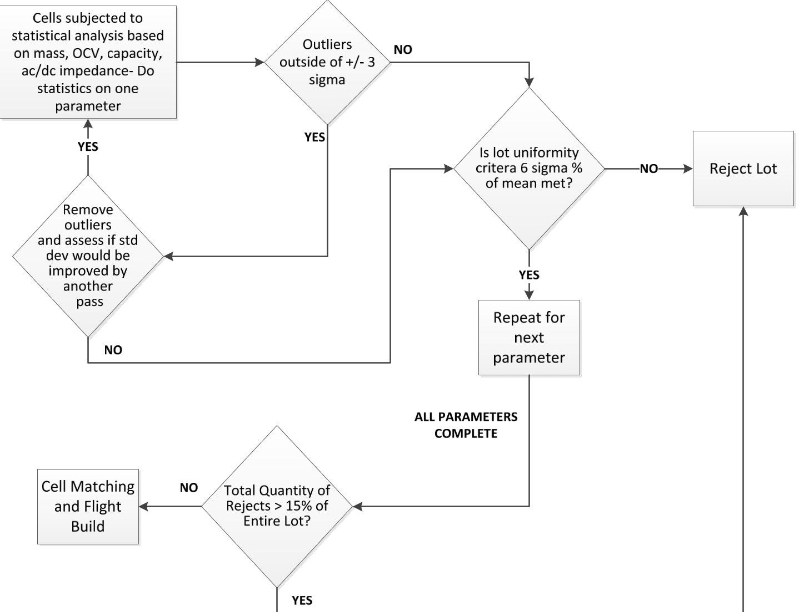
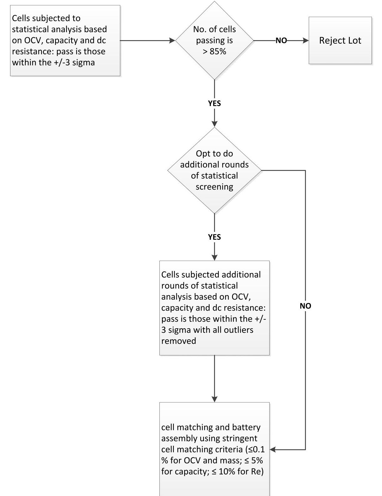
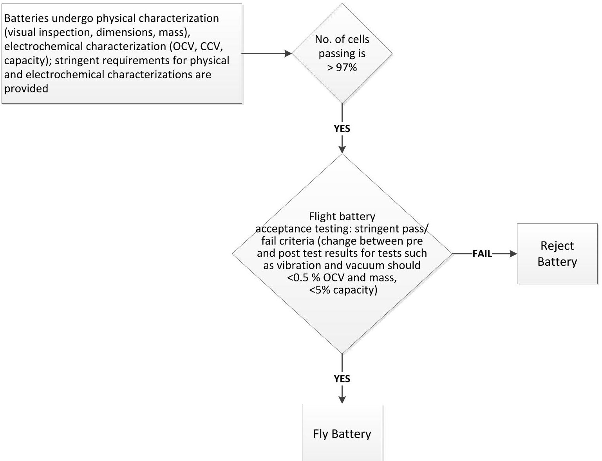
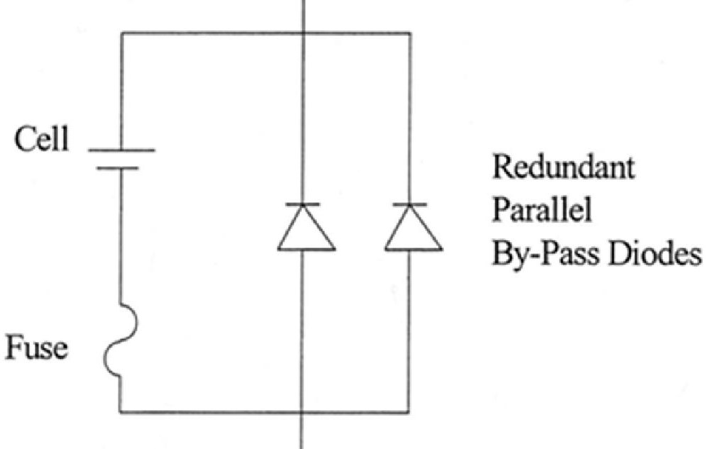
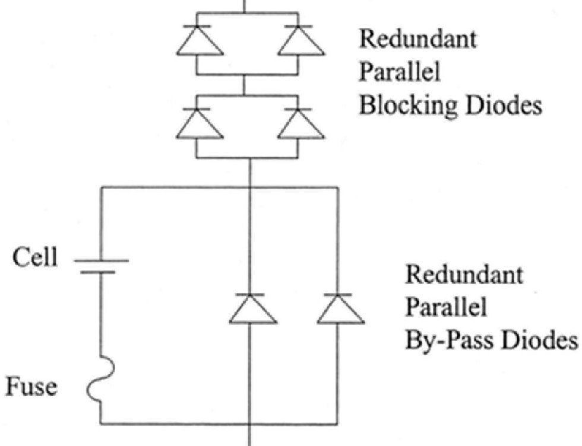
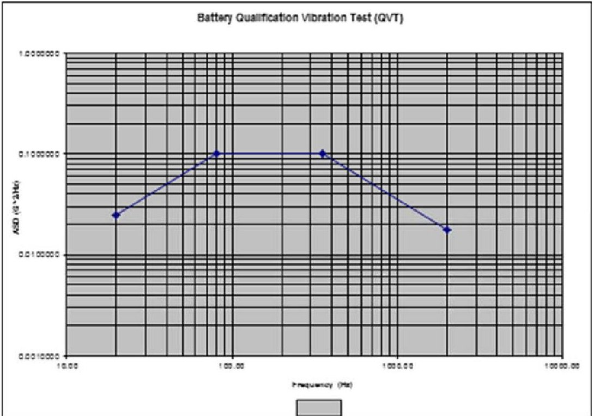
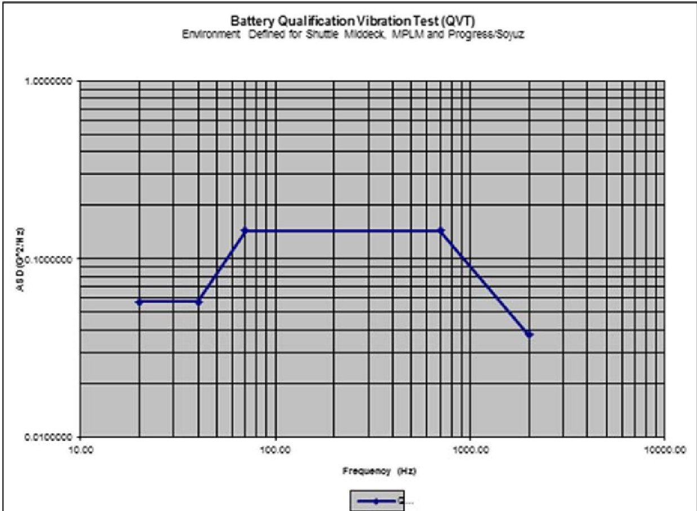
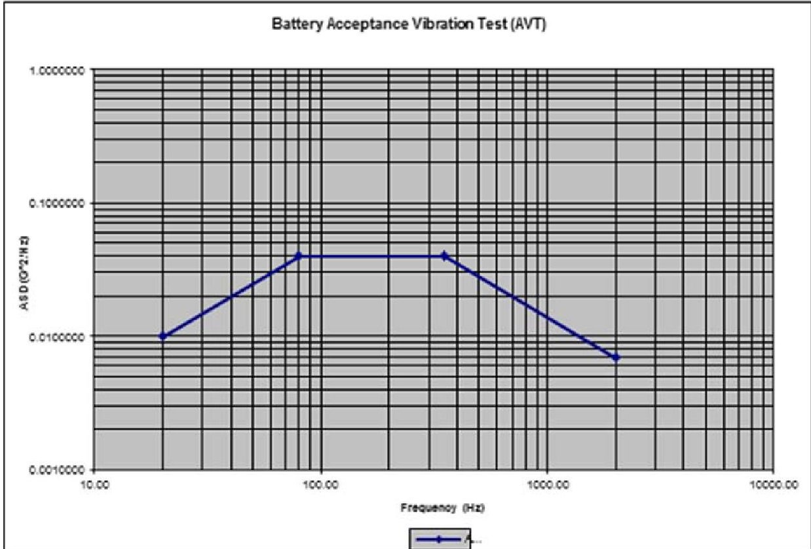
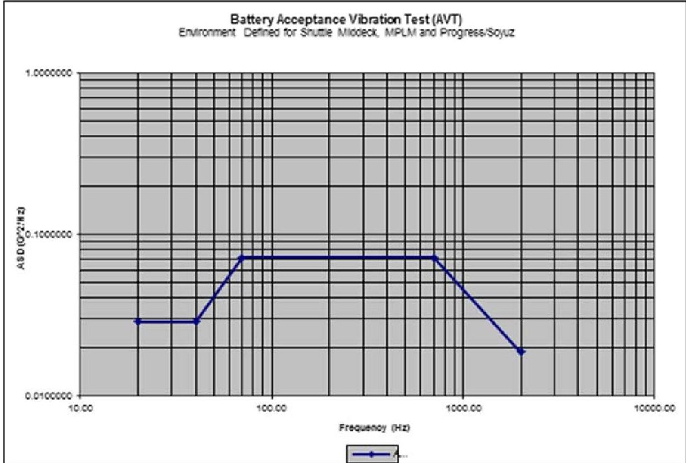

> Complete conversion of the archived source PDF, not an assertion of standard applicability or conformance.

<!-- PDF_PAGE: 1 -->

# CREWED SPACE VEHICLE BATTERY SAFETY REQUIREMENTS

Engineering Directorate Propulsion and Power Division

Availability:

## Public Release Statement:

This document has been reviewed for Proprietary, SBU, and Export Control (ITAR/EAR) and has been determined to be nonsensitive. It has been released to the public via the NASA Scientific and Technical Information (STI) Process DAA JSC 40389.

March 2017 Revision D

National Aeronautics and Space Administration Lyndon B. Johnson Space Center Houston, Texas 77058

<!-- PDF_PAGE: 2 -->

## PREFACE

The Crewed Space Vehicle Battery Safety Requirements document has been prepared for use by designers of battery-powered vehicles, portable equipment, and experiments intended for crewed spaceflight. The purpose of the requirements document is to provide battery designers with information on design provisions to be incorporated in and around the battery and on the verification to be undertaken to demonstrate a safe battery is provided. The term "safe battery" means that the battery is safe for ground personnel and crew members to handle and use; safe to be used in the enclosed environment of a crewed space vehicle; and safe to be mounted or used in unpressurized spaces adjacent to habitable areas.

Battery design review, approval, and certification is required before the batteries can be used for ground operations and be certified for flight.

## ACKNOWLEDGMENT

The authors would like to acknowledge the significant contributions of Dr. Chris Iannello (NESC Technical Fellow for Electrical Power), Paul Shack (NESC-SEI) , Robert Button (NESC-Discipline Deputy Power), Dr. Daniel Doughty (NESC-Battery Specialist), Concha Reid (NASA-GRC-Battery Specialist), Jeffrey Brewer (NASA-MSFC-Battery Specialist), Thomas Miller (NASA-GRC-Battery Specialist), Margaret McPhail (JSC-S&MA), Trent Kite (JSC-S&MA), Dr. Bugga Ratnakumar (JPL-Battery Specialist), Penni Dalton (NASA-GRC-Battery Specialist), and Jonay Campbell (NESC TDT support).

<!-- PDF_PAGE: 3 -->

<table><tr><td colspan="2">Revised by: SAMUEL RUSSELL</td><td>Digitally signed by SAMUEL RUSSELL
DN: c=US, o=U.S. Government, ou=NASA, ou=People,
cn=SAMUEL RUSSELL, 0.9.2342.19200300.100.1.1=srussell
Date: 2017.03.09 13:01:54 -06'00'</td></tr><tr><td colspan="2">Samuel Russell
Power Systems Branch, EP5</td><td>Date</td></tr><tr><td colspan="2">Reviewed by: DAVID DELAFUENTE</td><td>Digitally signed by DAVID DELAFUENTE
Date: 2017.03.09 13:22:14 -06'00'</td></tr><tr><td colspan="2">David Delafuente
Battery Safety Technical Discipline Lead
Power Systems Branch, EP5</td><td>Date</td></tr><tr><td colspan="2">ERIC DIMPAULT-DARCY
2017.03.09 14:35:55 -06'00'</td><td>Date</td></tr><tr><td colspan="2">Eric Darcy
Battery Systems Technical Discipline Lead
Power Systems Branch, EP5</td><td>Date</td></tr><tr><td colspan="2">Approved by: KARLA BRADLEY</td><td>Digitally signed by KARLA BRADLEY
DN: c=US, o=U.S. Government, ou=NASA, ou=People,
cn=KARLA BRADLEY, 0.9.2342.19200300.100.1.1=kfbradle
Date: 2017.03.09 15:49:51 -06'00'</td></tr><tr><td colspan="2">Karla Bradley
Chief
Power Systems Branch, EP5</td><td>Date</td></tr><tr><td colspan="2">EDGAR CASTRO</td><td>Digitally signed by EDGAR CASTRO
DN: c=US, o=U.S. Government, ou=NASA, ou=People,
cn=EDGAR CASTRO, 0.9.2342.19200300.100.1.1=ecastro
Date: 2017.03.20 14:13:13 -05'00'</td></tr><tr><td colspan="2">Edgar O. Castro
Chief
Propulsion and Power Division, EP</td><td>Date</td></tr><tr><td colspan="2">MARY SCHWARTZ</td><td>Digitally signed by MARY SCHWARTZ
DN: c=US, o=U.S. Government, ou=NASA, ou=People,
cn=MARY SCHWARTZ, 0.9.2342.19200300.100.1.1=mbschwar
Date: 2017.03.30 13:00:13 -05'00'</td></tr><tr><td colspan="2">Lauri Hansen
Director
Engineering Directorate</td><td>Date</td></tr></table>

See cover for full disclosure. Verify correct revision before use at https://qmsmasterlist.jsc.nasa.gov/Home.aspx/Organization/31.

<!-- PDF_PAGE: 4 -->

Change Record

<table border="1"><tr><td>Rev.</td><td>Date</td><td>Originator</td><td>Description</td></tr><tr><td>Basic</td><td>September 1985</td><td>Bobby Bragg</td><td>Original version</td></tr><tr><td>A</td><td>January 2005</td><td>Judith Jeevarajan Eric Darcy</td><td>Revised to update battery chemistries, hazards, and controls. Changed from a handbook/guideline to a requirements document.</td></tr><tr><td>B</td><td>April 2006</td><td>Judith Jeevarajan</td><td>Revised to clarify sentences and requirements for each chemistry; added new section for vibration requirements.</td></tr><tr><td>C</td><td>January 2014</td><td>Judith Jeevarajan Eric Darcy, with support from other members of the Agency Power Technical Discipline Team</td><td>Revised to clarify all requirements, specifically, lithium-ion battery chemistry; added new sections for lithium-sulfur and thermal battery chemistries, as well as supercapacitors. Significant reformat to aid in readability and identification of requirements vs. best practice. Added thermal runaway propagation evaluation, as well as other lessons learned from lithium-ion battery incidents of 2013.</td></tr></table>

<!-- PDF_PAGE: 5 -->

<table border="1"><tr><td>D</td><td>March 8,2017EA CCBCR/D EA-0229</td><td>Samuel Russell</td><td>Included risk characterization methodology and consolidated non-critical criteria, increased non-critical threshold from 300 to 1000mAhr, removed vacuum leak checks for non-critical chemistries, defined cell DPA quantity, updated internal references to Appendix A, incorporated alkaline shelf life memo (EP-11-042), and incorporated recommended changes from ISS CR 014210 basic and revision A: updated applicable and reference document tables, removed references to Form 1230 and Form 1298, corrected qualification test vacuum pressure limit, clarified lot testing requirements, extended vendor configuration control authority to International Partners, added computer based control requirements and verification references, clarified toxicology assessment description, removed legacy voltage limit on electrical short requirement, included functional test definition, added Unique Hazard Report requirement, clarified transport requirements for lithium sulfur cells, updated safety review requirement, certification and training, and shipping references.</td></tr></table>

<!-- PDF_PAGE: 6 -->

## Table of Contents

PREFACE ...II

ACKNOWLEDGMENT ...II

CHANGE RECORD ...IV

TABLE OF CONTENTS ...VI

1. INTRODUCTION ...1

   1.1 PURPOSE AND SCOPE ...1

   1.2 RESPONSIBILITY AND CHANGE AUTHORITY ...2

   1.3 BATTERY DESIGN EVALUATION AND APPROVAL ...2

2. APPLICABLE DOCUMENTS ...3

   2.1 APPLICABLE DOCUMENTS ...3

   2.2 REFERENCE DOCUMENTS ...4

   2.3 ORDER OF PRECEDENCE ...6

3. ACRONYMS AND DEFINITIONS ...7

   3.1 ACRONYMS AND ABBREVIATIONS ...7

   3.2 DEFINITIONS ...8

4. GENERAL BATTERY REQUIREMENTS ...13

   4.1 METHODOLOGIES USED IN ENSURING SAFE OUTCOMES ...13

   4.1.1 FAILURE TOLERANCE ...13

   4.1.2 DESIGN FOR MINIMUM RISK (DFMR) ...13

   4.1.3 RISK CLASSIFICATION ...14

   4.2 KEY ASPECTS OF ENGINEERING EVALUATION, QUALIFICATION, AND ACCEPTANCE TESTING ...16

   4.2.1 ENGINEERING EVALUATION ...16

   4.2.2 QUALIFICATION TESTING ...18

   4.2.3 ACCEPTANCE TESTING ...19

   4.3 MANUFACTURING QUALITY ...20

   4.3.1 CONFIGURATION CONTROL ...20

   4.3.2 SUBSEQUENT FLIGHT LOT TESTING ...21

   4.4 GENERAL DESIGN REQUIREMENTS ...22

   4.4.1 ELECTRICAL INTERCONNECTION ...23

   4.4.2 ELECTRICAL WIRING ...23

   4.4.3 LITHIUM-ION BATTERY AND CELL MONITORING ...23

   4.4.4 CELL MATCHING ...24

   4.4.5 DISSIMILAR CONTROLS ...24

   4.5 MISSION USAGE ...25

   4.6 POST-FLIGHT CELL AND PACK EVALUATION ...26

   4.7 GROUND PROCESSING REQUIREMENTS ...26

   4.7.1 REQUIREMENTS FOR GROUND HANDLING AND TRANSPORTATION ...26

   4.7.2 DESIGN AND OPERATIONS REQUIREMENTS FOR GROUND SUPPORT EQUIPMENT ...28

   4.8 SHELF AND SERVICE LIFE RELATED REQUIREMENTS ...29

5. GENERAL BATTERY HAZARDS AND CONTROLS ...30

   5.1 FIRE/EXPLOSION HAZARD ...30

   5.1.1 SOURCES – CHEMICAL REACTION ...30

   5.1.2 SOURCES – OVERCHARGE FAILURE/OVER-DISCHARGE FAILURE ...33

   5.1.3 SOURCES – EXTERNAL SHORT CIRCUIT ...35

   5.1.4 SOURCES – INTERNAL SHORT CIRCUIT FAILURE ...39

   5.1.5 SOURCES – THERMAL RUNAWAY PROPAGATION ...43

## vi

See cover for full disclosure. Verify correct revision before use at https://qmsmasterlist.jsc.nasa.gov/Home.aspx/Organization/31.

<!-- PDF_PAGE: 7 -->

5.2 CHEMICAL EXPOSURE HAZARDS ... 45

5.2.1 CHEMICAL EXPOSURE SOURCES – MECHANICAL FAILURE ... 45

5.2.2 SOURCES – SEALS AND VENTS ... 47

5.3 ELECTRICAL HAZARDS ... 48

5.3.1 SOURCES OF ELECTRICAL SHOCK, CORONA, AND ARC-FLASH ... 48

5.3.2 SOURCES OF LOSS OF POWER ... 48

5.4 EXTREME TEMPERATURE HAZARDS ... 50

5.4.1 SOURCES ... 50

5.4.2 REQUIREMENTS ... 50

6. SAFETY RELEVANT TO SPECIFIC BATTERY CHEMISTRIES ... 53

6.1 ALKALINE PRIMARY BATTERIES ... 55

6.1.1 DEFINITION ... 55

6.1.2 HAZARD SOURCES ... 56

6.1.3 CONTROLS/PROCESS REQUIREMENTS ... 56

6.2 ALKALINE SECONDARY BATTERIES ... 56

6.2.1 DEFINITION ... 56

6.2.2 HAZARD SOURCES ... 57

6.2.3 CONTROLS/PROCESS REQUIREMENTS ... 57

6.3 LEAD-ACID BATTERIES ... 57

6.3.1 DEFINITION ... 57

6.3.2 HAZARD SOURCES ... 58

6.3.3 CONTROLS/PROCESS REQUIREMENTS ... 58

6.4 LITHIUM-ION SECONDARY BATTERIES ... 58

6.4.1 DEFINITION ... 58

6.4.2 HAZARD SOURCES ... 61

6.4.3 CONTROLS/PROCESS REQUIREMENTS ... 62

6.5 LITHIUM/LITHIUM-ION POLYMER SECONDARY BATTERIES ... 69

6.5.1 DEFINITION ... 69

6.5.2 HAZARD SOURCES ... 71

6.5.3 CONTROLS/PROCESS REQUIREMENTS ... 71

6.6 LITHIUM PRIMARY BATTERIES ... 73

6.6.1 DEFINITION ... 73

6.6.2 HAZARD SOURCES ... 74

6.6.3 CONTROLS/PROCESS REQUIREMENTS ... 75

6.6.4 CERTIFICATION REQUIREMENT FOR HANDLING LITHIUM BATTERIES ... 78

6.6.5 APPLICATION OF UL DATA ... 78

6.6.6 PREPACKAGED MULTI-CELLED BATTERIES ... 78

6.7 NICKEL-CADMIUM BATTERIES ... 78

6.7.1 DEFINITION ... 78

6.7.2 HAZARDS ... 79

6.7.3 CONTROLS/PROCESS REQUIREMENTS ... 79

6.8 NICKEL-HYDROGEN BATTERIES ... 80

6.8.1 DEFINITION ... 80

6.8.2 HAZARD SOURCES ... 80

6.8.3 CONTROLS/PROCESS REQUIREMENTS ... 80

6.9 NICKEL-METAL HYDRIDE BATTERIES ... 81

6.9.1 DEFINITION ... 81

6.9.2 HAZARDS ... 82

6.9.3 CONTROLS/PROCESS REQUIREMENTS ... 82

6.10.1 DEFINITION ... 83

6.10.2 HAZARD SOURCES ... 84

6.10.3 CONTROLS/PROCESS REQUIREMENTS ... 84

6.11 ZINC-AIR BATTERIES ... 86

<!-- PDF_PAGE: 8 -->

6.11.1 DEFINITION ... 86

6.11.2 HAZARD SOURCES ... 86

6.11.3 CONTROLS/PROCESS REQUIREMENTS ... 86

6.12 LITHIUM-SULFUR ... 87

6.12.1 DEFINITION ... 87

6.12.2 HAZARDS ... 88

6.12.3 CONTROLS ... 88

6.13 THERMAL BATTERIES ... 89

6.13.1 DEFINITION ... 89

6.13.2 HAZARDS ... 89

6.13.3 CONTROLS ... 89

6.14 CAPACITORS/SUPERCAPACITORS ... 90

7. REFERENCES ... 91

8. APPENDICES ... 92

## List of Figures

FIGURE 6.4.3-1. CELL ACCEPTANCE FLOW WITH LARGE NUMBERS OF SMALLER, HIGH-VOLUME COMMERCIAL CELLS...66

FIGURE 6.4.3-2. CELL ACCEPTANCE FLOW WITH SMALL NUMBERS OF LARGER, LOWER VOLUME CUSTOM CELLS...67

FIGURE 6.4.3-3. COTS BATTERY ACCEPTANCE FLOW ...69

FIGURE 6.6.3-1. FUSE AND DIODE PROTECTION OF A CELL ...76

FIGURE 6.6.3-2. REDUNDANT PARALLEL BLOCKING DIODES FOR EACH SERIES STRING IN A PARALLEL-SERIES BATTERY COMBINATION...77

## List of Tables

TABLE 6.6.2-1. ENERGY DENSITY OF DIFFERENT CELL CHEMISTRIES (MANUFACTURER'S DATA) 74

## List of Appendices

List of Appendices

APPENDIX A: QUALIFICATION AND FLIGHT ACCEPTANCE VIBRATION TESTING FOR BATTERIES

...93

APPENDIX B: CUSTOM CELL MANUFACTURING FACILITY AUDITS...99

APPENDIX C: SHELF AND SERVICE LIFE FOR VARIOUS CELL/BATTERY CHEMISTRIES...102

APPENDIX D: BATTERY DESIGN EVALUATION AND APPROVAL...104

APPENDIX E: REQUIREMENTS MATRIX...105

<!-- PDF_PAGE: 9 -->

# CREWED SPACE VEHICLE BATTERY SAFETY REQUIREMENTS

## 1. INTRODUCTION

## 1.1 Purpose and Scope

This requirements document is applicable to all batteries on crewed spacecraft, including vehicle, payload, and crew equipment batteries. It defines the specific provisions required to design a battery that is safe for ground personnel and crew members to handle and/or operate during all applicable phases of crewed missions, safe for use in the enclosed environment of a crewed space vehicle, and safe for use in launch vehicles, as well as in unpressurized spaces adjacent to the habitable portion of a space vehicle. The required provisions encompass hazard controls, design evaluation, and verification. The extent of the hazard controls and verification required depends on the applicability and credibility of the hazard to the specific battery design and applicable missions under review. Evaluation of the design and verification program results shall be completed prior to certification for flight and ground operations.

This requirements document is geared toward the designers of battery systems to be used in crewed vehicles, crew equipment, crew suits, or batteries to be used in crewed vehicle systems and payloads (or experiments). This requirements document also applies to ground handling and testing of flight batteries. Specific design and verification requirements for a battery are dependent upon the battery chemistry, capacity, complexity, charging, environment, and application. The variety of battery chemistries available, combined with the variety of battery-powered applications, results in each battery application having specific, unique requirements pertinent to the specific battery application. However, there are basic requirements for all battery designs and applications, which are listed in section 4. Section 5 includes a description of hazards and controls and also includes requirements.

The following definitions differentiate between requirements and other statements.

Shall: This is the only verb used for binding requirements.

Should/May: These verbs are used for stating non-mandatory goals or when used in the italicized text herein refer to best practice methods which can be construed as example methods for meeting the requirement it refers to.

Will: This verb is used for stating facts or declaration of purpose.

Section 6 includes chemistry-specific information. No requirements appear in that section only best practices.

<!-- PDF_PAGE: 10 -->

Shall requirements are summarized in Appendix E.

In keeping with the NASA standards template, italicized text is intended to indicate rationale, best practice examples, or guidelines; while the italicized text never includes the requirement, it often helps to convey the intent of the requirement.

In cases where a requirement includes associated italicized text and that text includes best practice, that best practice can be considered part of an accepted means to address the requirement. If other methods are used, rationale and supporting data demonstrating the adequacy of those methods should be presented and must be reviewed for adequacy by the program's technical team.

## 1.2 Responsibility and Change Authority

The responsibility for the development of this document lies with the Propulsion and Power Division at NASA Johnson Space Center (JSC). Change authority resides with the Propulsion and Power Division.

## 1.3 Battery Design Evaluation and Approval

To be compliant to the requirements herein, every battery design, along with its safety verification program, its ground and/or on-orbit usage plans, and its post-flight processing shall be evaluated and approved by the appropriate technical review panel in the given program or project. Center and program specific examples of the review and approval process can be found in Appendix D.

<!-- PDF_PAGE: 11 -->

## 2. APPLICABLE DOCUMENTS

## 2.1 Applicable Documents

<table border="1"><tr><td>Document Number</td><td>Document Title</td></tr><tr><td>JPR 1700.1</td><td>JSC Safety and Health Handbook</td></tr><tr><td>JSC-STD-8080</td><td>JSC Design and Procedural Standards</td></tr><tr><td>JSC 25159</td><td>Toxicological Hazard Assessments on Batteries used in Space Shuttle Missions</td></tr><tr><td>JSC 66548</td><td>Requirements for Flight Certification and Acceptance of Commercial Off the Shelf Lithium Ion Batteries</td></tr><tr><td>JSC 26895</td><td>Guidelines for Assessing the Toxic Hazard of Spacecraft Chemicals and Test Materials</td></tr><tr><td>49 CFR 173.185</td><td>Transportation Requirements for Lithium Cells and Batteries</td></tr><tr><td>JWI 8705.3</td><td>Battery Processing</td></tr><tr><td>SSP 52005 Rev.C</td><td>Payload Flight Equipment Requirements and Guidelines for Safety-Critical Structures</td></tr><tr><td>SSP 50021</td><td>Safety Requirements for ISS Program</td></tr><tr><td>SSP 41172</td><td>Qualification and Acceptance Environmental Test Requirements for Space Station</td></tr><tr><td>SSP 51700</td><td>Payload Safety Policy and Requirements for the International Space Station (ISS)</td></tr><tr><td>SSP 30599</td><td>Safety Review Process International Space Station</td></tr><tr><td>SSP 50038</td><td>Computer Based Control System Safety Requirements</td></tr><tr><td>NASA-STD-5019</td><td>Fracture Control Requirements for Spaceflight Hardware</td></tr><tr><td>NASA-STD-3001</td><td>NASA Space Flight Human-System Standard</td></tr><tr><td>ANSI/AIAA S-080-1998</td><td>Space Systems - Metallic Pressure Vessels, Pressurized Structures, and Pressure Components</td></tr><tr><td>NPR 8705.2B</td><td>Human-Rating Requirements for Space Systems</td></tr><tr><td>NSTS 1700.7B ISS Addendum</td><td>Safety Policy and Requirements for Payloads Using the International Space Station</td></tr><tr><td>AWS C7.4/C7.4M:2008</td><td>Process Specification and Operator Qualification for Laser Beam Welding</td></tr><tr><td>NASA-STD-5020</td><td>Requirements for Threaded Fastening Systems in Spaceflight Hardware</td></tr><tr><td>PRC-0009D</td><td>Resistance Spot Welding of Battery and Electronic Assemblies</td></tr><tr><td>UL 840</td><td>Insulation Coordination Including Clearances and Creepage Distances for Electrical Equipment</td></tr><tr><td>NASA-STD-8739.4</td><td>Crimping, Interconnecting Cables, Harnesses, and Wiring</td></tr></table>

<!-- PDF_PAGE: 12 -->

<table border="1"><tr><td>J-STD-001ES</td><td>Space Applications Electronic Hardware Addendum to J-STD-001E</td></tr><tr><td>NASA-STD-8739.1A</td><td>Workmanship Standard for Polymeric Application on Electronic Assemblies</td></tr><tr><td>MIL-STD-1686</td><td>Electrostatic Discharge Control Program for Protection of Electrical and Electronic Parts, Assemblies and Equipment</td></tr><tr><td>IPC-6012C-2010</td><td>Qualification and Performance Specification for Rigid Printed Boards</td></tr></table>

## 2.2 Reference Documents

This section lists those documents that may aid in the understanding or clarification of the specification.

<table border="1"><tr><td>Document Number</td><td>Document Title</td></tr><tr><td>NPR 8705.4</td><td>Risk Classification for NASA Payloads</td></tr><tr><td>JSC 26626A</td><td>EVA Hardware Generic Design Requirements</td></tr><tr><td>JSC 26549</td><td>JSC Manual for Control of Program Stock</td></tr><tr><td>JSC 26943</td><td>Guidelines for the Preparation of Payload Flight Safety Data Packages and Hazard Reports</td></tr><tr><td>JSC 61360</td><td>Engineering Directorate Certified Parts Approval Process (EDCPAP)</td></tr><tr><td>EP-WI-031</td><td>Specification for Acceptance Testing of Commercial Lithium Ion Cell Lots</td></tr><tr><td>SMC-S-016</td><td>Test Requirements for Launch, Upper Stage and Space Vehicles</td></tr><tr><td>JSC 66217</td><td>Specification for Lot Testing and Flight Screening of Canon BP 927 and BP 930 Lithium-ion Batteries</td></tr><tr><td>EP-WI-014 Rev. B</td><td>Specification for Acceptance Testing of Commercial Nickel Metal Hydride (NiMH) and Nickel Cadmium (NiCd) Cells</td></tr><tr><td>ISS_EP-03</td><td>EP5 Battery Design Evaluation Form</td></tr><tr><td>Form 1298</td><td>Flight Payload Standardized Hazard Control Report</td></tr><tr><td>ESTA-OP-049 Ver. D</td><td>Lithium Battery Handler Certification</td></tr><tr><td>P32928-103</td><td>Requirements For International Partner Cargoes Transported on Russian Progress and Soyuz Vehicles</td></tr><tr><td>JSC 50835A</td><td>ISS Pressurized Volume Hardware Common Interface Requirements Document</td></tr><tr><td>NESC-RP-08-00492</td><td>Assessment of Risks and Mitigation Strategies for the use of Lithium-ion (Li-ion) Long Life Batteries (LLB)</td></tr><tr><td>MSFC-STD-531</td><td>High Voltage Design Guide</td></tr><tr><td>JSC 29129</td><td>STS Orbiter Upgrades Program – Electrical Auxiliary Power Unit (EAPU) Corona Design Guideline</td></tr></table>

<!-- PDF_PAGE: 13 -->

<table border="1"><tr><td>SSP 30309</td><td>Safety Analysis and Risk Assessment Requirements Document</td></tr><tr><td>CCT-STD-1140</td><td>Crew Transportation Technical Standards and Design Evaluation Criteria</td></tr><tr><td>CCT-REQ-1130</td><td>ISS Crew Transportation and Services Requirements Document</td></tr></table>

<!-- PDF_PAGE: 14 -->

## 2.3 Order of Precedence

This is a safety requirements document. Wherever there is conflict between this and reference documents, the following hierarchy applies:

1. Program-level documentation/specifications (International Space Station (ISS), Commercial Crew, etc.)

2. JSC Engineering Directorate documentation/specifications

3. This document

4. Any other document/specification cited herein

<!-- PDF_PAGE: 15 -->

## 3. ACRONYMS AND DEFINITIONS

## 3.1 Acronyms and Abbreviations

A amperes (current)

AC Alternating Current

Ag/Zn Silver-zinc

AgO Silver (II) oxide

$ \mathrm{A g_{2} O} $ silver (I) oxide or monovalent silver oxide

Ah ampere-hour

ARC Accelerating Rate Calorimetry

AVT Acceptance Vibration Test

$ ^{\circ} \mathrm{C} $ degrees Centigrade

CCV Closed Circuit Voltage

$ \mathrm{C d (O H)_{2}} $ Cadmium hydroxide

CFE Contractor Furnished Equipment

CID Current Interrupt Device

COTS Commercial Off the Shelf

C rate or C Charge/discharge rate based on the nameplate capacity of the cell

CT Computed Tomography

DC Direct Current

DFMR Design for Minimum Risk

DoD Depth of Discharge

DOT Department of Transportation

DPA Destructive Physical Analysis

ESTA Energy Systems Test Area

$ ^{\circ} \mathrm{F} $ degrees Fahrenheit

G Gravitational Constant

$ \mathrm{g^{2} / H z} $ Measurement of Vibration Amplitude

GEO Geosynchronous Earth Orbit

GFE Government Furnished Equipment

GSE Ground Support Equipment

HAZMAT Hazardous Material

ISRP ISS Safety Review Panel

ISS International Space Station

JF JSC Form

JSC Johnson Space Center

KOH Potassium hydroxide

LEL Lower Exposure Limit

LEO Low Earth Orbit

Li-BCX Lithium-bromine chloride complex

LiBOB Lithium bisoxalato borate

$ \mathrm{L i B F_{4}} $ Lithium tetrafluoroborate

$ \mathrm{L i C F_{x}} $ Lithium polycarbon monofluoride

<!-- PDF_PAGE: 16 -->

$ \mathrm{L i F e S_{2}} $ Lithium iron disulfide

$ \mathrm{L i - M n O_{2}} $ Lithium manganese dioxide

$ \mathrm{L i P F_{6}} $ Lithium hexafluorophosphate

$ \mathrm{L i - S O_{2}} $ Lithium-sulfur dioxide

$ \mathrm{L i - S O_{2} C l_{2}} $ Lithium-sulfuryl chloride

$ \mathrm{L i - S O C l_{2}} $ Lithium-thionyl chloride

Li-ion Lithium-ion

mAh milliamp-hours

MCMB Mesophase Carbon Micro Beads

MOSFET Metal Oxide Semiconductor Field Effect Transistor

NDE Nondestructive Evaluation

$ \mathrm{N i C d} $ Nickel-cadmium

$ \mathrm{N i H_{2}} $ Nickel-hydrogen

$ \mathrm{N i M H} $ Nickel-metal hydride

$ \mathrm{N i O O H} $ Nickel oxyhydroxide

NPR NASA Procedural Requirement

NSTS National Space Transportation System

OCV Open Circuit Voltage

OEM Original Equipment Manufacturer

PAN Polyacrylonitriles

$ \mathrm{P b O_{2}} $ Lead dioxide

PSRP Payload Safety Review Panel

PTC Positive Temperature Coefficient

PVC Polyvinyl chloride

PVDF Polyvinylidene Di-fluoride

QVT Qualification Vibration Testing

SDS Safety Data Sheet

SLA Sealed Lead Acid

$ \mathrm{S O_{2}} $ Sulfur dioxide

SOC State of Charge

STS Space Transportation System (Space Shuttle)

UL Underwriters Laboratory

V Voltage, in volts

VRLA Vent Regulated Lead Acid

Wh watt-hour

## 3.2 Definitions

Activation: The process of making an assembled cell functional, either by introducing an electrolyte, by immersing the cell into an electrolyte, or by any other means dictated by the cell manufacturer.

Active material: The material contained in the electrodes of a cell or battery that takes part in the electrochemical reactions of charge and discharge.

<!-- PDF_PAGE: 17 -->

Aging: Permanent loss of capacity due to repeated cycling or passage of time during nonuse.

Anode - (negative electrode): Gives up electrons to external circuit and is oxidized during the electrochemical reaction of discharge.

Available capacity: The total capacity, ampere-hour (Ah) or watt-hour (Wh), that will be obtained from a cell or battery at defined discharge rates and other specified discharge or operating conditions (including temperatures).

Battery (also termed battery pack): Interconnected modules, including all ancillary subsystems for mechanical support, thermal management, and electronic control.

C rate: The discharge or charge current, in amperes, expressed as a multiple of the rated capacity in ampere hours.

Capacity: The total number of ampere-hours or watt-hours that can be withdrawn from a fully charged cell or battery under specified conditions of discharge.

Catastrophic failure mode: An event that results in the death or permanent disability of a crew member or passenger, or an event results in the unplanned loss/destruction of a major element of the crewed space system that could potentially result in the death or permanent disability of a crew member or passenger.

Cathode - (positive electrode): Accepts electrons from the circuit and is reduced during the electrochemical reaction of discharge.

Cell (also termed battery cell): An assembly of at least one positive electrode, one negative electrode, and other necessary electrochemical and structural components. A cell is a self-contained energy storage device whose function is to deliver electrical energy to an external circuit.

Cell bank: A grouping of interconnected cells in a parallel arrangement, into a single mechanical and electrical unit.

Certification: The result of the qualification and design review process, often documented by memorandum or completion of requirement verification list, table, or document specific to the end item being certified.

Charge acceptance: The willingness of a battery or cell to accept charge. It may be affected by cell temperature, charge rate, and state of charge (SOC).

Closed circuit voltage (CCV): The difference in potential between the terminals of a cell or the voltage measured when the circuit is under an electrical load.

<!-- PDF_PAGE: 18 -->

Concentration polarization: Polarization caused by the depletion of ions in the electrolyte at the surface of the electrode.

Conditioning: Cyclic charging and discharging of a battery to ensure that it is fully formed and fully charged. Also carried out when a battery is first placed into service or returned to service after prolonged storage. In some cases, this may involve deep discharging as in the case of NiCd or NiMH.

Cutoff voltage: The cell or battery voltage at which the discharge is terminated. Also called end voltage.

COTS battery: Original equipment manufacturer (OEM) battery designed to power commercially available (or COTS) equipment. Examples include cameras, laptops, tablets, power tools, etc.

Custom battery: Any battery designed for the purpose of powering non-COTS applications. It is designed with either COTS or custom cells.

Cycle testing: Repetitive charge discharge tests performed to demonstrate rate performance capability or verify continued operability after completing acceptance testing.

Depth of discharge (DOD): Ratio of the quantity of electricity (in amp-hours or watt hours) removed from a cell or battery on discharge to its rated capacity.

Electroformation: Term used to describe the conversion of the material in both the positive and negative plates to their respective active materials. Also called 'formation'.

End voltage: The prescribed voltage at which the discharge (or charge, if the end-of-charge voltage) of a cell or battery should be terminated per the application or the manufacturer's specification/recommendation.

Fast charge: A rate of charging that returns full capacity to a rechargeable battery, at a rate higher than the nominal rate recommended by the cell/battery manufacturer.

Flooded cell: A cell design that incorporates an excess amount of electrolyte.

Forced discharge: Discharging a cell or battery below zero volts causing voltage reversal.

Formation: Electrochemical processing of a battery plate or electrode that transforms the active materials into usable form. Also referred to as 'electroformation'.

Gassing: The evolution of gas from one or more of the electrodes or the electrolyte in a cell.

<!-- PDF_PAGE: 19 -->

Internal resistance: The opposition to the flow of electric current within a cell or battery expressed as the sum of the ionic and electronic resistances of the cell components.

Life: For rechargeable batteries, the duration of satisfactory performance, measured in years (calendar or shelf life) or in the number of charge/discharge cycles (cycle or service life). For primary batteries, the duration of satisfactory performance measured in years (calendar or shelf life) or the period of performance under load (service life).

Memory effect: A phenomenon in which a cell, operated in successive cycles to less than full DoD, experiences a depression of its discharge voltage and temporary loss of the rest of its capacity when cycled again at normal voltage levels.

Module: A grouping of interconnected cells in series and/or parallel arrangement into a single mechanical and electrical unit.

Open circuit voltage (OCV): The difference in potential between the terminals of a cell or the voltage measured when the circuit is open (no-load condition).

Overcharge: The forcing of current through a cell after all of the active material has been converted to the charged state. Charging continued after 100-percent SOC is achieved.

Over-discharge: To discharge a cell or battery past the point where the full capacity has been obtained.

Nominal voltage: The reported or reference voltage of the cell/battery, also sometimes referred to as the "normal" voltage of the cell/battery.

Oxygen recombination: The process by which oxygen generated at the positive plate during charge is reacted at the negative plate.

Prismatic cells: A cell fabricated typically with flat plate electrodes, which are stacked to provide capacity.

Rated capacity: The number of ampere-hours a cell or battery can deliver under specific conditions (rate of discharge, end voltage, temperature), usually, the manufacturer's rating.

Shape change: Change in shape of an electrode due to migration of active material during charge/discharge cycling.

Shelf life: The duration of storage under specified conditions at the end of which a cell or battery still retains the ability to give a specified performance.

<!-- PDF_PAGE: 20 -->

Starved electrolyte cell: A cell containing little or no free liquid electrolyte.

State of charge (SOC): The available charge capacity in a cell or battery expressed as a percentage of rated capacity.

Taper charge: A charge regime delivering moderate- to high-rate charge current when the battery is at a low SOC and tapering the charge current to lower values as the battery reaches its end-of-charge voltage.

Thermal runaway: A condition whereby a cell or battery overheats and reaches very high temperatures in very short periods (i.e., seconds) through internal heat generation caused by an internal short or due to an abusive condition. The temperature of the cell or battery is uncontrollable at this point.

Trickle charge: A charge at a low rate, balancing losses through a local action and/or periodic discharge, to maintain a cell or battery in a fully charged condition.

Unactivated shelf life: The period of time, under specified conditions of temperature and environment, that an unactivated cell or battery can be stored before deteriorating below a specified capacity.

Wet shelf life: The period of time that a cell or battery can stand in the charged or activated condition before deteriorating below a specified capacity.

Working voltage: The typical voltage or range of voltage of a cell or battery during discharge.

<!-- PDF_PAGE: 21 -->

## 4. GENERAL BATTERY REQUIREMENTS

The following sections address general technical requirements intended to ensure safe outcomes in NASA battery deployments, addressing issues related to design, manufacture, qualification, and acceptance.

## 4.1 Methodologies used in Ensuring Safe Outcomes

A key aspect of ensuring safe outcomes is the approach taken to control hazards. The following section addresses the prescribed strategies: failure tolerance and Design for Minimum Risk (DFMR).

## 4.1.1 Failure Tolerance

Failure tolerance is the basis of the NASA safety approach. This method is applied in all safety evaluations unless it can be proven that a failure tolerance approach is not feasible.

a. Battery systems for crewed spacecraft shall implement failure tolerance as the preferred approach to control all catastrophic hazard causes.

b. The level of failure tolerance shall be the product of an integrated design and safety analysis but be a minimum of one.

As an example, to be considered two-fault tolerant, a battery design should be capable of maintaining safe operation or incur a safe shutdown after the imposition of the failure of any two mutually independent catastrophic hazard control measures or features.

For the purposes of fault tolerance discussions, NASA Procedural Requirements (NPR) 8705.2B, "Human Rating Requirements and Guidelines for Space Flight Systems," defines "catastrophic event" as one resulting in the death or permanent disability of a crew member or passenger or an event resulting in the unplanned loss/destruction of a major element of the crewed space system during the mission that could potentially result in the death or permanent disability of a crew member or passenger.

Fault tolerance for batteries should consider the toxicity as well as the energy content. This takes into consideration the causes resulting in leakage, rupture, electrical shock, fire, and explosion hazards.

Note that SSP 30309 provides the requirements for the safety analysis and risk assessment for the ISS.

## 4.1.2 Design for Minimum Risk (DFMR)

Some potentially catastrophic hazards cannot practically be controlled using failure tolerance and are exempted from the tolerance requirement provided the risk they pose is mitigated to the maximum practical extent through a defined process in which

<!-- PDF_PAGE: 22 -->

approved standards and margins are implemented to account for the absence of failure tolerance. Herein, this process is called DFMR.

a. The DFMR approach shall be used to address catastrophic battery hazards that cannot practically be controlled by a failure tolerance approach.

NPR 8705.2B, "Human Rating Requirements and Guidelines for Space Flight Systems," recognizes that some potentially catastrophic hazards cannot be practically controlled using failure tolerance and are exempted from the tolerance requirement provided they are controlled through a defined process in which approved standards and margins are implemented to account for the absence of failure tolerance. Herein, this process is called DFMR.

DFMR is a process that relies on the application of mature/proven technology, robust design margins, and accepted standards for manufacturing, inspection, analysis, test, and operational measures to mitigate the potential for failures that cannot be controlled by failure tolerance. When a DFMR approach is used, technical authorities accept that the process has demonstrated the risk of catastrophic hazards has been minimized to the maximum practical extent.

A risk matrix may be used to demonstrate that the applied methods have reduced the probability of occurrence and/or the severity of the hazards to an acceptable level for the intended use.

This approach to hazard control takes advantage of existing acceptable processes and best practices. Guidance and recommendations for acceptable processes and best practices are given in Sections 5.0 and 6.0 and in the appendices. If other methods are used, rationale and supporting data demonstrating the adequacy of those methods should be presented.

Examples of the kinds of battery failures that might employ DFMR include leakage and internal short. Many battery or cell designs become impractical with the implementation of triple containment to be two-fault tolerant to catastrophic electrolyte leakage. Similarly, the imposition of three layers of separators between anode and cathode to be two-fault tolerant to catastrophic cell internal short circuits hazards in many cases can severely degrade performance.

For the purposes of streamlining the battery design approval, some simple battery designs below certain low energy and voltage thresholds as specified in Sections 4, 5 and 6 herein also can use the DFMR approach for hazard control.

## 4.1.3 Risk Classification

Three levels of risk classifications have been defined for battery systems included in this specification. Threshold limits are defined based on contained energy and experience with specific manufacturing methods and cell formats. Safety of crew, vehicle, and mission may be a factor in selecting the appropriate classification. For systems which do not confirm with established limits, the next higher level of classification is

<!-- PDF_PAGE: 23 -->

recommended. Threshold limits are defined for each chemistry in Section 6 of this document. Risk classes are defined as:

- Non-Critical - the lowest level of hazard control is reserved for low energy cells and battery designs for which standard emergency procedures are written and practiced. Batteries within this 'Non-Critical'* classification shall be:

o Low energy < 4 Wh per battery pack where each battery is thermally and electrically isolated (or < 60Wh for Alkaline Primary Batteries) where Watt Hours (Wh) = Cell Capacity (Ah) $ \times $ Cell Voltage (V), and

o Rated with a toxicological level of 1 or 2, and

o Contained within a not intentionally sealed compartment, and

o Meet one the following criteria for its chemistry:

- Alkaline Primary Batteries - Alkaline (non-rechargeable) cells in sizes D or smaller with a maximum of 12 V and/or 60 Wh and with cells either all in series or all in parallel and with no potential charging source and with the cells located in a vented compartment. Silver oxide cells are considered within this category.

- Lithium-ion Secondary Batteries-COTS (rechargeable) lithium-ion button, cylindrical, or pouch batteries of up to 1000 mAh capacity. Battery is defined as one cell or a packaged or unpackaged assembly of two or more cells.

- Lithium Primary Batteries - COTS (non-rechargeable) lithium button cells (only Li-MnO2, Li-CFX and LiFeS2) of up to 1000 mAh capacity.

- Nickel Cadmium Batteries - Nickel-cadmium (rechargeable) batteries and cells of up to 1000 mAh capacity.

- Nickel-Metal Hydride Batteries - Nickel-metal hydride (rechargeable) silver oxbatteries and cells of up to 1000 mAh capacity.

- Silver-Zinc Batteries - Silver-zinc (rechargeable) batteries and cells of up to 1000 mAh capacity.

- Zinc-Air Primary Batteries - Zinc-air (non-rechargeable) batteries and cells of up to 1000 mAh capacity.

- Note: For primary cells, rated cell capacity is defined as the maximum stated capacity per cell product data sheet

- Critical - the intermediate level of risk classification requiring single fault tolerance typical of commercial devices manufactured in high volumes for the global consumer. Batteries within this 'Critical' $ ^{*} $ classification shall be one of these chemistries and do not meet the 'Non-Critical' classification:

o Lithium Ion Secondary Batteries-COTS (rechargeable) lithium ion of less than 20 V and 60 Wh

o Nickel Cadmium

o Nickel Metal Hydride

o Silver Zinc

o Alkaline Primary

<!-- PDF_PAGE: 24 -->

o Lithium Primary

o Zinc-Air

- Catastrophic - the highest level of risk classification requiring two fault tolerance typical of custom, high energy, or high power designs.

* Note: The term "non-critical" described within this section differs in context and is not to be confused with the ISRP hazard severity definitions of "critical hazards" as defined within SSP 30599, SSP 50021, and SSP 51700.

## 4.2 Key Aspects of Engineering Evaluation, Qualification, and Acceptance Testing

The thorough nature of NASA's test regime from early engineering evaluation, through qualification, and ultimately to acceptance testing is a key aspect in the Agency's safe use of batteries in its missions. The following section specifies general requirements in those areas and provides references to additional best practices.

Application of the requirements in this section is dependent on risk classification. The italicized text provides guidance for requirement application to critical and non-critical battery systems.

JSC 66548 can be used as an example for the flight certification and acceptance of COTS lithium-ion batteries that details the level of testing required under the engineering, qualification, flight acceptance, and lot sample testing of COTS lithium-ion batteries.

## 4.2.1 Engineering Evaluation

This section addresses the preliminary evaluation of safety and performance features at both the cell and battery level and would include the evaluation testing of prospective cells before their selection for use in a flight battery. Engineering evaluation commonly includes abuse test protocols intended to assess safety and performance features necessary for the battery design.

a. Cell and battery designs considered for flight shall first undergo evaluation testing to characterize the performance and safety of the flight battery design.

b. Evaluation testing shall, at a minimum, consist of characterizing the cell and battery safety under abuse conditions of overcharge, over-discharge into reversal, external short circuit and cell internal short circuit, temperature tolerance, vent and burst pressure determination and for critical/catastrophic batteries (See 4.1.3) perform cell destructive physical analysis.

c. Evaluation testing shall confirm manufacturer's specifications that are relevant to the project, as well as confirm that the cell and/or battery design can handle unique requirements levied by the project.

<!-- PDF_PAGE: 25 -->

In the case where safety features at the cell level are rendered less effective when the cells are assembled into the battery, abuse testing at the cell level and then subsequently at progressive levels of assembly evaluates the effectiveness of these features.

Establish a baseline characterization of thermal signature (calorific output as a function of temperature) for cells being used in custom batteries. Accelerating Rate Calorimetry (ARC) is one such method.

Cell designs used in custom batteries should be examined by a combination of computed tomography and destructive physical analysis (DPA) (tear down) to assess quality of manufacture and absence of defects.

When performing battery safety tests that simulate abuse conditions, the mechanical and thermal environment of the test article should be representative of conditions expected during normal use.

<!-- PDF_PAGE: 26 -->

## 4.2.2 Qualification Testing

This section addresses the qualification testing of the flight battery.

a. Qualification testing shall be performed to the worst-case relevant flight environments with margin.

The qualification sample of batteries should be randomly sampled from units from the flight lot that have passed acceptance testing.

b. Environmental tests shall include, at a minimum, extreme temperature exposures, vacuum, and vibration tests.

The margin used for qualification tests will be provided by the respective projects or programs or from SSP41172 for ISS environments. Appendix A may be used as a guideline for qualification vibration tests (QVTs) for cells and batteries if there are no project-provided environments. The margin proposed here should be consistent with the program's margining policies. In the event none are provided, as a guideline, 6 db above the maximum expected is typically used.

The qualification of the battery should include testing the batteries to environmental and vibration levels that are higher than the mission requirements. The number of flight missions that the batteries will be used for, along with the location of the battery in the spacecraft, should determine the period and level of vibration. As a minimum, the qualification test program should include the following:

1. Functional baseline test (open circuit voltage (OCV), mass, capacity or load check, internal resistance, visual inspection).

2. Vibration to qualification levels.

3. Functional baseline test recheck.

4. Charge/discharge cycles (for rechargeable batteries) or a load test (for primary batteries) at 20 degrees Fahrenheit （ $ ^{\circ} F $ ）margin above and below worst-case hot and worst-case cold, respectively.

5. Functional baseline test recheck.

6. Vacuum (approx. 0.1 psi) or equivalent leak checks.

7. Functional baseline test recheck.

For batteries used in a pressurized volume or environment, exposure to a vacuum environment (approximately 0.1 psi) for a minimum of 6 hours should be carried out. For batteries used in an unpressurized volume or environment, thermal vacuum cycles must be performed with the deep vacuum levels below $ 1 \times1 0^{-4} $ Torr (instead of the 0.1 psi used for habitable volume/pressurized environments). Alternatively, the thermal cycles and vacuum environment tests can be performed independently.

If the acceptance test vibration levels and spectra used to screen cells for manufacturing defects are not enveloped by the mission vibration levels, a separate qualification for acceptance vibration test (AVT) should be performed to verify that the screening levels do not degrade cell reliability.

<!-- PDF_PAGE: 27 -->

The qualification batteries should pass all cell and battery acceptance tests as described in Section 4.2.3 prior subjecting them to qualification tests.

For custom battery designs, safety (abuse) testing performed during engineering evaluation should be repeated at qualification with pass/fail criteria for the qualification tests determined based on information derived during engineering evaluation.

c. Flight cell lot destructive testing shall consume a randomly selected sample size that is, at minimum, 3 percent of the flight lot size or three cells, whichever is greater for each destructive test. The destructive test sample size need not exceed 350 cells.

This is to adequately populate the test matrix necessary to confirm critical safety and performance characteristics, especially those features that are critical for mission and crew safety. For COTS batteries, cells can be obtained from the disassembly of a sample from the battery flight lot. To achieve statistically significant results, all initial destructive tests must be populated with a minimum of three cells. The maximum sample size was established to define as a reasonable limit.

d. The operation of cell safety devices, if used as a control at the battery level, shall be verified by a qualification test at the battery level or at a level that accurately simulates the level at which the control is required to confirm the operation of the safety device.

The pass/fail criteria for these qualification tests should be established after engineering evaluation tests are completed.

e. To verify cell manufacturing quality does not vary within the lot, cell lot destructive testing shall include a minimum of 3 randomly selected cells (or 3 cells from 1 randomly selected COTS battery) that has passed cell (or battery) acceptance screening.

The cell/battery should be downgraded from flight class to uncontrolled class prior to the DPA. Supporting the DPA with a prior CT scan examination is recommended. The pass/fail criteria for the DPA should be established after the engineering DPAs are completed. Variation of components and methods used in cell construction can be detected by DPA and are grounds for lot rejection.

f. Qualification testing shall be performed at the battery level, using flight equivalent builds.

Multiple qualification units may be used to run different tests in parallel. Tests may be re-sequenced to accommodate schedule and resource constraints as long as the intent of the test is not compromised.

Battery designs deemed non-critical need only provide verification evidence as required to complete the Unique Hazard Report for the subject battery system.

## 4.2.3 Acceptance Testing

<!-- PDF_PAGE: 28 -->

This section addresses the acceptance testing of the flight battery.

a. Cell lots intended for custom flight batteries shall undergo 100-percent acceptance screening that includes, at minimum, visual inspection of bare cell with shrink wrap removed if present, mass, OCV retention, alternating current (AC) and direct current (DC) resistance.

Work Instruction EP-WI-031 provides an example of OCV retention screen.

b. Batteries intended for flight shall undergo flight acceptance (nondestructive) testing, which will include an evaluation of OCV, mass, capacity (for rechargeable chemistries) or load check (for primaries), internal resistance, visual inspection, vibration to flight acceptance levels, and thermal/vacuum testing.

As a minimum, the flight acceptance test program should include the following:

1. Functional baseline test (OCV, mass, capacity (for rechargeable chemistries or load check for primaries), internal resistance, and visual inspection).

2. Vibration to flight acceptance levels (see Appendix A for more details).

3. Functional baseline test recheck.

4. Vacuum (approx. 0.1 psi) or equivalent leak checks.

5. Functional baseline test recheck.

For batteries used in a pressurized volume or environment, exposure to a vacuum environment (approximately 0.1 psi) for a minimum of 6 hours. For batteries used in an unpressurized volume or environment, thermal vacuum cycles must be performed with the deep vacuum levels below $ 1 \times1 0^{-4} $ Torr (instead of the 0.1 psi used for habitable volume/pressurized environments). Alternatively, the thermal cycles and vacuum environment tests can be performed independently.

Details of recommended flight acceptance tests are provided under each battery chemistry section in Section 6 with a detailed example in Section 6's lithium-ion section. For those chemistries not listed in Section 6, early consultation with program technical staff is recommended.

Battery designs deemed non-critical need only provide cell verification in the form of UL (or similar) certification data or acceptance test results, battery system functional performance, and verification of hazard control features.

## 4.3 Manufacturing Quality

This section contains quality related provisions on the manufacturing lot and is intended to outline certain key aspects of manufacturing quality.

## 4.3.1 Configuration Control

<!-- PDF_PAGE: 29 -->

Custom cell and battery designs intended for flight shall only be procured from vendors with configuration control processes approved by the NASA or International Partner program.

Configuration control is adequate when the manufacturer maintains documentation that enables control and replication of all tools, fixtures, machines, instruments, settings, environmental conditions, contaminant mitigation measures, materials, and pass/fail criteria for the production of a unique cell/battery design. This includes periodic independent verification of the certificates of compliance and/or analyses to meet required specifications for composition, impurities, and properties of materials and components. Configuration control requires complete two-way traceability, which is defined as documentation that demonstrates a solid chain of custody from incoming materials to final assembly and vice versa.

Custom and critical battery system designs should have independent material verifications by the cell manufacturer or customer (NASA or NASA contractor). Noncritical battery designs can rely on UL certification or international standard verification to insure configuration control. In no situation is the manufacturer specification sheet a viable form of cell performance verification.

## 4.3.2 Subsequent Flight Lot Testing

Some applications could require additional lots of flight batteries/cells beyond the original lot that was acceptance tested, qualified, and approved for flight. Key safety features must be retested to be sure that the new cell lots are performing like the previous qualified lot.

a. Any new COTS battery lot and/or cell date code shall require a repeat of all battery and/or cell lot qualification testing and mitigation measures specified in Section 4.2.2.

An exception can be made for COTS cell batches delivered with two date codes that represent consecutive days if it can be verified the two days spanned a single production run.

b. Subsequent flight cell lot destructive testing shall confirm that subsequent lot performance and safety features are the same as that of the original qualification lot.

A key purpose of this repetition is to gain confidence that configuration control of the manufacturing process is still effective and that the new cell lots are performing like the previous qualified lot. For example, if a cell internal fusible link is used as a control for external short circuit hazards, sample cells from each subsequent lot should be tested to confirm that the fusible link works as expected.

Lot sample testing is carried out to confirm that the safety tolerances of the cells/batteries remain the same compared with the original lot. A statistically significant

<!-- PDF_PAGE: 30 -->

number of cells/batteries should be randomly selected for lot sample testing and should be based on the flight program, the number of cells manufactured, the period between manufacturing of the lots, the original materials that go into the manufacturing of a single lot, etc. A 3- to 6-percent sample size has been used for past flight battery programs.

For cell designs with configuration control, subsequent flight lot destructive testing can consist of a reduced set of lot sample testing but should include computed tomography (CT)/DPA, capacity (primary), 100-percent depth of discharge (DoD) cycle life (rechargeable), ARC or similar method (lithium), short circuit, and overcharge (rechargeable).

## 4.4 General Design Requirements

The following design requirements are general in nature. They are generally applicable to all battery builds.

<!-- PDF_PAGE: 31 -->

## 4.4.1 Electrical Interconnection

The solid interconnection of cells to make up the battery is crucial in preventing ohmic heating, which would result in reduced performance and/or life and may result in a hazardous overheating of cells within the battery.

a. The electrical interconnections that form the pack through the interconnection of cells shall be made of low-resistance connections such that ohmic heating at the design load presents no over-temperature hazard.

b. The means of interconnection (i.e., mechanical fasteners, tack weld, etc.) and its verification shall ensure that the flight environments and usage profile do not reduce the effectiveness of the connection.

In the case of bus bar interconnections via threaded fasteners, flight vibration as well as thermal variation over the course of the load profile would tend to loosen the connection. Torqueing requirements coupled with fastener locking features are necessary to ensure the effectiveness of the connection throughout the mission (reference NASA-STD-5020, "Requirements for Threaded Fastening Systems in Spaceflight Hardware," for best practices).

## 4.4.2 Electrical Wiring

The integrity of wire and the insulation used within the battery must be ensured.

a. Wiring used within the flight battery shall adhere to Electrical Wire and Cable Acceptance Tests described in JSC-STD-8080.5 E-24 or be certified via an equivalent standard.

## 4.4.3 Lithium-ion Battery and Cell Monitoring

For lithium-ion batteries, monitoring of key parameters such as cell/battery voltages, cell temperature, and battery/string current is necessary to ascertain health and maintain safe operation of the battery. Monitoring of pertinent parameters may show adverse trends in the state of health and can be essential to investigating failures within the battery.

a. For custom or COTS batteries with catastrophic failure modes due to cell under/over voltage, monitoring shall be provided in order to detect and control hazardous under/over voltage of any cell in the battery.

The requirements here seek to strike a balance between monitoring required for safety and the reliability of the battery and accompanying instrumentation.

b. For custom or COTS batteries with catastrophic failure modes due to high currents, battery-level current monitoring shall be provided in order to detect and control hazardous currents in the battery.

<!-- PDF_PAGE: 32 -->

c. For custom or COTS batteries with catastrophic failure modes due to high/low temperatures, temperature monitoring shall be provided to detect and control hazardous temperatures at any cell in the battery.

Optimal number and placement of the temperature sensors to provide adequate coverage for all cells should be based on high-fidelity thermal analysis for nominal and off-nominal conditions.

d. For custom battery designs with catastrophic failure modes, instrumentation shall collect data during use and during charge and be reviewable on the ground for use in trending and/or post anomaly analysis.

The requirements above focus on key measurements and time periods for monitoring. For example, a requirement to monitor key parameters even when not in use (i.e., on the shelf) may be prohibitive (i.e., may drive a monitoring system that is self-powered and self-contained within the battery) and yield other adverse effects. Similarly, for the purpose of trending, it is acceptable to only monitor/record key parameters before, during, and after each charge to increase simplicity and reliability the battery for the discharge phase.

## 4.4.4 Cell Matching

Cell performance matching for selection into batteries is a useful practice in custom battery builds when done in addition to cell acceptance screening specified in Section 4.2.3b.

a. For custom batteries with catastrophic failure modes, cell performance matching prior to battery assembly shall be performed to mitigate state-of-charge (SOC) imbalances that could adversely affect battery performance and/or safety.

b. For custom batteries with catastrophic failure modes, cells shall be matched in a battery based on charge retention, internal resistance and/or AC impedance, and ampere-hour capacity (for rechargeable chemistries).

The requirements above prescribe a matching protocol intended to select from the acceptance screened lot of cells. These requirements are not a remedy for poor lot uniformity. Note that cell matching and the use of balancing circuits should not be rationale for accepting lots with poor cell lot uniformity, which indicates a less controlled manufacturing process and may indicate product with a higher likelihood of rapid degradation of field performance.

## 4.4.5 Dissimilar Controls

For battery chemistries with catastrophic failure modes due to excessive charge or discharge (including external short circuit), software-based controls to mitigate these hazards are more and more common. These controllers manage the charging and discharging of the battery within safe parameters and can be located in the battery charger, the power distribution system, and/or the battery itself.

See cover for full disclosure. Verify correct revision before use at https://qmsmasterlist.jsc.nasa.gov/Home.aspx/Organization/31.

<!-- PDF_PAGE: 33 -->

a. For custom batteries with catastrophic failure modes, software-based controls responsible for managing the charge/discharge of the battery shall operate inside a safe envelope maintained by active or passive hardware-based controls and guards.

b. For custom batteries with catastrophic failure modes, in cases where software-based controls are not enveloped by hardware controls, the software is safety critical and its development shall include conventional software assurance processes and confidence not based solely on integrated testing.

Where computer based controls are used, applicable safety requirements (SSP 50038) will need to be met.

## 4.5 Mission Usage

a. During the preparation phase for on-orbit processing, the hardware owner shall provide details for safe operation of the hardware on-orbit, any on-orbit processing that may be required, and safe stowage or disposal.

b. The hardware owner shall establish on-orbit processes and operational constraints in coordination with the mission controllers for the hardware.

Provide on-orbit processes that may include procedures for hardware inspection and checkout that are required prior to on-orbit usage of the equipment.

Provide procedures to dispose of depleted cell(s) and batteries and replace them if the battery-powered applications are designed for on-orbit replacement.

Provide procedures for recharging, re-installing, and storing rechargeable cells and batteries if the application is designed for rechargeable cells or batteries.

Provide procedures to remove, visually inspect, tape, and bag depleted or discrepant cells and battery packs and place them in dry trash.

NOTE: For cells and batteries that are returned as trash on Russian vehicles, the requirements given in P32928-103, "Requirement for International Partner Cargoes Transported on Russian Progress and Soyuz Vehicles," are followed.

Crew members should record anomalies during any phase of battery use from installation and usage through removal/recharge to storage/disposal.

c. For the custom lithium-ion battery designs that are designated as catastrophic (see 4.1.3) and required to be used in a crewed environment for more than 1 year or for multiple missions requiring launch and landing, the health of the battery shall be monitored to allow insight into changes that could lead to a catastrophic failure.

The long-term physical and chemical changes associated with the cells and internal construction of the batteries are not typically fully understood when a custom-designed battery is flown for space application; hence, it is imperative to

<!-- PDF_PAGE: 34 -->

monitor the health of the battery. Techniques such as thermography when the battery is under load can provide information on bad welds or electrical connections; unique discharge loads with a high current pulse inserted to provide internal resistance measurements can also provide a warning to changes that may lead to a catastrophic failure.

A fleet leader may be provided on ground to monitor and characterize the health and physical appearance of the battery. The fleet leader should have storage and operating time and cycles, with margin, in excess of the flight units to provide confidence that any anomalous behavior may be detected prior to occurring in flight.

## 4.6 Post-flight Cell and Pack Evaluation

a. A post-flight performance evaluation of the hardware and the batteries shall be conducted when hardware is returned post-flight.

b. For cells and batteries installed in hardware during return flight, after the postflight evaluation, the cells and battery pack shall be removed so that the equipment may be stored without the cells and pack installed.

An exception is made for coin cells that provide memory storage for hardware. Cells providing memory storage need not be removed unless performance degradation has been noted, the shelf life has expired, or signs of damage or corrosion are evident.

For additional information, battery storage is defined in JSC 26549, "JSC Manual for Control of Program Stock." Details regarding the process for post-flight removal of cells or battery packs are provided in JWI 8705.3.

## 4.7 Ground Processing Requirements

Battery systems intended for crewed spacecraft must maintain safety during ground handling, transportation, and ground operations. While this document contains a number of items that should be considered to ensure safety of ground battery operations and handling, the subset listed in this section is considered necessary and contains requirements to ensure safe operation.

a. The hardware developer or provider shall establish protocols and controls to address identified hazards and document those processes in the safety data package prepared for the system.

b. Battery system transportation shall be in accord with domestic and international regulations.

## 4.7.1 Requirements for Ground Handling and Transportation

<!-- PDF_PAGE: 35 -->

a. Sufficient ventilation shall be provided when processing non-sealed batteries to ensure that the concentrations of electrolyte vapors, combustible gases, or toxic gases do not reach 50 percent of the lower exposure limit (LEL).

b. Ground handling and transportation shall be in accordance with JPR 1700.1, "JSC Safety and Health Handbook," or equivalent standards.

<!-- PDF_PAGE: 36 -->

Ground handling and transportation best practices include:

a. Battery test benches and tables should be coated with electrolyte-impervious coatings.

b. The battery test areas should have a designated eye wash station and shower.

c. Shock sensors should be installed on containers transporting cells and batteries (typically classified as Hazardous Material (HAZMAT) Class 9 by 49 CFR).

d. Temperature sensors should be installed on containers transporting cells and batteries (typically classified as HAZMAT Class 9 by 49 CFR).

JWI 8705.3, "Battery Processing." contains excellent guidance regarding ground handling.

## 4.7.2 Design and Operations Requirements for Ground Support Equipment

Ground support equipment (GSE) consists of the non-flight systems, equipment, or devices (with a physical or functional interface with flight hardware) necessary to routinely support the operation of transporting, receiving, handling, assembly inspection, test, checkout, and servicing of flight hardware.

a. GSE for batteries shall be designed such that the combination of the battery and GSE does not reduce the level of failure tolerance intended in the flight battery design.

Equipment used to test or charge batteries should have redundant controls in place, including dissimilar redundancy to prevent hazards due to malfunction of test equipment.

Best practices in GSE design include but are not limited to:

a. The polarity of GSE connecting to battery terminals should be keyed.

b. For external chargers, the specification document for the charger should be used as guidance for the build and test procedures.

c. COTS GSE should not be modified without GSE manufacturer's recommendations and approval.

d. All test equipment, especially those interfacing with flight batteries, should be calibrated periodically as required by the equipment manufacturer. Verification of calibration should be confirmed before the start of test so that no calibration will be required during the test program.

e. Test protocols programmed into the GSE should have tolerance ranges for all the parameters used for charging or operation.

f. Test protocols programmed into the GSE should have design limits specified for the test parameters.

g. Test protocols programmed into the GSE should have safety limits specified for the test program.

<!-- PDF_PAGE: 37 -->

h. The test equipment should be designed with limits that prevent restart of equipment or continuation of the test in the event of power, test equipment, or battery failures.

i. Safety devices and mandatory verification steps should be incorporated into the GSE designs and handling/operating procedures, especially where failure tolerance is not met by the battery system alone.

j. GSE should be verified to operate safely prior to connecting a battery to it.

k. Uninterrupted power supply should be provided for all GSE that involves critical testing, such as testing of flight batteries.

I. Battery test equipment should be internally protected against short circuits.

m. Battery test equipment should not impose short circuits on the test article.

n. Access to emergency eye wash, shower, or combination units for the battery charging and conditioning area should not be obstructed and should be no more than 25 feet distant or 10 seconds travel time from the battery test area.

o. Personnel involved with handling, testing, installing, or any other battery-related operations should be trained as required in the specific battery chemistry safety. Test team personnel should receive daily briefings on the tasks to be carried out each day with an emphasis on safety.

p. All battery storage should be in accordance with the manufacturer's specification and Safety Data Sheets (SDS).

q. A Lith-X or Class ABC fire extinguisher, as required per the SDS of the batteries should be available in the test location.

4. 8 Shelf and Service Life Related Requirements

a. Shelf and service life of batteries shall be tracked.

Appendix C provides further details on the shelf life and service life of various commonly used cell chemistries.

<!-- PDF_PAGE: 38 -->

## 5. GENERAL BATTERY HAZARDS AND CONTROLS

Potential hazards and safe design requirements are discussed in this section. Hazard sources are identified, hazard manifestations are explained, and hazard prevention and control requirements are presented. Not all controls will apply to all battery designs; hence, thorough identification of hazards and controls is required to prove design safety.

At minimum, fire/explosion, chemical exposure, electrical shock, and touch temperature are battery hazards to crewed spacecraft and crew.

Requirements:

a. The possible sources of battery hazards shall be identified for each battery design while considering the entire set of mission phases and conditions.

b. Each hazard shall be evaluated to determine applicability and to identify all sources, which can be broadly categorized as inadequate design, poor workmanship, and/or abuse (electrical, mechanical, and/or thermal).

See Section 6 for details of chemistry-specific battery hazard sources.

c. The hazard severity shall be categorized as catastrophic, critical, or non-critical.

## 5.1 Fire/Explosion Hazard

Fire and/or explosion hazards can result from the generation and ignition of a combustible gas mixture, evolution of large quantities of free gases, or initiation of a runaway internal reaction in a cell (thermal runaway). Excessive internal pressure (either within cell or battery enclosure) can result in failure of cell and/or battery seals and cases. Cell and/or battery contents can then be expelled from the cell, either slowly or forcibly. Shrapnel fragments from violent cell or battery enclosure bursting can cause damage upon impact to personnel, structure, or equipment.

## 5.1.1 Sources - Chemical Reaction

1. Some batteries generate hydrogen and/or oxygen while discharging and/or charging. Hydrogen gas, mixed with air or oxygen, is flammable and/or explosive over a concentration range of 4 percent to 75 percent by volume in air.

2. Many aqueous electrolyte cells subjected to charging will generate oxygen as the charge nears completion, providing oxygen where none may have existed previously, such as in a battery container that had been purged with nitrogen to flush away oxygen.

3. Accumulation of gases in a sealed cell or battery case can build up pressure within the case.

4. A plugged or faulty pressure relief valve in a cell or battery enclosure.

<!-- PDF_PAGE: 39 -->

5. Electrolysis of aqueous electrolyte on ground paths into hydrogen and oxygen, creating an explosive gas mixture.

6. Vaporization and decomposition of flammable electrolytes to form flammable gases or aerosols.

## 5.1.1.1 Requirements - Chemical Reaction

## Flammability

a. Design of the hardware shall limit accumulation of hydrogen in enclosed spaces containing oxygen to less than 2 percent of the total free-space volume.

The traditional means of avoiding hydrogen accumulation is to provide continuous air ventilation at a rate sufficient to dilute evolved hydrogen below 2.0 percent, which gives 100-percent margin below the 4-percent flammability level. Wherever a flammable and/or explosive mixture of hydrogen and oxygen may exist, an ignition source is presumed to exist because the energy required for ignition of stoichiometric hydrogen and oxygen mixtures is only on the order of 1 to 2 microjoules.

b. Electrolyte absorbing materials used in battery designs shall be nonflammable or flame retardant.

Electrically conductive battery parts should be insulated to protect against a flammability hazard if the absorbent material could trap flammable electrolyte against those conductive battery parts.

The volume of void spaces inside the battery case that cannot be eliminated by design should be filled with electrolyte-resistant nonflammable filler, such as potting material or electrolyte absorbent material. Fillers limit the volume and mass of gases that can accumulate prior to venting, thus limiting the force of any gas explosion.

## Venting of Battery Enclosure

c. The battery enclosure and cells shall prevent excessive pressure buildup due to gas accumulation.

A venting feature is a designed opening or an intended weak point that will release below an intended pressure. A relief valve is a mechanism designed to open at a specified pressure and may or may not reseal after the pressure is released.

Depending on the cell chemistry and cell case, the venting feature may need a liquid impermeable, gas permeable covering to trap electrolyte while venting gases.

Cell vents or relief valves should not be blocked or plugged with the application of potting materials that would prevent them from venting safely.

<!-- PDF_PAGE: 40 -->

d. Relief valves and vents used as controls for the accumulation of excessive pressure shall be tested.

Cell vents should be tested in a flight-like mechanical configuration to verify that they operate correctly at the designed pressure.

Relief valves on battery enclosures should be tested after installation to verify that they operate correctly at the designed pressure.

<!-- PDF_PAGE: 41 -->

## Burst of Pressurized Battery Chemistries

e. If the battery cell enclosure failure mode is demonstrated to be leak-before-burst, then the ratio of failure pressure to vent pressure shall be a minimum of 1.5:1.

A test of relief-valve-equipped cells and battery cases should disable the relief function and then apply an internal pressure equal to 1.5 times the relief valve maximum vent pressure. There should be no detectable leak.

Leak-before-burst: A design concept in which potentially critical flaws will grow through the wall of the pressurized hardware and cause pressure-relieving leakage rather than burst (catastrophic failure) at maximum design pressure.

f. All other cell enclosures shall demonstrate a minimum ratio of failure pressure to vent pressure of 2.5:1.

g. Cells that do not meet the 1.5:1 ratio shall not be used for manned space applications.

Batteries with pressurized metallic cells that exceed an internal pressure of 100 psi are classified as special pressurized equipment and must meet the leakbefore-burst failure mode, demonstrate a minimum factor of safety for the design burst to maximum design pressure of 1.5:1 and follow acceptance and qualification test requirements as called out in ANSI/AIAA S-080-1998, "Space Systems - Metallic Pressure Vessels, Pressurized Structures, and Pressure Components."

For fracture control, batteries are unique forms of pressurized containers. Batteries and battery systems can be classified as non-fracture-critical by meeting one of the following:

1. Non-hazardous leak-before-burst design.

2. The pressure of the sealed container is less than 689.5 KPa (100 psia); the sealed container does not contain a hazardous fluid; and loss of pressure in the system will not result in a catastrophic hazard.

3. Small batteries that fall under the noncritical category (see 4.1.3) are exempt from fracture control.

Otherwise, the requirements of NASA-STD-5019, "Fracture Control Requirements for Spaceflight Hardware," must be addressed.

## 5.1.2 Sources - Overcharge Failure/Over-discharge Failure

1. Failure of charge control devices such as smart chips, feedback loops, switches, temperature sensors, and timing devices.

2. Inadvertent charging of primary/nonrechargeable batteries.

3. Improper design of a device containing both a battery and an additional power source that also contains a battery (primary or secondary) which unintentionally

<!-- PDF_PAGE: 42 -->

creates a current path that can lead to inadvertent transfer of charge between the two sources.

4. Improper charging device or method.

5. Increase in cell imbalance caused when batteries with unbalanced cells in series are charged and discharged, which leads to further variations in cell voltages and/or capacities with service life. This can lead to inadvertent over-discharge of one or more cells in a string, potentially causing the weak cells to go into a voltage reversal (over-discharge) condition.

6. Circulating currents between parallel-connected cell stacks resulting from lowered voltage in one or more stacks due to cell or insulating material degradation, followed by current flow from adjacent electrically sound stacks as a result of the difference between stack potentials.

## 5.1.2.1 Requirements - Overcharge Failure/Over-discharge Failure

a. The battery/charger design shall maintain required failure tolerance against overcharge/ over-discharge failure.

b. Operational procedures shall ensure that the battery is not operated outside limits recommended by the cell/battery pack manufacturer or that established during qualification testing.

c. The charger shall be designed for the specific type of battery being used and incorporate the necessary charge termination controls.

Charge termination criteria usually vary with battery chemistry.

d. Inadvertent charging of primary batteries shall be prevented.

For batteries with cells or cell strings that should not be charged (as in primary/ nonrechargeable batteries), redundant serial blocking diodes should be installed in each parallel leg of a battery consisting of primary cells to prevent circulating currents between parallel cells or cell stacks, unless tests show these currents cannot present catastrophic failure modes. Small Schottky diodes have been used for this purpose to minimize voltage drop.

e. Uncontrolled charging of secondary batteries shall be prevented.

f. Charger circuit schematic shall be reviewed and evaluated for required failure tolerance.

g. For external chargers, the specification document for the charger shall be used as guidance for the development of in-flight charging procedures.

h. If it can lead to a hazardous condition, the charger shall be designed to stop charging the battery after a set period of time to prevent continuous balancing charge discharge loops.

i. Operational tolerances of the charger shall not exceed the safe operating range of the cell or battery.

<!-- PDF_PAGE: 43 -->

j. Operational protocols programmed into battery chargers used on spacecraft shall have safety limits specified.

## 5.1.3 Sources-External Short Circuit

1. External to battery short circuit sources:

a. Bridging at the power or sense voltage connectors

b. Bridging with the power (charging), load, or voltage sense cables

c. Bridging at the battery load, charging source, or voltage monitor

<!-- PDF_PAGE: 44 -->

2. Internal to battery but external to cell short circuit sources:

a. Faulty bussing/cell interconnect insulation

b. Faulty wiring insulation

c. Conductive electrolyte leakage path

d. Conductive condensation or water intrusion path

e. Faulty cell-to-cell electrical isolation

f. Faulty cell-to-structure electrical isolation

g. Conductive contaminant bridge

3. Circulating currents due to corona arcing between poorly insulated conductive surfaces in high-voltage batteries while exposed to low pressures.

## 5.1.3.1 Requirements - External Short Circuit

a. External shorts to the battery shall be controlled using a combination of preventive controls.

External shorts are normally prevented using insulative barriers and current limiters. Insulative barriers include well-insulated connectors with adequate separation between positive and negative battery pins, adequate cable insulation, insulation between internal cell terminals and the battery case, insulation between banks of series cells, etc.

Circuit interrupters that are rated well below the battery's peak current source capability should be installed in the battery power circuit. Interrupters may be fuses, circuit breakers, thermal switches, PTCs, or other effective devices. Circuit interrupters (as one of several design constraints on limiter sizing) such as fuses should be rated at

200 percent of the maximum load to be provided by the battery in order to avoid nuisance trips. Circuit interrupters other than fuses should be rated at a value that is equal to or lower than the maximum current that the cell is capable of handling without causing venting, smoke, explosion, fire, or thermal runaway.

Since the battery case is usually grounded/bonded to the structure, the interrupters should be in the ground (negative) leg of a battery where the negative terminal is connected to ground. Where the circuit is "floating," as in plastic battery cases used in those for portable electronic devices, the circuit interrupters can be placed in either leg. In either case, the circuit interrupters should be placed as close to the cell or battery terminals as the design will allow to maximize the zone of protection.

The cell and battery maximum continuous and pulse current-carrying capability dictated by worst-case operating conditions should be confirmed by testing to verify that the battery remains safe under those conditions and that the current limiter(s) have been properly selected to clear short circuits while avoiding nuisance trips.

b. Controls for battery external shorts shall be tested at the appropriate and relevant battery configuration in the relevant environment.

<!-- PDF_PAGE: 45 -->

The appropriate configuration and environment is critical during the test, as factors such as thermal gradients, heat dissipation paths, heat transfer, as well as the current-carrying capability of the interconnects and cells vary with battery design as well as with environment (e.g., temperatures, pressurized versus unpressurized environments, etc.).

The smart external short (external to the battery) circuit test uses an impedance in the external circuit that is set just below the limits of the current limiters in the battery pack design, such that the battery tolerances are tested under maximum stress conditions.

c. The battery packs shall be tested for shorts (bypassing all battery level current limiters) of the low and high impedance types and provide protection controls accordingly.

Cell level safety controls may not work effectively, as safety controls at the battery level may become a hazard cause themselves. Hence, testing in the relevant configuration and environment is critical to understanding the worst-case hazards. For example, cell-level controls such as positive thermal coefficient (PTC) current limiting devices should be characterized by test and should be shown to be effective at the cell and appropriate string or bank level before the flight design is completed as a part of the engineering evaluation described in section 4.2.1. The appropriate configuration and environment is critical during the test, as factors such as thermal gradients, heat dissipation paths, heat transfer, as well as the current-carrying capability of the interconnects and cells vary with battery design as well as with environment (e.g., temperatures, pressurized versus unpressurized environments, etc.).

Low impedance shorts, also known as hard shorts, are short circuits of the lowest possible impedance in the external circuit that can be applied during test. Cables, connectors, and instrumentation are all designed to minimize impedance applied to the battery pack under test.

A high impedance short (smart shorts external to cell but internal to battery) occurs inside the battery that has been determined to be a worst-case condition (determined by analysis and engineering evaluation test) for the battery pack as the cell response falls outside the purview of the protective devices.

Cell level controls such as PTC current limiting devices should be characterized before the flight design is completed. PTC device limitations should be characterized using tests and should be shown to be effective by testing at the cell and appropriate string or bank level.

Absorbent material should be provided to absorb any condensation that may occur due to widely varying temperature changes. Such condensation on conductive surfaces within the battery could lead to a short circuit.

d. The surfaces of battery terminals on the outside of the battery case shall be protected from accidental bridging.

<!-- PDF_PAGE: 46 -->

This may be accomplished by using a scoop-proof female connector, recessing stud-type terminals, installation of effective insulating barriers, etc.

e. All inner surfaces of metal battery enclosures shall be anodized and/or coated with a non-electrically conductive electrolyte-resistant paint to prevent a subsequent short circuit hazard.

f. Battery and cell terminals shall be protected from contact with other conductive surfaces.

Examples include potting the terminals with room-temperature vulcanizing (RTV) silicone or other nonconductive sealants or by isolating the terminals with a nonconductive barrier. Leaked electrolyte is also a conductor that can be a cause of a short.

g. Battery terminals that pass through metal battery enclosures shall be insulated from the case by an insulating collar or other effective means.

h. Wires inside the battery case shall be insulated, restrained from contact with cell terminals, protected against chafing, and physically constrained from movement due to vibration or shock.

This should be verified by inspection of each final battery assembly before it is completely sealed. The qualification unit should be inspected after vibration and shock testing.

Standards for electronic circuit board workmanship, wire crimping, interconnect cables, harnessing, wiring, soldering of electrical and electronic assemblies electrostatic discharge control for protection of electronic components and assemblies, and qualification and performance specification for rigid printed boards should be followed per the documents listed in Section 2.1.

Controls should be verified by carrying out the insulation/isolation resistance test.

The isolation resistance divided by the maximum working voltage of the circuit under test should be at least 100 ohm/V (UL 840 or IECEC60068-2-30).

i. Adjacent insulative barriers such as layers, wraps, and coatings shall be unlike in design and material properties.

Unlike examples are nonflammable paper, plastic shrink wrap, durable tape, fiberglass, penetration resistant layers, etc. Select only electrolyte resistant or compatible materials that can withstand worst-case mission temperature extremes inside the battery.

j. In battery designs greater than 50 Vdc, corona-induced short circuits (high- voltage-induced gas breakdown) shall be prevented.

Corona can be mitigated by proper design and material selection (reference MSFC-STD-531). If higher voltages and low operating pressures are anticipated or if a single failure (leak) can lead to low operating pressures, testing should be performed to verify corona design mitigations.

<!-- PDF_PAGE: 47 -->

## 5.1.4 Sources - Internal Short Circuit Failure

Catastrophic internal shorts are generally rare events but can be very violent and damaging. Demonstrating tolerance to all external shorts does not imply achieving tolerance to all internal shorts. There are no tests that fully screen for the possibility or the severity of outcome for an internal short circuit of an individual cell.

Although thermal runaway has been attributed in some cases to internal shorts, it is difficult to prove that this was the cause due to the loss of evidence after such an event. Although difficult to prove after an event, this phenomenon has been well studied with simulated internal shorts in a research environment using different methods.

Internal shorts can occur in two ways:

1. Poor quality control of the cell manufacturing process that allow impurities and contaminants to be present as latent defects inside the cell, which can later pierce the separator causing an internal short circuit that can result in electrolyte leakage, fire, and thermal runaway.

2. Cells used beyond their specifications, such as charge and discharge rates beyond the manufacturer's recommended limits; exceeding maximum charge current, end-of-charge, or end-of-discharge voltages; or exceeding operational temperature environments.

In lithium ion rechargeable batteries, these deviations can cause the deposition of dendritic deposits of lithium during charge and of copper after a dissolution and deposition during over-discharge which may cause separator damage. If these dendrites create an internal short circuit, localized temperature rise due to localized high current flow through the internal short circuit can lead to eventual thermal runaway and fire due to the flammability of the electrolyte.

All cell chemistries and cell designs are susceptible to internal shorts. However, not all internal shorts result in a thermal runaway. If thermal runaway occurs during cell abuse testing (see Section 4.2.1.b), then the cells are referred to as intolerant of internal shorts. In general, most lithium-based cell chemistries are prone to catastrophic internal shorts, while those with aqueous electrolytes are not.

## Sources of internal cell short:

1. Induced via charge/discharge and temperature abuse, which can cause the deposition of metallic dendrites of copper and/or lithium upon cycling leading to separator stress to the point of failure

See cover for full disclosure. Verify correct revision before use at https://qmsmasterlist.jsc.nasa.gov/Home.aspx/Organization/31.

<!-- PDF_PAGE: 48 -->

2. Separator defects or damage during manufacture or assembly

3. Electrode defects (e.g., metallic burrs) and/or degradation

4. Tab/lead defects or inadequate isolation

5. Misalignment of electrodes and separators during winding/stacking.

6. Impurities or contaminants

7. Soft goods seal or glass-to-metal seal failure that compromises its electrical isolation function

## 5.1.4.1 Requirements - Internal Short Circuit

a. Cells used in COTS batteries or cells selected for a custom battery shall be evaluated to ascertain the severity of an internal short circuit event.

Evaluation criteria of the short circuit event can include, but are not limited to, maximum cell temperature achieved, time to maximum temperature and duration of event, products vented/ejected from the cell, measurement and/or video of flames/hot gases exiting the cell, etc.

Internal short circuits can be initiated and triggered within a cell by various thermal and mechanical methods. The mechanical methods involve crushing, penetrating, and/or shocking forces applied to the cell. Thermal methods involve heat exposure to damage the separator that insulates the anode and cathode. More advanced methods involve implanting defects into a cell either during manufacture or afterwards and triggering the short by mechanical or thermal means.

b. Measures shall be taken to reduce the likelihood and/or severity of an internal short circuit event to a level acceptable to the program/project.

Best practices listed below are intended to minimize the likelihood of a cell internal short event occurring. Section 5.1.5 discusses steps to be taken when trying to minimize the consequence/severity of an internal short circuit event in a custom battery design.

## 1. Design mitigation measures

a. In the case of a custom battery design, only cell designs whose performance and safety have been sufficiently characterized to support safety assessment and validation of the abuse tolerance and where insight into the manufacturing control process is provided should be approved.

b. In the case of COTS battery designs, only batteries whose performance and safety have been sufficiently characterized to support safety assessment and validation of the abuse tolerance should be approved.

c. Batteries should be designed to perform well within the manufacturer's specifications for the cells used to build the battery.

d. If a particular cell/battery is to be used in an application or environment that is beyond the manufacturer's specification, extensive testing with

<!-- PDF_PAGE: 49 -->

margin to predicted environments should be carried out to confirm that the battery design will not be driven into a catastrophic safety hazard.

e. Battery designs should also have the required fault tolerance in place to prevent the cells from being subjected to off-nominal conditions that result in the formation of internal shorts.

f. Cells or batteries used in space applications should not have any records of Consumer Product Safety Commission (CPSC) recalls.

## 2. Manufacturing mitigation measures

a. For custom battery designs, cells should be selected from cell manufacturers with a mature production history.

b. Cell lots should be defined for each battery system as all cells with a common date code made from the same continuous production run.

c. In the case of a custom cell or custom battery design, a cell production line audit of the cell design should be conducted to evaluate how well contamination, humidity control, and cell defects are limited in all phases of cell production processes. High particle counts and poor contamination and humidity control are known to contribute to the high occurrence of cell failures.

<!-- PDF_PAGE: 50 -->

## 3. Test mitigation measures

a. For custom battery designs, rigorous 100-percent cell acceptance testing should be carried out, including charge retention (soft shorts), performance uniformity. Poor OCV stability, poor coulombic efficiency (discharge ampere-hour (Ah) out/charge Ah in), internal resistance fluctuations, and high self-discharge (poor voltage retention) are indicators of internal cell defects that could result in an internal short circuit. As an additional measure, the cells can be X-rayed for jelly roll or stack misalignment and other defects that could cause internal shorts. Credit can be taken for X-rays carried out at the manufacturing facility.

b. For custom-designed and COTS batteries, early in the cell design selection process random sample cells should be examined by DPA and nondestructive evaluation (NDE) techniques (CT scans or high-resolution X-rays) to look for defects that could develop into latent internal short circuits. Since production quality is known to vary from lot to lot, this DPA and NDE sample testing should be required for all flight lots.

c. All anomalous observations in a DPA should be chemically analyzed and discussed with the cell manufacturer to determine whether they will lead to a catastrophic latent defect through the life of the cell.

d. For lithium-ion and primary lithium systems, the vibration test levels should be significantly higher than those typically imposed for acceptance tests intended to detect workmanship defects (Appendix A). As a consequence, qualification acceptance vibration testing, which is done at levels at least two times than that used for acceptance, may be necessary to demonstrate that the higher acceptance levels will not adversely impact performance (see Appendix A).

## 4. Operation

a. The battery system should be operated in a way that preserves measurably positive margins in operating voltage, current, temperature, and cycle life versus the manufacturer's limits for the cell design.

b. If the cell/battery is to be used in environments or applications that are beyond the manufacturer's specification, relevant testing should be carried out to qualify the battery design to confirm that no failures will develop due to this type of usage during the life of the battery. In addition, samples from each new lot should be tested to confirm that this tolerance and safe performance capability exists on subsequent productions.

Information on mitigating measures for the lithium-based chemistries is provided in the relevant sections in Section 6.

<!-- PDF_PAGE: 51 -->

## 5.1.5 Sources - Thermal Runaway Propagation

1. Thermal runaway can be induced by:

- Overcharge (see Section 5.1.2)

- Short circuit (see Section 5.1.3)

- Internal cell short circuit (see Section 5.1.4)

- Excessively high temperature (see Section 5.4)

## 5.1.5.1 Requirements - Thermal Runaway Propagation

a. For battery designs greater than a 80-Wh energy employing high specific energy cells (greater than 80 watt-hours/kg, for example, lithium-ion chemistries) with catastrophic failure modes, the battery shall be evaluated to ascertain the severity of a worst-case single-cell thermal runaway event and the propensity of the design to demonstrate cell-to-cell propagation in the intended application and environment.

Worst-case thermal runaway events will include method and location of thermal runaway initiation and environmental conditions. Thermal analysis that considers ohmic and entropic heating should be performed and validated by test.

NASA has traditionally addressed the threat of thermal runaway incidents in its battery deployments through comprehensive prevention protocols. This prevention-centered approach has included extensive screening for manufacturing defects, as well as robust battery management controls that prevent abuse-induced runaway even in the face of multiple system failures. This focused strategy has made the likelihood of occurrence of such an event highly improbable.

This requirement focuses not on the likelihood of such an event but rather on understanding the severity of consequences in the intended application should this unlikely event occur. Understanding the consequences of an event allows an informed risk assessment and identifies potential mitigation via design or operations.

b. The evaluation shall include all necessary analysis and test to quantify the severity (consequence) of the event in the intended application and environment as well as to identify design modifications to the battery or the system that could appreciably reduce that severity.

In addition to prevention protocols, programs developing battery designs with catastrophic failure modes should take the steps necessary to assess the severity of a possible thermal runaway event. Programs should assess whether there are reasonable design changes that could appreciably affect the severity of the outcome.

<!-- PDF_PAGE: 52 -->

Evaluation should include environmental effects to surrounding hardware (i.e., temperature, pressure, shock), contamination effects due to any expelled contaminants, and venting propulsive effects when venting overboard.

<!-- PDF_PAGE: 53 -->

## 5.2 Chemical Exposure Hazards

Battery cells may contain and/or generate toxic and/or corrosive gases. Release of these chemicals and gases into the enclosed environment of a space vehicle would contaminate the air supply and exposed surfaces, creating health hazards for personnel, operational problems for surrounding hardware, and potential structural problems for surrounding facilities. Release of these chemicals and gases external to a space vehicle also may contaminate a space suit and create a resulting human exposure hazard upon return to a habitable volume.

Electrolyte leakage occurs during the unintended venting of electrolyte liquid and gases.

a. An assessment shall be made by a toxicologist on the level of toxicity associated with the vented products of the battery.

JSC toxicology assesses the vented products according to JSC 26895 Guidelines for Assessing the Toxic Hazard of Spacecraft Chemicals and Test Materials. If the cell electrolyte is rated at toxicity hazard level 2 or higher, the leakage is considered catastrophic due to the potential for moderate to severe irritation, permanent eye damage, and/or appreciable systemic effects. Many common electrolytes are toxicity hazard level 2.

## 5.2.1 Chemical Exposure Sources - Mechanical Failure

1. Rupture or structural failure of cell case during launch or use, permitting uncontrolled release of electrolyte and gases into the battery enclosure or beyond.

2. Breakage or other failure of sealing provisions, permitting uncontrolled release of electrolyte and gases to the battery environment.

3. Breakage of mounting provisions, including bolts, permitting unconstrained movement of the battery.

4. Fracture of internal current-carrying components, providing a source for arcing and explosion.

5. Generation and release of toxic and/or corrosive gases and liquids via venting.

## 5.2.1.1 Requirements - Mechanical Failure

a. Battery assembly shall maintain function and be safe after exposure to required vibration environments (e.g., SSP 41172, SSP 52005).

b. Battery assembly shall maintain function and be safe after exposure to required shock environments.

c. Battery assembly shall maintain function and be safe after exposure to required atmospheric/vacuum environments.

d. Cell and battery enclosure materials shall be compatible and ensure that the material strength and function are maintained after exposure to electrolyte liquids

<!-- PDF_PAGE: 54 -->

and gases/vapors, painted coatings, potting materials and their solvents, cleaning solutions, and cell case sealing materials and their solvents.

<!-- PDF_PAGE: 55 -->

## 5.2.2 Sources-Seals and Vents

1. Faulty seals in cells.

2. Inadequate design of mechanism to trap electrolyte within the cell, such as a vent tube extension or Teflon frit in the vent tube, as pertains to cell designs with a relief valve.

3. Forced electrolyte leakage due to cell overheating under electrical, mechanical, and/or thermal abuse conditions.

4. Exposure to high temperatures may damage or degrade the internal components of the battery, the battery container, or other equipment in close proximity to the battery.

## 5.2.2.1 Requirements-Seals and Vents

a. A welded seal construction without softgood seals shall be used for all $ \mathrm{L i-S O_{2}} $ and oxyhalide battery chemistries and be provided with a rupture disk or equivalent pressure-relief mechanism to provide for a leak-before-burst design.

An equivalent pressure relief mechanism can be a glass-to-metal seal that cracks to relieve pressure prior to header bursting.

Secondary enclosures should be considered in the design.

b. Cells with highly toxic or lethal electrolytes (greater than toxicology category 2), such as those in Li-BCX, Li-SO $ \mathrm{C l_{2}} $ , Li- $ \mathrm{S O_{2} C l_{2}} $ , and Li- $ \mathrm{S O_{2}} $ , shall not be used in or vented into habitable volumes.

If used external to habitable volumes, operational safety controls should be implemented to protect personnel during pre- and post-mission processing.

c. Cell seals shall be 100-percent leaked tested at flight cell and/or flight battery level.

d. Cell seal design shall have positive margins over cell vent pressures, as specified in 5.1.1.1e-g.

e. Cells with welded seals shall follow the requirement stated in AWS C7.4/C7.4M:2008.

f. Electrolyte absorbent material, containment, and/or a tortuous path for the exit of liquid electrolyte from the battery enclosure shall be used in the design.

g. All internal surfaces of a metal battery enclosure shall be anodized and/or coated with a non-electrically conductive electrolyte-resistant paint to prevent a subsequent short circuit hazard as a result of electrolyte leakage.

A nonmetallic battery case should be made of an electrolyte compatible material.

h. Vent holes in the battery enclosure, if present, shall be covered with a gas permeable/liquid impermeable or electrolyte absorbent, nonflammable material to trap released liquid electrolyte.

<!-- PDF_PAGE: 56 -->

i. The seals of cell and battery designs shall be verified to work at worst-case mission operating conditions.

Determination of worst-case condition should consider any two credible failures, such as loss of external cooling or an unanticipated load up to the limit of designed circuit protections, which may lead to off-nominal thermal conditions, to ensure the battery design has adequate thermal management to keep cell and battery seals within their operating pressure and temperature limits.

j. Cells with welded seal construction may also be enclosed in sealed containers. If the sealed container is used as a control for fault tolerance to a catastrophic hazard, it shall be verified with test.

k. If a container with a welded seal construction is used to contain toxic gas from being released into a habitable volume, then the sealed container shall be compliant with NASA-STD-5019 or an equivalent standard.

## 5.3 Electrical Hazards

Specific electrical hazards associated with batteries include electrical shock, arc-flash, and loss of power to critical safety systems.

## 5.3.1 Sources of Electrical Shock, Corona, and Arc-Flash

1. Personnel exposure to battery power terminals and/or sensor terminals.

2. Failure of battery case, exposing high voltages.

3. Failure of internal wiring, exposing high voltages to the case.

4. Bridging of battery terminals, resulting in an arc-flash.

5. Bridging of high voltage battery terminals with sharp edges, in a vacuum environment, resulting in a corona event.

## 5.3.1.1 Requirements

a. Batteries shall protect against electrical shock as specified in NASA-STD-3001.

b. Batteries exceeding 100 Vdc shall be assessed for arc-flash hazards.

c. In battery designs where analysis shows an arc-flash risk, arc flash and shock personal protective equipment shall be employed when working in or around the battery.

d. External shorts shall be controlled as documented in Section 5.1.3.

e. Corona mitigation designs shall be incorporated as stated in JSC 29129 for high-voltage batteries used in a vacuum environment.

## 5.3.2 Sources of Loss of Power

<!-- PDF_PAGE: 57 -->

1. Short circuit or overload leading to a designed interruption of power (fuse, etc.).

2. Over-discharge of the battery beyond usable voltage levels caused by use beyond intended design, low temperatures that reduce battery capacity, failure controls that degrade performance, etc.

<!-- PDF_PAGE: 58 -->

## 5.3.2.1 Requirements

a. Batteries employed as the sole source of energy for critical safety systems shall be assessed for loss-of-power hazard.

Incorporation of design features intended to constrain battery operation in order to optimize battery health, should consider if the equipment the battery is powering is deemed more critical than the battery health. The assessment should be used to determine the appropriate level and number of features whose failure could cause loss of electrical power. If an off-nominal operation of the battery will be required for contingency, battery safety should be assessed prior to further use. Battery health refers to factors that reduce its performance or life.

## 5.4 Extreme Temperature Hazards

Extreme battery temperatures can be hazards for the crew and ground personnel (touch temperatures) and can be a failure source for chemical exposure and fire/explosion hazards.

From a battery perspective, high temperature occurs when the operating temperature of a battery or cell exceeds the upper temperature limit of the manufacturer's performance specifications, leading to hazards found in other sections, such as chemical exposure, explosion, fire, and loss of power.

## 5.4.1 Sources

1. External heating from the environment and/or surrounding equipment.

2. Sustained short circuit/high discharge rates.

3. Sustained high charge rates.

4. Cell failure leading to thermal runaway and possible propagation to other cells in the battery.

5. Failure of battery heaters leading to uncontrolled high or low temperatures.

6. Failure of an active cooling system.

7. Charging lithium-ion type batteries at very low temperatures causing lithium metal deposition that could subsequently lead to failures, including high temperatures, venting, and fire.

8. Imbalanced internal resistances caused by temperature variations within a battery leading to large imbalances and thermal gradients.

## 5.4.2 Requirements

a. Battery thermal extremes shall be controlled during all mission phases to ensure that the crew is protected from extreme touch temperatures.

The maximum allowable continuous touch temperature for surfaces in crewed spacecraft is 44 degrees Centigrade （ $ ^{\circ} \mathrm{C} $ ）( $ 1 1 2^{\circ} \mathrm{F} $ ). Warning labels should be

See cover for full disclosure. Verify correct revision before use at https://qmsmasterlist.jsc.nasa.gov/Home.aspx/Organization/31.

<!-- PDF_PAGE: 59 -->

employed for surface temperatures between 45 and 50 $ ^{\circ} \mathrm{C} $ (113 and 122 $ ^{\circ} \mathrm{F} $ ), and should have protective measures above $ 50^{\circ} \mathrm{C} $ (122 $ ^{\circ} \mathrm{F} $ ). The minimum touch temperature for surfaces in crewed spacecraft is $ 10^{\circ} \mathrm{C} $ $ (50^{\circ} \mathrm{F} ) $ . The requirements and guidelines in NASA-STD-3001 should be consulted and followed.

If the battery or cell will not be directly touched but is located near a surface that will be touched, temperature controls should be incorporated to prevent excessive battery or cell heat from transferring to the touchable surface.

b. Battery thermal extremes shall be controlled and verified via test at worst-case mission environments to ensure that all cell temperatures remain within safe operating ranges specified by the manufacturer or verified by tests.

Excessive battery and/or cell temperatures can lead to battery and/or cell leakage, venting, or fire/explosion.

Thermal protective devices should be incorporated to protect batteries from going into a venting, fire, or thermal runaway condition. Some examples include: 1) thermally actuated circuit breakers or thermostats set to interrupt the load current before the cell and/or battery temperature reaches a hazardous temperature, 2) heat sinks, 3) heat shunts, or 4) active cooling loops in the battery to remove internally generated heat from the cells and/or battery.

Batteries should be installed such that they are isolated from potential external heat sources by thermal optimization of the on-board location of the battery to provide protection from convective, radiative, or conductive heat sources.

Thermal analysis should be carried out to determine design characteristics that will minimize thermal gradients within a battery design.

Heat sinks and heat dissipation and other thermal design features should be used to minimize sensible heating of the battery during operation as well as to minimize thermal gradients within the battery design to the degree necessary to meet mission requirements.

c. External short circuits shall be controlled for the cells and battery assembly, as discussed in Section 5.1.3, to prevent heat generation resulting from high rates of discharge.

d. Validated thermal analysis and testing shall be performed to confirm that the battery cells will not be exposed to temperatures below the manufacturer's rating or the limit established by qualification tests.

Heaters or equivalent devices and methods should be used if charging is required in thermal environments that are below the safe charging temperature of the battery.

e. Thermal extremes due to thermal runaway propagation shall be addressed as discussed in Section 5.1.5.

f. Battery heaters shall be designed with appropriate levels of failure tolerance to prevent excessive heating of the battery and/or cells.

<!-- PDF_PAGE: 60 -->

Where practical, the heater should be designed such that maximum heat input at maximum environmental temperature would not result in any one cell exceeding the specified maximum operating temperature. When this is not possible, redundant high-temperature cutoff thermostats should be used. Hardware controls are preferred over software/firmware controls.

The effects of differential thermal expansion and contraction between dissimilar materials, such as plastic cell cases and metal battery cases, should be incorporated in the verification of the battery design if the battery will experience significantly low or high temperatures from external or internal sources. For example, plastic cell cases should not be "pinned" to a metal battery case by cement, hard potting, or mechanical means. Resilient filler material may be required inside the battery case to absorb dimensional changes resulting from thermal expansion/contraction changes. In prismatic cell designs, the battery case structure should be designed to withstand or negate the stresses induced by cell swelling. The direction of cell swelling during discharge varies for cell shapes and chemistries. Most prismatic cells swell in the direction normal to the plane of their electrodes (flat face of cells).

<!-- PDF_PAGE: 61 -->

## 6. SAFETY RELEVANT TO SPECIFIC BATTERY CHEMISTRIES

Battery users frequently request a listing of batteries "approved" for use onboard crewed space vehicles. Since the safe use of a battery is partially application specific, there can be no such list. Any battery that can be made safe to fly in the crewed space vehicle environment can be used; however, there are some batteries that are not practical to make safe. For example, lithium-sulfur dioxide cells have built-in overpressure vents that will release $ \mathrm{S O_{2}} $ (sulfur dioxide) gas and other electrolyte components that are highly toxic; thus, these are unacceptable in the habitable area of a space vehicle. However, that chemistry has been used safely in the non-pressurized areas of crewed spacecraft. Note that the thrust possible from a cell/battery venting incident should be addressed for possible impacts to vehicle mission. When at all possible, it is better to build a battery using a cell chemistry and cell design that is inherently safe on its own for space vehicle use rather than applying extensive (and often costly) modifications to make an inherently unsuitable cell acceptable for crewed flight use.

Batteries can be categorized into three main types: primary, secondary, and reserve. The primary batteries are typically one-time usage types and are not capable of being charged after they are depleted. The secondary batteries are those that can be recharged. The reserve batteries are those in which the active materials are mixed just before use.

The following is a historical list of cell chemistries, both primary (nonrechargeable) and secondary (rechargeable), which have been flown on crewed space vehicles.

- Alkaline-manganese primary

- LeClanche (carbon-zinc) primary

- Lead-acid secondary cells having immobilized electrolyte

- Lithium/lithium-ion polymer secondary (including lithium-polymer variation)

- Lithium metal anode primary cells having the following cathodic (positive) active materials:

o Poly-carbon monofluoride

o lodine

o Manganese dioxide

o Silver chromate

o Sulfur dioxide (external to habitable spaces only)

o Thionyl chloride

o Thionyl chloride with bromine chloride complex additive (Li-BCX)

o Iron disulfide

- Lithium sulfur

- Mercuric oxide-zinc primary

- Nickel-cadmium secondary

- Nickel-hydrogen secondary

<!-- PDF_PAGE: 62 -->

- Nickel-metal hydride secondary

- Silver-zinc primary and secondary

<!-- PDF_PAGE: 63 -->

- Zinc-air primary

- Sodium-sulfur secondary (external to habitable space)

- Thermal batteries

There are additional battery chemistries that are emerging in commercial/industrial prominence. Use of these chemistries should be reviewed on a case-by-case basis for use in crewed flight.

Often the cells used in batteries for crewed space vehicle are commercially available. A special "government" purchase is not required for alkaline, zinc-air, and lithium coin cells; however, minimal screening tests are required of sample commercial cells to ensure the cells will perform in the required load and environment without leakage or failure. Specific certification tests may also be required of a battery depending on its application and design. Often a certificate of compliance regarding manufacturing processes and shelf life data is required by Safety and Mission Assurance personnel responsible for certifying the hardware, so designers are cautioned to inquire ahead of time regarding necessary documentation.

To ensure that cells are fresh for flight use, shelf-life limits from the date the cells are manufactured have been established for the various chemistries. See Appendix C for more details on shelf and service life. Battery providers need to keep in mind that stowage of a cell with a bypass diode across the cell/battery terminals can cause a slow drain of capacity of the cell, thus lowering the service life.

Rechargeable cells typically are stowed late to retain a good charge on the cells for flight use. Rechargeable cells generally have a faster self-discharge rate than primary cells, so some launch delays could force a hardware exchange with freshly charged cells or a recharge on the launch pad (with prior approval). In cases where large nickelhydrogen batteries will require charging in a space vehicle on the launch pad, consideration should be given to see that adequate cooling of the battery is available.

## 6.1 Alkaline Primary Batteries

## 6.1.1 Definition

Alkaline manganese dioxide cells were introduced in the early 1960's and have become the most dominant battery cell in use today. They have higher energy density, better service and shelf life, and better resistance to leakage than the carbon-zinc cell. The cell is typically of a bobbin (or button) design.

The basic electrochemical processes taking place in these alkaline cells are:

Anode:

Cathode:

$$
\begin{array}{l} \mathrm {Z n} + 2 \mathrm {O H} ^ {-} \rightarrow \mathrm {Z n} (\mathrm {O H}) _ {2} + 2 \mathrm {e} ^ {-} \\ 2 \mathrm {M n O} _ {2} + \mathrm {H} _ {2} \mathrm {O} + 2 \mathrm {e} ^ {-} \rightarrow 2 \mathrm {M n O O H} + 2 \mathrm {O H} ^ {-} \\ \end{array}
$$

See cover for full disclosure. Verify correct revision before use at https://qmsmasterlist.jsc.nasa.gov/Home.aspx/Organization/31.

<!-- PDF_PAGE: 64 -->

$$
\mathrm {Z n} + 2 \mathrm {M n O} _ {2} + 2 \mathrm {H} _ {2} \mathrm {O} \rightarrow \mathrm {Z n} (\mathrm {O H}) _ {2} + 2 \mathrm {M n O O H}
$$

The anode is made up of zinc powder and the cathode of manganese dioxide powder. The electrolyte is 35 percent KOH. The nominal voltage of alkaline cells ranges from 1.5 to 1.6 V, and most of their capacity is consumed when the voltage drops to about 1.0 V. Shelf life limits are summarized in Appendix C.

## 6.1.2 Hazard Sources

As with any aqueous electrolyte, the cell can generate flammable mixtures of hydrogen and oxygen. The KOH electrolyte is extremely caustic and can cause damage to eyes, skin, and mucous membranes, as well as corrosion of metals. In short circuit conditions, these cells can exceed touch temperature limits and swell to the point that removal from cylindrical constraints becomes difficult. Silver oxide cells utilize the same KOH electrolyte and are considered within this section.

## 6.1.3 Controls/Process Guidelines

a. The battery boxes used for alkaline cells should be vented and have a nonconductive coating and absorbent material.

b. Non Critical alkaline battery designs are documented on a Unique Hazard Report.

c. The unique hazard report should include cell product information, Underwriters Laboratory (UL) or international standard safety test data, and a circuit schematic showing the safety circuitry (e.g., fuses, diodes, etc.). In the absence of verification data and/or safety circuitry, testing should be performed to provide this safety data.

d. For cells and batteries listed in the Non Critical category, flight acceptance testing should include functional tests OCV, CCV, mass, internal resistance, and visual inspection.

e. For batteries that do not fall within the Non Critical category, a complete engineering, qualification, and flight acceptance test program should be completed and a Unique Hazard Report should be submitted.

f. Alkaline cells should not be left in devices that are not operated for more than 1 year. If devices will not be used for more than 1 year, the alkaline cells should be removed and discarded after each use.

g. Alkaline cells that are partially used should not be stored and reused. Tracking of performance for each cell is cost and time prohibitive; hence, they should be discarded in dry trash after each use.

## 6.2 Alkaline Secondary Batteries

## 6.2.1 Definition

<!-- PDF_PAGE: 65 -->

In the early 1990's, "rechargeable" alkaline cells entered the commercial cell market. Historically, alkaline cells have been used solely as primary, nonrechargeable cells. Alkaline cells being advertised as rechargeable are sold with a special charger that should be used, following strict instructions, in order to achieve rechargeability. However, since their performance and capacity is significantly less than alternative primaries, a comparison with a nickel-metal hydride battery design is advised before this option.

## 6.2.2 Hazard Sources

Due to the hazards associated with charging cells and the strict routine that should be followed for processing these cells through charge/discharge cycles, flight hardware using "rechargeable" alkaline cells should be on a case-by-case basis. Since the commercial chargers typically lack the type of fail-safe controls required for use of the hardware in the space vehicle environment, the use of the commercial chargers should be restricted. A thorough evaluation of the charger design is required to identify the hazard controls inherent in the design, if any, and the missing hazard controls. The applicable hazards detailed in subsections of Section 4.0 should be accounted for in the design, especially controls concerning the hazards associated with gas generation, high temperature, and charging.

## 6.2.3 Controls/Process Guidelines

The controls from Section 5 are applicable here. In addition, the applicable controls detailed in subsections of Section 5 should be accounted for in the design, especially controls concerning the hazards associated with charging.

## 6.3 Lead-Acid Batteries

## 6.3.1 Definition

The practical lead-acid battery traces its origins to 1860 and is one of the few batteries with acid electrolyte (battery acid). Since this battery generates hydrogen during charge and discharge and on open circuit, the Vent Regulated Lead Acid (VRLA) battery is not to be flown without a waiver. The Sealed Lead Acid (SLA) battery cell is designed to contain any hydrogen generated within the cell case.

The half-reactions in a lead-acid battery are the following:

Anode:

$$
\begin{array}{l} \mathrm {P b} \Leftrightarrow \mathrm {P b} ^ {2 +} + 2 \mathrm {e} ^ {-} \\ \mathrm {P b} ^ {2 +} + \mathrm {S O} _ {4} ^ {2 -} \Leftrightarrow \mathrm {P b S O} _ {4} \\ \end{array}
$$

Cathode:

$$
\mathrm {P b O} _ {2} + 4 \mathrm {H} ^ {+} + 2 \mathrm {e} ^ {-} \Leftrightarrow \mathrm {P b} ^ {2 +} + 2 \mathrm {H} _ {2} \mathrm {O}
$$

See cover for full disclosure. Verify correct revision before use at https://qmsmasterlist.jsc.nasa.gov/Home.aspx/Organization/31.

<!-- PDF_PAGE: 66 -->

$$
\mathrm {P b} ^ {2 +} + \mathrm {S O} _ {4} ^ {2 -} \Leftrightarrow \mathrm {P b S O} _ {4}
$$

$$
\mathrm {P b} + \mathrm {P b O} _ {2} + \mathrm {H} _ {2} \mathrm {S O} _ {4} \Leftrightarrow 2 \mathrm {P b S O} _ {4} + 2 \mathrm {H} _ {2} \mathrm {O}
$$

The anode in lead acid cells is made up of a sponge-like metallic lead, and the cathode is lead dioxide $ \mathrm{(P b O_{2})} $ in both $ \alpha $ and $ \beta $ forms. The $ \alpha $ form contributes to a higher cycle life, although it is slightly less electrochemically active and lower in gravimetric energy density. The electrolyte is sulfuric acid of about 37 percent by weight (approximately $ 2 \mathrm{M H_{2} S O_{4}} $ ) and a specific gravity of 1.26 to 1.28 when fully charged.

The operating voltage of the cell is typically 2.0 to 1.75 V; however, the cell can be discharged down to 1.0 V. Lead-acid cells are charged using a constant voltage protocol to 2.39 V, and because most of these are used as uninterruptible power sources, they should be kept fully charged at a float voltage between 2.17 to 2.25 V, with this voltage being dependent on the nature of the anode and the specific gravity of the electrolyte. A shelf life of 7 years can be obtained if the cells are maintained at a float voltage when not in use.

## 6.3.2 Hazard Sources

a. The traditional concerns with lead-acid batteries are hydrogen generation and loss of electrolyte containment.

b. This cell chemistry is capable of extremely high current rates, which could result in burns to the crew or overheating of improperly protected electronic components.

## 6.3.3 Controls/Process Guidelines

a. Appropriate absorbent materials should be used to contain any electrolyte vented from the cells.

b. Fusing components should be used to limit the maximum discharge capability of the battery.

c. All batteries should be two-fault tolerant to overcharge and external short hazards (see Sections 5.1.2 and 5.1.3, respectively) and a Unique Hazard Report should be completed.

d. All batteries should undergo engineering, qualification, and flight acceptance testing.

e. Sample lot testing should be performed on 3 to 6 percent of every new lot of cells and batteries procured for the same application.

6. 4 Lithium-ion Secondary Batteries

## 6.4.1 Definition

<!-- PDF_PAGE: 67 -->

Lithium-ion batteries are rechargeable batteries and have a high voltage cathode such as $ \mathrm{L i M O_{2}} $ （M=Co,Ni,Mn,Al,or combinations of these）or $ \mathrm{L i F e P O_{4}} $ （and derivatives of this olivine material). The anode is usually a form of carbon or $ \mathrm{L i T i_{4} O_{5}} $ or lithium alloys of Si or Sn. The electrolyte in these cells is made up of a combination of organic carbonates and a salt. The most commonly used salt is $ \mathrm{L i P F_{6}} $ （lithium hexafluorophosphate). Other salts such as LiBOB（lithium bisoxalato borate）or $ \mathrm{L i B F_{4}} $ （lithium tetrafluoroborate）have also been used. The charge and discharge in the lithium-ion cells occurs by the process of intercalation and deintercalation, respectively, as shown in the equations on the following page.

<!-- PDF_PAGE: 68 -->

<table border="1"><tr><td>Positive</td><td>LiMO2</td><td>charge discharge</td><td>Li1-xMO2+xLi++xe</td></tr><tr><td>Negative</td><td>C+xLi++xe</td><td>charge discharge</td><td>LixC</td></tr><tr><td>Overall</td><td>LiMO2+C</td><td>charge discharge</td><td>LixC+Li1-xMO2</td></tr></table>

The nominal voltage of lithium-ion cells is about 3.6 V, and the highest energy density obtained from a state-of-the-art cell is currently greater than 230 Wh/kg. The typical charging protocol for the lithium-ion cells includes a constant current charge to a voltage of 4.1 V or 4.2 V (depending on the metal oxide cathode and manufacturer's recommendations) and a hold at constant voltage until the current falls down to approximately C/100 (this can vary according to the manufacturer). Due to the unique charging characteristic of the lithium-ion cells and batteries, charging should be performed with a dedicated charger only. This charger may be a "smart" charger in some cases. If a dedicated charger does not exist, the equipment used for charging should have adequate controls so as to not impose an overcharge, overcurrent, or overvoltage condition on the battery. The discharge of the cell depends on the load used, but the end voltage during discharge should not go below manufacturer's specified voltage. Typical end of discharge voltages for the batteries in different equipment has been 3.0 V/cell. Internal resistance for the lithium-ion cells varies from 80 to 120 m $ \Omega $ for low-capacity (1 to 3 Ah) cells to about 0.8 m $ \Omega $ for high-capacity (190 Ah) cells.

Lithium-ion cells typically are spiral wound or prismatic. Under the prismatic types there are true prismatic, which are stacked flat plates, and others that are folded over to give a prismatic appearance. A third variety that is increasingly common in the market today is the elliptic cylindrical type, where the spiral wound stack is flattened to give a prismatic appearance. Typically, the commercial cells used in cellular phones are prismatic cells, while those used in camcorders, cameras, and PCs are spiral wound cylindrical cells. Lithium-ion cells have

100-percent energy efficiency through most of their cycle life (input energy is equal to output energy). While commercial cylindrical cells are either case negative or case positive, most of the prismatic cells above 5-Ah capacity are either case neutral or case positive.

Commercial cylindrical cells (e.g., 18650, 26650, etc.) can have three levels of protection. These are the PTC current limiters, current interrupt device (CID), and the shutdown separator. The PTC device is activated in the case of external short/overcurrent and over-temperature conditions. The CID is activated when the cells build up excessive pressure that usually occurs when the cells are overcharged to voltages close to or above 5 V. The shutdown separator is activated when the cells reach a certain temperature that causes a meltdown of the middle polyethylene layer of

<!-- PDF_PAGE: 69 -->

the three-layer separator. This usually occurs at about $ 1 3 0^{\circ} \mathrm{C} $ $ (2 6 6^{\circ} \mathrm{F}) $ . Not all lithiumion cells have a shutdown separator. Commercial cell designs today have a ceramic-coated separator that is expected to be more robust to shorting events. The cells also have a vent that is rated to vent above 150 psi. However, in most of the cell designs under discussion here, the shutdown separator and vent activate near or above the onset of thermal runaway temperatures and are not typically considered to be safety controls. Furthermore, venting of flammable gases will result in flames, sparks, and fire in the presence of an oxygen atmosphere, which in a majority of cases may evolve from cathode decomposition inside the cell.

High-capacity cells consist of the shutdown separator, vents, and a fusible link to the electrode as possible levels of protection. The shutdown separator is activated when the cells reach temperatures close to $ 1 3 0^{\circ} \mathrm{C} $ $ (2 6 6^{\circ} \mathrm{F}) $ . The fusible link melts at specific current levels, which then inhibits any hazardous occurrences during an external short condition. The vent typically operates above 150 psi, and cells typically do not perform after a vent. These safety features are not always effective at mitigating a safety incident.

The SOC and temperature at which the cells are stored or cycled greatly affects the irreversible capacity loss in the cells. For example, one commercial cell in a period of storage for 1 year exhibited less than a 2-percent loss at 0-percent SOC and $ 0^{\circ} \mathrm{C} $ whereas it exhibited about

13-percent loss at 100-percent SOC and $ 4 0^{\circ} \mathrm{C} $ . The temperature and the DoD to which the cells are cycled also affect the deliverable capacity of the cells with cycle life.

## 6.4.2 Hazard Sources

The main abuse conditions that cause hazards in lithium-ion cells are the result of overcharge, internal and external shorts, and high temperatures. Although overdischarge is in itself not a hazard, it can cause development of high resistance and cell conditions that can subsequently lead to a hazard.

Studies have shown that overcharge conditions can lead to the deposition of lithium metal that can create internal shorts in the cell. The electrolyte in the lithium-ion cells contains flammable organic solvents, and under high voltage conditions they decompose, leading to the formation of gases (e.g., carbon monoxide, carbon dioxide, and other gaseous decomposition products). This can cause overpressure conditions inside the cell, leading to smoke and flame if the gases are not vented benignly. Rapid charging at temperatures below the manufacturer's specification can also cause deposition of lithium dendrites. However, lithium dendrite formation can be mitigated if the charge current is lowered per the manufacturer's specification or is limited to less than full SOC.

<!-- PDF_PAGE: 70 -->

External short of lithium-ion cells of the high and low impedance types can also result in high temperatures and pressures inside the cell, resulting in venting, fire, thermal runaway, and/or explosions.

The lithium-ion cells under simulated internal short conditions have shown to exhibit venting, fire, and smoke, as well as thermal runaway. Simulated internal short tests can determine the tolerance of particular cell designs to internal shorts. However, most lithium-ion cell designs have been shown to be intolerant to internal shorts, especially at high SOCs.

Internal shorts can occur in two ways. One is due to poor quality control in the cell manufacturing process that causes impurities and contaminants to be present as latent defects inside the cell that can later pierce the separator, causing an internal short circuit that can result in electrolyte leakage, fire, and thermal runaway. This cause is mitigated by the DFMR approach specified herein. The second cause for this event results from abuse such as overcharge and over-discharge or extreme temperatures. Internal shorts can occur when cells are used beyond their specifications, such as charge and discharge rates beyond the cell's capability, exceeding end-of-charge or end-of discharge voltages, and exceeding operational temperature ranges. Such excesses can cause the deposition of metallic dendrites of copper and lithium. Localized intense heat due to impurities or dendrite formation provides the environment for a fire in the presence of a flammable organic electrolyte. Aluminum metal current collector contributes to the thermal runaway of a cell when internal temperatures reach the melting temperature of aluminum (~660 $ ^{\circ} \mathrm{C} $ ). This second cause is to be controlled by a failure tolerance approach.

Over-discharge conditions lead to the electrodeposition of copper on the anode, cathode, and separator, causing the formation of a short circuit condition. Gas formation due to decomposition of electrolyte under/over-discharge conditions have also been reported in the literature [32, 33]. In most cases, over-discharge, even into reversal, is benign and results in a shorted (dead) cell. However, subsequent charges of multi-cell modules with one or more cells that experience over-discharge can cause other cells to go into an overcharge condition. The tolerance of a cell to over-discharge conditions (voltage, etc.) should be characterized for battery designs before safety controls are set.

Lithium-ion cells under very high temperature conditions [above $ 1 5 0^{\circ} \mathrm{C} $ $ (3 0 2^{\circ} \mathrm{F}) $ ] can vent, smoke, and exhibit thermal runaway accompanied by fire and/or an expulsion of can contents through the vent holes in the cell or through the bursting of the cell header.

## 6.4.3 Controls/Process Guidelines

a. As with all rechargeable crewed spacecraft batteries, lithium-ion secondary batteries should include design features and operational protocols to provide

<!-- PDF_PAGE: 71 -->

failure tolerance to misuse and off-nominal operating conditions beyond cell manufacturer's and/or verified voltage, current, temperature, and life limits.

b. Engineering and qualification testing of lithium-ion batteries and cells, lot certification, acceptance testing, and screening of flight batteries should be performed on all batteries that do not fall under the noncritical category.

## 6.4.3.1 Engineering Evaluation, Development, and Design

## COTS Applications

a. In the case of COTS lithium-ion batteries, features that should be characterized for the battery include the fuse rating; the operational characteristics (voltage) of the overcharge, overcurrent, and over-discharge protection switches; and the details of operation of the protective circuitry.

b. For lithium-ion batteries of the Critical Category, test data should be provided to show at least single-fault tolerance. The second level of control should be supported with existing test data or manufacturer data.

c. Critical batteries should be built from cells from a single lot, and the battery safety circuitry should be provided for review with the Unique Hazard Report.

d. For all lithium-ion button cells, the cell specification, UL safety test data, and the safety circuitry should be provided in the Unique Hazard Report.

## Custom Designs

a. The lithium-ion batteries should undergo performance and abuse tests at the cell and battery level as part of the engineering evaluation test program.

1. The performance tests should include, as a minimum, physical characterization (i.e., dimensions and weight), electrochemical characterization (i.e., OCV, closed circuit voltage (CCV), internal resistance/impedance, capacity checks), mission profile performance, and vacuum leak checks.

2. The abuse tests should consist of, as a minimum, overcharge, overdischarge, external short (i.e., low and smart impedance (an impedance necessary to draw current just below the current limiter designed limit)) internal short/crush, heat-to-vent, vibration, drop, and vent and burst pressure determination.

3. Some of the features that should be characterized for the battery are the fuse rating, the operational characteristics (voltage) of the overcharge and over-discharge protection switches, and the details of operation of the protective circuitry.

<!-- PDF_PAGE: 72 -->

b. Safety devices incorporated into the cell, if any, should be tested and documented (e.g., PTC devices, CIDs, shutdown separator, etc.).

c. For custom-designed batteries, cell voltage monitoring consistent with 4.4.3 should be provided.

d. For custom-designed batteries, battery-level current monitoring consistent with 4.4.3 should be provided for all phases of a mission from ground testing to return and landing.

e. For large custom-designed batteries in the catastrophic category, thermal analyses should be carried out to determine the battery design and configuration that would provide the optimum heat dissipation and the least thermal gradient over the entire battery (recommended range of $ < 3 $ $ ^{\circ} \mathrm{C} $ ).

f. For custom-designed batteries, temperature monitoring consistent with 4.4.3 should be provided based on high-fidelity thermal analysis to determine the optimum number of thermal sensors required to monitor and protect the batteries for nominal and off-nominal conditions.

## Battery Charging

a. Charging and other ground and flight operations should not impose any hazards on the battery pack that is being charged.

1. Lithium-ion batteries should be charged with a dedicated charger or a universal "smart" charger that recognizes the battery chemistry via the use of unique electrically erasable programmable read-only memory or equivalent method of identification. In the event that a dedicated charger is not used or an alternative charging method is used, adequate controls should be in place to prevent any one cell or a battery pack from going into an overvoltage, overcurrent, or overcharge condition.

2. The charger, charging equipment, charge circuitry, or charging protocol should be evaluated under normal operating conditions to understand its characteristics and verify its safety.

3. It should be verified that the battery charging equipment (if not the dedicated charger) has at least two levels of control that will prevent it from causing a hazardous condition on the battery being charged.

4. The COTS chargers, if used to charge the batteries on-orbit, should be from a single lot, and charger circuitry should be provided with the standard hazard report for review and approval.

5. The overcharge controls should be consistent with the dissimilar redundancy requirements of Section 4.

## 6.4.3.2 Qualification Testing

a. For Non-Critical battery designs, a Unique Hazard Report with UL or international standard safety test data is sufficient for documentation of the battery.

See cover for full disclosure. Verify correct revision before use at https://qmsmasterlist.jsc.nasa.gov/Home.aspx/Organization/31.

<!-- PDF_PAGE: 73 -->

Non-Critical Lithium-ion button cells that cannot be removed from the equipment (e.g., cell soldered to circuit board) may be qualified at the end-item level.

b. The pass/fail criteria for the recheck of the functional baseline should be set stringently to determine any failures, including subtle failures due to cell internal manufacturing defects.

For example, COTS battery programs use a less-than-0.5-percent change in OCV and mass and a less-than-3-percent capacity change as pass/fail criteria.

## 6.4.3.3 Acceptance Testing

a. All flight cells and batteries should undergo acceptance testing that includes, as a minimum, verification of battery performance to mission requirements by charge/discharge cycling, vibration, and vacuum leak checks.

b. Acceptance testing should include a minimum of 10 charge/discharge cycles to screen for latent defects and infant mortalities. The required number of cycles can be achieved using the total of cycles performed at the vendor, during cell acceptance screening, at sub-battery assembly, and at the completed assembly level.

c. The vibration levels and spectrum used to screen the qualification and flight batteries for the occurrence of internal shorts should be higher than what is obtained from the calculation of mission requirements (Appendix A).

d. In the event that cell-level controls are used as safety controls, irrespective of the cell size and design, test data should be provided to prove that these devices are effectively working as designed in the flight lot of cells.

e. For custom battery designs, the flight lot of cells should be 100-percent visually inspected (e.g., corrosion, bulging, scratches, dents and deformations, misaligned seals, electrolyte leakage, contaminants in the seal, etc.).

f. For custom battery designs made of small-capacity, high-volume commercial cells, the flight lot of cells should be acceptance screened to remove $ \pm3 $ - sigma outliers for the following minimum performance parameters: OCV, mass, dimensions, DC internal resistance and/or AC impedance, leak check, charge and discharge capacity, and charge or voltage retention. (For large lot sizes of cells, dimensional screening can be performed using "go/no-go" jigs or gauges.) Cells with temporary discrepancies should be rejected. EP-WI-031 can be used for cell acceptance testing of lots of lithium-ion cells. To ensure only lots with adequate performance uniformity pass, after removing outlier cells, the resultant $ \pm3^{*} \sigma $ range for the following parameters as a percentage of the mean ( $ \pm3 $ - sigma range/mean) should not exceed the following:

1. OCV (<1%)

2. Mass (<2%)

3. Capacity (<5%)

See cover for full disclosure. Verify correct revision before use at https://qmsmasterlist.jsc.nasa.gov/Home.aspx/Organization/31.

<!-- PDF_PAGE: 74 -->

## 4. DC and AC resistance (<15%)

If the total number of cells that fail the acceptance screening criteria is greater than

15 percent of the lot, then the lot is rejected.

The following flow takes advantage of the low cost of high-volume commercial cells and assumes a large quantity of cells within the sample set that can be screened down to flight set. In addition, this flow imposes a uniformity requirement such that the 6-sigma range ( $ \pm 3 $ -sigma range width) is narrow by requiring that it be less than a percentage of the mean. These strict uniformity requirements may not be suitable for large-capacity cell designs, as these are often lower volume, and uniformity is often not as tight as on the smaller, high-volume commercial cells.

Figure 6.4.3-1. Cell Acceptance Flow with Large Numbers of Smaller, High-Volume Commercial Cells

In this case, subsequent iterations yield a flight lot that is tightly grouped. As a result, the cell matching that follows becomes a formality.

In the event that large-capacity, lower volume cells are planned for the flight build, a different flow may be more suitable, as generally there are fewer cells to

<!-- PDF_PAGE: 75 -->

work with at the beginning of the screening. In this case, additional screening iterations may not be possible with the limited number of high-cost cells involved. In addition, cell matching takes a more prominent role.

Figure 6.4.3-2. Cell Acceptance Flow with Small Numbers of Larger, Lower Volume Custom Cells

<!-- PDF_PAGE: 76 -->

g. Within the cells that fall into the $ \pm 3 $ - sigma range, the following parameters may be used for matching cells: OCV, mass, capacity, DC resistance, and AC impedance.

h. For custom batteries, the "as received" cell OCV measurement is an excellent screen for identifying charge retention (soft short) outliers if the time between the last time the SOC was set and the measurement is made is over 1 year. If that time delay is not possible, then one method for screening cells with soft shorts is to deeply and slowly discharge the cells to 0-percent SOC at the lowest operational constant voltage set by the manufacturer and observe the bounceback of the OCV over a 14-day period. Declining OCVs from a maximum over the 14-day stand can be indicative of a soft short and pass/fail criteria should be set accordingly.

i. For custom battery designs, 100 percent of the flight batteries should undergo acceptance screening that includes visual inspection, OCV, mass, dimensions, DC internal resistance, vibration to higher levels (Appendix A), and leak check with charge and discharge capacity checks before and after the vibration check. The pass/fail criteria should be stringent in order to recognize subtle failures or defects and should be based on the results of the qualification test program.

j. For COTS battery designs, 100 percent of the flight batteries should undergo acceptance screening that should remove $ \pm 3 $ - sigma outliers in the following minimum performance parameters: visual inspection, OCV, mass, dimensions, DC internal resistance, leak check, and charge and discharge capacity. The flight acceptance tests should include, as a minimum, baseline physical and electrochemical tests, vibration to relevant levels (Appendix A) and vacuum leak checks with baseline physical and electrochemical tests performed before and after the vibration and vacuum leak checks. The pass/fail criteria should be stringent. For example, COTS battery programs use less than 1-percent change in OCV and mass and less than 3-percent capacity change as pass/fail criteria. If greater than 3 percent of the lot fails, then the lot is rejected.

For COTS lithium-ion button cells of up to 1000 mAh capacity, flight cells should undergo acceptance testing that includes functional test with weight checks, visual inspection, and open-circuit and closed-circuit voltage verification.

Lithium-ion button cells that cannot be removed from the equipment (e.g., cell soldered to circuit board) may be functionally checked at the end-item level.

<!-- PDF_PAGE: 77 -->

Figure 6.4.3-3. COTS Battery Acceptance Flow

## 6.5 Lithium/Lithium-ion Polymer Secondary Batteries

## 6.5.1 Definition

Lithium/lithium-ion polymer batteries are rechargeable batteries and have polymer blends in the cathode or anode or separator or in all three. In the polymer cells, flat, bonded electrodes are used to enable the fabrication of thin cells. The cells could be made in flexible shapes and sizes and packaged in aluminized plastic pouches. Although the commercial market labels all polymer batteries as "lithium-polymer" batteries, most of those in the market today are of the lithium-ion polymer type. These are called lithium-ion polymers as they contain electrode formulations and some liquid electrolyte that are similar in composition to lithium-ion cells and do not contain a purely polymeric electrolyte or lithium metal electrode.

The electrochemical nature of these cells is very similar to the liquid electrolyte lithium ion cells dealt with in the previous section. These cells have a $ \mathrm{L i M O_{2}} $ cathode (M = Co, Ni, Mn, or combinations of these). The commonly used cathodes in lithium/lithium-ion

<!-- PDF_PAGE: 78 -->

polymer cells are Li-Mn $ _{2} $ O $ _{4} $ spinel compounds. The anode can be any form of carbon, namely, natural and synthetic graphites, mesophase carbon micro beads (MCMB), or carbon fibers (lithium-ion polymer cells). The anode can also be lithium metal (lithium polymer cells). The electrolyte in these cells is made up of a combination of organic carbonates and a salt in a polymer matrix. The most commonly used salt is $ \mathrm{LiPF}_{6} $ (lithium hexafluorophosphate). The polymers commonly used are based on polyacrylonitriles (PANs), PVDF-based polymers (PVDF-HFP, PVDF-CTFE), polyvinyl chloride (PVC), etc. In some cases, an ancillary plasticizer such as dibutyl phthalate is incorporated into the resin, which facilitates the densification of the electrodes under low temperature and pressure. The plasticizer is later vaporized or removed by a suitable solvent extraction process. The charge and discharge in the lithium/lithium-ion cells occurs in a manner similar to that described in Section 6.4.

The nominal voltage of the lithium-ion polymer cells with the cobaltate cathode is about 3.6 V and the energy density obtained can range from 145 to 190 Wh/kg. The lithium ion polymer cells with the manganese spinel cathode have a nominal voltage of about 3.8 V and have energy densities in the range of 130 to 144 Wh/kg. The typical charging protocol for the lithium/lithium-ion polymer cells includes a constant current charge to a voltage of 4.1 V or

4. 2 V (depending on the metal oxide cathode and manufacturer's recommendations) and held at constant voltage until the current falls down to approximately C/100 (this can vary according to the manufacturer). Due to the unique charging characteristic of the lithium-ion cells and batteries, charging should be performed with a dedicated charger only. This charger can be a "smart" charger in some cases. Lithium polymer cells may sometimes require higher temperatures for operation (about 60 $ ^{\circ} $ C (140 $ ^{\circ} $ F)). The discharge of the cell depends on the load used, but the end voltage during discharge should not go below 2.5 V. Typical end-of-discharge voltages for the batteries in different equipment have been 3.0 V/cell. Internal resistance for the lithium-ion polymer cells varies from 20 to 60 m $ \Omega $ for small (0.5 to 15 Ah) cells and is expected to drop with increased capacity cells.

Lithium/lithium-ion polymer cells are typically flat and thin. The cells are packaged in vapor-impermeable, flexible, multilayer metalized polymer bags. The polymer cells are typically made up of a positive electrode plate and a negative electrode plate bonded to two opposite sides of an ionically conductive separator. The plates can be stacked as individual plates, Z-folded, or folded in other ways depending on the mechanical properties of the individual component layers. A large-capacity cell would thus have several plates stacked on each other to give the capacity required. Another common method of cell stacking is the "bicell" configuration, where the central plate (typically a negative electrode) is shared by two positive plates on either side. There is a layer of separator between the center negative plate and the two positive plates on either side. Several bicells can be stacked to give a larger capacity cell.

Polymer cells typically perform well at low rates of charge and discharge. However, cells can be made for specific medium and high rate applications. Because of the

<!-- PDF_PAGE: 79 -->

higher resistance caused by the polymer materials used in the electrodes and separator, currently, a small quantity of liquid electrolyte is added to improve ionic conductivity.

The SOC and temperature at which the cells are stored or cycled greatly affects the irreversible capacity loss in the cells. These are similar to the liquid lithium-ion cells.

The polymer cells do not have the same safety features that a liquid lithium-ion cell would have. The only safety feature in the cell is the shutdown separator that works in a manner similar to that of the liquid systems. With the polymer cells, due to the nature of the cell design and package, the cell seals lose integrity under abusive conditions, leading to electrolyte leakage. But, due to the presence of very little electrolyte compared with the liquid cells, the hazards associated with them are less. The presence of the gel polymer can cause a self-healing process in instances of nail penetration in a fully charged state and hence reduces the occurrence of explosions or fires.

## 6.5.2 Hazard Sources

The main abuse conditions that cause hazardous conditions in lithium/lithium-ion polymer cells are the result of overcharge, internal and external shorts, and high temperatures. These are similar to those for the liquid lithium-ion cells, discussed in Section 5.4. However, the polymer lithium-ion cells have additional problems with electrolyte leakage under abusive conditions and corrosion of polymer pouches. These pouch-design cells are also intolerant to vacuum conditions and undergo swelling.

## 6.5.3 Controls/Process Guidelines

The controls for the polymer cell batteries are similar to those for the lithium-ion liquid systems. The battery should be failure tolerant to overcharge, over-discharge conditions, external short (high and low impedance), and extreme temperature hazards. Although an over-discharge condition has not been deemed to be a hazard in lithium ion cells, subsequent charges can cause a hazardous condition in one or more cells in a multi-cell pack. The controls and processes listed in Sections 5 and 6.4 (lithium-ion) should be used as applicable to incorporate safety controls into the battery design.

In addition, the following should be taken into account while using the lithium-ion polymer cells.

a. The lithium-ion polymer cells should be tested in an environment of 8 to 10 psi pressure for the flight acceptance leak test rather than the vacuum (~0.1 psi) or deep vacuum

(below $ \sim10^{-4} $ Torr). In addition, the pouch cell designs should be leak tested with the pressure restraints on the wide faces of the cells to prevent damage due to pouch expansion. The restraint pressure should be obtained from the cell

See cover for full disclosure. Verify correct revision before use at https://qmsmasterlist.jsc.nasa.gov/Home.aspx/Organization/31.

<!-- PDF_PAGE: 80 -->

manufacturer. The cells should be restrained at all times to prevent inadvertent swelling during storage, cycling, and low pressure or vacuum environments.

b. Cells should be stringently monitored for any signs of voltage decay, visual evidence of external corrosion, or inadequate isolation of the terminals from the pouch.

<!-- PDF_PAGE: 81 -->

## 6.6 Lithium Primary Batteries

## 6.6.1 Definition

Lithium batteries of the primary or nonrechargeable type are of several different chemistries. In most cases, primary lithium cells have a lithium metal anode. Cells of this chemistry have a nonaqueous electrolyte that is either organic or inorganic in nature. Depending on the cathode present, the nominal voltage of the cell differs. The most commonly used lithium primary batteries for space applications are lithium manganese dioxide $ \mathrm{(L i-M n O_{2})} $ , lithium iron disulfide $ \mathrm{(L i F e S_{2})} $ , lithium polycarbon monofluoride $ \mathrm{(L i C F_{x})} $ , lithium thionyl chloride $ \mathrm{(L i-S O C l_{2})} $ , and lithium bromine chloride complex (Li-BCX). The less commonly used ones are lithium sulfur dioxide $ \mathrm{(L i-S O_{2})} $ and lithium sulfuryl chloride $ \mathrm{(L i-S O_{2} C l_{2})} $ .

The half-cell reactions, chemistry, and operating voltage details are provided below for the most commonly used lithium primary batteries.

The half reactions for the Li-MnO $ _{2} $ cell chemistry are:

Anode:

$$
\begin{array}{l} \mathrm {L i} \rightarrow \mathrm {L i} ^ {+} + \mathrm {e} ^ {-} \\ \mathrm {M n} ^ {\mathrm {I V}} \mathrm {O} _ {2} + \mathrm {L i} ^ {+} + \mathrm {e} ^ {-} \rightarrow \mathrm {M n} ^ {\mathrm {I I I}} \mathrm {O} _ {2} \left(\mathrm {L i} ^ {+}\right) \\ \end{array}
$$

Cathode:

$$
\text {L i} + \mathrm {M n} ^ {\mathrm {I V}} \mathrm {O} _ {2} \rightarrow \mathrm {M n} ^ {\mathrm {I I I}} \mathrm {O} _ {2} \left(\mathrm {L i} ^ {+}\right)
$$

The cathode is made up of solid heat treated $ \mathrm{M n O_{2}} $ , and the electrolyte is a mixture of propylene carbonate or butylene carbonate and dimethoxyethane, along with a salt such as lithium perchlorate or lithium trifluoroethylacetate (triflate). The OCV of this cell chemistry is 3.3 V. The nominal or operating voltage of the cell is 3.0 V. Caution should be exercised in using cells with an OCV greater than 3.3 V. Higher voltages accelerate corrosion and lead to significant reduction in the calendar life of the battery.

The half reactions for the Li CFx are:

$$
\text {A n o d e :} \quad \mathrm {x L i} \rightarrow \mathrm {x L i} ^ {+} + \mathrm {x e} ^ {-}
$$

$$
\mathrm {C a t h o d e}: \quad (\mathrm {C F}) _ {\mathrm {x}} + \mathrm {x e} ^ {-} \rightarrow \mathrm {x C} + \mathrm {x F} ^ {-}
$$

$$
\mathrm {T h e o v e r a l l r e a c t i o n i s :} \quad \mathrm {x L i} + (\mathrm {C F}) _ {\mathrm {x}} \rightarrow \mathrm {x L i F} + \mathrm {x C}
$$

The cathode is solid polycarbon monofluoride, and the electrolyte is a mixture of gamma-butyrolactone with a salt such as lithium tetrafluoroborate. In coin cells, dimethoxyethane is also added to the solvent mixture. The OCV is 3.2 V, and the operating voltage is between 2.5 to 2.6 V, which drops down further under higher loads. Voltage delays are common with this chemistry, especially at low temperatures, and predischarge is typically performed to remove this feature.

The half reactions for the $ \mathrm{L i F e S_{2}} $ are shown on the following page:

See cover for full disclosure. Verify correct revision before use at https://qmsmasterlist.jsc.nasa.gov/Home.aspx/Organization/31.

<!-- PDF_PAGE: 82 -->

<table border="1"><tr><td>Anode:</td><td>4Li</td><td>$\rightarrow$</td><td>4Li$^{+}$+4e</td></tr><tr><td>Cathode:</td><td>FeS$_{2}$+4e</td><td>$\rightarrow$</td><td>Fe+2S$^{2}$</td></tr></table>

The overall reaction is:

$$
4 \mathrm {L i} + \mathrm {F e S} _ {2} \rightarrow \mathrm {F e} + 2 \mathrm {L i} _ {2} \mathrm {S}
$$

The cathode is a solid iron disulfide $ \mathrm{(F e S_{2})} $ , and the electrolyte is a mixture of organic solvents such as dimethoxyethane and dioxolane and a salt such as lithium iodide. The OCV of the cells is as high as 1.9 V, and its nominal voltage is 1.5 V. The operating voltage range is from about 1.6 V to 1.0 V, and the cells are capable of providing up to a C rate discharge.

The half reactions for the Li-SOCl $ _{2} $ cell are:

$$
\begin{array}{l l l l} \mathrm {A n o d e :} & \mathrm {L i} & \rightarrow & \mathrm {L i} ^ {+} + \mathrm {e} ^ {-} \\ \mathrm {C a t h o d e :} & 2 \mathrm {S O C l} _ {2} + 2 \mathrm {e} ^ {-} & \rightarrow & \mathrm {S O} _ {2} + \mathrm {S} + 4 \mathrm {C l} ^ {-} \\ \mathrm {T h e o v e r a l l r e a c t i o n i s : 4 L i + 2 S O C l} _ {2} & \rightarrow & 4 \mathrm {L i C l} + \mathrm {S O} _ {2} + \mathrm {S} \end{array}
$$

The catholyte is a mixture of thionyl chloride and lithium aluminum tetrachloride on highsurface-area carbon. The OCV is 3.7 V, and the nominal operating voltage for the former is 3.5 V.

The half reactions for the Li-BCX cell are:

$$
\begin{array}{l l l} \mathrm {A n o d e :} & \mathrm {L i} \rightarrow \mathrm {L i} ^ {+} + \mathrm {e} ^ {-} \\ \mathrm {C a t h o d e :} & 2 \mathrm {S O C l} _ {2}. \mathrm {B r C l} + 2 \mathrm {e} ^ {-} \rightarrow \mathrm {S O} _ {2} + \mathrm {S} + 3 \mathrm {C l} _ {2} + \mathrm {B r} _ {2} \\ \mathrm {T h e o v e r a l l r e a c t i o n i s : 6 L i + 2 S O C l} _ {2}. \mathrm {B r C l} \rightarrow 4 \mathrm {L i C l} + \mathrm {S O} _ {2} + \mathrm {S} + 2 \mathrm {L i B r} \end{array}
$$

The catholyte in Li-BCX cells is a mixture of thionyl chloride $ \mathrm{(S O C l_{2})} $ , lithium aluminum tetrachloride, and bromine chloride (BrCl), with a $ \mathrm{S O C l_{2}} $ to BrCl ratio of 6:1. The OCV for

Li-BCX is approximately 3.8 to 3.9 V, with an operating voltage of 3.6 V.

## 6.6.2 Hazard Sources

Lithium batteries have very high energy densities compared with other batteries, as shown by Table 6.6.2-1.

$$
\begin{array}{c c c} \mathrm {C h e m i s t r y} & \mathrm {W a t t - h r / l b} & \mathrm {W a t t - h r / c u . i n .} \end{array}
$$

See cover for full disclosure. Verify correct revision before use at https://qmsmasterlist.jsc.nasa.gov/Home.aspx/Organization/31.

<!-- PDF_PAGE: 83 -->

<table border="1"><tr><td>Alkaline manganese D-cell</td><td>37</td><td>3.8</td></tr><tr><td>Carbon-zinc D-cell</td><td>17</td><td>1.2</td></tr><tr><td>Lithium-BCX D-cell</td><td>175</td><td>16.9</td></tr><tr><td>Mercuric oxide D-cell</td><td>41</td><td>5.7</td></tr><tr><td>Silver oxide-zinc rectangular cell</td><td>80</td><td>7.0</td></tr></table>

Under unique and abusive conditions, lithium cells can be made to yield their contained energy suddenly and explosively. Some of these conditions are:

a. Any condition that results in the lithium anode reaching its melting point of $ 1 8 0^{\circ} \mathrm{C} $ $ (3 5 6^{\circ} \mathrm{F}) $ is a hazardous condition. Discharging lithium cells at a high rate produces heat; therefore, a lithium battery must be designed to safely remove that heat. High temperatures can also be caused by an external heat source, an external short circuit, or physical abuse (e.g., crushing or penetration by a sharp object) that results in an internal short or a manufacturing defect resulting in an internal short.

b. Discharging a cell until its voltage falls to 0 volts and then overdischarging the cell by forcing it into negative voltage, whether by cells in series with it or by another power supply, can result in cell rupture and/or explosion.

c. Charging lithium cells can result in cell rupture and/or explosion. Parallel combinations between cells, batteries, and power sources may force a charging current through a stack of cells containing a weak or dead cell.

d. A toxicity hazard is presented by certain lithium cells that contain a pressure relief vent. Cell overpressurization under certain abuse conditions may release such toxic gases as sulfur dioxide, thionyl chloride, and/or hydrogen chloride, depending on the type of lithium battery, into the space vehicle environment. Batteries with an electrolyte toxicity of level 4 should not be used in the habitable environment (irrespective of size) of a space vehicle. Examples of such battery chemistries are lithium-sulfur dioxide, lithium-sulfuryl chloride, lithium-thionyl chloride, and Li-BCX.

e. Internal shorts due to manufacturing defects and/or contamination.

## 6.6.3 Controls/Process Guidelines

a. Lithium primary batteries should be failure tolerant to inadvertent charge, overdischarge into reversal, external shorts, and high temperatures.

b. All primary lithium batteries with capacity in excess of the non-critical limits should be tested for tolerance to internal shorts using simulated internal short tests (see internal shorts). Those that are intolerant to internal shorts (i.e., they exhibit leakage, venting, explosion, or fire) should undergo a higher vibration screening before flight.

<!-- PDF_PAGE: 84 -->

c. Lithium cell and battery temperatures should be controlled such that the temperature during operation remains below the manufacturer's stated upper temperature limit, for example, $ 7 1^{\circ} \mathrm{C} $ $ (1 5 9. 8^{\circ} \mathrm{F}) $ for Li-BCX. Testing should be done to verify safe performance at the operating temperature limits if the manufacturer's recommended limits will be exceeded for any application.

d. Thermal sensors, switches, or fuses set to open at the appropriate temperature should be installed in batteries containing lithium primary cells if the temperature of the battery is expected to exceed its safe rating.

e. Both external and internal heat sources should be controlled in the battery design, as detailed in Section 5 on high temperatures.

f. Overcurrent protection devices, such as fuses or circuit breakers, should be provided for lithium cells regardless of whether or not the cells have self-contained fuses. Protective devices should be rated above the highest likely load current but should have a low enough rating to prevent any form of external short circuit on the cell or battery. See Section 4.5 for more details on short circuit protection.

g. Wherever more than one lithium cell is used in series, each cell in the series string should have redundant parallel bypass diodes attached to them so that the diodes become conductive at the smallest possible negative voltage in order to provide over-discharge protection (see Figure 6.6.3-1). Overcurrent devices, such as fuses or PTCs, should be in series to the cells to prevent bypass diode failures from causing external short hazards in the cells. In selecting a shunt diode for the battery design, strive for the least negative value.

h. Non-Critical button cells which are used as backup power sources for computer memories, clocks, etc., may use a high-value resistor to limit a potential charging current.

Figure 6.6.3-1. Fuse and Diode Protection of a Cell

<!-- PDF_PAGE: 85 -->

i. If the battery design utilizes parallel strings of cells to obtain the desired current, each string should contain redundant blocking diodes in series with each string of cells. Batteries that are in parallel with external power sources should be equipped with charge-current blocking devices (see Figure 6.6.3-2). (The blocking diodes as shown below provide redundancy for both safety and mission success if a diode fails open or short-circuited. For just safety, only two blocking diodes in series are required.)

Figure 6.6.3-2. Redundant Parallel Blocking Diodes for each Series String in a Parallel- Series Battery Combination

j. Primary lithium button cells, such as $ \mathrm{L i-(C F)_{x}} $ , Li-iodine, $ \mathrm{L i-V_{2}O_{5}} $ , and $ \mathrm{L i-M n O_{2}} $ which fall under the non-critical category require the cell specification, require UL or international standard verification data and safety circuitry for review and approval on a Unique Hazard Report. The cells should be acceptance-tested with weight checks, visual inspection, and open-circuit and closed-circuit voltage checks. For those that cannot be removed from the equipment, a functional check along with UL (or similar) safety test data should be supplied.

k. All other batteries that do not fall under the Non-Critical category should undergo engineering, qualification, and flight acceptance tests for each unique application and a unique hazard report should be completed.

I. All flight batteries that do not fall under the Non-Critical category should undergo acceptance testing that includes visual inspection and testing for OCV, closed-circuit voltage, vibration to flight requirement levels or higher (Appendix A), and vacuum leak checks with weight and voltage measurements performed before and after each test.

<!-- PDF_PAGE: 86 -->

m. All inorganic electrolyte lithium primary cells should be verified to have undergone

X-rays at the cell manufacturing facility.

n. All the DFMR measures against cell internal shorts that are required for and mentioned in previous sections for lithium-ion (and that don't involve cycling) should be applied to lithium primary batteries.

## 6.6.4 Certification Requirement for Handling Lithium Batteries

Personnel who handle lithium batteries or cells at JSC are required to be certified per the Center requirements under provisions of JPR 1700.1, "JSC Safety and Health Handbook."

## 6.6.5 Application of UL Data

The UL conducts abuse tests on several models of lithium cells. Cells that pass the abuse tests receive UL recognition (distinct from approval) by cell number. The UL test data can be used as a reference during battery review to determine whether adequate hazard controls have been incorporated in a lithium battery design. The use of UL safety test data does not indicate that safety controls are not required.

## 6.6.6 Prepackaged Multi-celled Batteries

The use of prepackaged lithium batteries containing more than one cell should still contain the necessary hazard controls. Modification of the prepackaged batteries may be required in order to incorporate the hazard controls into the final battery design.

## 6.7 Nickel-Cadmium Batteries

## 6.7.1 Definition

While charging, nickel-cadmium cells produce a voltage with a gradually rising slope. When the cells are fully charged, the voltage begins to increase its rate of rise and then drops off due to the inverse relationship of voltage and temperature in nickel-cadmium cells. This peak in the voltage curve is readily detected, normally on the negative slope, and the chargers are designed to use this to terminate the charge. Alternatively, nickel-cadmium battery charging may be terminated on the basis of an upward break in the temperature curve. A timed cutoff is recommended as a backup for charge termination.

The half reactions for the nickel-cadmium chemistry are:

Anode:

$$
\mathrm {C d} + 2 \mathrm {O H} ^ {-} \Leftrightarrow \mathrm {C d} (\mathrm {O H}) _ {2} + 2 \mathrm {e} ^ {-}
$$

Cathode:

$$
\mathrm {N i O} _ {2} + 2 \mathrm {H} _ {2} \mathrm {O} + 2 \mathrm {e} ^ {-} \Leftrightarrow \mathrm {N i} (\mathrm {O H}) _ {2} + 2 \mathrm {O H} ^ {-}
$$

See cover for full disclosure. Verify correct revision before use at https://qmsmasterlist.jsc.nasa.gov/Home.aspx/Organization/31.

<!-- PDF_PAGE: 87 -->

The overall reaction is:

$$
\mathrm {C d} + \mathrm {N i O} _ {2} + 2 \mathrm {H} _ {2} \mathrm {O} \Leftrightarrow \mathrm {C d} (\mathrm {O H}) _ {2} + \mathrm {N i} (\mathrm {O H}) _ {2}
$$

The cathode in the nickel-cadmium cell is made up of nickel oxyhydroxide (NiOOH), and the anode is made up of cadmium hydroxide $ \mathrm{[C d(OH)_{2}]} $ . The electrolyte is 45 percent by weight of KOH, which is approximately 6 M concentration. The OCV of nickel-cadmium cells can be as high as 1.55 V, their nominal operating voltage is 1.2 V, and they are typically discharged down to 1.0 V per cell.

## 6.7.2 Hazards

Since nickel-cadmium cells undergo both charge and discharge, the battery hazards detailed in subsections of Section 5 should be accounted for in the battery design especially the hazards associated with gas generation, high temperature, and charging. While nickel-cadmium cells are designed to recombine gases produced during nominal charging conditions, these battery types have pressure relief vents set at 200-300 psia. This vent is often a resealable type. There are welded seal aerospace-type nickel-cadmium cells without a vent, and these cells are generally used on openframe designs.

## 6.7.3 Controls/Process Guidelines

a. The controls detailed in the subsections of Section 5 should be incorporated for nickel-cadmium batteries.

b. The charge should be terminated by voltage slope and temperature sensing or by a rigid cutoff time with either voltage slope or temperature sensing.

c. The charger should be tested under conditions representing the nominal operational mode, as well as under reasonable abuse scenarios (i.e., overcharge) for the intended application. The tests should verify the successful operation of the charge termination method.

d. Nickel-cadmium batteries and cells which fall under the non-critical category, a Unique Hazard Report and UL or international standard verification is sufficient for documentation of the battery.

e. Non-Critical Nickel-cadmium batteries and cells should undergo acceptance testing that includes weight checks, visual inspection, and open-circuit and closed-circuit voltage checks. For those that cannot be removed from the equipment, a functional check along with UL or international standard safety test data should be supplied.

f. In all cases, the cell specification and the safety circuitry should be provided with the Unique Hazard Reports.

g. COTS nickel-cadmium batteries in the Critical category should be documented on a Unique Hazard Report and include description of manufacturer's

<!-- PDF_PAGE: 88 -->

specification, the battery protective features, and charger schematics to describe two-fault tolerance for catastrophic hazards.

## 6.8 Nickel-Hydrogen Batteries

## 6.8.1 Definition

Nickel-hydrogen batteries utilize essentially the same positive electrode and electrolyte as nickel-cadmium cells and a platinum catalyst negative electrode. This battery does not suffer a fate similar to other nickel-based cells if overcharged or if over-discharged into reversal. Nickel-hydrogen batteries exhibit maximum performance between $ -10^{\circ} \mathrm{C} $ and $ 0^{\circ} \mathrm{C} $ with performance dropping off sharply above $ 30^{\circ} \mathrm{C} $ . Operational life exceeding 60,000 low Earth orbit (LEO) cycles and more than 15 years of geosynchronous Earth orbit (GEO) cycling has been obtained in satellite use. The expense of this battery generally dictates its use.

The half reactions for the $ \mathrm{N i H_{2}} $ are:

Anode:

$$
1 / 2 \mathrm {H} _ {2} + \mathrm {O H} ^ {-} \Leftrightarrow \mathrm {H} _ {2} \mathrm {O} + \mathrm {e} ^ {-}
$$

Cathode:

$$
\mathrm {N i O O H} + \mathrm {H} _ {2} \mathrm {O} + \mathrm {e} ^ {-} \Leftrightarrow \mathrm {N i} (\mathrm {O H}) _ {2} + \mathrm {O H} ^ {-}
$$

$$
\mathrm {N i O O H} + 1 / 2 \mathrm {H} _ {2} \Leftrightarrow \mathrm {N i} (\mathrm {O H}) _ {2}
$$

The anode in $ \mathrm{N i H_{2}} $ cells is the hydrogen electrode, which is hydrogen gas in a compressed state and a Teflon bonded platinum black catalyst that is supported on a photo-etched nickel substrate. The cathode is similar to the other nickel chemistries and is composed of nickel hydroxide impregnated on a porous nickel sintered plaque. The electrolyte is concentrated KOH, but it varies in concentration depending on the application. The concentration of KOH in a fully discharged cell used for LEO applications ranges from 26 to 31 percent, and from 31 to 38 percent in those used for GEO applications. The nominal voltage for this battery chemistry is 1.2 V.

## 6.8.2 Hazard Sources

The principal hazard associated with nickel-hydrogen batteries is the high-pressure hydrogen in fully charged cells, 800-1,000 psia. Internal pressure is directly proportional to the relative SOC. These cells are welded seal, leak-before-burst designs without relief valves and can typically found in open-frame battery designs.

## 6.8.3 Controls/Process Guidelines

<!-- PDF_PAGE: 89 -->

The nickel-hydrogen cell container is considered a thin-walled pressure vessel and should be designed and certified to leak before burst to ensure that breaching the container does not result in release of shrapnel. Special arrangements need to be made well in advance of launch of any nickel-hydrogen battery that will require crew handling. See Section 5.1.1.1 for requirements for pressure vessels.

## 6.9 Nickel-Metal Hydride Batteries

## 6.9.1 Definition

Nickel-metal hydride cells became commercially available in the early 1990's as replacements for nickel-cadmium cells. In part this was sparked by new limits on the allowable cadmium in the manufacturing work place. Nickel-metal hydride cells typically provide up to twice the capacity for the same size nickel-cadmium cell and experience less of the "memory effect" characteristic of nickel-cadmium cells. The voltage and discharge parameters of both chemistries are sufficiently similar to allow the interchange of nickel-cadmium and nickel-metal hydride cells for discharge purposes. However, the intricacies of the charge characteristics of nickel-metal hydride cells differ enough from the nickel-cadmium cells that nickel-cadmium chargers cannot be safely used to charge nickel-metal hydride cells in the habitable environment of a spacecraft.

The half reactions for the nickel-metal hydride are:

$$
\begin{array}{l l l} \mathrm {A n o d e :} & \mathrm {M H} + \mathrm {O H} ^ {-} & \Leftrightarrow \mathrm {M} + \mathrm {H} _ {2} \mathrm {O} + \mathrm {e} ^ {-} (\mathrm {M} = \mathrm {m e t a l a l l o y}) \\ \mathrm {C a t h o d e :} & \mathrm {N i O O H} + \mathrm {H} _ {2} \mathrm {O} + \mathrm {e} ^ {-} & \Leftrightarrow \mathrm {N i} (\mathrm {O H}) _ {2} + \mathrm {O H} ^ {-} \\ \mathrm {T h e o v e r a l l r e a c t i o n i s :} & \mathrm {N i O O H} + \mathrm {M H} & \Leftrightarrow \mathrm {N i} (\mathrm {O H}) _ {2} + \mathrm {M} \end{array}
$$

The cathode is nickel oxyhydroxide, and the anode is typically one of two types of metallic alloys. One such alloy is the misch metal type that is made up of rare earth alloys of lanthanum nickel $ \mathrm{(L a N i_{5})} $ known as the $ \mathrm{A B}_{5} $ class, and another is made up of titanium and zirconium known as the $ \mathrm{A B}_{2} $ class. Substitutions of the misch metal alloys can be made with Ce, Nd, Pr, Gd, and Y in the place of La. In the case of $ \mathrm{A B}_{2} $ types, major substitutions by the use of V, Ti, and Zr provide improved hydrogen storage. Other metal substitutions are made in both cases to suppress corrosion that would result in longer life. The electrolyte is typically 30 percent by weight of KOH. The OCV for the nickel-metal hydride is similar to the nickel-cadmium and is approximately 1.55 to 1.6 V. The nominal or operating voltage of the cell is 1.2 V, and the cell is discharged down to 1.0 V.

Nickel-metal hydride cells exhibit a gradually rising slope to the discharge curve while charging. However, the negative slope at completion of charge is not as significant as with nickel-cadmium cells. The negative slope may go undetected, especially at the lower charge rates, forcing the cells into overcharge. For this reason, chargers designed strictly for nickel-cadmium batteries cannot be used to charge nickel-metal

<!-- PDF_PAGE: 90 -->

hydride cells and/or batteries. The nickel-metal hydride charger should be designed to terminate the charge on a characteristic other than the negative voltage slope in addition to the negative voltage slope. Chargers designed specifically for nickel-metal hydride cells often terminate charge when the voltage changeover time is zero. Alternatively, the charge is terminated on the basis of an upward break in the temperature curve. A timed cutoff is recommended as a backup for charge termination.

## 6.9.2 Hazards

Since nickel-metal hydride cells undergo both charge and discharge, the battery hazards detailed in subsections of Section 5 should be accounted for in the battery design, especially the hazards associated with gas generation, high temperature, and charging. While both are designed to recombine gases produced during nominal charging conditions, these battery types have pressure relief vents set at 200-300 psia. This vent is often a resealable type.

## 6.9.3 Controls/Process Guidelines

a. The controls detailed in the subsections of Section 5 should be incorporated for nickel-metal hydride batteries.

b. The charge should be terminated by voltage slope and temperature sensing or by a rigid cutoff time with either voltage slope or temperature sensing.

c. The charger should be tested under conditions representing the nominal operational mode as well as under reasonable abuse scenarios (i.e., overcharge) for the intended application. The tests should verify the successful operation of the charge termination method. An example of acceptance and lot testing of cells is provided in EP-WI-014 B.

d. Nickel-metal hydride batteries and cells which fall under the non-critical category should be documented on a Unique Hazard Report which includes UL or international standard verification evidence.

e. Non-Critical Nickel-metal hydride batteries and cells should undergo acceptance testing which includes weight checks, visual inspection, and open-circuit and closed-circuit voltage checks. Evidence of acceptance testing should be included in the Unique Hazard Report.

f. For Non-Critical nickel-metal hydride batteries and cells that cannot be removed from the equipment, a functional check along with UL or international standard safety verification should be supplied on the Unique Hazard Report.

g. In all cases, the cell specification and the safety circuitry should be provided with the Unique Hazard Report.

h. COTS nickel-metal hydride batteries in the Critical category can be listed on a Unique Hazard Report which includes the manufacturer's specification, battery

<!-- PDF_PAGE: 91 -->

protective features, and charger schematics to support two-fault tolerance to catastrophic hazards.

## 6.10 Silver-Zinc Batteries

## 6.10.1 Definition

Although silver-zinc batteries have limited cycle life, they are frequently used because of their high energy density, for example, in the Extravehicular Mobility Unit (EMU).

The half reactions are:

Anode:

$$
\begin{array}{l l l} \mathrm {Z n} & \Leftrightarrow & \mathrm {Z n} ^ {2 +} + 2 \mathrm {e} ^ {-} \\ \mathrm {Z n} ^ {2 +} + 2 \mathrm {O H} ^ {-} & \Leftrightarrow & \mathrm {Z n} (\mathrm {O H}) _ {2} \\ 2 \mathrm {A g O} + \mathrm {H} _ {2} \mathrm {O} + 2 \mathrm {e} ^ {-} \Leftrightarrow & \mathrm {A g} _ {2} \mathrm {O} + 2 \mathrm {O H} ^ {-} \\ \mathrm {A g} _ {2} \mathrm {O} + 2 \mathrm {H} _ {2} \mathrm {O} + 2 \mathrm {e} ^ {-} \Leftrightarrow & 2 \mathrm {A g} + 2 \mathrm {O H} ^ {-} \end{array}
$$

Cathode:

The overall reaction is:

$$
\mathrm {A g} _ {2} \mathrm {O} + \mathrm {Z n} + \mathrm {H} _ {2} \mathrm {O} \Leftrightarrow \mathrm {Z n} (\mathrm {O H}) _ {2} + \mathrm {A g}
$$

The anode is a zinc electrode supported by a silver or copper current collector. The cathode is silver oxide on a silver grid that serves as the current collector. Silver is in its pure metallic form during discharge and is converted to silver (II) oxide (AgO) at the end of full charge. An intermediate product that is formed is silver (I) oxide or monovalent silver oxide $ \mathrm{A g_{2} O} $ . The electrolyte is KOH with an optimum concentration of 45 percent, which is corrosive and can cause burns on the skin and damage to equipment. The OCV for a silver-zinc cell is typically 1.86 V at room temperature.

<!-- PDF_PAGE: 92 -->

## 6.10.2 Hazard Sources

The main safety concern is electrolyte leakage. It should be noted that if it is necessary to top off the electrolyte, one should add only electrolyte and not water, as water alone will lead to degradation of the cell separator.

## 6.10.3 Controls/Process Guidelines

a. The controls associated with electrolyte leakage, as discussed in subsections of Section 5, apply.

b. Cells with free electrolyte and that generate gases even while at open circuit, such as in silver-zinc, should be designed with a relief valve in line with the vent port with liquid absorbent material to allow "burping" of gases but to trap liquid electrolyte, especially during the atmospheric pressure changes, which occur with launch and reentry.

c. Battery cases, such as those for silver-zinc batteries, should have redundant pressure relief valves. The relief valve on the cell itself can be used as one level of control, wherever applicable.

d. Cell vents in silver-zinc cells should be made out of noncorrosive or corrosion-resistant materials. A cell vent made of metallic materials could possibly contribute to the formation of shorting paths. In addition, corroded vents can easily plug up, contributing to an energetic release of gases and electrolyte.

e. For silver-zinc batteries that have a relatively low pressure relief valve, whenever possible during prelaunch stowage, the batteries should be oriented "upright" relative to the launch gravity-vector so that any free electrolyte will be forced by the earth's gravity and the launch acceleration into the cell away from cell seals or vents.

f. Silver-zinc batteries and cells in the non-critical category should use a Unique Hazard Report for documentation of the battery.

i. Non-Critical Silver-zinc batteries and cells should undergo acceptance testing that includes weight checks, visual inspection, and open-circuit and closed-circuit voltage checks. Evidence of acceptance testing should be included in the Unique Hazard Report.

g. For Non-Critical silver-zinc batteries and cells that cannot be removed from the equipment, a functional check along with UL or international standard safety test data should be supplied in the Unique Hazard Report.

h. In all cases, the cell specification and the safety circuitry should be provided with the standardized hazard reports.

i. For batteries which do not satisfy Non-Critical criteria and that are rechargeable, acceptance test cycles should be performed on the flight batteries.

<!-- PDF_PAGE: 93 -->

j. COTS silver-zinc batteries in the Critical category can be documented on a Unique Hazard Report with manufacturer's specification, battery protective features, and charger schematics provided to support two-fault tolerance to catastrophic hazards.

<!-- PDF_PAGE: 94 -->

## 6.11 Zinc-Air Batteries

## 6.11.1 Definition

Zinc-air batteries have a high energy density since the bulk of the cell contains only one of the reactants: zinc. Oxygen from the air is required to complete the chemical reaction that produces voltage from a zinc-air cell. The zinc-air battery should therefore contain air holes to let oxygen in, yet should also be sealed to prevent the leakage of electrolyte. Using gas permeable, liquid impermeable material to cover the air holes makes this possible. To prevent voltage loss during storage due to self-discharge reactions, the battery design should include an air barrier over the air holes (i.e., battery inside a bag or gas impermeable material placed over the air holes). Removal of the air barrier when the battery is to be used will activate the cells by allowing air into the cell reactions. In addition to these guidelines for zinc-air batteries, the following hazards must also be considered.

## 6.11.2 Hazard Sources

a. Hydrogen gas is generated by the chemical reaction between the KOH electrolyte and the zinc anode. The hydrogen generation rate is 0.01 cc hydrogen/hr/gram of zinc for 0.5 percent mercury amalgamated zinc at $ 2 1. 1^{\circ} \mathrm{C} $ $ (70^{\circ} \mathrm{F}) $ , based on silver-zinc chemistry. The hydrogen generation rate doubles or halves with each $ 1 0^{\circ} \mathrm{C} $ increase or decrease, respectively, in temperature (corresponding to a doubling or halving for every $ 1 8^{\circ} \mathrm{F} $ increase or decrease). The discharge rate also affects the rate of hydrogen generation.

b. Zinc-air cells and battery cases require air holes in order to provide an access port for oxygen, a necessary reactant of the chemical reaction, which produces current. The air holes are a potential leak point for the KOH electrolyte. KOH is a strong base that can be caustic to eyes, mucous membranes, and skin and corrosive to most metals. In addition to the air holes, another potential leak point is the gasket between the two parts of the cell can. Also, charging zinc-air primary cells may cause cells to rupture, releasing the electrolyte.

c. Other causes for hazards for zinc-air cells include short circuits, circulating currents, high temperature, and charging. The details of these hazards are contained in their respective subsections of Section 5.

## 6.11.3 Controls/Process Guidelines

a. Accumulation of generated hydrogen gas should be minimized by providing vents in the battery. The air holes, which bring oxygen to the cells, can also serve as vent holes for generated hydrogen.

b. If a ventilated zinc-air battery is installed inside another container, the second container should also have a relief vent for hydrogen.

See cover for full disclosure. Verify correct revision before use at https://qmsmasterlist.jsc.nasa.gov/Home.aspx/Organization/31.

<!-- PDF_PAGE: 95 -->

c. The air holes in zinc-air should be covered with a material, such as Gore-Tex $ ^{\circledR} $ fabric, which is permeable to air but impermeable to the electrolyte.

d. The battery case, potting material, and case sealants should be made of materials that are compatible with the strong base potassium hydroxide electrolyte.

e. The zinc-air battery design should have controls for short circuits, circulating currents, high temperature, and charge prevention as detailed in their respective subsections of Section 4.0.

f. Zinc-air batteries and cells which satisfy Non-Critical criteria should be documented on a Unique Hazard Report and include evidence for UL or international standard verification.

g. Non-Critical Zinc-air batteries and cells should undergo acceptance testing that includes weight checks, visual inspection, and open-circuit and closed-circuit voltage checks. Evidence of acceptance testing should be included in the Unique Hazard Report.

h. For Non-Critical zinc-air batteries and cells that cannot be removed from the equipment, a functional check along with UL or international standard safety test data should be supplied on a Unique Hazard Report.

## 6.12 Lithium-Sulfur

## 6.12.1 Definition

Lithium-sulfur (Li-S) is a rechargeable battery chemistry that has been researched and improved in the past decade. Although the theoretical energy density of this battery chemistry is at

2,500 Wh/kg, the practical energy density at 400 Wh/kg is still the highest achievable for any rechargeable battery chemistry. This type of battery chemistry would offer tremendous savings in mass. However, due to the decomposition products formed during the charge/discharge process, the cycle life of this chemistry at this time is extremely limited. The half-reactions for the lithium-sulfur chemistry are the following:

$$
\mathrm {A n o d e :} \quad \mathrm {S} _ {8} \rightarrow \mathrm {L i} _ {2} \mathrm {S} _ {8} \rightarrow \mathrm {L i} _ {2} \mathrm {S} _ {6} \rightarrow \mathrm {L i} _ {2} \mathrm {S} _ {4} \rightarrow \mathrm {L i} _ {2} \mathrm {S} _ {3}
$$

$$
\mathrm {C a t h o d e}: \mathrm {L i} _ {2} \mathrm {S} \rightarrow \mathrm {L i} _ {2} \mathrm {S} _ {2} \rightarrow \mathrm {L i} _ {2} \mathrm {S} _ {3} \rightarrow \mathrm {L i} _ {2} \mathrm {S} _ {4} \rightarrow \mathrm {L i} _ {2} \mathrm {S} _ {6} \rightarrow \mathrm {L i} _ {2} \mathrm {S} _ {8} \rightarrow \mathrm {S} _ {8}
$$

The anode of the lithium-sulfur cell is made up of lithium metal, and the cathode is liquid sulfur. The electrolyte is made up of dioxolane and a salt such as bis(trifluoromethane sulfonimide). The cell is initially made up of a solid sulfur cathode which goes into solution when charged. At the anode, lithium is dissolved during discharge and plates

<!-- PDF_PAGE: 96 -->

out on the anode during charge. The sulfur $ \left( \mathrm{S}_{8} \right) $ cathode combines with lithium to form $ \mathrm{L i_{2} S_{8}}, \mathrm{L i_{2} S_{6}}, \mathrm{L i_{2} S_{3}}, \mathrm{L i_{2} S_{2}}, $ and $ \mathrm{L i_{2} S}. $ The higher polysulfides, such as $ \mathrm{L i_{2} S_{8}} $ , are present at the higher states of charge. The lower polysulfides, such as $ \mathrm{L i_{2} S}, $ are present at the lower states of charge. The operating voltage range for the lithium-sulfur cell is between 2.5 to 1.7 V.

## 6.12.2 Hazards

The hazards associated with lithium-sulfur cells are similar to most other lithium-based rechargeable battery chemistries. Under abuse conditions such as overcharge and external short, due to the presence of a flammable electrolyte and lithium metal the cells can vent and burn until all the electrolyte and active material has been consumed.

## 6.12.3 Controls/Process Guidelines

a. Lithium-sulfur cells should be two-fault tolerant to overcharge, over-discharge into reversal, external short, and high temperatures.

b. Lithium-sulfur cells should be screened for internal shorts using the vibration method.

c. All lithium-sulfur batteries should undergo engineering, qualification, and flight acceptance tests for each unique application.

d. Qualification testing should include vibration to a higher level as for cells intolerant to internal shorts.

e. Lot testing should be performed on 3 to 6 percent of every new lot of cells and batteries procured for the same application.

f. All flight lithium-sulfur cells and batteries should be from a single lot and should undergo open-circuit and closed-circuit voltage tests, vibration to a higher level for cells intolerant to internal shorts, and vacuum tests with functional charge/discharge cycles performed before and after each test.

g. All lithium-sulfur cells should be transported in accordance with domestic or international standards.

h. All lithium-sulfur cells should be visually inspected before removing from shipping containers.

i. Lithium-sulfur cells that are warm to the touch should be allowed to cool to room temperature. If the cells do not cool down, they should be placed in mineral oil to neutralize the active materials in the cell.

j. Lithium-sulfur cells should always be stored at temperatures between 0 and $ 3 0^{\circ} \mathrm{C}。 $

k. Lithium-sulfur cells should be discharged in the temperature range of $ - 2 0 $ to $ 4 5^{\circ} \mathrm{C}。 $

<!-- PDF_PAGE: 97 -->

I. A lithium-sulfur cell fire should be extinguished by smothering with copper powder or with a Lith-X fire extinguisher and should not be disturbed for a minimum of 24 hours.

## 6.13 Thermal Batteries

## 6.13.1 Definition

Thermal batteries are a form of reserve batteries and are used extensively in applications that require an indefinite stand time and long life. They are used in mines, missiles, nuclear weapons, etc., where they have to perform on demand. They are used in applications that require an extremely reliable battery that can withstand extreme environmental stresses such as shock and spin. The battery, once activated, performs at a very high rate for a very short time, typically on the order of a few minutes. The batteries are activated by using a current pulse or by laser activation methods. The most commonly used thermal battery is of the lithium iron disulfide type, which has lithium as the anode and iron disulfide as the cathode. The electrolyte is a combination of lithium chloride, potassium chloride, and magnesium oxide.

Although the basic unit of the battery chemistry is about 1.5 V, thermal batteries are made with the appropriate stacks of electrodes to provide the voltage desired. The diameter and thickness of the electrodes determines the capacity of the battery, and the capacity is typically provided by the discharge life time rather than in ampere-hours. Hence, thermal batteries of different voltages as well as capacities can be manufactured.

## 6.13.2 Hazards

The hazards associated with thermal batteries are due to the high energies that can be released within very short periods. Hazards are associated with inadvertent charge, over-discharge into reversal, external short circuits, crush, high temperatures during storage, as well as inadvertent activation of the batteries.

## 6.13.3 Controls/Process Guidelines

a. Thermal batteries should be failure tolerant to inadvertent charge, over-discharge into reversal, external short circuit, and high temperatures.

b. Thermal batteries should be X-rayed to eliminate the presence of metallic or activate material particles in the cell stack.

c. The welded seal of the thermal batteries should be maintained after exposure of the battery to 90 psig for one hour at room temperature.

d. The voltage of the batteries when measured for less than 30 seconds prior to initiation should not exceed 3 mV. The measurement should be taken with an

<!-- PDF_PAGE: 98 -->

instrument with a minimum of 6 MOhm input resistance and less than 100 picofarads of input capacitance.

e. The insulation resistance of the battery when measured using 100 +/- 5 Vdc, prior to initiation, between the terminal and case or between the initiator terminal and either the positive or negative or between the positive and negative terminals should be greater than 20 MOhms. Caution should be exercised during this test to avoid measurements between the two initiator terminals, as this would cause inadvertent activation of the battery.

f. Flight acceptance testing should include tests from "c" to "e" on all flight batteries, as well as vibration to higher than typical levels for those intolerant to internal shorts.

## 6.14 Capacitors/Supercapacitors

Traditional capacitors and supercapacitors are used in several applications as alternate energy sources (in the place of or in conjunction with batteries) for space use. Capacitors do not have the same hazards as batteries, but with the advancement in capacitor technology and the invention of asymmetric as well as lithium-ion supercapacitors, the hazards associated with the use of capacitors as alternate energy sources may not remain the same as those of EEE parts, especially when used in a human-rated space environment.

For traditional capacitors and supercapacitors used as alternate energy sources, a destructive analysis should be carried out to determine if any excess electrolyte is present. In the absence of excess electrolyte and if the toxicological assessment indicates a toxicity rating lower than 2, then only open-circuit voltage measurements need to be recorded on flight units and requires documentation in the Unique Hazard Report. In the presence of excess electrolyte (electrolyte droplets visually observed or obtained by centrifuging or squeezing electrodes) or if the toxicity rating is 2 or higher, then a safety assessment similar to that of batteries should be carried out.

Asymmetric capacitors should undergo an assessment similar to that of batteries and depending on the chemistry, the relevant battery chemistry requirements and processes should be used. For example, lithium-ion supercapacitors should be treated in a manner similar to lithium-ion batteries.

Capacitors that are used in a non-"alternate energy source" application as standard circuit-board-level components (example "EEE part" applications) and that are nonelectrolytic, do not contain free/excess electrolyte, and are not of the asymmetric or lithium-ion type are not subject to the guidelines recommended herein. Documentation of the safety of these components are verified via nominal hardware testing and acceptance processes used for EEE parts.

<!-- PDF_PAGE: 99 -->

## 7. References

Battery designers and hardware providers can obtain additional details about battery chemistries, design, testing and battery applications from the sources listed in the following bibliography.

1. Linden's Handbook of Batteries, 4th Edition, T. B. Reddy, Ed., McGraw-Hill Book Company, November 2010.

2. Fleischer, A. and Lander, J. J., Zinc-Silver Oxide Batteries, John Wiley and Sons, Inc.

3. Falk, S. U. and Salkind, A. J., Alkaline Storage Batteries, Wiley-Interscience

4. Vinal, G. W., Storage Batteries, John Wiley and Sons, Inc.

5. Vinal, G. W., Primary Batteries, John Wiley and Sons, Inc.

6. Heise, G. W. and Cahoon, N. C., The Primary Battery, John Wiley and Sons, Inc.

7. Bauer, P., "Batteries for Space Power Systems," NASA SP-172.

8. Proceedings of Power Sources Symposiums, Sponsored by U.S. Army Signal Corps, Ft. Monmouth, N.J.; annual and biannual.

9. Proceedings of Goddard Space Flight Center Battery Workshops; annual.

10. Gabano, J-P., Lithium Batteries, Academic Press.

11. Scott, W. R., and Rusta, D. W., "Sealed-Cell Nickel-Cadmium Battery Applications Manual," NASA Reference Publication 1052.

12. Smith, G., Storage Batteries, Sir Isaac Pitman and Sons, Ltd.

13. Various editors, Progress in Batteries and Solar Cells, a journal published annually by JEC Press, Inc., Volume I published 1978.

14. Proceedings of IECEC, annual conference, publication by American Chemical Society.

15. Mantel, C. L., Batteries and Energy Systems, McGraw-Hill Book Company.

16. Bis, R. F. and Murphy, R. M., "Safety Characteristics of Non-Lithium Battery Systems," NSWC TR 84-302, Naval Surface Weapons Center.

17. Darcy, E., "Investigation of the Response of NiMH to Burp Charging" Ph.D. Thesis, University of Houston, 1998.

18. Jeevarajan, J. A., "Use of COTS Batteries on ISS and Shuttle," Proceedings of the International Payload Safety and Mission Success Conference, Cape Canaveral, FL, April, 2004.

19. Jeevarajan, J. A., "Certification of COTS and Non-COTS batteries for Crewed Space Vehicles," Proceedings of the 1 $ ^{st} $ IAASS Conference, Nice, France, October, 2005.

20. Jeevarajan, J. A. and Bragg, B. J., Proceedings of the 1998 NASA Aerospace Battery Workshop, Huntsville, AL, October 1998.

21. Jeevarajan, J. A. and Bragg, B. J., Proceedings of The 1999 NASA Aerospace Battery Workshop, Huntsville, AL, November 1999.

22. Jeevarajan, J. A., Davies, F. J., Bragg, B. J., and Lazaroff, S. M., Proceedings of the 39th Power Sources Conference, Cherry Hill, NJ, June 2000.

<!-- PDF_PAGE: 100 -->

23. Jeevarajan, J. A., Cook, J. S., Collins, J., Davies, F. J., and Bragg, B. J., Proceedings of the 203 $ ^{rd} $ Meeting of the Electrochemical Society, Paris, France, April 2003.

24. Jeevarajan, J. A., Collins, J., and Cook, J. S., Proceedings of the $ 4 1^{st} $ Power Sources Conference, Philadelphia, PA, June 2004.

25. Piao, T., Jeevarajan, J. A., Bragg, B. J., and Zhang, J., Proceedings of the IEEE 14th Annual Battery Conference, Long Beach, CA, January 1999.

26. Tracinski, W. A. and Jeevarajan, J. A., Proceedings of the IEEE 16th Annual Battery Conference, Long Beach, CA, January 2001.

27. Jeevarajan, J. A., Tracinski, W. A., and Bragg, B. J., Proceedings of $ 4 0^{th} $ Power Sources Symposium, Cherry Hill, NJ, June 2002.

28. Jeevarajan, J. A., Cook, J. S., and Collins, J., Proceedings of the 2003 NASA Aerospace Battery Workshop, Huntsville, AL, November 2003.

29. Jeevarajan, J. A. and Hall, A. D., Proceedings of the 208 $ ^{th} $ Electrochemical Society Meeting, San Diego, CA, October, 2005.

30. "Assessment of Risks and Mitigation Strategies for the Use of Lithium-Ion (Li-ion) Long-Life Batteries (LLB)," NASA Engineering and Safety Center NESC-RP-08- 00492, April, 2009.

31. NESC-TB 09-02, "Limitations of Internal Protective Devices in High-Voltage/High-Capacity Batteries Using Lithium-Ion Cylindrical Commercial Cells", 2009.

32. Li, H-F, Gao, J-K., Zhang, S.-L., Chinese Journal of Chemistry, 26, 1585-1588, 2008.

33. H. Maleki, J. N. Howard, Journal Power Sources, 160, 1395, 2006.

34. NESC-TB 09-03, "Data Base and Guidelines Document Developed for Lithiumlon Battery", 2009.

## 8. Appendices

APPENDIX A: Qualification and Flight Acceptance Vibration Tests for Batteries

APPENDIX B: Custom Cell Manufacturing Facility Audits

APPENDIX C: Shelf and Service Life for Various Cell/Battery Chemistries

APPENDIX D: Battery Design Evaluation and Approval

APPENDIX E: Requirements Matrix

<!-- PDF_PAGE: 101 -->

# APPENDIX A: QUALIFICATION AND FLIGHT ACCEPTANCE VIBRATION TESTING FOR BATTERIES

Flight Cell and Battery Pack Qualification Testing

The qualification testing should be conducted at the cell level and the battery level (i.e., on the standalone battery), as well as at the integrated, top-level assembly (i.e., with the cells or battery pack installed in the top-level assembly). Determination of the qualification and certification test plan is achieved via inputs from the battery evaluation process, the intended application, and the program (i.e., shuttle or station) requirements. Typical testing includes functional checkout

(i.e., operational, cycle), environmental (i.e., vibration, thermal, thermal vacuum), electromagnetic compatibility, power quality, or others as deemed appropriate for the specific hardware and application. The vibration spectrum varies depending on the cell chemistry and tolerance of the cell to internal shorts. The safety tests that are required to prove two-fault tolerance to catastrophic hazard should be performed as part of a qualification test program and repeated for each newly purchased lot of the same battery. The flight cell and battery packs that form the flight lot can go into the flight acceptance testing after the qualification test has been successfully completed.

## A.1 Qualification Vibration Testing (QVT) for Batteries Tolerant to Internal Shorts

The purpose of the QVT for those batteries that are tolerant to internal shorts is to demonstrate the ability of the component to withstand the stresses and accumulated fatigue damage resulting from the maximum random vibration environment. The test duration in each of the three orthogonal axes should be equivalent to either the total AVT time the battery will experience or

5 minutes, whichever is greater. The test levels and spectrum are shown in Figure A-1 and

Table A-1.

<!-- PDF_PAGE: 102 -->

Figure A-1. Qualification Vibration Spectrum for Batteries and Cells Tolerant to Internal Shorts

Table A-1. Qualification Vibration Spectrum for Batteries and Cells Tolerant to Internal Shorts

<table border="1"><tr><td>FREQ(Hz)</td><td>ASD(G2/Hz)</td><td>dB/OCT</td><td>Grms</td></tr><tr><td>20.00</td><td>0.025000</td><td>$\cdot$</td><td>$\cdot$</td></tr><tr><td>80.00</td><td>0.100000</td><td>3.01</td><td>1.94</td></tr><tr><td>350.00</td><td>0.100000</td><td>0.00</td><td>5.55</td></tr><tr><td>2000.00</td><td>0.017500</td><td>-3.01</td><td>9.58</td></tr></table>

Test condition tolerances should be applied to the nominal values defined in Figure A-1 and Table A-1. A maximum allowable tolerance of +/-1.5 dB should be applied to the power spectral density values. Any aspect of the test not specifically defined in this document should be conducted in accordance with the applicable requirement (e.g., SSP-41172, SSP-52005).

<!-- PDF_PAGE: 103 -->

## A.2 QVT for Batteries Intolerant to Internal Shorts

The purpose of the QVT for those batteries that are "intolerant" or "not tolerant" to internal shorts is to demonstrate the ability of the component to withstand the stresses and accumulated fatigue damage resulting from the maximum random vibration environment and to identify any potential internal short hazard. The test duration in each of the three orthogonal axes should be equivalent to either the total AVT time the battery will experience or 5 minutes, whichever is greater.

Figure A-2. Qualification Vibration Spectrum for Batteries Intolerant to Internal Shorts

Table A-2. Qualification Vibration Spectrum for Batteries Intolerant to Internal Shorts

<table border="1"><tr><td>FREQ(Hz)</td><td>ASD(G2/Hz)</td><td>dB/OCT</td><td>Grms</td></tr><tr><td>20.00</td><td>0.057600</td><td>$\cdot$</td><td>$\cdot$</td></tr><tr><td>40.00</td><td>0.057600</td><td>0.00</td><td>1.07</td></tr><tr><td>70.00</td><td>0.144000</td><td>4.93</td><td>2.02</td></tr><tr><td>700.00</td><td>0.144000</td><td>0.00</td><td>9.74</td></tr><tr><td>2000.00</td><td>0.037440</td><td>-3.86</td><td>13.65</td></tr></table>

Test condition tolerances should be applied to the nominal values defined in Figure A-2 and Table A-2. A maximum allowable tolerance of +/-1.5 dB should be applied to the power spectral density values. Any aspect of the test not specifically defined in this document should be conducted in accordance with the applicable requirement (e.g., SP-T-0023, SSP-41172, SSP-52005).

<!-- PDF_PAGE: 104 -->

## A.3 Acceptance Vibration Testing (AVT) for Batteries Tolerant to Internal Shorts

The purpose of the AVT for those batteries tolerant to internal shorts is to detect material and workmanship flaws prior to flight by subjecting the battery to a dynamic vibration environment. The test duration in each of the three orthogonal axes should be no less than 1 minute. The test levels and spectrum are shown in Figure A-3 and Table A-3.

Figure A-3. Flight Acceptance Vibration Spectrum for Batteries Tolerant to Internal Shorts

Table A-3. Flight Acceptance Vibration Spectrum for Batteries Tolerant to Internal Shorts

<table border="1"><tr><td>FREQ(Hz)</td><td>ASD(G2/Hz)</td><td>dB/OCT</td><td>Grms</td></tr><tr><td>20.00</td><td>0.010000</td><td>$\cdot$</td><td>$\cdot$</td></tr><tr><td>80.00</td><td>0.040000</td><td>3.01</td><td>1.22</td></tr><tr><td>350.00</td><td>0.040000</td><td>0.00</td><td>3.51</td></tr><tr><td>2000.00</td><td>0.007000</td><td>-3.01</td><td>6.06</td></tr></table>

Test condition tolerances should be applied to the nominal values defined in Figure A-3 and Table A-3. A maximum allowable tolerance of +/-1.5 dB should be applied to the power spectral density values. Any aspect of the test not specifically defined in this document should be conducted in accordance with the applicable requirement (e.g.,

<!-- PDF_PAGE: 105 -->

SP-T-0023,SSP-41172, SSP-52005).

<!-- PDF_PAGE: 106 -->

## A.4 AVT for Batteries Intolerant to Internal Shorts

The purpose of the AVT for those batteries that are intolerant to internal shorts is to detect material and workmanship flaws prior to flight by subjecting the battery to a dynamic vibration environment and to identify any potential internal short hazard. The test duration in each of the three orthogonal axes should be no less than 1 minute.

Figure A-4. Flight Acceptance Screening Vibration Spectrum for Batteries Intolerant to Internal Shorts

Table A-4. Flight Acceptance Screening Vibration Spectrum for Batteries Intolerant to Internal Shorts

<table border="1"><tr><td>FREQ(Hz)</td><td>ASD(G2/Hz)</td><td>dB/OCT</td><td>Grms</td></tr><tr><td>20.00</td><td>0.028800</td><td>$\cdot$</td><td>$\cdot$</td></tr><tr><td>40.00</td><td>0.028800</td><td>0.00</td><td>0.76</td></tr><tr><td>70.00</td><td>0.072000</td><td>4.93</td><td>1.43</td></tr><tr><td>700.00</td><td>0.072000</td><td>0.00</td><td>6.89</td></tr><tr><td>2000.00</td><td>0.018720</td><td>-3.86</td><td>9.65</td></tr></table>

Test condition tolerances should be applied to the nominal values defined in Figure A-4 and Table A-4. A maximum allowable tolerance of +/-1.5 dB should be applied to the power spectral density values. Any aspect of the test not specifically defined in this document should be conducted in accordance with the applicable requirement (e.g., SP-T-0023, SSP-41172, SSP-52005).

<!-- PDF_PAGE: 107 -->

## APPENDIX B: CUSTOM CELL MANUFACTURING FACILITY AUDITS

The manufacturer's cell production line used for making the flight cells should be audited to determine the following.

- Cell production control documentation. The production control document should define the procedure for defining impurities and the material specifications and inspections. Stringent configuration control should be implemented. It is advised that an independent analysis of incoming raw materials be carried out.

- Quality control documents, material specifications with impurity level specifications, incoming goods inspection documentation, supplier batch impurity analysis documentation, and periodic third-party audits of the supplier's certificates of analyses

for, at a minimum, the components of the active electrode materials, electrolyte (or components of the electrolyte), separator, insulators, and any safety components.

- The audit should confirm that the manufacturer is adhering to approved definition of cell lots.

- Configuration control process. This is essential when a particular project would not be able to accept changes to the baseline cell design due to the nature and criticality of the application. Configuration control is applicable to custom cell designs and should be achieved with documentation that enables traceability to all tools, fixtures, machines, instruments, settings, environmental conditions, contaminant control, and pass/fail criteria for the production of a unique cell design. Configuration control can also be defined as documentation that demonstrates a solid chain of custody from incoming materials to final assembly and vice versa.

- Particulate and contaminant control documents and inspection of processes, and the methods used to minimize contaminants. These environmental audits should verify that magnets, adhesive tapes, and vacuum extraction are employed along with documentation of particle count and equipment calibration. The manufacturer's procedure for collection of loose material produced during the production process should be audited. Metal-on-metal contact and other sources of contamination should be minimized near cell production processes up through cell closure. Examples of expected housekeeping measures to prevent contamination include dedicated or disposable footwear, hair caps, and lab coats, along with disposable gloves for all personnel in cell production areas up through cell closure. In addition, air pressure, as used in air knifes and air showers, is an effective alternative method to control mobile contaminants. It is important to control all contaminants in the vicinity of electrode manufacturing process before they become embedded into the electrode coatings, as visual inspection of final product will not identify embedded contaminants if these processes are not followed. Manufacturers should implement effective

See cover for full disclosure. Verify correct revision before use at https://qmsmasterlist.jsc.nasa.gov/Home.aspx/Organization/31.

<!-- PDF_PAGE: 108 -->

contamination control procedures for critical operations. A DPA is a means of demonstrating effective contamination control.

- The audit should objectively verify the effectiveness of contaminant mitigation measures for each process, through methods such as magnetic sampling. The contaminants collected should be examined by various methods (optical, Scanning Electron Microscopy/ Energy Dispersive Spectroscopy).

- Design documents for the cells, analysis records for actual manufactured cells, and action reports for any cells not meeting specification are all part of the configuration control process.

- The burr control process, to include burr measurement equipment, calibration certificates, burr definition, cutting tool change procedures, and machine maintenance procedures and records, etc. Sample testing for burr control should be witnessed; no burrs should be present in any of the cell components.

- Electrode manufacturing process, including visual inspection of production line, testing carried out on line, testing of coating adherence, defect identification and classification, procedure for electrode extraction, electrode inspection procedure for uniform coating, defective electrode identification, examples of defective electrodes, electrode scrapping process, damaged electrode disposal, checking of manufacturing machines for cause of electrode defects, and detection of nonconforming cell cores.

- Tension of the electrode winding process to confirm that this process is characterized, optimized, and controlled; inspection of cell assembly specification or confirmation that the cell core assembly processes have been characterized, optimized, and controlled to prevent damage to the cell core.

- Cell assembly process, including the assembly of insulating materials, electrode alignment, positive and negative tab placement characterization, inspection of positioning of insulating plates, integrity of cell core assembly check using resistance/continuity tests, and equipment calibration for the equipment used for testing; X-rays of 100 percent of the cells to look for electrode alignment at the top and bottom of cells; and review of pass/fail criteria for X-ray inspection.

- Cell aging and validation of aging process, including grading and sorting.

- Cell screening process for removal of leaking cells and documentation of leaked cells.

- Other processes, such as welding, are characterized and tested and have proper documentation.

- Qualification process for new cell designs and qualification process of production cells.

- Determine whether the vendor's quality system meets the requirements of ISO 9001.

<!-- PDF_PAGE: 109 -->

Audits should be pre-coordinated with the manufacturer to allow for a thorough examination of the manufacturing facility during a production process. The audit should enable the audit team to see all processes used by the production line for making the cell designs for a specific flight program while cells are being manufactured. Witnessing of cell production used for the engineering evaluation and/or qualification phases of a flight program is recommended to allow the manufacturer to respond to any findings/observations compiled by the audit. During the audit, the auditors should observe all cell manufacturing processes, from incoming inspection of materials to cell formation, cell closure, and testing. At the end of the audit, the auditing team will analyze the list of findings and observations and resolve this with the entire team, including the cell manufacturer, before full production of the flight cell design is initiated. Acceptable cell manufacturing processes for crewed spacecraft batteries are those with processes that are consistent with those that achieve less than 1 ppm catastrophic cell internal short circuit failure rates.

<!-- PDF_PAGE: 110 -->

## APPENDIX C: SHELF AND SERVICE LIFE FOR VARIOUS CELL/BATTERY CHEMISTRIES

Batteries and cells have both shelf (or calendar) life and service life. For simplicity, single cells and multi-cell packs will be described as batteries. Both parameters are dependent on the battery chemistry. Both parameters should be specified while obtaining safety certification for the cells and batteries used for each unique application. The shelf life and service life vary depending on whether the batteries are primary (nonrechargeable) or secondary (rechargeable).

The shelf or calendar life is described as the life of the battery wherein its components (internal and external) have been, historically and by test, proven to be stable and safe. This is provided by the cell or battery manufacturer. The shelf life of batteries is affected by factors such as environment and usage. Usage in environments beyond the manufacturer's recommendation can cause irreversible damage to the batteries, lowering their shelf life. Table C-1 provides the shelf life for the various chemistries. The shelf life of primary batteries should not be extended, as the components of the cell are manufactured to meet only the manufacturer's stated shelf life. For rechargeable batteries, this shelf life can be extended by carrying out cycle life testing, as this data will provide adequate evidence of the robustness of the cell components. This testing includes performing at least five charge and discharge cycles on a representative sample from the stored lot. If at least 90 percent of the required performance is obtained from the batteries, the life of the battery can be extended for 2 years, and if at least 80 percent of the required performance is obtained, then the life can be extended for 1 year. At the end of this period, testing can be repeated to extend the life again, until the battery is incapable of meeting the minimum performance requirements levied by the project.

Table C-1. Shelf life of Commonly Used Cell/Battery Chemistries

<table border="1"><tr><td>Chemistry</td><td>Shelf life</td></tr><tr><td>Li-BCX,Li-SOCl2,Li-SO2Cl2,Li-SO2,Li-MnO2,LiCFx</td><td>10 years</td></tr><tr><td>Li-FeS2</td><td>15 years</td></tr><tr><td>Alkaline and silver oxide</td><td>7 years</td></tr><tr><td>Ag-Zn primary</td><td>30 to 45 days wet life</td></tr><tr><td>Li-ion(liquid),NiMH,NiCd</td><td>5 years</td></tr><tr><td>Li-ion(polymer)</td><td>3 years</td></tr><tr><td>Ag-Zn rechargeable</td><td>3 years</td></tr></table>

The service life is the performance a battery can provide in a certain application. This is also affected by factors such as environment and usage. For example, exposure to long periods of high temperatures will cause the batteries to exceed performance at the beginning of life due to the lowered internal resistance at high temperatures but will reduce their service life rapidly due to the decomposition of active materials. The service life depends on the application and the battery capacity. For a primary battery, the capacity of the battery should be chosen to provide the required period of

<!-- PDF_PAGE: 111 -->

performance. For example, if a primary battery is required to power a device continually, then the load on the battery and the period it is expected to provide that power should be taken into consideration to determine the size (capacity) of the battery. When obtaining battery certification, both the load and the period of use that reflects the service life required will have to be provided. For rechargeable batteries, apart from the capacity factor, the service life is provided as cycle life, or the number of times it can be recharged. This is dependent on the battery chemistry. For example, some rechargeable silver-zinc batteries have a maximum cycle life of 30 cycles unless specified otherwise by the battery manufacturer. Nickel-metal hydride, nickel-cadmium, and lithium-ion (liquid electrolyte systems only) have a cycle life of greater than 500 cycles. Lithium-ion batteries have been shown to provide from one thousand to tens of thousands of cycles in portable equipment and satellite systems, respectively. The service life of both primary and rechargeable may exceed the calendar life of the battery, and in those cases the calendar life becomes the limiting factor.

<!-- PDF_PAGE: 112 -->

## APPENDIX D: BATTERY DESIGN EVALUATION AND APPROVAL

The process by which battery design and usage plans are reviewed and approved varies with each Center and from program to program. This appendix will be used to collect examples of processes used within example programs. It is merely intended as guidelines of how the approval process can be conducted.

## D.1 Example JSC Processes

Battery approval should be provided via a signed battery evaluation form (e.g., ISS_EP 03 for NASA Safety Panels). The only exception to this is in cases where the battery is the main power supply for a space vehicle that is designed and flown by a prime contractor. In this case, the responsible battery safety expert should verify that the design is safe through the appropriate safety panel review processes. Approval of a battery design for a particular hardware or mission will not be construed as a general certification for all hardware and missions. Approval of battery usage should be obtained for any new application of any approved hardware configuration and/or with each increase in scope of its certification. The process for obtaining battery design evaluation and approval from JSC is detailed in JWI 8705.3. The safety review process for the ISS and all the visiting vehicles is described in SSP 30599. The safety review process for the Commercial Crew and Cargo Program is described in the CCT-STD 1140 and

CCT-REQ-1130 documents. The Payload Safety Review policy and data submittal requirements are provided in SSP 30599 and SSP 51700.

<!-- PDF_PAGE: 113 -->

## APPENDIX E: REQUIREMENTS MATRIX

<table border="1"><tr><td>Requirement Number</td><td>Requirement Language</td><td>Section</td><td>Page Number</td></tr><tr><td>1.1</td><td>Evaluation of the design and verification program results shall be completed prior to certification for flight and ground operations.</td><td>1.0 Introduction;1.1 Purpose and Scope</td><td>1</td></tr><tr><td>1.3</td><td>To be compliant to the requirements herein, every battery design, along with its safety verification program, its ground and/or on-orbit usage plans, and its post-flight processing shall be evaluated and approved by the appropriate technical review panel in the given program or project.</td><td>1.0 Introduction;1.3 Battery Design Evaluation and Approval</td><td>2</td></tr><tr><td>4.1.1a</td><td>Battery systems for crewed spacecraft shall implement failure tolerance as the preferred approach to control all catastrophic hazard causes.</td><td>4.0 General Battery Requirements;4.1 Methodologies used in Ensuring Safe Outcomes;4.1.1 Failure Tolerance</td><td>12</td></tr><tr><td>4.1.1b</td><td>The level of failure tolerance shall be the product of an integrated design and safety analysis but shall be a minimum of one.</td><td>4.0 General Battery Requirements;4.1 Methodologies used in Ensuring Safe Outcomes;4.1.1 Failure Tolerance</td><td>12</td></tr><tr><td>4.1.2a</td><td>The DFMR approach shall be used to address catastrophic battery hazards that cannot practically be controlled by a failure tolerance approach</td><td>4.0 General Battery Requirements;4.1 Methodologies used in Ensuring Safe Outcomes;4.1.2 Design for Minimum Risk</td><td>13</td></tr><tr><td>4.1.3</td><td>Risk Classification</td><td>4.0 General Battery Requirements;4.1 Methodologies used in Ensuring Safe Outcomes;4.1.3 Risk Classification</td><td>13</td></tr><tr><td>4.2.1a</td><td>Cell and battery designs considered for flight shall first undergo evaluation testing to characterize the performance and safety of the flight battery design.</td><td>4.0 General Battery Requirements;4.2 Key Aspects of Engineering Evaluation, Qualification, and Acceptance Testing;4.2.1 Engineering Evaluation</td><td>15</td></tr><tr><td>4.2.1b</td><td>Evaluation testing shall, at a minimum, consist of characterizing the cell and battery safety under abuse conditions of overcharge, over-discharge into reversal, external short circuit and cell internal short circuit, temperature tolerance, vent and burst pressure determination and for critical/catastrophic batteries (See 4.1.3) perform cell destructive physical analysis.</td><td>4.0 General Battery Requirements;4.2 Key Aspects of Engineering Evaluation, Qualification, and Acceptance Testing;4.2.1 Engineering Evaluation</td><td>15</td></tr><tr><td>4.2.1c</td><td>Evaluation testing shall confirm manufacturer&#x27;s specifications that are relevant to the project, as well as confirm that the cell and/or battery design can handle unique requirements levied by the project.</td><td>4.0 General Battery Requirements;4.2 Key Aspects of Engineering Evaluation, Qualification, and Acceptance Testing;4.2.1 Engineering Evaluation</td><td>15</td></tr></table>

See cover for full disclosure. Verify correct revision before use at https://qmsmasterlist.jsc.nasa.gov/Home.aspx/Organization/31.

<!-- PDF_PAGE: 114 -->

<table border="1"><tr><td>4.2.2a</td><td>Qualification testing shall be performed to the worst-case relevant flight environments with margin.</td><td>4.0 General Battery Requirements;4.2 Key Aspects of Engineering Evaluation, Qualification, and Acceptance Testing;4.2.2 Qualification Testing</td><td>16</td></tr><tr><td>4.2.2b</td><td>Environmental tests shall include, at a minimum, extreme temperature exposures, vacuum, and vibration tests.</td><td>4.0 General Battery Requirements;4.2 Key Aspects of Engineering Evaluation, Qualification, and Acceptance Testing;4.2.2 Qualification Testing</td><td>16</td></tr><tr><td>4.2.2c</td><td>Flight cell lot destructive testing shall consume a randomly selected sample size that is, at minimum, 3 percent of the flight lot size or three cells, whichever is greater for each destructive test. The destructive test sample size need not exceed 350 cells.</td><td>4.0 General Battery Requirements;4.2 Key Aspects of Engineering Evaluation, Qualification, and Acceptance Testing;4.2.2 Qualification Testing</td><td>17</td></tr><tr><td>4.2.2d</td><td>The operation of cell safety devices, if used as a control at the battery level, shall be verified by a qualification test at the battery level or at a level that accurately simulates the level at which the control is required to confirm the operation of the safety device.</td><td>4.0 General Battery Requirements;4.2 Key Aspects of Engineering Evaluation, Qualification, and Acceptance Testing;4.2.2 Qualification Testing</td><td>17</td></tr><tr><td>4.2.2e</td><td>To verify cell manufacturing quality does not vary within the lot, cell lot destructive testing shall include a minimum of 3 randomly selected cells (or 3 cells from 1 randomly selected COTS battery) that has passed cell (or battery) acceptance screening.</td><td>4.0 General Battery Requirements;4.2 Key Aspects of Engineering Evaluation, Qualification, and Acceptance Testing;4.2.2 Qualification Testing</td><td>17</td></tr><tr><td>4.2.2f</td><td>Qualification testing shall be performed at the battery level, using flight equivalent builds.</td><td>4.0 General Battery Requirements;4.2 Key Aspects of Engineering Evaluation, Qualification, and Acceptance Testing;4.2.2 Qualification Testing</td><td>17</td></tr><tr><td>4.2.3a</td><td>Cell lots intended for custom flight batteries shall undergo 100-percent acceptance screening that includes, at minimum, visual inspection of bare cell with shrink wrap removed if present, mass, OCV retention, alternating current (AC) and direct current (DC) resistance.</td><td>4.0 General Battery Requirements;4.2 Key Aspects of Engineering Evaluation, Qualification, and Acceptance Testing;4.2.3 Acceptance Testing</td><td>17</td></tr><tr><td>4.2.3b</td><td>Batteries intended for flight shall undergo flight acceptance (nondestructive) testing, which will include an evaluation of OCV, mass, capacity (for rechargeable chemistries) or load check (for primaries), internal resistance, visual inspection, vibration to flight acceptance levels, and thermal/vacuum testing.</td><td>4.0 General Battery Requirements;4.2 Key Aspects of Engineering Evaluation, Qualification, and Acceptance Testing;4.2.3 Acceptance Testing</td><td>18</td></tr><tr><td>4.3.1a</td><td>Custom cell and battery designs intended for flight shall only be procured from vendors with configuration control processes approved by the NASA or International Partner program.</td><td>4.0 General Battery Requirements;4.3 Manufacturing Quality;4.3.1 Configuration Control</td><td>18</td></tr><tr><td>4.3.2a</td><td>Any new COTS battery lot and/or cell date code shall require a repeat of all battery and/or cell lot qualification testing and mitigation measures specified in Section 4.2.2.</td><td>4.0 General Battery Requirements;4.3 Manufacturing Quality;4.3.2 Subsequent Flight Lot Testing</td><td>19</td></tr></table>

<!-- PDF_PAGE: 115 -->

<table border="1"><tr><td>4.3.2b</td><td>Subsequent flight cell lot destructive testing shall confirm that subsequent lot performance and safety features are the same as that of the original qualification lot.</td><td>4.0 General Battery Requirements;4.3 Manufacturing Quality;4.3.2 Subsequent Flight Lot Testing</td><td>19</td></tr><tr><td>4.4.1a</td><td>The electrical interconnections that form the pack through the interconnection of cells shall be made of low-resistance connections such that ohmic heating at the design load presents no over-temperature hazard.</td><td>4.0 General Battery Requirements;4.4 General Design Requirements;4.4.1 Electrical Interconnection</td><td>20</td></tr><tr><td>4.4.1b</td><td>The means of interconnection (i.e., mechanical fasteners, tack weld, etc.) and its verification shall ensure that the flight environments and usage profile do not reduce the effectiveness of the connection.</td><td>4.0 General Battery Requirements;4.4 General Design Requirements;4.4.1 Electrical Interconnection</td><td>20</td></tr><tr><td>4.4.2a</td><td>Wiring used within the flight battery shall adhere to Electrical Wire and Cable Acceptance Tests described in JSC-STD-8080.5 E-24 or be certified via an equivalent standard.</td><td>4.0 General Battery Requirements;4.4 General Design Requirements;4.4.2 Electrical Wiring</td><td>20</td></tr><tr><td>4.4.3a</td><td>For custom or COTS batteries with catastrophic failure modes due to cell under/over voltage, monitoring shall be provided in order to detect and control hazardous under/over voltage of any cell in the battery.</td><td>4.0 General Battery Requirements;4.4 General Design Requirements;4.4.3 Lithium-ion Battery and Cell Monitoring</td><td>20</td></tr><tr><td>4.4.3b</td><td>For custom or COTS batteries with catastrophic failure modes due to high currents, battery-level current monitoring shall be provided in order to detect and control hazardous currents in the battery.</td><td>4.0 General Battery Requirements;4.4 General Design Requirements;4.4.3 Lithium-ion Battery and Cell Monitoring</td><td>21</td></tr><tr><td>4.4.3c</td><td>For custom or COTS batteries with catastrophic failure modes due to high/low temperatures, temperature monitoring shall be provided to detect and control hazardous temperatures at any cell in the battery.</td><td>4.0 General Battery Requirements;4.4 General Design Requirements;4.4.3 Lithium-ion Battery and Cell Monitoring</td><td>21</td></tr><tr><td>4.4.3d</td><td>For custom battery designs with catastrophic failure modes, instrumentation shall collect data during use and during charge and be reviewable on the ground for use in trending and/or post anomaly analysis.</td><td>4.0 General Battery Requirements;4.4 General Design Requirements;4.4.3 Lithium-ion Battery and Cell Monitoring</td><td>21</td></tr><tr><td>4.4.4a</td><td>For custom batteries with catastrophic failure modes, cell performance matching prior to battery assembly shall be performed to mitigate state-of-charge (SOC) imbalances that could adversely affect battery performance and/or safety.</td><td>4.0 General Battery Requirements;4.4 General Design Requirements;4.4.4 Cell Matching</td><td>21</td></tr><tr><td>4.4.4b</td><td>For custom batteries with catastrophic failure modes, cells shall be matched in a battery based on charge retention, internal resistance and/or AC impedance, and ampere-hour capacity (for rechargeable chemistries).</td><td>4.0 General Battery Requirements;4.4 General Design Requirements;4.4.4 Cell Matching</td><td>21</td></tr><tr><td>4.4.5a</td><td>For custom batteries with catastrophic failure modes, software-based controls responsible for managing the charge/discharge of the battery shall operate inside a safe envelope maintained by active or passive hardware-based controls and guards.</td><td>4.0 General Battery Requirements;4.4 General Design Requirements;4.4.5 Dissimilar Controls</td><td>22</td></tr></table>

<!-- PDF_PAGE: 116 -->

<table border="1"><tr><td>4.4.5b</td><td>For custom batteries with catastrophic failure modes, in cases where software-based controls are not enveloped by hardware controls, the software is safety critical and its development shall include conventional software assurance processes and confidence not based solely on integrated testing.</td><td>4.0 General Battery Requirements;4.4 General Design Requirements;4.4.5 Dissimilar Controls</td><td>22</td></tr><tr><td>4.5a</td><td>During the preparation phase for on-orbit processing, the hardware owner shall provide details for safe operation of the hardware on-orbit, any on-orbit processing that may be required, and safe stowage or disposal.</td><td>4.0 General Battery Requirements;4.5 Mission Usage</td><td>22</td></tr><tr><td>4.5b</td><td>The hardware owner shall establish on-orbit processes and operational constraints in coordination with the mission controllers for the hardware.</td><td>4.0 General Battery Requirements;4.5 Mission Usage</td><td>22</td></tr><tr><td>4.5c</td><td>For the custom lithium-ion battery designs that are designated as catastrophic(see4.1.3)and required to be used in a crewed environment for more than1 year or for multiple missions requiring launch and landing,the health of the battery shall be monitored to allow insight into changes that could lead to a catastrophic failure.</td><td>4.0 General Battery Requirements;4.5 Mission Usage</td><td>22</td></tr><tr><td>4.6a</td><td>A post-flight performance evaluation of the hardware and the batteries shall be conducted when hardware is returned post-flight.</td><td>4.0 General Battery Requirements;4.6 Post-flight Cell and Pack Evaluation</td><td>23</td></tr><tr><td>4.6b</td><td>For cells and batteries installed in hardware during return flight,after the post-flight evaluation,the cells and battery pack shall be removed so that the equipment may be stored without the cells and pack installed.</td><td>4.0 General Battery Requirements;4.6 Post-flight Cell and Pack Evaluation</td><td>23</td></tr><tr><td>4.7a</td><td>The hardware developer or provider shall establish protocols and controls to address identified hazards and document those processes in the safety data package prepared for the system.</td><td>4.0 General Battery Requirements;4.7 Ground Processing Requirements</td><td>23</td></tr><tr><td>4.7b</td><td>Battery system transportation shall be in accord with domestic and international regulations.</td><td>4.0 General Battery Requirements;4.7 Ground Processing Requirements</td><td>23</td></tr><tr><td>4.7.1a</td><td>Sufficient ventilation shall be provided when processing non-sealed batteries to ensure that the concentrations of electrolyte vapors,combustible gases,or toxic gases do not reach50 percent of the lower exposure limit(LEL).</td><td>4.0 General Battery Requirements;4.7 Ground Processing Requirements;4.7.1 Requirements for Ground Handling and Transportation</td><td>22</td></tr><tr><td>4.7.1b</td><td>Ground handling and transportation shall be in accordance withJPR1700.1,“JSC Safety and Health Handbook,”or equivalent standards.</td><td>4.0 General Battery Requirements;4.7 Ground Processing Requirements;4.7.1 Requirements for Ground Handling and Transportation</td><td>23</td></tr><tr><td>4.7.2a</td><td>GSE for batteries shall be designed such that the combination of the battery and GSE does not reduce the level of failure tolerance intended in the flight battery design.</td><td>4.0 General Battery Requirements;4.7 Ground Processing Requirements;4.7.2 Design and Operations Requirements for Ground Support Equipment</td><td>24</td></tr></table>

<!-- PDF_PAGE: 117 -->

<table border="1"><tr><td>4.8a</td><td>Shelf and service life of batteries shall be tracked.</td><td>4.0 General Battery Requirements; 4.8 Shelf and Service Life Related Requirements</td><td>25</td></tr><tr><td>5.0a</td><td>The possible sources of battery hazards shall be identified for each battery design while considering the entire set of mission phases and conditions.</td><td>5.0 General Battery Hazards and Controls</td><td>26</td></tr><tr><td>5.0b</td><td>Each hazard shall be evaluated to determine applicability and to identify all sources, which can be broadly categorized as inadequate design, poor workmanship, and/or abuse (electrical, mechanical, and/or thermal).</td><td>5.0 General Battery Hazards and Controls</td><td>26</td></tr><tr><td>5.0c</td><td>The hazard severity shall be categorized as catastrophic, critical, or non-critical.</td><td>5.0 General Battery Hazards and Controls</td><td>26</td></tr><tr><td>5.1.1.1a</td><td>Design of the hardware shall limit accumulation of hydrogen in enclosed spaces containing oxygen to less than 2 percent of the total free-space volume.</td><td>5.0 General Battery Hazards and Controls; 5.1 Fire/Explosion Hazard; 5.1.1 Sources-Chemical Reaction; 5.1.1.1 Requirements-Chemical Reaction</td><td>27</td></tr><tr><td>5.1.1.1b</td><td>Electrolyte absorbing materials used in battery designs shall be nonflammable or flame retardant.</td><td>5.0 General Battery Hazards and Controls; 5.1 Fire/Explosion Hazard; 5.1.1 Sources-Chemical Reaction; 5.1.1.1 Requirements-Chemical Reaction</td><td>27</td></tr><tr><td>5.1.1.1c</td><td>The battery enclosure and cells shall prevent excessive pressure buildup due to gas accumulation.</td><td>5.0 General Battery Hazards and Controls; 5.1 Fire/Explosion Hazard; 5.1.1 Sources-Chemical Reaction; 5.1.1.1 Requirements-Chemical Reaction</td><td>27</td></tr><tr><td>5.1.1.1d</td><td>Relief valves and vents used as controls for the accumulation of excessive pressure shall be tested.</td><td>5.0 General Battery Hazards and Controls; 5.1 Fire/Explosion Hazard; 5.1.1 Sources-Chemical Reaction; 5.1.1.1 Requirements-Chemical Reaction</td><td>27</td></tr><tr><td>5.1.1.1e</td><td>If the battery cell enclosure failure mode is demonstrated to be leak-before-burst, then the ratio of failure pressure to vent pressure shall be a minimum of 1.5:1.</td><td>5.0 General Battery Hazards and Controls; 5.1 Fire/Explosion Hazard; 5.1.1 Sources-Chemical Reaction; 5.1.1.1 Requirements-Chemical Reaction</td><td>28</td></tr><tr><td>5.1.1.1f</td><td>All other cell enclosures shall demonstrate a minimum ratio of failure pressure to vent pressure of 2.5:1.</td><td>5.0 General Battery Hazards and Controls; 5.1 Fire/Explosion Hazard; 5.1.1 Sources-Chemical Reaction; 5.1.1.1 Requirements-Chemical Reaction</td><td>28</td></tr><tr><td>5.1.1.1g</td><td>Cells that do not meet the 1.5:1 ratio shall not be used for manned space applications.</td><td>5.0 General Battery Hazards and Controls; 5.1 Fire/Explosion Hazard;</td><td>28</td></tr></table>

<!-- PDF_PAGE: 118 -->

<table border="1"><tr><td></td><td></td><td>5.1.1 Sources- Chemical Reaction; 5.1.1.1 Requirements- Chemical Reaction</td><td></td></tr><tr><td>5.1.2.1a</td><td>The battery/charger design shall maintain required failure tolerance against overcharge/over-discharge failure.</td><td>5.0 General Battery Hazards and Controls; 5.1 Fire/Explosion Hazard; 5.1.2 Sources- Overcharge Failure/Over-discharge Failure; 5.1.2.1 Requirements- Overcharge Failure/Over-discharge Failure</td><td>29</td></tr><tr><td>5.1.2.1b</td><td>Operational procedures shall ensure that the battery is not operated outside limits recommended by the cell/battery pack manufacturer or that established during qualification testing.</td><td>5.0 General Battery Hazards and Controls; 5.1 Fire/Explosion Hazard; 5.1.2 Sources- Overcharge Failure/Over-discharge Failure; 5.1.2.1 Requirements- Overcharge Failure/Over-discharge Failure</td><td>29</td></tr><tr><td>5.1.2.1c</td><td>The charger shall be designed for the specific type of battery being used and incorporate the necessary charge termination controls</td><td>5.0 General Battery Hazards and Controls; 5.1 Fire/Explosion Hazard; 5.1.2 Sources- Overcharge Failure/Over-discharge Failure; 5.1.2.1 Requirements- Overcharge Failure/Over-discharge Failure</td><td>29</td></tr><tr><td>5.1.2.1d</td><td>Inadvertent charging of primary batteries shall be prevented</td><td>5.0 General Battery Hazards and Controls; 5.1 Fire/Explosion Hazard; 5.1.2 Sources- Overcharge Failure/Over-discharge Failure; 5.1.2.1 Requirements- Overcharge Failure/Over-discharge Failure</td><td>29</td></tr><tr><td>5.1.2.1e</td><td>Uncontrolled charging of secondary batteries shall be prevented.</td><td>5.0 General Battery Hazards and Controls; 5.1 Fire/Explosion Hazard; 5.1.2 Sources- Overcharge Failure/Over-discharge Failure; 5.1.2.1 Requirements- Overcharge Failure/Over-discharge Failure</td><td>29</td></tr><tr><td>5.1.2.1f</td><td>Charger circuit schematic shall be reviewed and evaluated for required failure tolerance.</td><td>5.0 General Battery Hazards and Controls; 5.1 Fire/Explosion Hazard; 5.1.2 Sources- Overcharge Failure/Over-discharge Failure; 5.1.2.1 Requirements- Overcharge Failure/Over-discharge Failure</td><td>29</td></tr></table>

<!-- PDF_PAGE: 119 -->

<table border="1"><tr><td>5.1.2.1g</td><td>For external chargers, the specification document for the charger shall be used as guidance for the development of in-flight charging procedures.</td><td>5.0 General Battery Hazards and Controls; 5.1 Fire/Explosion Hazard; 5.1.2 Sources-Overcharge Failure/Over-discharge Failure; 5.1.2.1 Requirements-Overcharge Failure/Over-discharge Failure</td><td>29</td></tr><tr><td>5.1.2.1h</td><td>If it can lead to a hazardous condition, the charger shall be designed to stop charging the battery after a set period of time to prevent continuous balancing charge discharge loops.</td><td>5.0 General Battery Hazards and Controls; 5.1 Fire/Explosion Hazard; 5.1.2 Sources-Overcharge Failure/Over-discharge Failure; 5.1.2.1 Requirements-Overcharge Failure/Over-discharge Failure</td><td>29</td></tr><tr><td>5.1.2.1i</td><td>Operational tolerances of the charger shall not exceed the safe operating range of the cell or battery.</td><td>5.0 General Battery Hazards and Controls; 5.1 Fire/Explosion Hazard; 5.1.2 Sources-Overcharge Failure/Over-discharge Failure; 5.1.2.1 Requirements-Overcharge Failure/Over-discharge Failure</td><td>29</td></tr><tr><td>5.1.2.1j</td><td>Operational protocols programmed into battery chargers used on spacecraft shall have safety limits specified.</td><td>5.0 General Battery Hazards and Controls; 5.1 Fire/Explosion Hazard; 5.1.2 Sources-Overcharge Failure/Over-discharge Failure; 5.1.2.1 Requirements-Overcharge Failure/Over-discharge Failure</td><td>29</td></tr><tr><td>5.1.3.1a</td><td>External shorts to the battery shall be controlled using a combination of preventive controls.</td><td>5.0 General Battery Hazards and Controls; 5.1 Fire/Explosion Hazard; 5.1.3 Sources-External Short Circuit; 5.1.3.1 Requirements-External Short Circuit</td><td>30</td></tr><tr><td>5.1.3.1b</td><td>Controls for battery external shorts shall be tested at the appropriate and relevant battery configuration in the relevant environment.</td><td>5.0 General Battery Hazards and Controls; 5.1 Fire/Explosion Hazard; 5.1.3 Sources-External Short Circuit; 5.1.3.1 Requirements-External Short Circuit</td><td>30</td></tr><tr><td>5.1.3.1c</td><td>The battery packs shall be tested for shorts (bypassing all battery level current limiters) of the low and high impedance types and provide protection controls accordingly.</td><td>5. General Battery Hazards and Controls; 5.1 Fire/Explosion Hazard; 5.1.3 Sources-External Short Circuit; 5.1.3.1 Requirements-External Short Circuit</td><td>31</td></tr><tr><td>5.1.3.1d</td><td>The surfaces of battery terminals on the outside of the battery case shall be protected from accidental bridging.</td><td>5.0 General Battery Hazards and Controls; 5.1 Fire/Explosion Hazard;</td><td>31</td></tr></table>

<!-- PDF_PAGE: 120 -->

<table border="1"><tr><td></td><td></td><td>5.1.3 Sources-External Short Circuit;5.1.3.1 Requirements-External Short Circuit</td><td></td></tr><tr><td>5.1.3.1e</td><td>All inner surfaces of metal battery enclosures shall be anodized and/or coated with a non-electrically conductive electrolyte-resistant paint to prevent a subsequent short circuit hazard.</td><td>5.0 General Battery Hazards and Controls;5.1 Fire/Explosion Hazard;5.1.3 Sources-External Short Circuit;5.1.3.1 Requirements-External Short Circuit</td><td>31</td></tr><tr><td>5.1.3.1f</td><td>Battery and cell terminals shall be protected from contact with other conductive surfaces.</td><td>5.0 General Battery Hazards and Controls;5.1 Fire/Explosion Hazard;5.1.3 Sources-External Short Circuit;5.1.3.1 Requirements-External Short Circuit</td><td>31</td></tr><tr><td>5.1.3.1g</td><td>Battery terminals that pass through metal battery enclosures shall be insulated from the case by an insulating collar or other effective means.</td><td>5.0 General Battery Hazards and Controls;5.1 Fire/Explosion Hazard;5.1.3 Sources-External Short Circuit;5.1.3.1 Requirements-External Short Circuit</td><td>32</td></tr><tr><td>5.1.3.1h</td><td>Wires inside the battery case shall be insulated, restrained from contact with cell terminals, protected against chafing, and physically constrained from movement due to vibration or shock.</td><td>5.0 General Battery Hazards and Controls;5.1 Fire/Explosion Hazard;5.1.3 Sources-External Short Circuit;5.1.3.1 Requirements-External Short Circuit</td><td>32</td></tr><tr><td>5.1.3.1i</td><td>Adjacent insulative barriers such as layers, wraps, and coatings shall be unlike in design and material properties.</td><td>5.0 General Battery Hazards and Controls;5.1 Fire/Explosion Hazard;5.1.3 Sources-External Short Circuit;5.1.3.1 Requirements-External Short Circuit</td><td>32</td></tr><tr><td>5.1.3.1j</td><td>In battery designs greater than 50 Vdc, corona-induced short circuits (high-voltage-induced gas breakdown) shall be prevented.</td><td>5.0 General Battery Hazards and Controls;5.1 Fire/Explosion Hazard;5.1.3 Sources-External Short Circuit;5.1.3.1 Requirements-External Short Circuit</td><td>32</td></tr><tr><td>5.1.4.1a</td><td>Cells used in COTS batteries or cells selected for a custom battery shall be evaluated to ascertain the severity of an internal short circuit event.</td><td>5.0 General Battery Hazards and Controls;5.1 Fire/Explosion Hazard;5.1.4 Sources-Internal Short Circuit Failure;5.1.4.1 Requirements-Internal Short Circuit</td><td>33</td></tr><tr><td>5.1.4.1b</td><td>Measures shall be taken to reduce the likelihood and/or severity of an internal short circuit event to a level acceptable to the program/project.</td><td>5.0 General Battery Hazards and Controls;5.1 Fire/Explosion Hazard;5.1.4 Sources-Internal Short Circuit Failure;5.1.4.1 Requirements-Internal Short Circuit</td><td>34</td></tr></table>

<!-- PDF_PAGE: 121 -->

<table border="1"><tr><td>5.1.5.1a</td><td>For battery designs greater than a 80-Wh energy employing high specific energy cells (greater than 80 watt-hours/kg, for example, lithium-ion chemistries) with catastrophic failure modes, the battery shall be evaluated to ascertain the severity of a worst-case single-cell thermal runaway event and the propensity of the design to demonstrate cell-to-cell propagation in the intended application and environment.</td><td>5.0 General Battery Hazards and Controls; 5.1 Fire/Explosion Hazard; 5.1.5 Sources- Thermal Runaway Propagation; 5.1.5.1 Requirements- Thermal Runaway Propagation</td><td>36</td></tr><tr><td>5.1.5.1b</td><td>The evaluation shall include all necessary analysis and test to quantify the severity (consequence) of the event in the intended application and environment as well as to identify design modifications to the battery or the system that could appreciably reduce that severity.</td><td>5.0 General Battery Hazards and Controls; 5.1 Fire/Explosion Hazard; 5.1.5 Sources- Thermal Runaway Propagation; 5.1.5.1 Requirements- Thermal Runaway Propagation</td><td>36</td></tr><tr><td>5.2a</td><td>An assessment shall be made by a toxicologist on the level of toxicity associated with the vented products of the battery</td><td>5.0 General Battery Hazards and Controls; 5.2 Chemical Exposure Hazards</td><td>37</td></tr><tr><td>5.2.1.1a</td><td>Battery assembly shall maintain function and be safe after exposure to required vibration environments (e.g., SSP 41172, SSP 52005).</td><td>5.0 General Battery Hazards and Controls; 5.2 Chemical Exposure Hazards; 5.2.1 Chemical Exposure Sources- Mechanical Failure; 5.2.1.1 Requirements- Mechanical Failure</td><td>37</td></tr><tr><td>5.2.1.1b</td><td>Battery assembly shall maintain function and be safe after exposure to required shock environments.</td><td>5.0 General Battery Hazards and Controls; 5.2 Chemical Exposure Hazards; 5.2.1 Chemical Exposure Sources- Mechanical Failure; 5.2.1.1 Requirements- Mechanical Failure</td><td>37</td></tr><tr><td>5.2.1.1c</td><td>Battery assembly shall maintain function and be safe after exposure to required atmospheric/vacuum environments.</td><td>5.0 General Battery Hazards and Controls; 5.2 Chemical Exposure Hazards; 5.2.1 Chemical Exposure Sources- Mechanical Failure; 5.2.1.1 Requirements- Mechanical Failure</td><td>37</td></tr><tr><td>5.2.1.1d</td><td>Cell and battery enclosure materials shall be compatible and ensure that the material strength and function are maintained after exposure to electrolyte liquids and gases/vapors, painted coatings, potting materials and their solvents, cleaning solutions, and cell case sealing materials and their solvents.</td><td>5.0 General Battery Hazards and Controls; 5.2 Chemical Exposure Hazards; 5.2.1 Chemical Exposure Sources- Mechanical Failure; 5.2.1.1 Requirements- Mechanical Failure</td><td>37</td></tr><tr><td>5.2.2.1a</td><td>A welded seal construction without softgood seals shall be used for all Li-SO2and oxyhalide battery chemistries and be provided with a rupture disk or equivalent pressure-relief mechanism to provide for a leak-before-burst design.</td><td>5.0 General Battery Hazards and Controls; 5.2 Chemical Exposure Hazards; 5.2.2 Sources- Seals and Vents; 5.2.2.1 Requirements- Seals and Vents</td><td>38</td></tr></table>

See cover for full disclosure. Verify correct revision before use at https://qmsmasterlist.jsc.nasa.gov/Home.aspx/Organization/31.

<!-- PDF_PAGE: 122 -->

<table border="1"><tr><td>5.2.2.1b</td><td>Cells with highly toxic or lethal electrolytes (greater than toxicology category 2), such as those in Li-BCX, Li-SOCl2, Li-SO2Cl2, and Li-SO2, shall not be used in or vented into habitable volumes.</td><td>5.0 General Battery Hazards and Controls; 5.2 Chemical Exposure Hazards; 5.2.2 Sources-Seals and Vents; 5.2.2.1 Requirements-Seals and Vents</td><td>38</td></tr><tr><td>5.2.2.1c</td><td>Cell seals shall be 100-percent leaked tested at flight cell and/or flight battery level.</td><td>5.0 General Battery Hazards and Controls; 5.2 Chemical Exposure Hazards; 5.2.2 Sources-Seals and Vents; 5.2.2.1 Requirements-Seals and Vents</td><td>38</td></tr><tr><td>5.2.2.1d</td><td>Cell seal design shall have positive margins over cell vent pressures, as specified in 5.1.1.1e-g.</td><td>5.0 General Battery Hazards and Controls; 5.2 Chemical Exposure Hazards; 5.2.2 Sources-Seals and Vents; 5.2.2.1 Requirements-Seals and Vents</td><td>38</td></tr><tr><td>5.2.2.1e</td><td>Cells with welded seals shall follow the requirement stated in AWS C7.4/C7.4M:2008.</td><td>5.0 General Battery Hazards and Controls; 5.2 Chemical Exposure Hazards; 5.2.2 Sources-Seals and Vents; 5.2.2.1 Requirements-Seals and Vents</td><td>38</td></tr><tr><td>5.2.2.1f</td><td>Electrolyte absorbent material, containment, and/or a tortuous path for the exit of liquid electrolyte from the battery enclosure shall be used in the design.</td><td>5.0 General Battery Hazards and Controls; 5.2 Chemical Exposure Hazards; 5.2.2 Sources-Seals and Vents; 5.2.2.1 Requirements-Seals and Vents</td><td>38</td></tr><tr><td>5.2.2.1g</td><td>All internal surfaces of a metal battery enclosure shall be anodized and/or coated with a non-electrically conductive electrolyte-resistant paint to prevent a subsequent short circuit hazard as a result of electrolyte leakage.</td><td>5.0 General Battery Hazards and Controls; 5.2 Chemical Exposure Hazards; 5.2.2 Sources-Seals and Vents; 5.2.2.1 Requirements-Seals and Vents</td><td>38</td></tr><tr><td>5.2.2.1h</td><td>Vent holes in the battery enclosure, if present, shall be covered with a gas permeable/liquid impermeable or electrolyte absorbent, nonflammable material to trap released liquid electrolyte.</td><td>5.0 General Battery Hazards and Controls; 5.2 Chemical Exposure Hazards; 5.2.2 Sources-Seals and Vents; 5.2.2.1 Requirements-Seals and Vents</td><td>38</td></tr><tr><td>5.2.2.1i</td><td>The seals of cell and battery designs shall be verified to work at worst-case mission operating conditions.</td><td>5.0 General Battery Hazards and Controls; 5.2 Chemical Exposure Hazards; 5.2.2 Sources-Seals and Vents; 5.2.2.1 Requirements-Seals and Vents</td><td>38</td></tr><tr><td>5.2.2.1j</td><td>Cells with welded seal construction may also be enclosed in sealed containers. If the sealed container is used as a control for fault tolerance</td><td>5.0 General Battery Hazards and Controls; 5.2 Chemical Exposure Hazards; 5.2.2 Sources-</td><td>39</td></tr></table>

<!-- PDF_PAGE: 123 -->

<table border="1"><tr><td></td><td>to a catastrophic hazard, it shall be verified with test.</td><td>Seals and Vents; 5.2.2.1 Requirements-Seals and Vents</td><td></td></tr><tr><td>5.2.2.1k</td><td>If a container with a welded seal construction is used to contain toxic gas from being released into a habitable volume, then the sealed container shall be compliant with NASA-STD-5019 or an equivalent standard.</td><td>5.0 General Battery Hazards and Controls; 5.2 Chemical Exposure Hazards; 5.2.2 Sources-Seals and Vents; 5.2.2.1 Requirements-Seals and Vents</td><td>39</td></tr><tr><td>5.3.1.1a</td><td>Batteries exceeding 40 Vdc shall provide hazard controls as specified in NASA-STD-3001.</td><td>5.0 General Battery Hazards and Controls; 5.3 Electrical Hazards; 5.3.1 Sources of Electrical Shock, Corona, and Arc-Flash; 5.3.1.1 Requirements</td><td>39</td></tr><tr><td>5.3.1.1b</td><td>Batteries exceeding 100 Vdc shall be assessed for arc-flash hazards.</td><td>5.0 General Battery Hazards and Controls; 5.3 Electrical Hazards; 5.3.1 Sources of Electrical Shock, Corona, and Arc-Flash; 5.3.1.1 Requirements</td><td>39</td></tr><tr><td>5.3.1.1c</td><td>In battery designs where analysis shows an arc-flash risk, arc flash and shock personal protective equipment shall be employed when working in or around the battery.</td><td>5.0 General Battery Hazards and Controls; 5.3 Electrical Hazards; 5.3.1 Sources of Electrical Shock, Corona, and Arc-Flash; 5.3.1.1 Requirements</td><td>39</td></tr><tr><td>5.3.1.1d</td><td>External shorts shall be controlled as documented in Section 5.1.3.</td><td>5.0 General Battery Hazards and Controls; 5.3 Electrical Hazards; 5.3.1 Sources of Electrical Shock, Corona, and Arc-Flash; 5.3.1.1 Requirements</td><td>39</td></tr><tr><td>5.3.1.1e</td><td>Corona mitigation designs shall be incorporated as stated in JSC 29129 for high-voltage batteries used in a vacuum environment.</td><td>5.0 General Battery Hazards and Controls; 5.3 Electrical Hazards; 5.3.1 Sources of Electrical Shock, Corona, and Arc-Flash; 5.3.1.1 Requirements</td><td>39</td></tr><tr><td>5.3.2.1a</td><td>Batteries employed as the sole source of energy for critical safety systems shall be assessed for loss-of-power hazard.</td><td>5.0 General Battery Hazards and Controls; 5.3 Electrical Hazards; 5.3.2 Sources of Loss of Power; 5.3.2.1 Requirements</td><td>40</td></tr><tr><td>5.4.2a</td><td>Battery thermal extremes shall be controlled during all mission phases to ensure that the crew is protected from extreme touch temperatures.</td><td>5.0 General Battery Hazards and Controls; 5.4 Extreme Temperature Hazards; 5.4.2 Requirements</td><td>40</td></tr><tr><td>5.4.2b</td><td>Battery thermal extremes shall be controlled and verified via test at worst-case mission environments to ensure that all cell temperatures remain within safe operating ranges specified by the manufacturer or verified by tests.</td><td>5.0 General Battery Hazards and Controls; 5.4 Extreme Temperature Hazards; 5.4.2 Requirements</td><td>41</td></tr></table>

<!-- PDF_PAGE: 124 -->

<table border="1"><tr><td>5.4.2c</td><td>External short circuits shall be controlled for the cells and battery assembly, as discussed in Section 5.1.3, to prevent heat generation resulting from high rates of discharge.</td><td>5.0 General Battery Hazards and Controls; 5.4 Extreme Temperature Hazards; 5.4.2 Requirements</td><td>41</td></tr><tr><td>5.4.2d</td><td>Validated thermal analysis and testing shall be performed to confirm that the battery cells will not be exposed to temperatures below the manufacturer&#x27;s rating or the limit established by qualification tests.</td><td>5.0 General Battery Hazards and Controls; 5.4 Extreme Temperature Hazards; 5.4.2 Requirements</td><td>41</td></tr><tr><td>5.4.2e</td><td>Thermal extremes due to thermal runaway propagation shall be addressed as discussed in Section 5.1.5.</td><td>5.0 General Battery Hazards and Controls; 5.4 Extreme Temperature Hazards; 5.4.2 Requirements</td><td>41</td></tr><tr><td>5.4.2f</td><td>Battery heaters shall be designed with appropriate levels of failure tolerance to prevent excessive heating of the battery and/or cells.</td><td>5.0 General Battery Hazards and Controls; 5.4 Extreme Temperature Hazards; 5.4.2 Requirements</td><td>41</td></tr></table>
