> Complete public strategy source, not an engineering standard.

<!-- PDF_PAGE: 1 -->

# EXPLORATION IMAGINATION INNOVATION

## A New Space Strategy for Canada

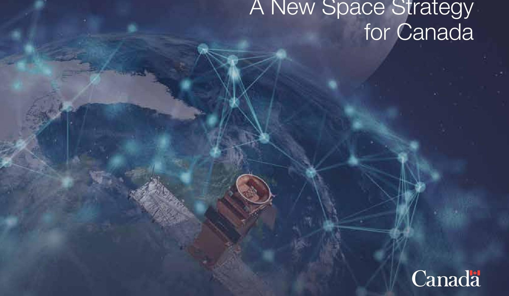

<!-- PDF_PAGE: 2 -->

$ \textcircled{c} $ Her Majesty the Queen in Right of Canada, as represented by the Minister of Innovation, Science and Economic Development Canada, 2019. Cat. no: ST99-60/2019E-PDF

<!-- PDF_PAGE: 3 -->

# EXPLORATION IMAGINATION INNOVATION

A New Space Strategy for Canada

## Contents

Message from the Minister 3

The Case for Space 5

CANADA'S LEGACY IN SPACE 5

THE ROLE OF SPACE IN CANADIAN SCIENCE EXCELLENCE 6

THE SOCIO-ECONOMIC BENEFITS OF SPACE 7

Canada's Vision for Space 9

Delivering the Vision – Canada's Space Strategy 10

1. ENSURE CANADA REMAINS A LEADING SPACEFARING

NATION BY JOINING THE LUNAR GATEWAY MISSION 10

2. INSPIRE THE NEXT GENERATION OF CANADIANS

TO REACH FOR THE STARS 12

3. HARNESS SPACE TO SOLVE EVERYDAY CHALLENGES

FOR CANADIANS 14

4. POSITION CANADA'S COMMERCIAL SPACE SECTOR TO HELP

GROW THE ECONOMY AND CREATE THE JOBS OF THE FUTURE 16

5. ENSURE CANADA'S LEADERSHIP IN ACQUIRING AND USING

SPACE-BASED DATA TO SUPPORT SCIENCE EXCELLENCE,

INNOVATION AND ECONOMIC GROWTH 18

<!-- PDF_PAGE: 4 -->

<!-- PDF_PAGE: 5 -->

# Message from the Minister

As the Minister of Innovation, Science and Economic Development Canada, I am pleased to present Canada's Space Strategy. Canada has a long and proud history of leadership in space science and technology. We were among the first to enter the space age and have maintained a global reputation for scientific and technological excellence and ingenuity.

Nearly every aspect of our daily lives is touched and made better by space innovation. Canadian scientists and firms are reshaping the way space is being explored and utilized. It has been estimated that the global space economy will triple in size over the next 20 years. This growth will be driven by a radical shift in the sector, whereby commercial firms are investing heavily in and benefitting significantly from their own space activities. They are launching mega-constellations of telecommunications satellites, finding new innovative applications for space-based technologies, and even carrying out their own exploration missions. This shift means that space will play a central role in the new digital economy, and in developing and supporting emerging technologies.

Through the Innovation and Skills Plan, Canada has committed to growing the economy through good, well-paying jobs for the middle class and ensuring that the benefits of a more innovative society are shared among all Canadians. By investing in this exceptionally innovative sector, we are improving quality of life across our country, and creating the jobs of the future here at home.

We are also focused on using space to improve the lives of Canadians by leading and collaborating on science activities including on the International Space Station (ISS). In fact since the inception of the ISS program, Canada has contributed to 60 science and health-related experiments. This research continues to advance our understanding of the aging process, improve chronic care and rehabilitation approaches, and advance radiation technology for precision cancer therapy.

The Government of Canada recognizes the importance of space as a strategic national asset, and since 2016 has committed to new investments worth over $2.6 billion to ensure the vitality of Canada's space sector and that Canadians can benefit from advances in space-based technology.

All this has helped grow our space sector and enabled our scientists to take part in missions of discovery about Earth, our solar system and the universe. We are showcasing Canadian innovation and know-how and creating well-paying middle-class jobs.

Today, the challenges we face on Earth, alongside the opportunities that the rapidly evolving space industry and advances in space science provide, demand that Canada again make strategic and visionary commitments to leverage space to maximize benefit for Canadians. Building on our proud history, we are now planning a bright future for Canada's space program.

The Government is committed to helping unlock the full potential of the space sector and respond to the realities of the new and evolving space environment. We will double down on our commitment to equip our youth to excel in the jobs of the future; to support scientific research, technology development and commercialization; and to enable firms to access investment and scale up.

The Honourable Navdeep Singh Bains Minister of Innovation, Science and Economic Development

<!-- PDF_PAGE: 6 -->

© Bristol Aerospace

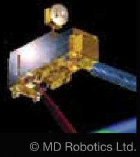

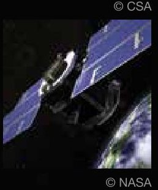

Earth observation and scientific data are essential for clean growth and monitoring the health of the planet. Five Canadian satellites and instruments - SCISAT, MOPITT on Terra, OSIRIS on Odin, CloudSat and RADARSAT-2 have been foundational to Canada's international contributions to the global effort to combat climate change by providing data to measure changes over land, over sea and in the atmosphere.

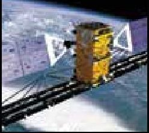

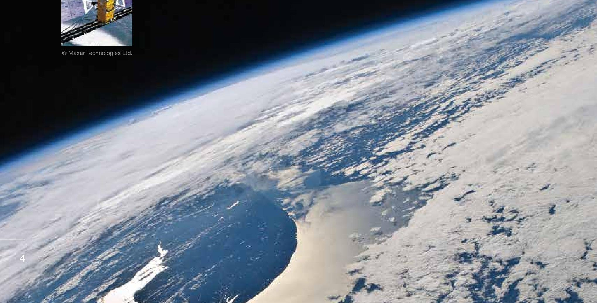

<!-- PDF_PAGE: 7 -->

# The Case for Space

## CANADA'S LEGACY IN SPACE

Canada is a nation defined by its bold efforts in space. We have a rich history of making forward-looking commitments to leverage space science, technology and exploration to improve the lives of Canadians, and answer fundamental questions about our planet and its place in the cosmos.

Sixty years ago, Canada became the third country in space with our own satellite: Alouette 1. Since then, thanks to the ingenuity and efforts of the highly skilled women and men working in this sector, Canada has emerged as a key international partner and contributor in all space domains, including human spaceflight exploration, Earth observation (EO) and space science. Our achievements in pioneering communications satellites; our contributions of the Canadarm and Canardarm2 to the Space Shuttle program and the International Space Station (ISS), respectively; the RADARSAT family of space-based EO satellites; and our astronauts are Canadian icons and sources of tremendous pride.

Today, Canadians continue to benefit from space. In fact, it is now an integral part of daily life in Canada, helping connect and inform us all, enabling everything from navigation, cell phone services and television broadcasts to financial transactions. As a vast country with a relatively small population, Canada relies on the information and imagery gathered by space-based systems to observe and monitor our country. These capabilities also help us support essential government functions such as environmental monitoring, disaster response, and search and rescue. Space systems are also vital to the Canadian Armed Forces, which rely on them to effectively conduct operations for the defence of Canada and North America and to contribute to global peace, safety and security.

Not only does space-based technology have the potential to cost-effectively address challenges that are specific to Canada's unique geography, population density and societal challenges, but it also has important spin-off benefits. From space-based radar to space robotics, scientists and engineers have found applications for space technologies on Earth, including pioneering new knowledge and treatments in health science and medicine. For example, the NeuroArm, an image-guided robotic system that assists neurosurgeons, is based on Canadarm2 technology that could only have been pioneered in the demanding environment of outer space.

In the years since the launch of Alouette 1, space has continued to inspire young Canadians. It has redefined what is possible and has demonstrated the best of the human spirit. Space endeavours will encourage a new generation of Canadians to develop the skills that will allow them to be a part of Canada's space legacy and contribute to the workforce of tomorrow.

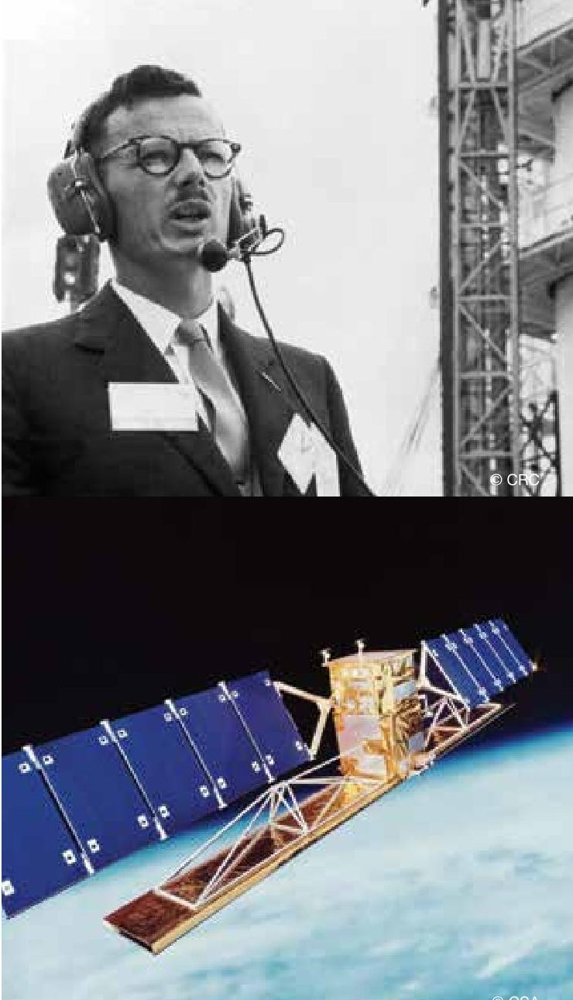

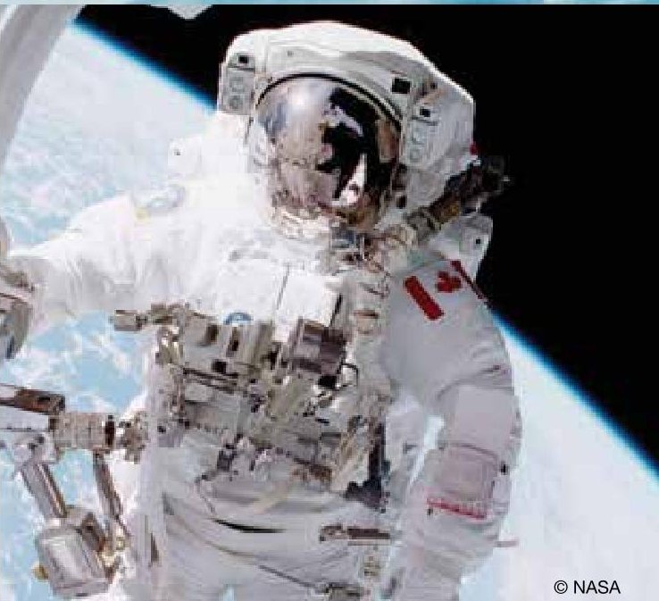

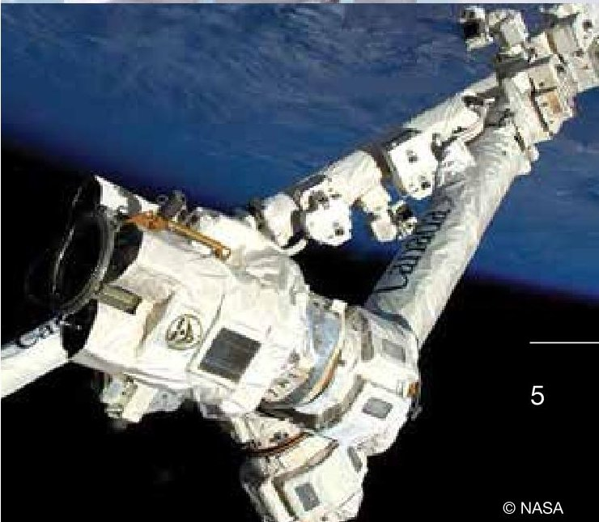

<!-- PDF_PAGE: 8 -->

David Saint-Jacques' Expedition 58 Canadian astronaut David Saint-Jacques has been inspiring youth throughout his time aboard the ISS through a range of STEM-focused activities aimed at helping kids discover the wonder of exploring Earth and our solar system.

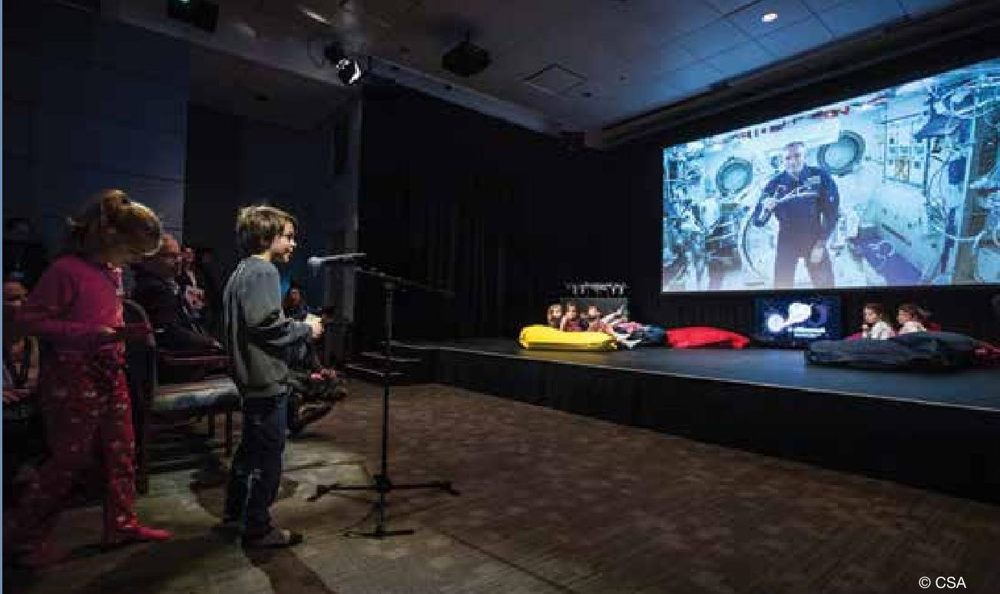

# THE ROLE OF SPACE IN CANADIAN SCIENCE EXCELLENCE

Science and research play an important role in our space pursuits. Canada's space scientists are world-renowned and experts in many disciplines, including astronomy, atmospheric, Earth systems, planetary, solar-terrestrial, and space life sciences. In fact, Canadian scientists are helping further humanity's understanding of the causes of climate change, the effects of pollution on our environment, and the origins of the universe. Canada's participation in national and international missions has afforded our space scientists the chance to share in discovery opportunities and to deepen our understanding of our world and our universe.

Canada has made significant contributions to major astronomy and planetary exploration missions in the form of payloads and technologies. Canada has even been to Mars, where the instruments we provided to the Phoenix lander helped discover the presence of snowflakes in the upper atmosphere.

Today, working as part of the Curiosity rover on the Mars Science Laboratory mission, Canadian instruments are being used to better understand the geology of the red planet. Canada is also a key enabler of space science onboard the ISS, which our astronauts helped build and maintain using Canadarm2 and Dextre. Both of these Canadian instruments are critical to ensuring that cutting-edge science can continue on this unique orbiting laboratory.

Spacefaring nations of the world are once again setting their sights on furthering our understanding of the universe by pushing the frontier of human spaceflight to the Moon and beyond. Canada has a historic opportunity to participate in this endeavour and to add to its legacy of international cooperation, science and disruptive technology development, all of which may lead to discoveries that generate benefits for Canadians and for the world.

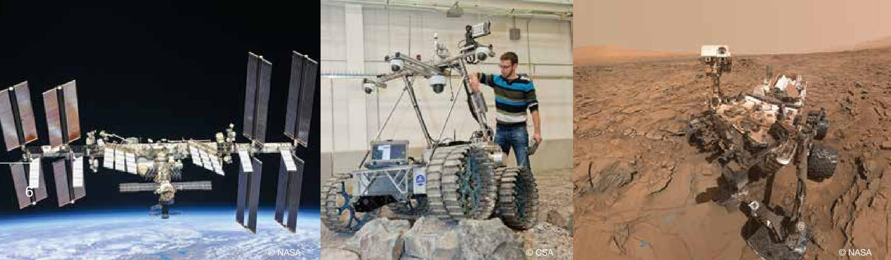

<!-- PDF_PAGE: 9 -->

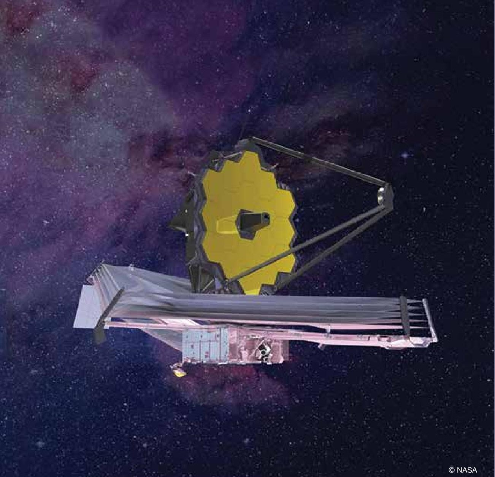

The James Webb Space Telescope Once launched, this joint project between NASA, ESA and the CSA will be the most powerful space telescope ever built.

Canada contributed the Fine Guidance Sensor and the Near-Infrared Imager and Slitless Spectrograph science instrument, which will help the telescope track moving targets and detect distant objects-a critical contribution that demonstrates the trust placed in Canadian technology. In exchange, Canadian astronomers are guaranteed to have a share of observing time.

## THE SOCIO-ECONOMIC BENEFITS OF SPACE

The economic benefits of space are significant. Canada's space sector contributes $2.3 billion to Canada's gross domestic product, directly employs almost 10,000 Canadians, and is one of the most research and development (R&D) intensive sectors in the Canadian economy. Small- and medium-sized businesses account for over 90 per cent of all Canadian space firms and nearly 30 per cent of employment.

Economic opportunities in the space sector are set to increase considerably, as the global market is changing rapidly. Disruptive technologies and advancements have changed the economics of building and launching spacecraft making space more accessible and opening the door to new business activities and new forms of partnerships. Commercial space is now a key growing market. Where governments were once the sole architects of space activities, firms are now taking the lead in launching new space-based

systems and services, attracting both public and private funding. This new space environment is creating jobs, enabling economic growth, and leading to socio-economic benefits in sectors as diverse as farming and clean tech. In fact, global demand for space is expected to grow faster than at any time in history; Morgan Stanley forecasts that in the next 20 years, the global space economy will nearly triple in size, from US$350 billion in 2017 to US$1.1 trillion in 2040.

As an illustration, the demand for EO data, science and imagery by Canadian firms and researchers within the space sector and beyond is increasing; a study by Northern Sky Research concluded that between 2017 and 2027, annual demand for EO data and services will rise from just over $3 billion to close to $7 billion.

<!-- PDF_PAGE: 10 -->

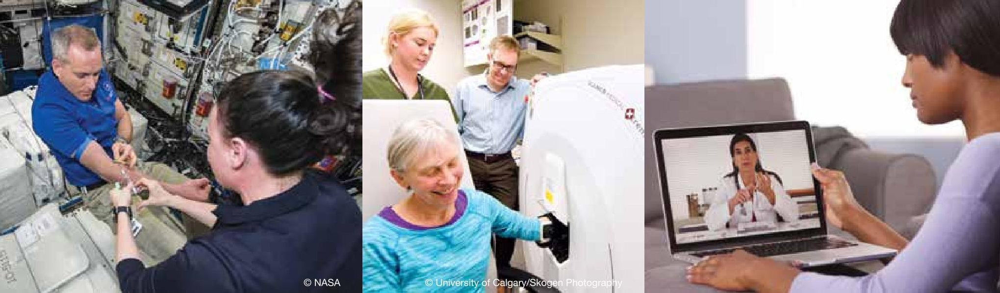

Canada's space activities have also brought social benefits back to Earth. Important examples are the advances in health sciences and medicine that have been enabled by Canada's involvement in the ISS program. Scientists have been able to develop a better understanding of a number of challenges related to cardiovascular, bone and bone marrow health; immunology and neurology; as well as to advance the development of related biomedical devices thanks to the extreme and unique characteristics of the ISS environment microgravity, radiation, isolation and confinement, its closed ecosystem and the long-duration stays of the astronauts who live there.

Recognizing the significant socio-economic opportunity, governments around the world are investing heavily in space and revisiting their policy and regulatory frameworks to create favourable conditions for new kinds of commercially

led space activities such as increased broadband connectivity, new EO services, space resource utilization, commercial launch services, on-orbit servicing and space tourism.

The Government of Canada recognizes the importance of space, as reflected in successive new investments of over $2.6 billion since 2016 to ensure the vitality of Canada's space sector. Through these smart investments, we have helped grow our space sector and enabled our scientists to take part in missions of discovery about Earth, our solar system and the universe. Today, the challenges we face here on Earth, and the opportunities that the rapidly evolving space industry and advances in space science provide, demand that Canada again make strategic and visionary commitments to leverage space to maximize benefits for Canadians. Building on our proud history, we are now planning a bright future for Canada's space program.

Fewer than 10 per cent of Canadian farms currently use satellite imagery to support activities.Increasing this rate to 25 per cent by 2027 could lead to cost savings to farmers in the range of $650M to $1.3B,depending on crop type.In addition,greater use of satellite navigation in precision agriculture could lead to cost savings of $800M per year by 2027.

(Euroconsult, 2018)

<!-- PDF_PAGE: 11 -->

## Vision Statement

Canada recognizes the space sector is a strategic national asset and seeks to ensure Canada remains a spacefaring nation. Looking forward, Canada seeks to create a vibrant and sustainable space sector anchored by a whole-of-government effort that sets a new vision for Canadian space exploration, sees increased partnership with industry to create the jobs of the future, leverages the power of space to inspire youth, and harnesses the potential of space to solve everyday challenges for Canadians while unlocking the secrets of our universe.

# Canada's Vision for Space

Our vision is informed by the work of Canada's Space Advisory Board and acknowledges space as a strategic national asset, requiring a whole-of-government effort to ensure that Canada can continue to rely on space to help meet national needs. It also seeks to realize the full potential of the Canadian space sector to be a leader in exploration, science excellence and innovation and deliver socio-economic benefits to improve life for all Canadians.

Space is the most exciting laboratory imaginable in which to inspire a new generation of Canadians in the pursuit of science, discovery and technological advancement. Canada's space sector is innately innovative. With a critical concentration of talent and technology firms that drive our innovation efforts as well as strong industrial capabilities and research strengths in areas such as EO, robotics, remote sensing and satellite communications, this sector, and the women and men who work in it, are key to realizing the Government's new vision for space.

As we stand on the cusp of successive waves of technological disruptions, space capabilities will also play a central role in the new digital economy, and in developing and supporting emerging technologies. That is why space is a key element of the Government's overall Innovation and Skills Plan and efforts to grow the middle class by supporting the creation of the jobs of the future here at home.

Canada's Space Advisory Board

Canada undertook a national public consultation to identify where it should focus future space efforts. The report, Consultations on Canada's Future in Space: What We Heard, suggested:

1. Designating the space sector as a national strategic asset that is essential for Canada's sovereignty, security and economic growth;

2. Strengthening the capacity of Canada's space sector to compete globally;

3. Adopting new policies and regulations to capitalize on the development of new space technologies;

4. Maintaining well-balanced government programming to support the space sector;

5. Renewing public education and outreach programs to inspire the next generation of Canadians; and

6. Revitalizing Canada's space program to ensure it remains responsive and relevant to its international partners.

<!-- PDF_PAGE: 12 -->

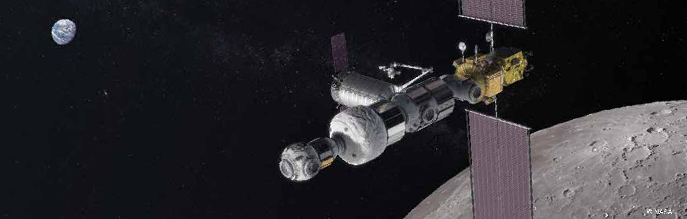

# Delivering the Vision Canada's Space Strategy

Canada will create the right conditions for the growth of the space sector, ensure that Canada's space scientists are offered a rich environment in which to pursue science excellence, fully realize the benefits of space for Canadians and leverage its ability to inspire, and ultimately help strengthen Canada's place in space. The following set of activities will help deliver on this vision for Canada's space sector.

## 1 ENSURE CANADA REMAINS A LEADING SPACEFARING NATION BY JOINING THE LUNAR GATEWAY MISSION

Canada will partner on the next major human exploration and science mission, the US-led Lunar Gateway mission. An outpost in the lunar vicinity, the Gateway will open a new frontier for the exploration of the Moon and pave the way for the first visit by Canadian astronauts to our nearest celestial neighbour. Canada is excited to be among the first partners to confirm its participation in humanity's foray into deep space and to make the Lunar Gateway a key anchor program for Canada's Space Strategy.

The Gateway will support human and robotic exploration, creating opportunities to support innovation, grow the economy, create the jobs of the future, and inspire young people to develop the skills they will need to succeed. The Gateway will be a science laboratory, a testbed for new technologies, a rendezvous location for exploration to the surface of the Moon, a control centre for operations on the Moon, and one day, a stepping stone for voyages to Mars. Canada aims to be a leading member of the next effort to push humanity into space, just as we were with the Space Shuttle program and the ISS. Through this effort, Canada will:

a. Build the next-generation Al-enabled deep-space robotic system: Leveraging the heritage of the Canadarms, our leadership in artificial intelligence (Al), and significant actions by the Government to cement that advantage through the Innovation Superclusters Initiative and the $125 million Pan-Canadian Al Strategy, Canada will remain a world leader in the domain of Al-enabled space robotics. To do so, Canada will invest $1.9 billion to develop and contribute an advanced, next-generation, Al-enabled deep-space robotic system. This smart robotic system will perform critical operations on the Gateway and support the deployment of science and technology experiments. It will be comprised of a large and small robotic arm to allow the system to walk end-over-end, traversing around the Gateway, and it will be highly autonomous, allowing it to make decisions and undertake operations without the presence of astronauts. The technology developed for this critical exploration mission will also position Canadian firms as global leaders in the future on-orbit servicing market.

<!-- PDF_PAGE: 13 -->

b. Enable scientific opportunities and global partnerships: Building on the Government's historic investment of nearly $4 billion in research and the next generation of scientists, Canada's participation in the Gateway will open new opportunities for space science in Canada, including global partnership opportunities for Canada's astronomers and planetary scientists to continue their efforts to probe the origins of the universe and explore new worlds. The Gateway's location in lunar orbit, outside Earth's magnetosphere, will allow Canadian researchers to perform observations in the fields of astrophysics, heliophysics, solar-terrestrial interactions and EO which are not possible from the ground or from Earth's orbit. In addition to studying the Moon, the Gateway will offer an exceptional vantage point to see our home planet from a new perspective. It will improve our understanding of solar storms and their effects on astronauts, spacecraft systems, and terrestrial infrastructure such as power lines and telecommunications systems. There is also still much to learn about the Moon, and Canada will seek to advance lunar science in domains defined by the Canadian science community, such as geology, geophysics and prospecting by landing and operating made-in-Canada scientific payloads on the lunar surface.

c. Guarantee the future of our astronaut program: In 2016, the Government provided $379 million for Canada's continued participation in the ISS and secured future Canadian astronaut flights to it, including astronaut David Saint-Jacques' mission, Expedition 58. On Canada Day 2017, the Government also announced the addition of two new recruits to our corps of highly trained astronauts. They are ambassadors for our space program and models of excellence in science and leadership as well as a source of inspiration for Canadians young and old. Our plan guarantees flight opportunities in low Earth orbit for our astronauts and sets the stage for a Canadian to visit the Moon for the first time.

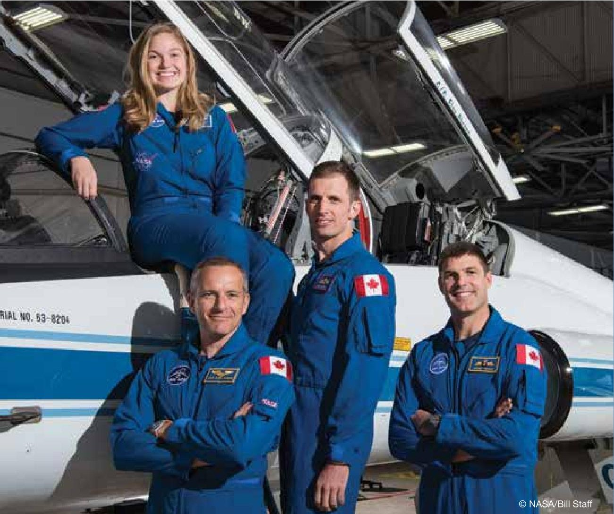

Canada's astronaut corps

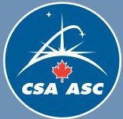

The Canadian Space Agency's (CSA) astronauts are the most visible ambassadors of our country's space program. Canada's newest astronauts are currently being trained by Jeremy Hansen, who is the Supervisor of the 2017 Astronaut Class at NASA's Johnson Space Center. They are learning to support space missions in progress and preparing for future missions through extensive training. As modern-day explorers, these astronauts are a source of inspiration and pride for Canadians of all ages.

<!-- PDF_PAGE: 14 -->

Canada's newest astronauts Joshua Kutryk and Jenni Sidey-Gibbons are the two newest Canadian astronaut recruits! Prime Minister Justin Trudeau and the Honourable Navdeep Bains introduced them in Ottawa during celebrations for the 150th anniversary of Canadian Confederation.

# 2 INSPIRE THE NEXT GENERATION OF CANADIANS TO REACH FOR THE STARS

Space has a unique ability to inspire Canadians - across all genders, cultures and communities - in the pursuit of science discovery and technological advancement. A steady pipeline of highly qualified personnel is also critical to creating and growing leading companies to sustain Canada's position in the global space market. Our youth need to be empowered to establish and pursue their goals and understand that opportunities in space exploration and STEM are open to all. That is why the Canadian Space Agency (CSA) continues to partner with organizations across the country to reach thousands of kids each year to spread the message that STEM matters, building national pride in the achievements of our astronauts and Canadian technologies, while branding Canada globally as a nation of innovators. The CSA will also seek additional opportunities for student involvement in

different aspects of CSA-initiated space projects, from design to operation. In addition, the CSA will:

## a. Launch a national contest to recruit Canada's

"junior astronauts": The Junior Astronauts initiative will reach young Canadians right across the country and help make the exciting opportunities of a career in space and STEM a reality through a diverse array of content and activities. The initiative will teach youth what it will take to be an astronaut through activities focused on scientific understanding, physical fitness, teamwork and communication. Top participants from across Canada will be invited to the CSA's headquarters in St. Hubert, Quebec, to train with real astronauts and learn about the scientific, physical and leadership qualities they will need to develop for a future mission to the Moon.

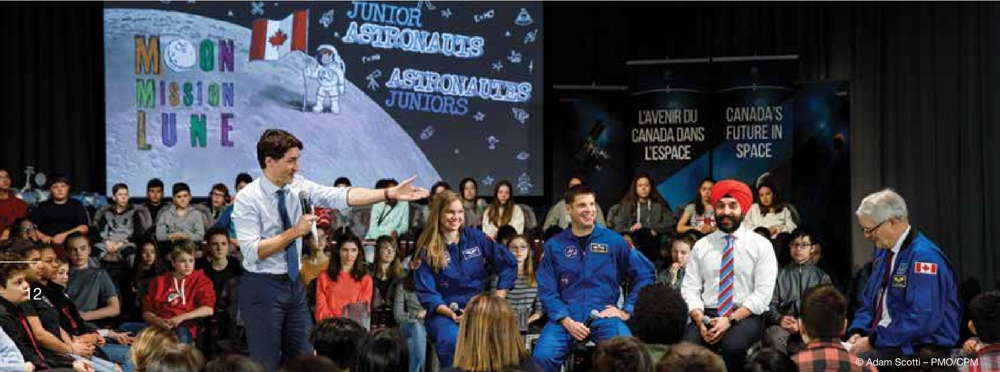

<!-- PDF_PAGE: 15 -->

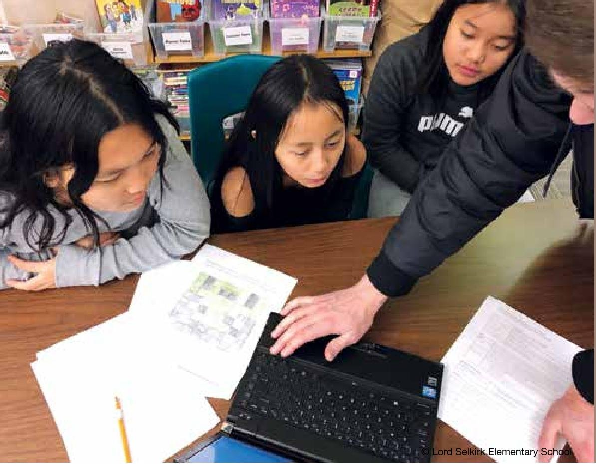

Investments in STEM activities

This Government will continue to use space to inspire Canadian youth to participate in STEM, including making use of the National Science and Engineering Research Council's PromoScience Program and the department of Innovation, Science and Economic Development's (ISED) CanCode. For example, the UInooweg project provides coding and digital skills to Indigenous students from K-12 in Nova Scotia, exposing these students to an array of STEM career fields, including Al and big data.

b. Organize visits by astronauts and other inspiring speakers to schools across Canada: Virtual and in-person visits will let kids experience the wonder of space first-hand and learn about Canada's role in the Lunar Gateway, and see how a career in STEM can allow them to play a role in Canada's space program. Interactive activities will bring the Lunar Gateway mission to young Canadians across the country and help turn our bright young minds towards solving real challenges in space.

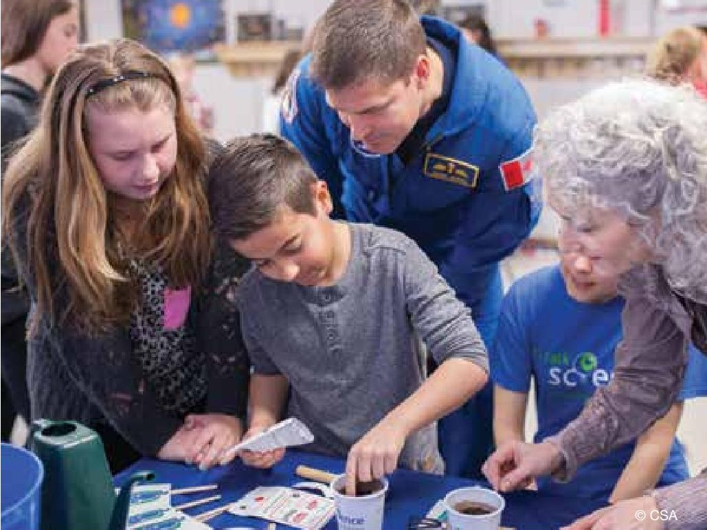

## Gender and diversity in Canada's space sector

Space is a STEM-intensive sector, with over 40 per cent of jobs held by highly qualified personnel (source: the CSA's annual State of the Sector Survey, 2017). Through key initiatives outlined in this strategy, the Government is working to ensure Canadians of diverse backgrounds benefit from the jobs, skills and economic growth of the space sector, and youth are positioned to take on the STEM jobs of tomorrow. For instance:

- The CSA is committed to encouraging firms to actively consider women and underrepresented groups in their hiring plans related to Lunar Gateway robotics and LEAP activities.

- All Junior Astronaut activities will be accessible, inclusive, and easily available to all young Canadians.

- SIF recipients are also encouraged to develop hiring and diversity plans to increase the representation of women and diverse groups in STEM occupations and corporate leadership positions.

<!-- PDF_PAGE: 16 -->

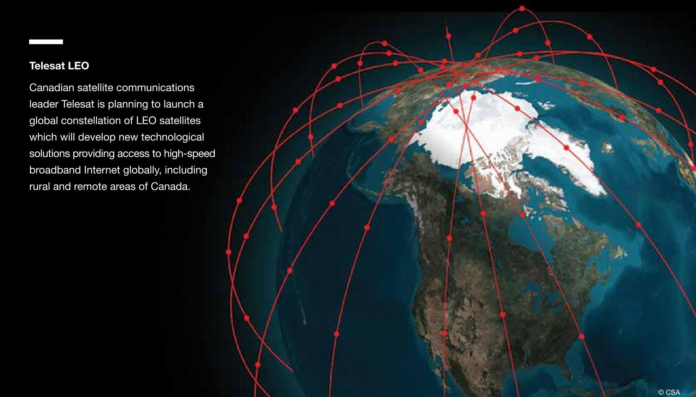

## 3 HARNESS SPACE TO SOLVE EVERYDAY CHALLENGES FOR CANADIANS

Space is a strategic national asset which underpins everything from our national security to our ability to connect Canadians living in rural and remote communities. Canada will leverage space to make life better for Canadians from coast to coast to coast by:

a. Connecting Canadians everywhere: In 2018, the Government announced $100 million over five years under the Strategic Innovation Fund (SIF) to invest in projects that relate to the development of low Earth orbit (LEO) satellites that support broadband connectivity. These investments have the potential to connect more Canadians than ever before, including in rural and remote areas, to next-generation high-speed networks. As a result of these investments, Canadian industry will be positioned as a leader in this field and poised to capture promising economic, public and innovation benefits.

b. Enhancing security and sovereignty: Space is essential to our ability to monitor our landmass and secure our borders. It is essential that the space assets used to enable these services remain reliable and secure. To confront emerging threats, deliver new capabilities and ensure mission resiliency, Canada's defence policy, Strong, Secure, Engaged, lays out stable long-term funding for a range of space projects including enhanced space situational awareness, EO and satellite communications. In addition, Canada will work with like-minded states to help shape emerging global norms of responsible behaviour to further promote the peaceful exploration and use of space.

<!-- PDF_PAGE: 17 -->

c. Improving remote medicine and health care: By leveraging Canada's health and medical research expertise, and emerging technologies such as artificial intelligence, Canada will advance autonomous medical systems to support astronaut health in space and health outcomes at home. Through the Lunar Gateway project and via new efforts on Earth, Canada will explore questions key to improving health care and quality of life for Canadians. Keeping astronauts healthy in deep space has many direct applications in health care today, especially for remote communities: monitoring vital signs, preventing illnesses, performing diagnostics and delivering medical care over great distances. Canada will work with health partners and northern communities to make sure that the advanced knowledge and technologies gained from the space program translate into concrete benefits for all Canadians.

d. Enhancing access to nutritious food: Growing nutritious food effectively in remote regions with harsh environments could allow us to mature the technology to do the same on the Moon and in deep space. The Government will work with provincial and territorial partners to explore how to help improve the accessibility of food across Canada, including the North, with the aim of, one day, taking these lessons learned to help astronauts grow food off Earth.

e. Supporting future secure communications: In 2017, the Government provided up to $80.9 million to the CSA to support new projects that utilize disruptive Canadian innovations in space, including the Quantum Encryption and Science Satellite (QEYSSat) mission. This mission supports the demonstration of emerging Canadian capabilities in the area of quantum key distribution, which has the potential to support more secure communications through unbreakable encryption codes.

Innovation for Defence Excellence and Security (IDEaS)

IDEaS was announced in Strong, Secure, Engaged and will support the development of solutions to some of Canada's toughest defence and security challenges. IDEaS offers support for innovations from their conceptual stage, through prototype testing and capability development. The program will foster a competitive environment by challenging stakeholders from a variety of domains, including space, to develop innovative science and technology solutions to these challenges. For example, the Department of National Defence and the Canadian Armed Forces (DND/CAF) is seeking to develop a common operating picture of space assets, a need driven by today's highly competitive space operations environment. New space-based technologies will enable DND/CAF to maintain space situational awareness for informed, expedited decision making in support of space system operations.

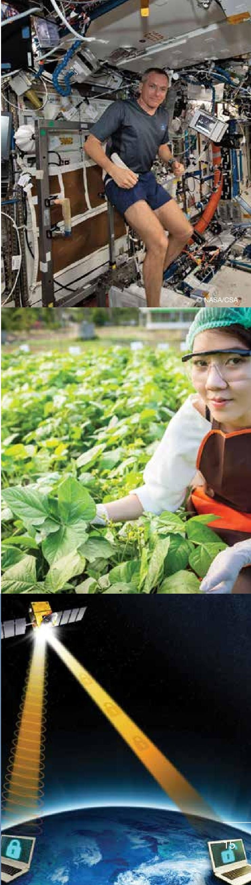

<!-- PDF_PAGE: 18 -->

## exactEarth

exactEarth received an investment of $7.2 million through the Strategic Innovation Fund to support a $14.4 million project. The project will support the development management and expansion of the company's real-time Satellite Automatic Identification System (AIS) service for ship tracking and shipping routes optimization. The funding will help exactEarth create and maintain 67 jobs.

# 4 POSITION CANADA'S COMMERCIAL SPACE SECTOR TO HELP GROW THE ECONOMY AND CREATE THE JOBS OF THE FUTURE

By their very nature, space activities require us to be at the forefront of innovation. The technologies needed to support missions in space are often transformative, resulting in enhanced industrial capabilities and incentivizing significant R&D investments. Space technologies have also spun-off into the creation of new downstream services, products and solutions that link other economic sectors to space, driving growth and productivity gains across the economy. To position Canadian industry to benefit from the rapidly growing international space economy, forecast to triple to US$1.1 trillion in the next 20 years, Canada will pursue regulatory reform, market access and efforts to scale up firms, and maintain a domestic industrial base that can meet Canada's future space needs. Canada will:

a. Create a modern regulatory framework: Building on announcements in the 2018 Fall Economic Statement regarding the creation of simpler, clearer and more modern regulatory systems, the Government will review Canada's regulatory framework for space-related activities to ensure they provide timely responses for industry, maintain strategic oversight for national security and enable commercial growth. This work will examine whether the regulatory system is keeping pace with emerging technologies and new business models in the space sector, and whether it is enabling innovative space companies to prosper in Canada.

## b. Cement and expand our international partnerships:

b. Cement and expand our international partnerships: Building on Canada's trade diversification strategy, Canada will secure and expand its privileged relationship with the European Space Agency (ESA) to support the ability of Canadian firms and researchers to benefit from ESA missions by renewing the Cooperation Agreement between Canada and ESA until 2030. This partnership has a demonstrated four-decade track record of connecting Canadian firms to the supply chains of European-based globally leading space firms, providing access to new technologies and programs. In addition, Canada will continue to seek those benefits for Canadians through its ongoing collaborations with NASA and by strengthening relations with space agencies in other international markets. To further reinforce efforts to access global supply chains, Canada will continue to support business-to-business exchanges to better showcase Canadian expertise to the world.

<!-- PDF_PAGE: 19 -->

c. Help our space firms start up and scale up: Through investments in our Innovation and Skills Plan and unprecedented support for fundamental science, Canada is creating the conditions for success. Canada will further build on these efforts by launching a Lunar Exploration Accelerator Program (LEAP), which will provide $150 million over five years to help firms develop and demonstrate space technologies that will create new commercial opportunities in Canada linked to our participation in the Lunar Gateway mission. LEAP will build on the CSA's highly successful Space Technology Development Program (STDP), which has invested over $64 million since 2015 to help build the space industry of tomorrow here in Canada.

d. Partner with industry to make investments and create jobs here in Canada: Initiatives such as the SIF are providing new opportunities for space companies and academia to link to other industrial sectors and develop new partnerships to accelerate technology solutions to broader market applications. Since 2015, the Government has invested over $45 million in the space sector through the SIF and related programs. Partnering with industry through programs such as the SIF, the STDP and Innovative Solutions Canada helps attract investments, create jobs and scale up firms, and supports cutting-edge R&D. Our plan will also leverage the purchasing power of government to help grow the sector.

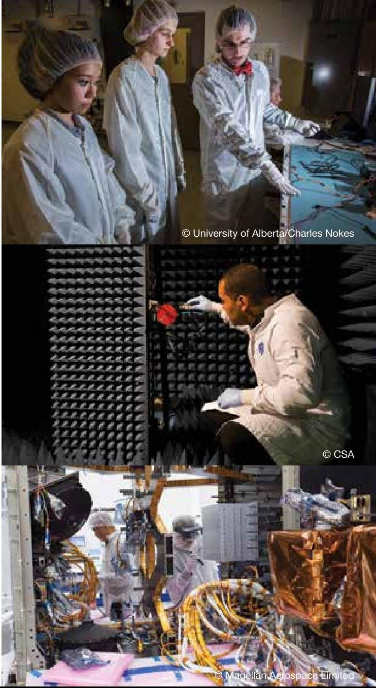

Leveraging Government procurement to help grow the space sector

The Industrial and Technological Benefits (ITB) Policy allows Canada to ensure our investments in our military and coast guard create economic activity here in Canada. In 2017, the Government made improvements to the policy through the identification of Key Industrial Capabilities including in space systems, which will help drive investments into the sector. The Innovative Solutions Canada program challenges Canadian innovators to develop solutions to important problems while providing them an opportunity to have the Government act as a first customer. This program is opening up valuable procurement opportunities for Canadian small businesses while advancing our ability to tackle pressing challenges in space. For example, the CSA asked Canadian innovators to help identify how artificial intelligence and big data analytics can be applied to help improve the operation and utilization of space assets, an innovation that could have important benefits across government.

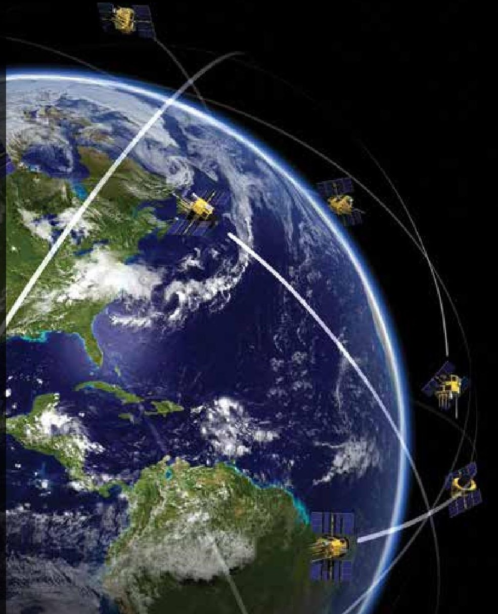

<!-- PDF_PAGE: 20 -->

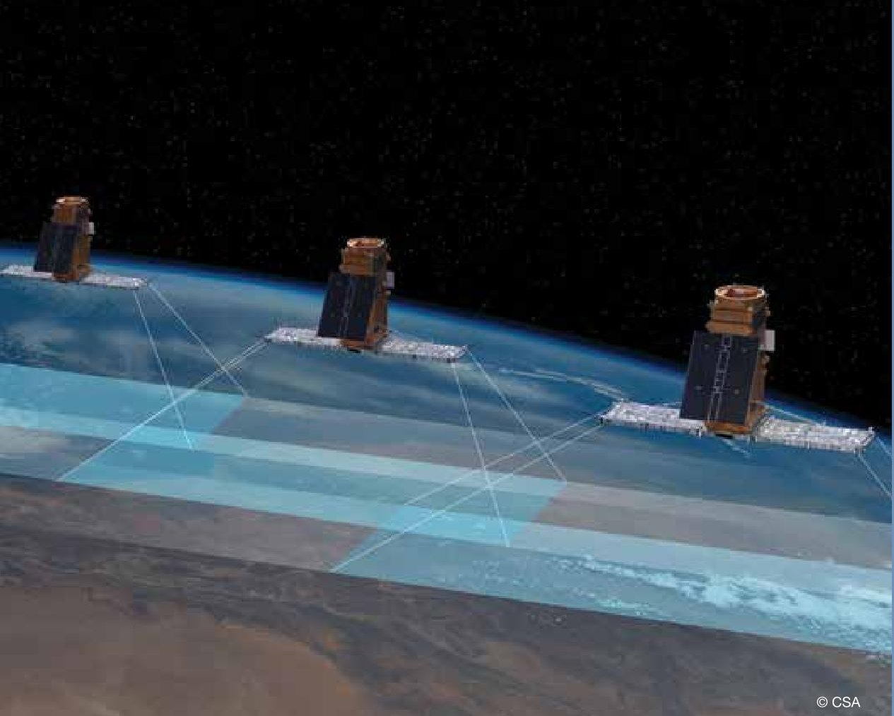

The RADARSAT Constellation is the evolution of the RADARSAT Program. It was developed through Government investments in Canada's world-leading capabilities in space-based Synthetic Aperture Radar. The three-satellite configuration will provide daily revisits of Canada's vast territory and maritime approaches, as well as daily access to 90 per cent of the world's surface. The RCM is designed to provide the data necessary to support government operations for three main applications: maritime surveillance, disaster management and ecosystem monitoring.

# 5 ENSURE CANADA'S LEADERSHIP IN ACQUIRING AND USING SPACE-BASED DATA TO SUPPORT SCIENCE EXCELLENCE, INNOVATION AND ECONOMIC GROWTH

Unique data collected from Canada's space assets enable the Government to make evidence-based decisions that keep Canadians safe, monitor and protect our environment, support a range of economic sectors, and allow us to remain key partners in global security and defence networks. These data are also key to businesses that translate them into new and innovative applications, and they underpin cutting-edge science in Canada. Canada will ensure that our country remains a world leader in harnessing those data while creating the conditions for success for our downstream space firms and scientists by:

a. Collecting climate change data: Canada counts on space-based assets to provide crucial data about how our climate is changing and how we can address and mitigate that change. Of the 50 Essential Climate Variables (ECVs) identified by the World Meteorological Organization to monitor climate change, 26 can only be observed effectively from space. The Government will actively explore the development of additional climate change science and monitoring missions to ensure the continued provision of those data.

b. Prioritizing future Earth observation capabilities: Canada will soon launch a new "constellation" of satellites, the RADARSAT Constellation Mission (RCM), that will provide unprecedented near-real-time data to allow for important evidence-based decision making in response to the changing climate and security threats. For example, the effects of climate change are increasingly evident in Canada with the rising number of floods, droughts, wildfires, as well as melting polar ice caps and rising sea levels; the full scope of these catastrophic events will be observed and monitored by the RCM. Over its life, the RCM will help increase our knowledge of climate processes and their impacts, and thus properly target our responses. Canada will need to continue to benefit from high-quality EO data, such as those provided by the RCM. The CSA and other government departments are therefore planning for data continuity beyond the expected lifespan of the RCM by launching concept studies to examine options for a successor solution.

<!-- PDF_PAGE: 21 -->

c. Supporting excellence in data analytics: Through open data policies and investments in infrastructure needed to process, analyze and distribute data, Canada will ensure that industry, government and Canadian researchers have enhanced access to the vast amounts of space-generated data we receive from space assets. The Government's manner of facilitating access to space data and support for related R&D will be modernized, to help Canadian firms turn these data sets into innovative new applications that can generate important economic benefits.

## d. Supporting space science to study Earth and

d. Supporting space science to study Earth and beyond: Space provides a unique perspective for space scientists to observe our planet, the health of our ecosystems and how our planet interacts with the Sun (e.g. space weather), and to learn more about our solar system and the universe we inhabit. The Government is improving its approach to selecting science missions by forging inclusive partnerships with the science community within and outside government to help collectively determine Canada's next slate of science missions. This new approach will ensure that resources are deployed to the highest priority scientific questions and issues. The Government will also explore innovative business models and partnership to deliver on those science missions and activities.

In 2018, the Government launched consultations led by digital innovation leaders who engaged with Canadians, including businesses, academia, innovators and entrepreneurs, in cities across the country and online to seek their views on how Canada should position itself to take advantage of the new data economy. Those consultations enabled us to better understand how we can help drive innovation and prepare Canadians for the future of work, all while ensuring they have trust and confidence in how their data are used. These lessons learned will assist us as we continue to support excellence in space-based data analytics.

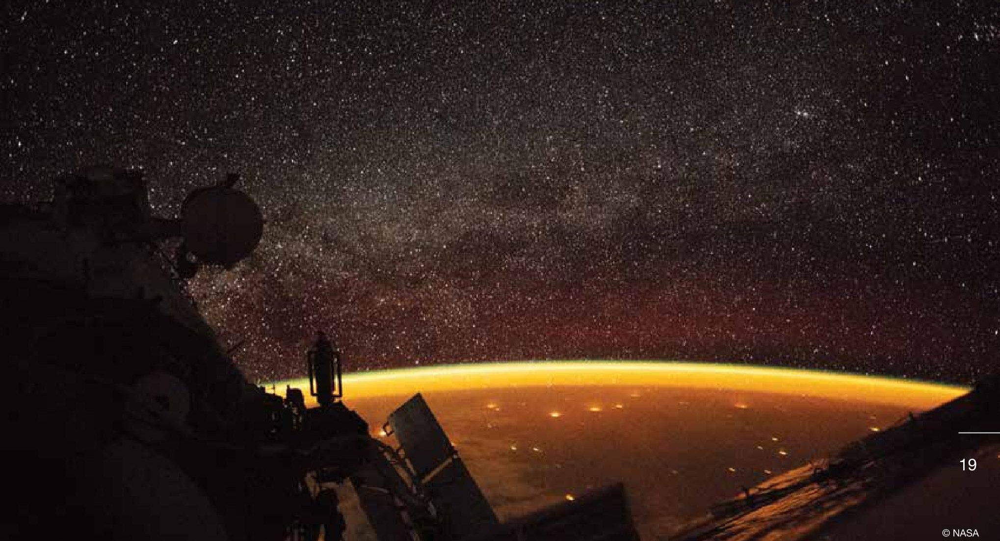

<!-- PDF_PAGE: 22 -->

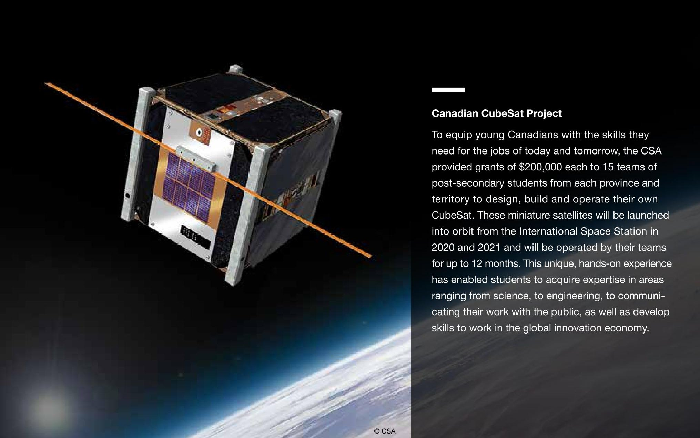

## Moving Forward

Canada has a long and proud history of innovation and leadership in space. We were among the first to enter the space age and have maintained a global reputation for technological excellence and ingenuity. We have produced some of the world's most advanced space hardware, and our technological capabilities continue to set us apart from the world.

Through the Innovation and Skills Plan, Canada is taking steps to grow the economy, which in turn, results in good, well-paying jobs for the middle class and benefits to Canadians. The space sector is well placed to help us further this commitment. Indeed, the activities outlined here will help bring high-value jobs to Canada, foster innovation in one of the most R&D-intensive sectors of the Canadian economy, and help build the workforce of tomorrow.

This Strategy will help unlock the full potential of the space sector and respond to the realities of the new and evolving space environment. It will provide a vision for building the

skills and capabilities needed to excel in space, including by inspiring a new generation of Canadians; supporting scientific research, technology development and commercialization; and enabling firms to invest and scale up.

Our more than 60-year history as a spacefaring nation has been driven by the talent, creativity and determination of Canadians. These values will remain at the core of our vision for the next 60 years and beyond. A renewed focus and vision will help ensure that the wonders of space can continue to inspire curiosity, spark passion and launch imagination in generations of Canadians to come.
