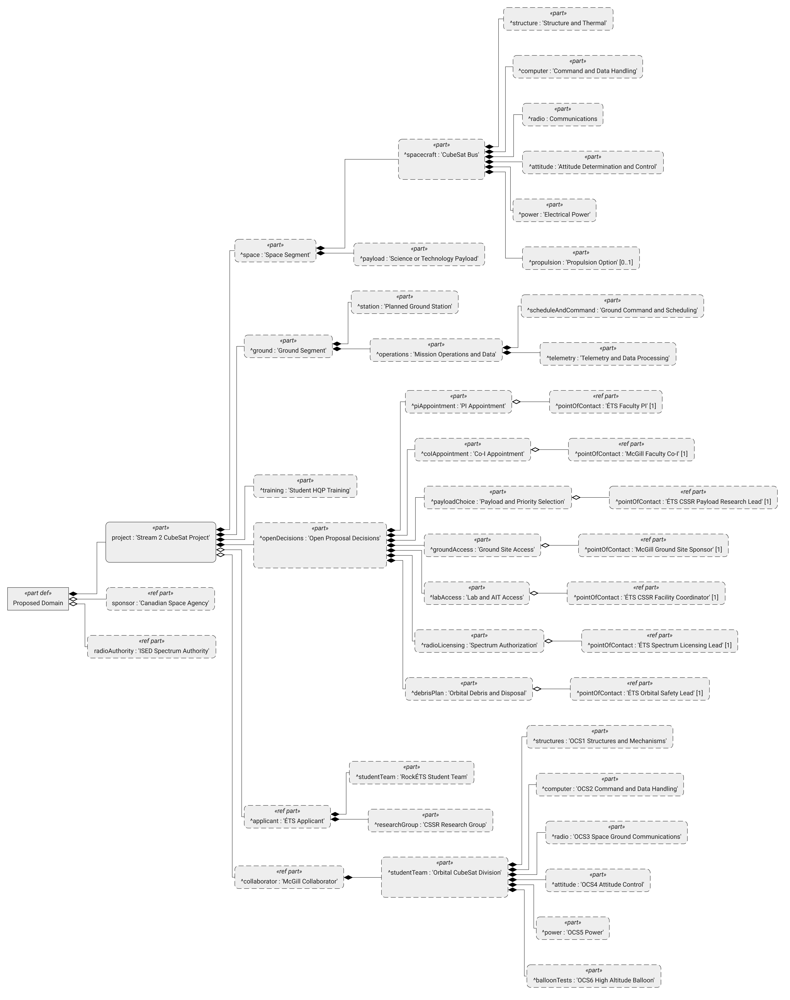

# ÉTS + McGill, CUBICS 2026 Stream 2 (proposed domain)



[Native tree SVG](rendered/tree/domain-structure.svg) · [SysML v2 model](domain.sysml) · [Alternate nested view](rendered/domain/domain-structure.svg) · [Focused open decisions view](rendered/open-decisions/domain-structure.svg)

Additional native organigrams: [ÉTS AIT units, staff, and equipment](ait/rendered/ets-tree/ets-ait-domain-structure.png) · [McGill AIT units, staff, and equipment](ait/rendered/mcgill-tree/mcgill-ait-domain-structure.png). [Institutional evidence](ait/README.md).

This is a **proposal concept**, not evidence of a partnership, grant award, licence, appointed PI, selected payload, or secured facilities. The `openDecisions` records are work to close before an application can claim capability. Each has **one point-of-contact role** with multiplicity `[1]` in the model. A person must still accept each role. ÉTS would be the sole applicant and grant signatory. The appointed ÉTS PI would be responsible for project outcomes and regulatory compliance throughout the mission. A McGill Co-I and students may carry out work without assuming that accountability [1].

## Why this split

- **McGill bus and RF:** The McGill Rocket Team's Orbital CubeSat Division describes OCS1 structure, OCS2 command and data handling, OCS3 spacecraft and ground radio, OCS4 ADCS, OCS5 power, and OCS6 balloon testing. It says it is *developing* a CubeSat and ground station. This supports a proposed bus, RF, and ground operations team. It does **not** establish an available, authorized ground station [2].
- **ÉTS student work:** RockÉTS reports design, fabrication, component testing, and ongoing hands-on engineering and knowledge sharing. Its sounding-rocket experience can support payload prototypes, integration practice, and student training. It does **not** establish orbital flight heritage [3].
- **ÉTS research and labs:** The ÉTS Satellite and Space Research Center (CSSR) reports CubeSat work, vacuum chambers, space and communication simulators, and microfabrication resources. It is a plausible **candidate** for payload research and assembly, integration, and testing (AIT). Its public page does **not** confirm capacity, qualification standards, booking terms, or access for this project [4].
- **Mission scope:** The local CSRM diagrams [7] separate space and ground segments and list the bus (structure, C&DH, communications, ADCS, power, thermal) and ground functions (planning, command, RF, telemetry, data, facilities). Propulsion is a trade, not an assumed installed subsystem. MARMOTSat [6] is a CUBICS 2022 example of students building both segments, training HQP, and using an ADCS supplied by CubeSpace. Its reported 2026 launch is evidence of its own mission, not evidence of ÉTS or McGill capacity.

## One contact role for each open concern

| Open concern | Single proposed contact role (unappointed) | Evidence required to close it |
| --- | --- | --- |
| PI and mission accountability | **ÉTS faculty PI** | Faculty acceptance, ÉTS approval, mission-long governance, operations and regulatory resourcing. ÉTS alone applies [1]. |
| Partner supervision | **McGill faculty Co-I** | Acceptance and letter of support defining work, budget or service arrangement, student supervision, and institutional approvals [1]. |
| Payload and CSA priority | **ÉTS CSSR payload research lead** | Select, supply, or procure an up-to-3U-compatible payload. Document science or technology output, at least one Space Strategy for Canada priority, interfaces, cost, and who owns the data [1, 4]. |
| Ground station facility | **McGill ground site sponsor** | Signed site permission and usable access, equipment and operating budget, ground licence assessment, station available before CDR, and demonstrated uplink and downlink by FRR. The OCS3 team can design and test the RF link [1, 2]. |
| Lab and AIT facilities | **ÉTS CSSR facility coordinator** | Facility owner agreement, bookings, equipment limits, environmental test plan, any external tests needed, and availability through delivery [1, 4]. |
| Spectrum and communications | **ÉTS spectrum licensing lead** | Band/service trade, ISED space station and applicable earth station authorization plan, compliance analysis, filings, timeline, and amateur-service benefit/IARU coordination if amateur bands are chosen. The **PI remains accountable** [1, 5]. |
| Orbital debris and disposal | **ÉTS orbital safety lead** | Orbit-dependent debris plan, disposal within five years after end of operational life with at least 90% probability of success, tracking/SSA service, conjunction procedure and 24/7 operational contact. Resolve active propulsion applicability with ISED if apogee approaches 600 km [1, 5]. The **PI remains accountable**. |

The CSSR page publicly lists Prof. René Jr Landry and project manager Jean-Marc Gagné as possible **outreach starting points** for an ÉTS faculty or facility conversation [4]. Neither is shown as an appointed PI or committed facility coordinator. Approach the McGill Rocket Team through its [contact page](https://mcgillrocketteam.com/contact/) to identify a faculty Co-I and a ground site sponsor [2]. A student division lead cannot alone authorize a roof site or commit a university lab.

**Critical mission gates.** Stream 2 supports 1U, 2U, or 3U with up to three years of grant activity. The AO describes a possible CSA launch three to four years after grant issuance, conditional on readiness, licences, testing, and CSA discretion [1]. The schedule and staffing must extend through operation and end of life even if they extend beyond the grant. The AO says a station without demonstrated functionality needs a credible path before CDR and proof of uplink/downlink at FRR. Its FAQ strongly recommends a team station [1]. CSA support or a prospective shared network is not proof of access. ISED CPC-2-6-02 §5.1.8 and the 2026 debris decision require the five-year and 90% analyses. The debris decision discusses propulsion at 600 km with slightly different threshold wording in its discussion and decision (D15). Resolve the chosen orbit and boundary case with ISED. Passive disposal is allowed only when it demonstrably meets applicable conditions [1, 5].

## Model and drawing semantics

`domain.sysml` follows the local [residential security domain example](../examples/residential-security-oosem/README.md). A `part` is a component of a modeled context or project. A `ref part` is a **non-owning role**. It does not assert that a specific person, institution, facility, or grant has accepted the role. `@SystemOfInterest` marks the project. A gap is a **project-owned decision record** containing one external `pointOfContact : Role [1]`, not a funded work package or a licence. All views under `rendered/` are native Syside Modeler visualizations of the checked SysML v2 source. The primary tree uses [`syside.toml`](syside.toml) with Syside's `general = "tree"` render style and unlimited depth. It shows every concern and its single contact role. Filled diamonds indicate composition; hollow diamonds indicate non-owning references. The rationale and evidence remain in this README.

To validate and regenerate the native views from the repository root:

```sh
TOOL=/Users/antho/agent-tools/sysmlv2/skills/sysmlv2/scripts/model.py
MODEL=cubics-2026-ets-mcgill/domain.sysml
uv run "$TOOL" check "$MODEL" --json
uv run "$TOOL" render "$MODEL" --element "ETSMcGillCUBICS2026::'Proposed Domain'" --view structure --native-depth -1 --config cubics-2026-ets-mcgill/syside.toml --formats svg,png --output-dir cubics-2026-ets-mcgill/rendered/tree --json
uv run "$TOOL" render "$MODEL" --element "ETSMcGillCUBICS2026::'Open Proposal Decisions'" --view structure --native-depth 2 --formats svg,png --output-dir cubics-2026-ets-mcgill/rendered/open-decisions --json
```

Validated with Syside Modeler 0.10.3: zero syntax or semantic diagnostics. Validation establishes model well-formedness, **not** project eligibility or verified external capability.

## Sources

1. [CSA, CUBICS 2026 Announcement of Opportunity](https://www.asc-csa.gc.ca/eng/funding-programs/funding-opportunities/ao/2026-cubics-cubesats-initiative-in-canada-for-stem.asp), §§3.2–3.4, 6.2, Appendix B.2–B.8, FAQ 4–9, 12. The AO's link to CPC-2-6-02 points to §5.1.9 (waivers); debris details appear in **§5.1.8**.
2. [McGill Rocket Team, Orbital CubeSat Division](https://mcgillrocketteam.com/cubesat/) and [team contact](https://mcgillrocketteam.com/contact/).
3. [ÉTS, RockÉTS](https://www.etsmtl.ca/clubs/rockets).
4. [ÉTS, Satellite and Space Research Center (CSSR)](https://cssr.etsmtl.ca/).
5. [ISED, CPC-2-6-02 (April 2026), §§5.1.4, 5.1.6, 5.1.8 and 8.1](https://ised-isde.canada.ca/site/spectrum-management-telecommunications/en/learn-more/key-documents/procedures/client-procedures-circulars-cpc/cpc-2-6-02-licensing-space-stations) and [ISED, 2026 Space Debris Mitigation decision, D5, D10–D11, D15–D16](https://ised-isde.canada.ca/site/spectrum-management-telecommunications/en/learn-more/key-documents/consultations/decision-changes-licensing-requirements-and-conditions-licence-space-debris-mitigation).
6. [MARMOTSat](https://www.marmotsat.ca/), University of Victoria CUBICS project and student mission example.
7. Local [`csrm-diagrams/`](../csrm-diagrams/) mission, space, CubeSat subsystem, ground, and ground subsystem figures.
