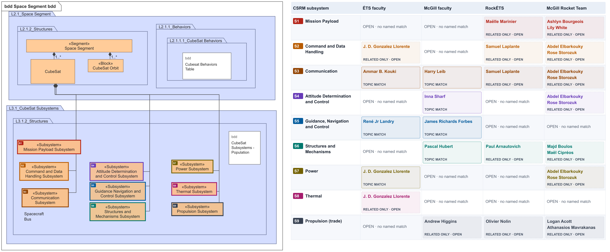
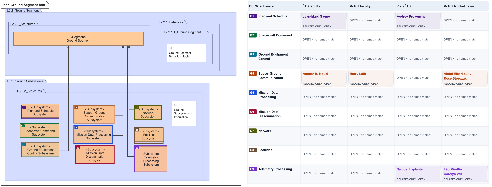
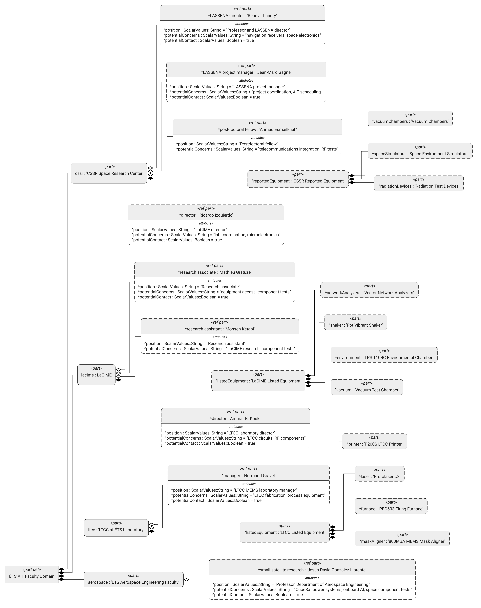
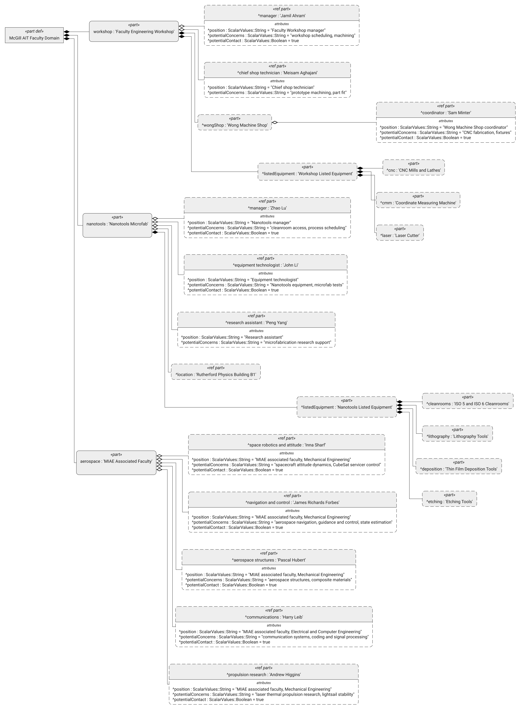

# ÉTS and McGill AIT faculty and student club domains

The two **native Syside faculty trees** show selected published research units, facilities, staff, and equipment relevant to assembly, integration, and testing (AIT). Separate student club trees show members, positions, and projects. The faculty domains exclude student clubs. These diagrams do not establish mission plans or confirmed CubeSat test capacity. Sources were checked on 24 September 2026. The club views include all seven names on the RockÉTS board page and all 27 names on the McGill Rocket Team roster page. Verify current positions before outreach.

A `ref part` connects a person to the unit that lists them. It does not treat a person as owned equipment. Every named person has a `position` attribute taken from the cited staff page. Their `potentialConcerns` attribute lists topics they **could** support, inferred from their published role or unit. The comma-separated topics are suggestions, not confirmed assignments. `potentialContact : Boolean = true` marks selected outreach candidates. It does not claim they agreed to work on CUBICS. The diagrams do not show unappointed leads or proposed partner agreements.

## CSRM subsystem contact overlays

These **derived overlays** add a distinct color and ID to each subsystem box in the [original space](reference/csrm-space-segment.png) and [ground](reference/csrm-ground-segment.png) reference images. The same color marks people flagged `potentialContact = true` in four AIT views (ÉTS faculty, McGill faculty, RockÉTS, and the McGill Rocket Team). The CSRM source PNGs remain unchanged. The faculty trees are native Syside renders of the updated models.

[Space overlay SVG](annotated/csrm-space-contact-overlay.svg) · [Ground overlay SVG](annotated/csrm-ground-contact-overlay.svg)





`TOPIC MATCH` identifies a named person whose published role or concerns align with the subject. `RELATED ONLY · OPEN` marks adjacent research, fabrication, division oversight, or rocket work without a direct topic match. `OPEN · no named match` marks the remaining gaps in each view. These cells describe the **modeled outreach evidence**, not missing institutional capabilities. None of the contacts is an appointed subsystem lead. New faculty matches come from published ÉTS small satellite power research [14, 15] and McGill aerospace and communications research [16–21]. Inna Sharf's work includes spacecraft attitude propagation [17]. James Richards Forbes works on aerospace guidance and control [18]. Pascal Hubert studies aerospace structures [19]. Harry Leib researches communication systems [16, 21]. Andrew Higgins studies laser thermal propulsion for interstellar missions, which is related to the propulsion trade but is not a CubeSat propulsion design [20]. The McGill club lists OCS1–OCS5 projects without named project leads. No named ground station sponsor, ground data operator, or spacecraft thermal lead was established by these sources.

## ÉTS faculty



[Native SVG](rendered/ets-tree/ets-ait-domain-structure.svg) · [SysML v2 source](ets-ait-domain.sysml)

| Unit shown under ÉTS faculty domain | People shown at that unit | Equipment published by the unit |
| --- | --- | --- |
| Satellite and Space Research Center (CSSR) | Its **Our Team** page lists René Jr Landry as LASSENA director, Jean-Marc Gagné as LASSENA project manager, and Ahmad Esmailkhah as a postdoctoral fellow [1]. | CSSR reports vacuum chambers, space environment simulators, and radiation test devices [1]. |
| LaCIME | Ricardo Izquierdo is director. Mathieu Gratuze is a research associate. Mohsen Ketabi is a research assistant [2]. | Its equipment page lists vector network analyzers, a *pot vibrant* shaker, a TPS T10RC environmental chamber, and a vacuum test chamber [3]. |
| LTCC@ÉTS | Ammar B. Kouki is director. Normand Gravel is lab manager [4]. | The lab lists a P200S LTCC printer, Protolaser U3, PEO603 furnace, and 800MBA MEMS mask aligner [4]. |
| Aerospace Engineering faculty | Jesus David Gonzalez Llorente is a professor researching small satellite electrical power and onboard autonomy [14, 15]. | His published work includes CubeSat EPS validation and battery tests. The diagram asserts no facility access [14]. |

The faculty tree places CSSR, LaCIME, LTCC@ÉTS, and the Aerospace Engineering faculty grouping directly under the ÉTS AIT Faculty Domain. It does not infer a reporting line between the research units. LaCIME mentions the LTCC laboratory in its contact and equipment pages [2, 3]. A listed chamber or shaker has no implied CubeSat test envelope or qualification status.

### RockÉTS student club

[Separate native RockÉTS tree](rendered/ets-club-tree/ets-ait-domain-structure.svg). The board lists captain Mélanie Fressard, treasurer Raphaël Tremblay, and named directors of payload, avionics, aerostructure, propulsion, and communications and logistics [10]. Its avionics department reports using the Anirniq modular rocket avionics system since 2019. It contains a commercial GPS and altimeter module and student built boards [11]. Anirniq is **rocket avionics**, with no claim of satellite qualification.

## McGill faculty



[Native SVG](rendered/mcgill-tree/mcgill-ait-domain-structure.svg) · [SysML v2 source](mcgill-ait-domain.sysml)

| Unit shown under McGill faculty domain | People shown at that unit | Equipment or location published by the unit |
| --- | --- | --- |
| Faculty of Engineering Workshop | Jamil Ahram is manager. Meisam Aghajani is a chief shop technician. Sam Minter is a coordinator at the Wong Machine Shop [5]. | Workshop Services lists CNC mills and lathes, a coordinate measuring machine, and a laser cutter [6]. |
| Nanotools Microfab | Zhao Lu is manager. John Li is equipment technologist. Peng Yang is research assistant [7]. | Nanotools lists ISO 5 and ISO 6 cleanrooms, lithography, thin film deposition, and etching. Its staff and cleanroom are in the Rutherford Physics Building basement [7, 8]. |
| MIAE associated faculty | Inna Sharf, James Richards Forbes, Pascal Hubert, Harry Leib, and Andrew Higgins are listed in McGill's aerospace faculty research pages [16, 20]. | Research affiliation only. The model asserts no shared equipment or facility access. |

The McGill faculty tree treats the Faculty Workshop and Nanotools as separate published facilities. MIAE's associated faculty form a separate research grouping, with no inferred reporting line to either facility. A cleanroom for microfabrication does not imply access to whole spacecraft assembly. Workshop jobs have a work order and funding approval process [6]. Nanotools has registration, supervisor approval, project review, and safety training requirements [9].

### McGill Rocket Team student club

[Separate native McGill club overview](rendered/mcgill-club-overview/mcgill-ait-domain-structure.svg) shows the branches at a readable depth. [OCS1–OCS6](rendered/mcgill-ocs-tree/mcgill-ait-domain-structure.svg) and [rocket subteams with leads](rendered/mcgill-rockets-tree/mcgill-ait-domain-structure.svg) have separate native detail views. Its roster lists captains Natalie Hassanien, Saiid Haymour, and Rawan Olabi. Abdel Elbarkouky and Rose Storozuk direct the Orbital CubeSat Division. The roster also names quality control and technical directors, a club workshop manager, an advisor, finance and media officers, and leads of six rocket subteams [12]. The six rocket subteams are Aerostructures, Avionics, Launch Systems, Payload, Propulsion, and Recovery. They are separate from the OCS1–OCS6 projects [12, 13]. OCS6 reports two high altitude balloon flights in the last design cycle [13]. The club's **Workshop Manager** is a club role. McGill's Faculty of Engineering Workshop has a different manager [5, 12]. The CubeSat division describes vibration and vacuum testing plans, with no claim of club-owned qualification equipment [13].

## Reproduce

Both `.sysml` models passed Syside Modeler 0.10.3 syntax and semantic validation with zero diagnostics. The native PNGs and SVGs were rendered using the parent [`syside.toml`](../syside.toml), which selects Syside's `tree` layout. The contact overlays are separate derived assets. Their reproducible generator uses Python 3 and `rsvg-convert`.

```sh
TOOL=/Users/antho/agent-tools/sysmlv2/skills/sysmlv2/scripts/model.py
CONFIG=cubics-2026-ets-mcgill/syside.toml
ETS=cubics-2026-ets-mcgill/ait/ets-ait-domain.sysml
MCGILL=cubics-2026-ets-mcgill/ait/mcgill-ait-domain.sysml
uv run "$TOOL" check "$ETS" --json
uv run "$TOOL" check "$MCGILL" --json
uv run "$TOOL" render "$ETS" --element "ETSAITDomain::'ÉTS AIT Faculty Domain'" --view structure --native-depth -1 --config "$CONFIG" --formats svg,png --output-dir cubics-2026-ets-mcgill/ait/rendered/ets-tree --json
uv run "$TOOL" render "$MCGILL" --element "McGillAITDomain::'McGill AIT Faculty Domain'" --view structure --native-depth -1 --config "$CONFIG" --formats svg,png --output-dir cubics-2026-ets-mcgill/ait/rendered/mcgill-tree --json
uv run "$TOOL" render "$ETS" --element "ETSAITDomain::'RockÉTS Club'" --view structure --native-depth -1 --config "$CONFIG" --formats svg,png --output-dir cubics-2026-ets-mcgill/ait/rendered/ets-club-tree --json
uv run "$TOOL" render "$MCGILL" --element "McGillAITDomain::'McGill Rocket Team'" --view structure --native-depth 3 --config "$CONFIG" --formats svg,png --output-dir cubics-2026-ets-mcgill/ait/rendered/mcgill-club-overview --json
uv run "$TOOL" render "$MCGILL" --element "McGillAITDomain::'Orbital CubeSat Division'" --view structure --native-depth -1 --config "$CONFIG" --formats svg,png --output-dir cubics-2026-ets-mcgill/ait/rendered/mcgill-ocs-tree --json
uv run "$TOOL" render "$MCGILL" --element "McGillAITDomain::'MRT Rocket Subteams'" --view structure --native-depth -1 --config "$CONFIG" --formats svg,png --output-dir cubics-2026-ets-mcgill/ait/rendered/mcgill-rockets-tree --json
python3 cubics-2026-ets-mcgill/ait/annotate_csrm.py
```

## Sources

1. [CSSR, equipment and team](https://cssr.etsmtl.ca/).
2. [ÉTS, LaCIME staff contacts](https://www.etsmtl.ca/laboratoires/lacime).
3. [ÉTS, LaCIME equipment](https://www.etsmtl.ca/laboratoires/lacime/equipement).
4. [ÉTS, LTCC@ÉTS staff and equipment](https://www.etsmtl.ca/recherche-innovation/chaires-laboratoires-instituts-centres/laboratoires-recherche/ltcc-ets).
5. [McGill, Faculty Workshop staff](https://www.mcgill.ca/engineering/faculty-staff/services-resources/faculty-workshop-services/team-members).
6. [McGill, Workshop Services](https://www.mcgill.ca/engineering/faculty-staff/services-resources/faculty-workshop-services/information-and-services/workshop-services).
7. [McGill, Nanotools staff and location](https://www.mcgill.ca/microfab/about/contact).
8. [McGill, Nanotools facility and equipment categories](https://www.mcgill.ca/microfab/about).
9. [McGill, Nanotools access process](https://www.mcgill.ca/microfab/getting-started-mcgill-nanotools).
10. [RockÉTS, board members and departments](https://rockets.etsmtl.ca/about/).
11. [RockÉTS, Anirniq modular avionics](https://rockets.etsmtl.ca/anirniq-%e1%90%8a%e1%93%82%e1%95%90%e1%93%82%e1%96%85/) and [club projects](https://rockets.etsmtl.ca/nos-projets/).
12. [McGill Rocket Team, member roster and roles](https://mcgillrocketteam.com/about/).
13. [McGill Rocket Team, Orbital CubeSat Division and OCS projects](https://mcgillrocketteam.com/cubesat/).
14. [ÉTS, Jesus David Gonzalez Llorente faculty profile and publications](https://www.etsmtl.ca/en/study-at-ets/professors/jgonzalez-llorente).
15. [ÉTS, autonomous and sustainable small satellite research](https://www.etsmtl.ca/en/news/satellites-autonomes-durables).
16. [McGill Institute for Aerospace Engineering, associated faculty and research](https://www.mcgill.ca/miae/research/miae-faculty-members).
17. [McGill, Inna Sharf, spacecraft orbit and attitude research](https://www.mcgill.ca/mecheng/inna-sharf).
18. [McGill, James Forbes, navigation, guidance, and control](https://www.mcgill.ca/mecheng/james-forbes).
19. [McGill, Pascal Hubert, aerospace structures and composites](https://www.mcgill.ca/mecheng/pascal-hubert).
20. [McGill Institute for Aerospace Engineering, space systems and robotics](https://www.mcgill.ca/miae/research/space-systems-and-robotics).
21. [McGill ECE, telecommunications and signal processing group](https://www.mcgill.ca/ece/research/telecommunications).
