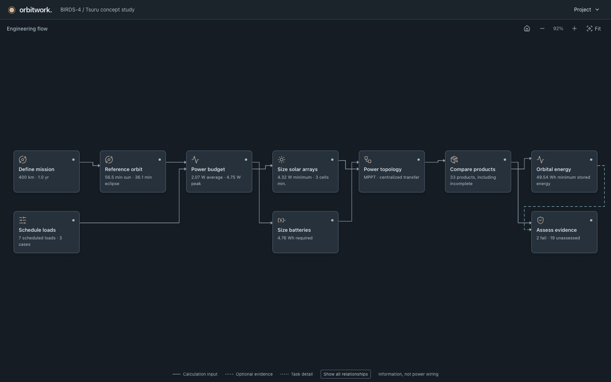

# Orbitwork

A graphical proof of concept for the EPS framework specified in [`final_report/`](../final_report/). Start with ten engineering activities on one graph. Click a node to open a focused right pane and reveal related work or review tasks.



[View a focused window editor and its highlighted task path](docs/images/scenarios.png).

The worked example uses **BIRDS-4 mission activities and explicit study assumptions**. Its catalog allocations are illustrative alternatives, not the BIRDS-4 flight architecture. Numerical results establish no flight qualification.

## Run

Requires Node.js 22.12+ or 24+ and npm.

```sh
cd eps-demo
npm ci
npm run dev
```

Open **http://127.0.0.1:5173**. Calculations, catalog browsing, lexical mission retrieval, and KiCad review exports run locally without an account or API key.

```sh
npm test
npm run test:catalog
npm run build
npm run preview
```

## Follow the worked example

1. Open **Project**, choose the BIRDS-4 example, and confirm **Load example**. Export first to keep the current design. Follow the ten connected activities from mission definition through sizing, hardware allocation, energy simulation, and requirement review.
2. Click an activity to edit inputs and inspect results. Editors, plots, findings and meaningful record reviews appear as related graph tasks. Collections reveal the selected record as a node. Open **Method & evidence** or another pane disclosure for equations, scope, traces, references and full read-only explanations. These disclosures add no graph nodes.
3. Open **Schedule loads** to select or create a case. Follow **Loads → chosen load → Power states** or **Active windows → chosen window**. Drag the window or use its numeric and keyboard controls. Active power replaces idle power. Overlapping intervals count once. **Energy conditions** holds the case's reserve, starting energy, illumination and duration.
4. Open **Compare products → Logical roles** to inspect one of six CSRM roles and its products. Use a product's **Allocate product** node to apply its exact role and freeze its count. **Product usages** shows shared allocations. Open the **Reference context** disclosure in **Define mission** for mission reference context.
5. Open **Power topology**, then its conditioning, transfer, bus or resource nodes. The demo supports a constant-efficiency MPPT energy model. Other reference alternatives retain their explicit modeling limits.
6. Change a schedule, mission input or product, then choose **Project → Recalculate available activities**. Saved results remain visible as historical values until their dependencies are current. Calculation freshness and requirement verdicts are separate.
7. Select another case in **Schedule loads**, then recalculate to compare routine operations, overlapping missions and reduced generation. **Orbital energy** exposes separate stored-energy and generation/demand chart nodes. One active scenario is evaluated at a time. A known shortage remains a failure.
8. Open **Assess evidence** and its check-group nodes for requirement findings. Open **Compare products → KiCad handoff** for review exports. Physical PCB routing stays blocked without reviewed terminal maps, footprints, connectivity and board constraints.

Child tasks form local trees beside their parents. Lines use explicit connection ports and right-angle routes around task boxes. Solid lines carry calculation inputs, dashed lines show optional evidence, and dotted lines connect task details. The default view shows a relationship backbone. **Show all relationships** reveals the full dependency view without moving nodes or routes. This denser view can contain wire crossings.

One branch path stays expanded. Selecting another activity replaces it. The highlighted path and breadcrumb track the selected task. **Back** returns to its parent. **Close** hides the pane and keeps the branch. **Fit** frames the focused branch, or the overview when no task is selected. **Home** restores the ten-node overview without changing the design.

Drag the graph background to pan. Use **+** and **−** to zoom. Tab and Shift+Tab reveal the focused node. Arrow keys pan when the canvas itself has focus. Narrow views and large branches intentionally retain readable scale and may require panning.

Above 900 px, the 460 px right pane leaves the graph and Project menu usable. Primary forms fit the tested 1440 × 900 and 1280 × 800 viewports with supplemental help collapsed. Open help retains complete text and intentionally scrolls when needed. Long editable fields use connected text parts with a 2,000-character limit across the complete field. Shorter windows retain accessible scrolling. At 900 px and below, the pane is a full-screen modal with keyboard focus contained, including with help open or closed. Escape returns to a parent task or dismisses the root. Dismissal restores focus to the graph trigger.

The default study provides an end-to-end calculation path. Unassessed hardware requirements and known resource violations remain visible. Completing a calculation does not establish a feasible or qualified EPS.

**Project** also contains new design, JSON import/export, and model help. Export before replacing work you want to keep. Authored inputs and allocations persist in this browser. Reload and JSON import discard calculation caches, so use **Recalculate** to produce fresh results. Invalid imports preserve the current design.

A catalog update preserves locally saved inputs and historical allocations for review. Reapply affected products before using simulation or KiCad results. Strict imports reject incompatible source records without replacing the design already open.

## Missing battery data

Preliminary required capacity comes from eclipse demand, the declared DoD, and the sizing margin. It does not require an installed pack rating.

An energy simulation additionally needs installed capacity, retention, efficiencies, and charge/discharge power limits. A selected product's missing rating remains missing. Inspect the affected inputs, choose an alternative with published energy data, or explicitly supply a study assumption. An assumption never repairs the manufacturer's catalog record or establishes product compliance.

## Sourced comparison options

Each of the six CSRM component groups has at least three distinct options covered by a documented comparison profile. The set includes solar and storage cells, converter and switch modules, controller boards, and real EPS software components.

Open **Compare products → Product catalog**, select a **CSRM role**, then filter **Comparison data → Core data covered**. Choose a product in the record selector and click its graph node. Follow **Source ratings**, **Candidate screen**, **Comparison gaps** and **Original sources** to inspect conditions, required external parts and separate core/richer data gaps. The coverage report counts genuine product options, not renamed records or software patch releases.

```sh
npm run catalog:coverage
npm run catalog:coverage:strict
```

Comparison coverage establishes available product facts. Installation, firmware/host compatibility, mission aging, internal battery efficiencies and software execution timing retain their own evidence requirements. Storage cells require additional pack engineering. They are not finished flight packs.

[Earlier comparison capture of three sourced storage options](docs/images/catalog-options.png). See the [reviewed source register](src/data/CATALOG-SOURCES.md) and [numerical evidence](src/data/evidence/enrichment-20261022.md).

## Mission assistance

Open **Define mission → Mission analogues** for sourced analogues to a plain text ConOps. Search leaves orbit parameters unchanged. Explicit acceptance transfers a sourced scalar altitude and retains its evidence. Similarity is a retrieval rank, not an orbit-suitability probability.

Choose **Lexical TF-IDF** for immediate offline retrieval. For local semantic retrieval, run a second terminal:

```sh
npm run assist:serve
```

The optional loopback service uses the existing research Python environment and cached Qwen model. It downloads no model and sends no text to a cloud service. `EPS_PYTHON` and `HF_HOME` can select another prepared environment. See [mission assistance](docs/MISSION-ASSIST.md).

## Engineering boundaries

- Circular reference orbit and the report's fixed sunlight/eclipse geometry.
- Scheduled constant-power loads and exact event integration.
- Preliminary EOL array power, integer cell lower bound, battery energy, and mission cycle demand.
- A small, revisioned manufacturer catalog with distinct missing evidence and known violations. Finished panels and packs retain their purchased properties.
- An energy-only history with retained capacity, finite charging/discharging power, efficiencies, curtailed surplus, and retained shortages.
- Scoped EPS-01 through EPS-20 findings. Stored energy is distinct from charge-based state of charge. Energy results leave unsupported charge, voltage, thermal, protection, and cycle-life criteria unassessed.
- Logical CSRM composition and allocations. Reference context, topology associations, and review drawings establish no physical wiring or complete installation geometry.

The [BIRDS-4 scenario basis](src/data/BIRDS4-SCENARIOS.md) distinguishes mission facts from authored powers, schedules, efficiencies, lifetime, reserve, retention, and operating limits. These inputs are not flight telemetry. Catalog selection does not supply missing characterization.

The full framework's SysML execution, formal phase reviews, general AI assistance, coupled spacecraft models, detailed electrical and thermal solvers, RAM, F Prime, MIL, SIL, hardware control, physical PCB generation, and qualification remain outside this demo.

See [model scope and equation traceability](docs/SCOPE.md), [catalog sources](src/data/CATALOG-SOURCES.md), [KiCad scope and commands](docs/KICAD.md), and [developer and browser checks](docs/TESTING.md).

## Local KiCad commands

Node.js 24+ and the KiCad CLI are required for native validation.

```sh
npm run kicad:export -- exported-design.json src/data/catalog.json new-kicad-export
npm run kicad:validate -- new-kicad-export
npm run kicad:rules -- new-kicad-export reviewed-rules.json new-rule-files
```

The GUI rule-input template contains null physical values and no approval. Synthetic rule fixtures are test data, not EPS engineering evidence.

## Code layout

- `src/components/`: engineering graph, focused task panes, diagrams and evidence views.
- `src/engine/`: pure calculations and bounded catalog evaluation.
- `src/workflow.ts`: dependencies, input gates, and freshness.
- `src/state/`: revisioned workspace, validated JSON boundary, and persistence.
- `src/data/`: sourced catalogs and BIRDS-4 scenario assumptions.
- `src/mission-assist/`: retrieval, explicit acceptance, and optional semantic service.
- `src/kicad/`, `scripts/kicad*.mjs`: logical review projects and approved physical-rule translation.

The CSRM role structure is adapted from the INCOSE Space Systems Working Group and OMG Space Domain Task Force reference model, licensed [CC BY 4.0](https://creativecommons.org/licenses/by/4.0/). The report retains the source citations. The report and existing research artifacts are unchanged by this demo.
